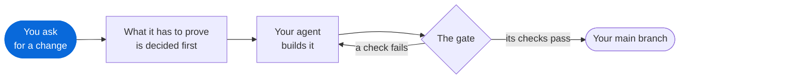

# Gate-Driven Development

Add gates to your project and automate with AI agents without losing quality.

Your agent says "done." The gate checks if it's true.

You ask your agent for something, it works for a while and tells you it's done. You try it, and it isn't. GDD is the method I use so that the agent's word doesn't open anything: before it starts, you decide what it has to prove, and checks it can't touch decide whether it did.



## Install

You need a git repository and an agent that loads skills: Claude Code, Codex or Antigravity. The skills install as a plugin, with a command or two.

**Claude Code** (2.1.275 or later), inside a session:

```
/plugin install gdd --marketplace MarsGotta/gdd
```

**Codex:**

```
codex plugin marketplace add MarsGotta/gdd
codex plugin add gdd@gdd
```

**Antigravity:**

```
git clone https://github.com/MarsGotta/gdd
agy plugin install gdd
```

Then check it's there, and come back to the same table when you want a newer version:

| Agent | Check | Update |
|---|---|---|
| Claude Code | `claude plugin list` shows `gdd@gdd`, enabled | `claude plugin marketplace update gdd`, then `claude plugin update gdd@gdd` |
| Codex | `codex plugin list` shows `gdd@gdd`, installed and enabled | `codex plugin marketplace upgrade gdd`, then `codex plugin add gdd@gdd` |
| Antigravity | `agy plugin list` shows `gdd`, enabled, with 7 skills | `git pull` in your clone, then `agy plugin install gdd` again |

If you'd rather keep the skills inside your project, [copy them by hand](skills/README.md#1-install-the-skills).

## Use it, step by step

Open your agent in your project's folder. From here on there are no commands to remember: you ask for things in your own words, and where your agent needs you it asks one thing at a time, with what it would do, so that a yes is enough.

### 1. Set it up, once

```
Set GDD up in this project
```

Use your agent's deepest model for this step. If the project is new, add in the same message what you're going to build.

Your agent looks at what's there and proposes what is delicate in your project (the zones, each with a color: green, yellow or red), what every change has to prove (the gates) and which model does each kind of work. It writes all of it in `gdd/blueprint.md` and a few files next to it, and then it stops and asks you, or your team, to read them and approve. Answer yes, or say what to change. Nothing gets built before that.

### 2. Let it set up the checks

You don't ask for this one. Before your first change, your agent sets up the checks your blueprint names, usually your tests, your linter and a scan that keeps secrets out of the repository. Then it tries each one on purpose, to see it reject something done wrong. No change starts until they hold.

### 3. Ask for a change

```
Add a filter by size to the catalog
```

One agent writes down what it has to do, another builds the checks, a third builds it, and a reviewer that heard none of it tries to make it fail. How much of that you see depends on the color of what the change touches. Where a person approves is your decision when you set GDD up, and this is how the skills propose it:

| The change touches | For example | What you do |
|---|---|---|
| Something green | The text of a button | Nothing. You hear about it when it's in |
| Something yellow | A filter in the catalog | You're told in a line what it will do, and nobody waits for you |
| Something red | Anything that moves money | You approve what it has to do, and you review the change at the end |

### 4. Answer when it asks

- **It wants your approval of what a change has to do,** on red. That is a short text, under 150 words, and a file of cases in `features/`. Read it and say yes, or correct it.
- **It found a decision nobody has made.** Answer it, or tell it to decide. It then decides how the work gets done and stops asking about that, and a rule of your product it takes from what is usual in your sector and tells you as an assumption. What loosens a check or can't be undone stays with you.
- **Something stopped the change.** A check that fails, a limit that ran out. It tells you what happened and the one way out it would take. The guide has [every case](skills/README.md#when-it-stops).

### 5. Read what happened

When a change is in, you get what changed in your product and one line per gate, passed or failed. The whole trail stays in `gdd/log/`, one event per line, with who approved what.

### 6. Harden

```
The size filter is lost on page 2, and no check caught it
```

Fixing it is a change like any other, through step 3. Hardening is the other half: your agent finds which gate should have caught it and proposes the check that would have. You approve it, and from then on every change in that zone passes it.

It goes the other way too. When a gate stops adding anything, say which one, and your agent reads the logs for what it caught and what it cost, and proposes relaxing or retiring it.

The [guide to the skills](skills/README.md) goes through each step in full, with what happens inside and the files you end up with.

## What's in this repository

- [`manifesto/`](manifesto/): the Manifesto, version 0.10, in English and Spanish. If anything else contradicts it, the Manifesto wins.
- [`web/`](web/): the source of [gate-driven.dev](https://gate-driven.dev), where the whole method is explained in both languages.
- [`skills/`](skills/): skills for your coding agent, so you can apply GDD in your own project without an engine. This is version 0.10. They install as a plugin on Claude Code, Codex and Antigravity.
- [`evals/`](evals/): scenarios that check, with a real model, how an agent behaves with those skills.

The engine that enforces the method is [T-minus](https://github.com/MarsGotta/t-minus). It has its own repository and it's still in development.

## License

GDD is free to use, by anyone and for anything. The Manifesto and the website's texts are under [CC BY 4.0](LICENSE-docs.md). The skills, the scripts and the website's code are under the [MIT license](LICENSE).

## How to cite

If you write about GDD or build on it, credit it like this:

> Marcela Gotta. *Gate-Driven Development*. 2026. https://gate-driven.dev

GitHub's "Cite this repository" button gives the same in other formats, from [`CITATION.cff`](CITATION.cff).
