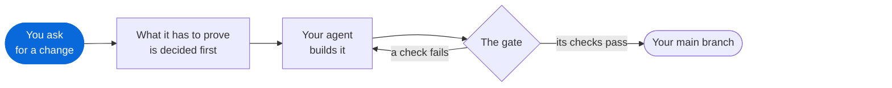

# Gate-Driven Development

Add gates to your project and automate with AI agents without losing quality.

Your agent says "done." The gate checks if it's true.

You ask your agent for something, it works for a while and tells you it's done. You try it, and it isn't. GDD is the method I use so that the agent's word doesn't open anything: before it starts, you decide what it has to prove, and checks it can't touch decide whether it did.



## Install

What you need:

- **A git repository,** with git 2.38 or later.
- **An agent that loads skills:** Claude Code, Codex or Antigravity.
- **[Rust](https://rustup.rs) 1.89 or later,** to build the layer, `gdd`: once in each copy of your project, and in your CI. The first build downloads what it depends on from crates.io, so it needs the network that once.
- **macOS or Linux.** Nobody has tried it on Windows yet.

The skills install as a plugin, with a command or two.

**Claude Code** (2.1.275 or later), inside a session:

```
/plugin install gdd --marketplace MarsGotta/gdd
```

**Codex:**

```
codex plugin marketplace add MarsGotta/gdd
codex plugin add gdd@gdd
```

**Antigravity:**

```
git clone https://github.com/MarsGotta/gdd
agy plugin install gdd
```

Then check it's there, and come back to the same table when you want a newer version:

| Agent | Check | Update |
|---|---|---|
| Claude Code | `claude plugin list` shows `gdd@gdd`, enabled | `claude plugin marketplace update gdd`, then `claude plugin update gdd@gdd` |
| Codex | `codex plugin list` shows `gdd@gdd`, installed and enabled | `codex plugin marketplace upgrade gdd`, then `codex plugin add gdd@gdd` |
| Antigravity | `agy plugin list` shows `gdd`, enabled, with 7 skills | `git pull` in your clone, then `agy plugin install gdd` again |

If you'd rather keep the skills inside your project, [copy them by hand](skills/README.md#1-install-the-skills).

**The layer.** The plugin also brings `gdd`, a small command that keeps the order of every change, counts its limits and writes its log, so your agent doesn't keep that bookkeeping from memory. It comes as source, in the plugin's `engine/` folder, and the first time your project needs it your agent builds it and leaves it at `.gdd/gdd`, which git ignores. Building it takes [Rust](https://rustup.rs) 1.89 or later: if you don't have it, your agent tells you in one line and waits. Your CI builds the same command, to check every change's log out of the agents' reach.

## Use it, step by step

Open your agent in your project's folder. From here on you ask for things in your own words, and where your agent needs you it asks one thing at a time, with what it would do, so that a yes is enough. Two commands are worth knowing, and they're in step 5.

### 1. Set it up, once

```
Set GDD up in this project
```

Use your agent's deepest model for this step. If the project is new, add in the same message what you're going to build.

Your agent looks at what's there and proposes what is delicate in your project (the zones, each with a color: green, yellow or red), what every change has to prove (the gates) and which model does each kind of work. It writes all of it in `gdd/blueprint.md` and a few files next to it, and then it stops and asks you, or your team, to read them and approve. Answer yes, or say what to change. Nothing gets built before that.

### 2. Let it set up the checks

You don't ask for this one. Before your first change, your agent sets up the checks your blueprint names, usually your tests, your linter and a scan that keeps secrets out of the repository. Then it tries each one on purpose, to see it reject something done wrong. No change starts until they hold. If your project has no code yet, that is only the scan for secrets and the check that nothing that judges was touched: the others start with the first change that brings them something to judge.

### 3. Ask for a change

```
Add a filter by size to the catalog
```

One agent writes down what it has to do, another builds the checks, a third builds it, and a reviewer that heard none of it tries to make it fail. How much of that you see depends on the color of what the change touches. Where a person approves is your decision when you set GDD up, and this is how the skills propose it:

| The change touches | For example | What you do |
|---|---|---|
| Something green | The text of a button | Nothing. You hear about it when it's in |
| Something yellow | A filter in the catalog | You approve what it has to do, in a short message, before anyone builds |
| Something red | Anything that moves money | You approve what it has to do, and you review the change at the end |

### 4. Answer when it asks

- **It wants your approval of what a change has to do,** where your blueprint asks for it. In under 150 words the agent gives each new or changed rule its own line, marks its assumptions and names the files in `features/` where you can read the cases. Say yes or correct a rule.
- **It found a decision nobody has made.** Answer it, or tell it to decide. It then decides how the work gets done and stops asking about that, and a rule of your product it takes from what is usual in your sector and tells you as an assumption. What loosens a check or can't be undone stays with you.
- **Something stopped the change.** A check that fails, a limit that ran out. It tells you what happened and the one way out it would take. The guide has [every case](skills/README.md#when-it-stops).

### 5. Read what happened

When a change is in, you get what changed in your product and one line per gate, passed or failed. The whole trail stays in `gdd/log/`, one event per line, with who approved what.

Two commands read it for you, from your project's folder:

```
.gdd/gdd waiting
.gdd/gdd metrics --all --summary
```

The first lists every question waiting for you, oldest first, and how long it has waited. The second says how your changes went: how they ended, how long each took without the waits for you, how often the gates and the reviewer passed them the first time, what each check costs and what the agents spent.

### 6. Harden

```
The size filter is lost on page 2, and no check caught it
```

Fixing it is a change like any other, through step 3. Hardening is the other half: your agent finds which gate should have caught it and proposes the check that would have. You approve it, and from then on every change in that zone passes it.

It goes the other way too. When a gate stops adding anything, say which one, and your agent reads the logs for what it caught and what it cost, and proposes relaxing or retiring it.

The [guide to the skills](skills/README.md) goes through each step in full, with what happens inside and the files you end up with.

## The five moments, and what holds each one up

Those steps are the method's five moments, seen from your side. What carries each one is written down, so it doesn't rest on your agent remembering what to do: a skill it loads for that moment, the files it leaves in your repository, and the layer, which refuses what comes out of order. One moment has no skill yet, and the table says which.

| Moment | What it's for | What holds it up |
|---|---|---|
| **1. Prepare.** At the start, and again when a gate is missing, isn't needed or is badly defined | It has two parts. First the blueprint: what can never happen in your product, what is delicate, which gates you need and where a person approves. Then the gates it defined get built. You build them, or your team does, with the agents and tools you use, and you try to beat them on purpose. No change starts until they hold. | `gdd-prepare` writes the blueprint and the constitution with you. `gdd-checks` sets up the standing checks and `gdd-review` tries them. It all stays in `gdd/blueprint.md`, `gdd/constitution.md` and `gdd/gates/`. |
| **2. Brief.** On every change, before it starts | What has to be true gets written down before anyone builds: the rules the change touches, a few scenarios and a first estimate of its risk. | `gdd-brief` writes the rules, the scenarios and the color, in `features/` and `gdd/briefs/`. On red, `gdd-review` reads the brief before you approve it. `gdd-checks` writes a test for each scenario, sees it fail and seals it. The layer refuses a scenario with no rule above it, and it lets nobody build before your yes, where your blueprint asks for one. |
| **3. Execute.** On every change | An agent builds the change and gets through the gates without touching what judges it. A reviewer that heard none of it tries to make it fail, and the risk is worked out again from what was touched. | `gdd-build` builds. The layer runs the gates from the seal, counts the limits and writes the log in `gdd/log/`. `gdd-review` reviews with a clean context. Your CI, once you set it up, checks every log and runs the gates again where no agent writes. |
| **4. Close.** Once the change is in use | You look at whether it helped, against what you expected when you asked for it. | No skill yet: for now it's yours. `.gdd/gdd metrics` and `gdd/log/` tell you how the change went. |
| **5. Harden.** When something slips through or repeats, and when a gate stops adding anything | What slipped through becomes one more check. What no longer adds anything gets relaxed or retired. Both change the blueprint, so you approve them, or your team does. | `gdd-harden` finds which gate should have caught it and proposes the check, or reads the logs for what a gate caught and what it cost. `gdd-checks` builds the check. |

Under all five there are two things more. `gdd`, the skill your agent loads on its own when you ask for a change, knows what comes next and who gets launched. And the layer, `.gdd/gdd`, keeps the order, the limits and the log, so that none of it depends on an agent's memory.

How far that holds depends on where your gates run. With the skills alone, the agent not touching what judges it is a rule it is told and then checked on. With protected branches and your CI, your platform enforces it. The guide says [what the skills don't guarantee](skills/README.md#what-they-dont-guarantee).

## What's in this repository

- [`manifesto/`](manifesto/): the Manifesto, version 0.11, in English and Spanish. If anything else contradicts it, the Manifesto wins.
- [`web/`](web/): the source of [gate-driven.dev](https://gate-driven.dev), where the whole method is explained in both languages.
- [`skills/`](skills/): skills for your coding agent, so you can apply GDD in your own project without an engine. This is version 0.14. They install as a plugin on Claude Code, Codex and Antigravity.
- [`engine/`](engine/): the layer, `gdd`, which the skills need from version 0.11: it keeps the order, the accounting and the evidence of every change, and the agents keep the judgment. It isn't an engine in the method's sense: while an agent runs it, it's within the agent's reach, and what keeps it honest is your CI.
- [`evals/`](evals/): scenarios that check, with a real model, how an agent behaves with those skills.

The engine that enforces the method is [T-minus](https://github.com/MarsGotta/t-minus). It has its own repository and it's still in development.

## License

GDD is free to use, by anyone and for anything. The Manifesto and the website's texts are under [CC BY 4.0](LICENSE-docs.md). The skills, the scripts and the website's code are under the [MIT license](LICENSE).

## How to cite

If you write about GDD or build on it, credit it like this:

> Marcela Gotta. *Gate-Driven Development*. 2026. https://gate-driven.dev

GitHub's "Cite this repository" button gives the same in other formats, from [`CITATION.cff`](CITATION.cff).
