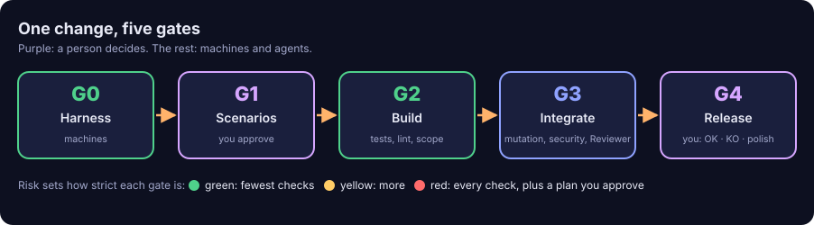

# gdd

**Build software with AI coding agents, one gate at a time.**

[](https://github.com/MarsGotta/gdd/actions/workflows/gdd.yml)
[](#license)
[](rust-toolchain.toml)

Coding agents write code fast, and most of it is almost right. Checking all of it by hand
turns you into the bottleneck; checking none of it ships the mistakes. gdd runs **GDD,
Gate-Driven Development**: every change moves forward by passing gates, risk decides how many
gates and how strict, machines check what can be checked, and you decide only what needs a
person, in as few sittings as possible.

<p align="center">
  
</p>

**[Documentation](https://gdd.marsgotta.com)** ·
[Tutorial](docs/getting-started/tutorial.md) ·
[GDD in one page](docs/explanation/method.md) ·
[Command reference](docs/reference/cli.md) ·
[Changelog](CHANGELOG.md) ·
[Documentación en español](https://gdd.marsgotta.com/es/)

## What it looks like

You describe a change and approve how it should behave, in Gherkin. gdd hands it to the
agents and comes back only when it needs you:

```text
$ bin/gdd new-change export-csv --title "Export notes as CSV" \
    --paths "src/notes/**" "tests/**" features/export_csv.feature
$ bin/gdd sitting                      # approve the scenario (G1), one sitting
$ bin/gdd launch export-csv
Paused at G4. Message: .gdd/changes/export-csv/inbox.md · To continue: gdd resume export-csv --g4 ok|ko|polish
```

While `launch` ran, a Builder wrote the tests and then the code, the Loop Gate (G2) and the
Merge Gate (G3) ran lint, types, every scenario, hidden examples, security and secrets checks,
and a Reviewer from another model family read the change and said OK. What is left for you is
one message, the change's Decision Inbox, and one answer: `ok`, `ko` or `polish`.

## Features

- **Risk decides the gates.** You map risky paths once in `gdd/zones.toml`; each change is
  green, yellow or red by what it touches, and the rules table says what each color gets.
- **Scenarios you approve, run for real.** Gherkin is the contract: G1 seals it, the Builder
  cannot touch it, and hidden examples catch code written to the test.
- **Roles with the least context.** A Builder in test mode, a Builder in build mode and a
  Reviewer from a different model family. Agents never open or close gates.
- **Deterministic guards.** Path Guard, scope checks, mutation testing on red changes, and a
  state check around every agent call.
- **Few human stops.** A sitting for scenarios, zones and plans; a Release Gate at the end.
  Everything else lands in the Decision Inbox, sorted into what needs you and what did not.
- **Measured.** Tokens and time per change, role and model, from one log; DORA's delivery
  metrics with `gdd report --dora`.
- **Board.** A terminal app (Ratatui) with every change by phase; `gdd` with no arguments.
- **Grows with you.** Spikes with variants side by side, changes in parallel with a merge
  queue, adopting an existing project with its known debt, releases and a Keep a Changelog file.
- **Your stack, your agents.** Python, Rust and TypeScript stack sheets; Claude Code, Codex CLI
  and OpenCode.

## Install

gdd is one binary. With Rust installed:

```sh
cargo install --locked --git https://github.com/MarsGotta/gdd --tag v0.1.0 gdd
```

You also need a coding agent (Claude Code, Codex CLI or OpenCode), git, and the tools of your
stack. [Install gdd](docs/how-to/install.md) lists them all.

## Get started

```sh
mkdir notes && cd notes && git init -b main
gdd init --name notes --platform cli --stack python --agents claude codex
bin/gdd bootstrap        # first install of the stack, and its lock file
bin/gdd selftest         # the harness checks itself: 4/4 opens G0
bin/gdd                  # the Board
```

From there, [Your first change](docs/getting-started/tutorial.md) takes you to a released
change in about half an hour.

## Documentation

- **Learn:** [Your first change](docs/getting-started/tutorial.md), [GDD in one page](docs/explanation/method.md).
- **Do:** [run a change](docs/how-to/run-a-change.md), [write scenarios](docs/how-to/write-scenarios.md),
  [answer the Release Gate](docs/how-to/release-gate.md),
  [adopt an existing project](docs/how-to/adopt-existing-project.md),
  [troubleshooting](docs/how-to/troubleshooting.md).
- **Look up:** [commands](docs/reference/cli.md), [configuration](docs/reference/configuration.md),
  [gates](docs/reference/gates.md), [glossary](docs/glossary.md).
- **Understand:** [the life of a change](docs/explanation/life-of-a-change.md),
  [how risk picks the gates](docs/explanation/risk.md), [design decisions](docs/explanation/design-decisions.md).

Everything starts at [gdd.marsgotta.com](https://gdd.marsgotta.com), or [docs/README.md](docs/README.md) here on GitHub.

## Built with itself

gdd is built with GDD. The harness of this repository is gdd: `bin/gdd` runs the binary built
from `main`, which runs the gates, the recipe and the agents. Every change has its scenarios in
[`features/`](features/), and its record in the git history. The method's rules are in
[`GDD.md`](GDD.md); what comes next is in [`ROADMAP.md`](ROADMAP.md).

## Status

gdd 0.1.0 is the first release: the whole method works end to end, and it has been used to build
gdd itself. Expect rough edges and breaking changes before 1.0; [`ROADMAP.md`](ROADMAP.md) says
what is planned.

## Contributing

Issues and pull requests are welcome. Read [CONTRIBUTING.md](CONTRIBUTING.md) first: pull
requests go through the same gates as every change here.

## License

Licensed under either of [Apache License, Version 2.0](LICENSE-APACHE) or [MIT license](LICENSE-MIT)
at your option.
