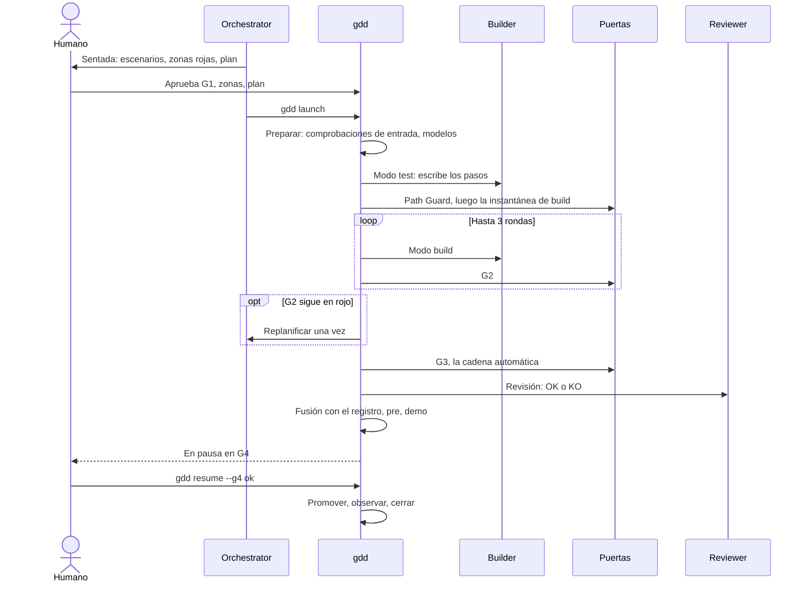
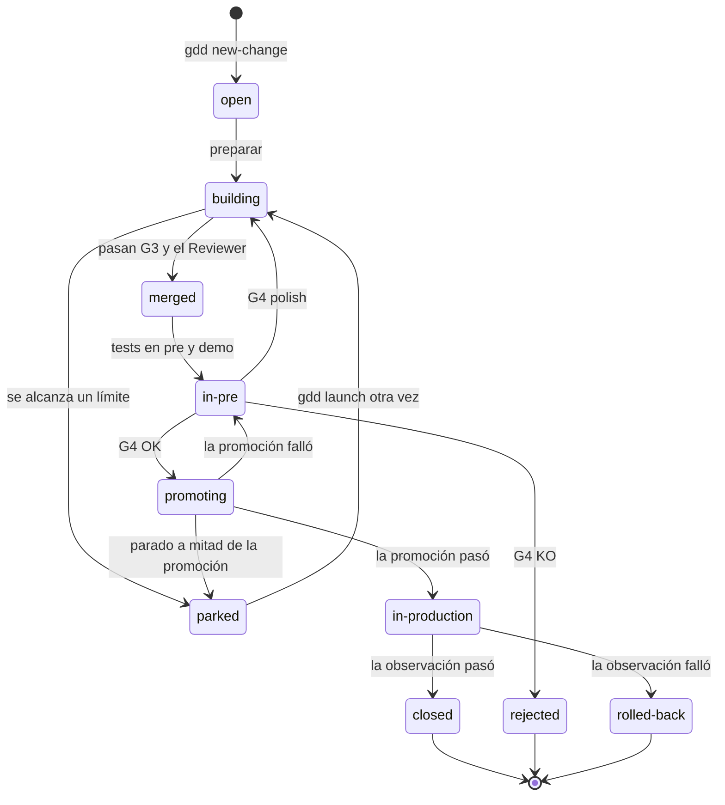

# La vida de un Change

¿Por qué gdd lleva cada Change por la misma receta fija en lugar de dejar que los agentes elijan
su camino? Porque un orden fijo es lo que da sentido a las puertas. Esta página sigue a un
Change por cada paso que dan `gdd launch` y `gdd resume`, y explica por qué está ahí cada uno.
Léela una vez y los mensajes de un lanzamiento, un aparcamiento o una pausa en G4 tendrán
sentido.

## Antes de empezar

Esta página parte de [GDD en una página](method.md): fases, puertas, colores y roles. El orden
que sigue sale de la receta de `crates/gdd-core/src/recipe/mod.rs`, y los escenarios de
[`features/recipe.feature`](../../../features/recipe.feature) lo comprueban.

## La receta es fija

Un Change no elige su propio camino. `gdd` ejecuta la misma receta para todos los Changes, y el
color solo enciende o apaga pasos: el modo test, el mutation testing (pruebas de mutación), el
Reviewer y tu G4. Así cada ejecución es previsible. Un agente no puede saltarse una puerta,
cambiar el orden de los pasos ni decidir que ya ha terminado. La alternativa, un agente que hace
todo el trabajo a partir de un solo prompt, es más simple, pero nada fuera del agente decide
cuándo el trabajo es lo bastante bueno.

El diseño sigue una distinción que hace Anthropic en
[Building effective agents](https://www.anthropic.com/engineering/building-effective-agents):
los *flujos de trabajo* (*workflows*) orquestan modelos "a través de rutas de código
predefinidas", mientras que los *agentes* dirigen su propio proceso. Dentro de cada paso, un
agente trabaja con libertad. Entre un paso y otro, la receta es un flujo de trabajo, con
"condiciones de parada (como un número máximo de iteraciones)" en cada bucle.

La secuencia de abajo muestra quién habla con quién en un Change rojo, el color que ejecuta
todos los pasos. Sigue las flechas de arriba abajo. El bucle son las rondas del Builder contra
G2.

## 1. Lanzar

El Orchestrator lanza el Change con `gdd launch CHANGE`, desde el checkout principal, nunca
desde un worktree. El lanzamiento se niega cuando hay cambios sin commit en ficheros versionados
fuera de la rama del Change, y cuando ya hay `[parallel] max` Changes en construcción (2 por
defecto), porque los agentes comparten tus suscripciones. Una negativa no toca nada.

Después, el Change recibe su propio worktree de git: una segunda carpeta de trabajo del mismo
repositorio, con otra rama activa. Por defecto es una carpeta hermana, `<repo>.worktrees/<id>`,
en la rama `change/<id>`. El checkout principal se queda en la rama principal, así que tú y el
Orchestrator seguís trabajando ahí mientras los agentes construyen. Todo el estado vive en
`.gdd/` del checkout principal, de modo que `gdd status` ve todos los Changes, se ejecuten donde
se ejecuten.

Si el Change planifica rutas que se solapan con las de otro Change en curso, el lanzamiento
avisa, en la salida y en la Decision Inbox, y sigue adelante. Git resuelve el solapamiento en la
fusión. [Ejecutar Changes en paralelo](../how-to/parallel-changes.md) explica el límite y los
solapamientos.

## 2. Preparar

La preparación comprueba que el Change puede entrar en Build. Hace estas comprobaciones en orden
y se niega con el motivo de la primera que falla:

1. **G0 está abierta**: el Setup está hecho y el autotest ha pasado.
2. **Las zonas rojas están aprobadas.** Solo un Spike puede empezar antes.
3. **G1** está aprobada cuando el Change crea o modifica escenarios.
4. **El plan** está aprobado cuando el Change es rojo.
5. **El Reviewer es de otra familia de modelos** que el Builder, cuando el Change tiene
   Reviewer, o bien aceptaste la misma familia en el Setup, cosa que entonces dice la Decision
   Inbox.
6. **La rama propia del Change** es la que está activa.

Las zonas rojas se aprueban para todo el proyecto, así que gdd juzga cada Change con el mapa de
zonas de main, no con la copia de la rama del Change. Una zona que apruebas hoy cuenta al
momento para un Change creado ayer, y una zona que cambió en main sin tu aprobación detiene
cualquier lanzamiento. Tu primera aprobación llega en el Setup, donde `/gdd-setup` te pide que
apruebes las zonas rojas que trae el arnés.

Cuando pasan todas las comprobaciones, la preparación escribe la decisión en el registro del
Change: color, vía, puertas, y el agente y el modelo de cada rol para ese color, tomados de
`gdd/models.toml`. El estado pasa a `building` y la construcción empieza en el commit actual. A
partir de ahí, Path Guard juzga todo lo que venga después de ese commit.

Un relanzamiento cuyo código ya pasa G2 se salta el Builder, que solo gastaría tokens.

## 3. Modo test

Cuando el Change necesita los tests primero (escenarios nuevos, o color amarillo o rojo), el
Builder trabaja en modo test. Escribe las definiciones de pasos, el código que conecta cada frase
de un escenario con el programa, contra el lenguaje del dominio y con aserciones reales. En
amarillo o rojo escribe también tests de caracterización, que fijan lo que hace hoy el código
existente. Los tests nuevos tienen que fallar porque falta el comportamiento, no por una errata.

El modo test no puede escribir código de producción ni tocar los ficheros `.feature` aprobados.
Path Guard lo comprueba justo después de la llamada, y si falla, el Change se aparca.

Luego gdd toma la **instantánea de build**: los hashes de todo lo que el Change ha tocado hasta
ese momento. A partir de ahí, al modo build solo se le juzga por su propio trabajo.

## 4. Modo build y G2

El Builder trabaja en modo build y escribe el dominio, el cableado y los tests unitarios, hasta
que G2 está en verde. Cada ronda es una llamada al Builder seguida de G2: linter, tipos, tests
unitarios, los escenarios del propio Change, reglas de arquitectura, Path Guard y la comprobación
de alcance. Hay tres rondas (`builder_retries = 3` en `gdd/rules.toml`), y el Builder ve los
fallos de la ronda anterior en `g2.json`.

El modo build no puede tocar los pasos escritos en modo test, los escenarios ni el arnés. Puede
salirse de las rutas planificadas solo en el color del Change o en uno inferior; una ruta de un
color superior hace fallar G2. [Cómo elige el riesgo las puertas](risk.md#la-regla-del-alcance)
explica por qué.

Cuando las tres rondas acaban en rojo, el Orchestrator **replanifica** una vez (`replans = 1`).
Lee el paquete, los fallos y las salidas del Builder, y escribe la causa y un enfoque nuevo en
`replan.md`. El fichero termina con una línea: `NEXT: build`, o `NEXT: test` cuando el fallo está
en los pasos o en los tests que escribió el modo test. Con `NEXT: test`, el modo test se ejecuta
una vez más para arreglar solo lo que nombra el replan, juzgado desde una instantánea de ronda
nueva. Después vienen una ronda de build más y G2.

Si G2 sigue en rojo, el Change se aparca con `G2 still red after 3 retries and 1 replan`, y la
Decision Inbox explica por qué.

## 5. G3, la puerta de integración

G3, la puerta de integración (*Merge Gate*), ejecuta toda la cadena automática: todos los
escenarios en modo estricto, ejemplos ocultos incluidos, análisis estático de seguridad,
comprobación de dependencias nuevas, secretos en el diff y, cuando el color lo pide, mutation
testing sobre el diff. Path Guard se ejecuta antes de los comandos y otra vez después.

Una G3 en rojo tiene un arreglo: una ronda de modo build con `fix=g3`, después G2 y después G3
otra vez, que decide. Si G3 sigue en rojo, el Change se aparca.

## 6. El Reviewer

Cuando el Change tiene Reviewer, el Reviewer lee el paquete, los escenarios, el diff completo,
los informes de las puertas y `docs/standards.md`. Responde con sus hallazgos y una última
línea, `VERDICT: OK` o `VERDICT: KO`. Su profundidad depende del color: rápida en verde y
amarillo, profunda en rojo.

Un KO tiene una ronda de arreglo. El modo build no puede editar los ficheros que escribió el modo
test, así que cuando un hallazgo nombra uno de ellos (un paso de un escenario, un test escrito
primero), la ronda empieza con el modo test (`fix=review`), que arregla solo esos hallazgos, y
Path Guard lo comprueba igual que después de cualquier modo test. Después, el modo build
(`fix=review`) arregla el resto. Siguen G2, G3 y una segunda revisión, que comprueba solo los
hallazgos anteriores, más cualquier cosa nueva que bloquee. Un segundo KO, o una G3 en rojo,
aparca el Change.

El registro guarda todas las revisiones, con los ficheros que cambiaron desde la anterior, para
que el Reviewer de un relanzamiento nunca repita un hallazgo ya resuelto.

Una revisión OK termina con una sección breve, `## How it works`, en palabras sencillas. Es lo
primero que lees en G4.

Cuando G3 y el Reviewer pasan, las máquinas registran G3 como `ok`: "automatic chain and
Reviewer".

## 7. Fusionar y después pre

Las fusiones van de una en una, bajo un cerrojo de fusión. Si la rama principal se movió mientras
el Change se construía, G3 se cierra, el Change incorpora el main más reciente y G3 se ejecuta
otra vez encima. Un conflicto o una G3 en rojo aparca el Change. A main no llega nada que solo
funcionara con un main más antiguo.

El commit de fusión lleva el **registro** del Change: color, vía y tipo, tus aprobaciones, cada
veredicto del Reviewer con sus hallazgos, lo que se decidió sin ti y los tokens gastados. Los
ficheros de trabajo se quedan en `.gdd/changes/<id>/`, que git no versiona. El estado del
registro pasa a `merged`.

Después, gdd ejecuta los pasos de salida de `gdd/commands.toml`: build, despliegue en pre, los
tests en pre y la demo. La demo son vídeos o capturas de los escenarios o, en una biblioteca o
una herramienta sin pantalla, la ejecución legible de sus escenarios. El estado pasa a `in-pre`.

## 8. G4, la puerta de salida

Un Change que te necesita (es rojo, o tuvo G1) se pone en pausa aquí, en G4, la puerta de salida
(*Release Gate*). `gdd` deja una petición en la Decision Inbox e imprime `Paused at G4`. El
Orchestrator trae el Change al chat y respondes con tus palabras, o respondes en la pantalla de
la [sentada](human-stops.md#la-sentada-de-g4). En los dos casos, gdd registra tu respuesta como
`gdd resume CHANGE --g4 ok|ko|polish`.

- **OK** promueve el Change.
- **KO** lo rechaza: producción se queda como está y el estado pasa a `rejected`. La fusión se
  queda en main, así que main y pre conservan el Change y producción no.
- **Polish** (pulir) guarda tus notas para el Builder y vuelve a ejecutar la receta desde el modo
  build, con las notas en su primera ronda, pasando por G2, G3, el Reviewer y pre, hasta que se
  pone en pausa en G4 otra vez. Polish sustituye a un KO; no es una parada más.

Cualquier otro Change se salta la pausa: las máquinas registran G4 como `ok` ("automatic
promotion: pre is green") y lo promueven.

## 9. Promover, observar, cerrar

La promoción lleva **el mismo artefacto** de pre a producción, sin volver a construirlo, así que
a producción llega exactamente lo que viste en pre. El estado es `promoting` mientras dura, y
después `in-production`. Con versiones automáticas, la opción por defecto, un Change con una
línea de changelog recibe su etiqueta de git `v<semver>` cuando la promoción ha pasado.

Una promoción que falla deja producción intacta y el Change en pausa en G4, y el mismo OK la
reintenta. Si gdd se detiene a mitad de una promoción, antes de registrar el resultado, el Change
se aparca con un mensaje: mira primero producción, para no desplegar nada dos veces.

Después viene la observación. Si sale en verde, el Change queda `closed`: su worktree desaparece
y su rama se queda. `gdd` imprime `Change <id> closed.` con dónde leer su mensaje y sus tokens.
Si suben los errores, el *rollback* devuelve producción a la versión anterior, y el Change queda
`rolled-back`, con una petición de Hotfix en la Decision Inbox.

## Alrededor de cada llamada de agente

Cada llamada de agente tiene sus propias comprobaciones, sea cual sea el paso al que pertenece:

- El agente trabaja en el worktree del Change. gdd lo arranca con los argumentos de su rol y un
  entorno sin secretos.
- El propio gdd rechaza los comandos de gdd que el trabajo del agente no necesita: un agente que
  arrancó gdd solo puede ejecutar `gdd g2`, `guard`, `note`, `status`, `classify`, `inbox`,
  `report` y `scope`.
- La llamada tiene un límite de tiempo, y cuando termina su turno, gdd mata todo su grupo de
  procesos.
- Después, gdd compara el estado de GDD con cómo estaba antes. Todo lo que un agente haya cambiado
  fuera de lo que gdd le deja escribir vuelve a como estaba, y el Change se aparca.
- El Reviewer tiene que dejar el árbol de trabajo exactamente como lo encontró.
- Lo que gastó la llamada, en tokens y en dólares estadounidenses (USD), lo añade al registro gdd y nadie más.

[Mantener honestos a los agentes](safety.md) explica cada comprobación.

## Los estados de un Change

El campo `state` del registro dice dónde está un Change. El diagrama muestra los estados que
escribe el código y el paso que lleva un Change de uno al siguiente. Fíjate en `parked`: todos
los límites llevan ahí, y un nuevo `gdd launch` lo saca de ahí.

El [Board](../glossary.md#board) (el tablero), la pantalla de gdd con todos los Changes, los
agrupa por fase: `open` en Discover, `in-pre` en Release, `closed`, `rejected` y `rolled-back`
en Done, y el resto en Build.

## Relanzar un Change aparcado

Un Change aparcado conserva su worktree y su rama. Su Decision Inbox dice por qué se aparcó y qué
hacer. Una vez arreglada la causa, un nuevo `gdd launch CHANGE` vuelve a ejecutar la receta desde
la preparación.

gdd hace primero commit del trabajo que una ejecución anterior dejó sin commit en el worktree,
pero solo cuando las puertas lo aceptan tal como lo juzgaron. Si no, el trabajo se queda como
está y lo juzgan las puertas del relanzamiento. En los dos casos, lo que escribió antes el modo
test nunca se le achaca al modo build.
[Volver a poner en marcha un Change aparcado](../how-to/parked-change.md) tiene los pasos.

## La receta de un Spike

Un Spike responde a una pregunta para que tú puedas decidir, y su código nunca llega a main. No
tiene modo test, ni G3, ni Reviewer, ni fusión. El modo build trabaja en `mode=spike` dentro de
un presupuesto fijo (`[spike] max_usd`, 5 USD por defecto), contra una G2 propia: Path Guard y un
ADR (registro de una decisión de arquitectura) en `docs/adr/` con una sección `## Decision`.
Cuando esa G2 está en verde, el Spike se pone en pausa en G4. El OK lleva a main solo su ADR, y
su rama conserva el código. Un Spike puede construir de dos a cuatro variantes, cada una en su
propia rama, para que las compares en una sola página.
[Explorar con un Spike](../how-to/spikes.md) explica cómo.

## Ver también

- [Referencia de la línea de comandos (CLI)](../reference/cli/index.md): `gdd launch`, `gdd resume` y los pasos
  sueltos que ejecutan.
- [Cómo elige el riesgo las puertas](risk.md): qué pasos de estos enciende cada color.
- [Mantener honestos a los agentes](safety.md): Path Guard, las instantáneas y las comprobaciones
  alrededor de cada llamada.
- [Pocas paradas para la persona](human-stops.md): la sentada, G4 y la Decision Inbox.
