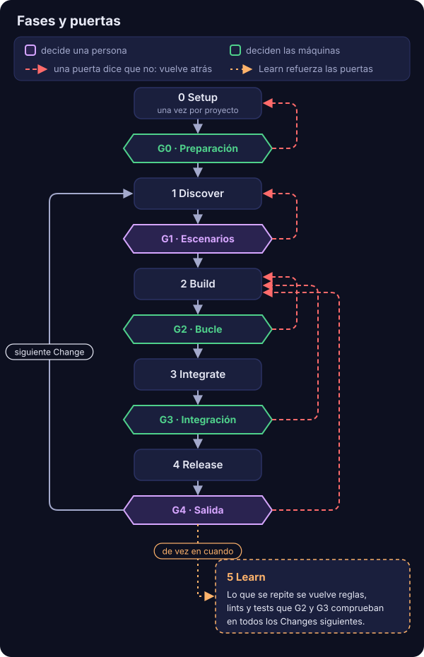
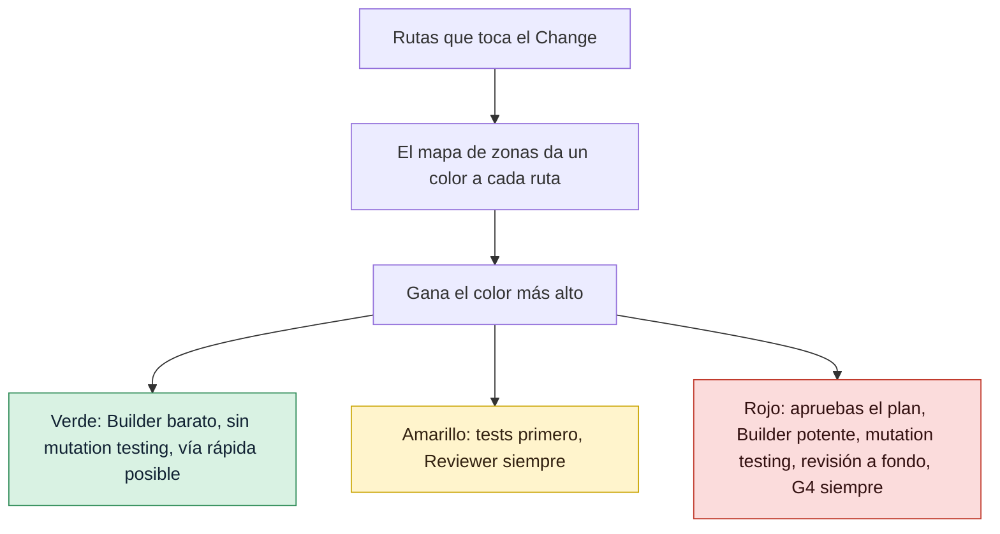

# GDD en una página

GDD, Gate-Driven Development, es una forma de construir software con agentes de programación de
IA en la que cada Change avanza pasando puertas, y el riesgo decide cuántas puertas y lo
estrictas que son. Esta página te da el método entero de una sentada: el problema que resuelve,
la idea, las fases y las puertas, el semáforo, los roles, el vocabulario y dos Changes frente a
frente.

## El problema

Los agentes de programación hacen que el trabajo parezca terminado muy deprisa. En minutos
tienes tests en verde, código ordenado y un resumen muy seguro de sí mismo. La última parte, la
que hace que el trabajo sea correcto para *tu* caso, a menudo falta, porque ya parece hecho.

Esto es algo habitual, no una rareza. En la
[2025 Stack Overflow Developer Survey](https://survey.stackoverflow.co/2025/ai), el 66 % de
los desarrolladores señaló las "soluciones de IA que están casi bien, pero no del todo" como su
mayor frustración con las herramientas de IA.

Tampoco puedes leer cada línea. Un agente escribe código más rápido de lo que una persona lo
lee. Si lo revisas todo, te conviertes en el cuello de botella y los agentes te esperan. Si no
revisas nada, publicas código que está casi bien.

GDD es una tercera vía: deja que las máquinas comprueben todo lo que se puede comprobar, y te
pregunta solo lo que necesita a una persona.

## La idea

Una **puerta** es un punto de control que un Change debe pasar para seguir adelante. Responde sí
o no, y dice por qué. La mayoría de las puertas las ejecutan máquinas: el linter, los tests, los
escenarios, mutation testing, los escáneres de seguridad, un segundo agente que revisa el
trabajo. Dos puertas son tuyas: aprobar lo que debe hacer el Change y aceptar el resultado.

**El riesgo decide las puertas.** No todos los Changes merecen el mismo cuidado. Una caseta de
jardín y un hospital necesitan licencia, pero nadie los inspecciona igual. En GDD, cada ruta del
proyecto tiene un color de riesgo en un mapa de zonas: verde, amarillo o rojo. Un Change toma el
color más alto de entre las rutas que toca, y el color decide qué puertas encuentra y lo
estrictas que son.

Las reglas del método están en [`GDD.md`](../../../GDD.md). `gdd` es la herramienta que las
ejecuta: arranca los agentes, ejecuta las puertas en un orden fijo y detiene el Change cuando se
alcanza un límite.

## Principios

Los principios son las normas que el método GDD nunca dobla. No dependen de la herramienta gdd,
de un stack ni de un modelo: seguirían valiendo con cualquier otra herramienta. Cada mecanismo de este sitio existe por uno de
ellos. La fuente es [`GDD.md`](../../../GDD.md#principles).

1. **Nada avanza sin pasar una puerta.** Nadie, ni persona ni agente, se salta una puerta ni la
   afloja. *Sostiene:* las [fases y puertas](#fases-y-puertas).
2. **El riesgo decide las puertas, no el tamaño.** Un Change toma el color de la ruta más
   delicada que toca, y el color decide cuántas puertas pasa y con qué rigor. *Sostiene:* [el
   semáforo y las zonas rojas](risk.md).
3. **Las máquinas comprueban; las personas deciden.** Una puerta responde sí o no con su
   motivo, nunca una opinión. Tú no lees código: decides qué es delicado, qué debe hacer el
   producto y si el resultado es bueno, en las menos sentadas posibles. *Sostiene:* G0, G2 y G3
   en manos de las máquinas, G1 y G4 [en las tuyas](human-stops.md).
4. **El comportamiento se acuerda antes que el código.** Los escenarios que apruebas son el
   contrato, y quien construye no puede cambiarlos. *Sostiene:* [G1, el Gherkin ejecutable y los
   ejemplos ocultos](../how-to/write-scenarios.md).
5. **Quien construye no juzga su propio trabajo.** Las comprobaciones son independientes de
   quien construye: puertas que el agente no puede editar y un Reviewer de otra familia de
   modelos. *Sostiene:* [Path Guard y la revisión](safety.md).
6. **Cada uno recibe el contexto mínimo.** Cada agente recibe solo lo que su tarea necesita.
   *Sostiene:* el paquete de cada Change y [los roles](../reference/roles.md).
7. **Todo bucle tiene un límite.** Lo que se atasca se para y pregunta; nada da vueltas para
   siempre. *Sostiene:* las rondas, la replanificación y [aparcar un
   Change](../how-to/parked-change.md).
8. **Hecho no es bueno.** Un Change que pasa todas las puertas puede no estar terminado. Al
   final, tú editas el resultado, y el proyecto escribe su listón de calidad en
   `docs/standards.md`. *Sostiene:* [G4 y el polish](../how-to/release-gate.md).
9. **Lo que se repite se vuelve regla, y se mide el resultado, no el volumen.** Un error que se
   repite se convierte en una regla, un lint, un hook o un test. Se miden las métricas de
   entrega y las señales propias de GDD; los tokens miden coste, no productividad. *Sostiene:*
   Learn y [la medición](measuring.md).

## Fases y puertas

El trabajo pasa por seis fases. La fase N termina en la puerta GN, salvo Learn, que no tiene
puerta. Fíjate en los colores: las puertas moradas son las que abre una persona; las otras las
abren las máquinas.

<p align="center">
  
</p>

Léelo como tres tipos de flecha. Las grises son el camino de un Change: Setup pasa una vez
por proyecto, y después de G4 el siguiente Change vuelve a empezar en Discover. Las rojas son
una puerta que dice que no: el Change vuelve a la fase que puede arreglarlo. Un KO en G1
devuelve los escenarios a Discover; una G2 en rojo le da al Builder otra ronda, y tras unas
cuantas rondas el Orchestrator replanifica una vez; una G3 en rojo o un KO del Reviewer tienen
un arreglo; polish en G4 es una pasada más del Builder con tus notas. Si después de esos intentos
el Change sigue sin pasar, no da vueltas para siempre: se *aparca* y te espera en su Decision
Inbox. La punteada es Learn, que no es un paso de cada Change: de vez en cuando miras lo que se
repite, notas de polish y hallazgos del Reviewer, y lo conviertes en reglas, lints y tests, para
que las puertas de todos los Changes siguientes lo atrapen solas.

| Fase | Qué pasa | Su puerta | Quién la abre |
|---|---|---|---|
| 0 Setup | Una vez por proyecto: qué es, plataforma, tecnología, qué sería grave si fallara. De aquí salen el [Brief del proyecto](../glossary.md#brief-del-proyecto), el arnés y su autotest. | G0, puerta de preparación (*Setup Gate*) | Las máquinas, cuando existe el Brief y el autotest pasa 4 de 4 |
| 1 Discover | Investigación, opciones, [Spikes](../glossary.md#spike), el MVP y su [regla de abandono](../glossary.md#regla-de-abandono), los siguientes Changes. Al final, las áreas sensibles se convierten en [zonas rojas](../glossary.md#zona-roja). | G1, puerta de escenarios (*Scenario Gate*) | Tú, cuando un Change crea o modifica escenarios |
| 2 Build | El Builder escribe los pasos de los escenarios (modo test) y después el código (modo build), vuelta tras vuelta. | G2, puertas del bucle (*Loop Gates*) | Las máquinas: linter, tipos, tests, Path Guard y reglas de arquitectura, en cada vuelta |
| 3 Integrate | La cadena automática completa y después un Reviewer de otra familia de modelos. Si pasa, se fusiona y se despliega solo en pre. | G3, puerta de integración (*Merge Gate*) | Las máquinas |
| 4 Release | Tests y una demo en pre. El mismo artefacto se promueve a producción. | G4, puerta de salida (*Release Gate*) | Tú, cuando hubo G1 o el Change es rojo; si no, las máquinas |
| 5 Learn | Los problemas repetidos se convierten en reglas, lints, tests y líneas de `docs/standards.md`. | Ninguna | |

Una regla para recordarlo, de [`GDD.md`](../../../GDD.md#human-stops): *las máquinas abren la 0;
la persona abre la 1 y a veces la 4; las máquinas vigilan la 2 y la 3.*

[La vida de un Change](life-of-a-change.md) sigue un Change por cada paso de Build, Integrate y
Release, en el orden en que los ejecuta `gdd`.

## El semáforo

El color de un Change es su Gate Level. Solo hay tres colores, y gana el más alto de entre las
rutas que toca el Change. Lee el diagrama de arriba abajo: lo que recibes crece con el color.



- **Verde**: un Builder barato o local, sin mutation testing, y la vía rápida es posible.
- **Amarillo**: tests de caracterización antes de tocar código existente, y el Reviewer siempre.
  Mutation testing sobre el diff cuando el proyecto lo activa para el amarillo. El código que
  ninguna zona nombra es amarillo por defecto: código sin tests conocidos.
- **Rojo**: apruebas el plan (no el código), un Builder más capaz, mutation testing sobre el
  diff, una revisión a fondo que también mira la seguridad, y G4 siempre. Nunca la vía rápida.

**El color manda sobre el tipo de trabajo y la vía.** Un Hotfix de una línea en una zona roja es
rojo. En caso de duda, el color más alto. [Cómo elige el riesgo las puertas](risk.md) explica
cada regla y por qué.

## Vías

Un Change recorre una de dos vías.

- **Vía rápida** (*Fast Lane*): G2 y G3, sin parada humana. Solo cuando se cumplen las tres
  condiciones: el Change no es rojo, no crea ni modifica ningún escenario y pasa la prueba de
  reanudación (otro agente podría retomarlo solo con el ticket). El Orchestrator juzga la
  última, y queda en el log.
- **Vía completa** (*Full Lane*): todo lo demás, según diga la tabla de reglas.

## Roles

| Rol | Quién | Qué hace | Qué no hace nunca |
|---|---|---|---|
| **Humano** | Tú | Responde al Setup, participa en Discover, aprueba escenarios, zonas rojas y planes rojos en una sola sentada, responde en G4 cuando toca | Leer código para aprobarlo |
| **Orchestrator** | Un modelo potente | Tiene el mapa: arquitectura, zonas, escenarios, estado. Divide el trabajo en Changes, escribe el pequeño paquete de contexto de cada Change, replanifica una vez un Change atascado, agrupa lo que te necesita a ti | Escribir código, resolver conflictos de fusión, aflojar puertas |
| **Builder** | Barato o local en verde, más capaz en rojo | Dos modos, en sesiones separadas por defecto: el *modo test* escribe los pasos de los escenarios con aserciones reales; el *modo build* escribe el código y sus tests unitarios hasta que G2 está en verde | Editar tests aprobados o ficheros protegidos, silenciar avisos |
| **Reviewer** | Un modelo de otra familia que el Builder | Lee el Change entero y los resultados de las puertas; dice OK o KO con sus motivos; comprueba que cada paso hace lo que dice su escenario | Cambiar un fichero, abrir vueltas nuevas |
| **Máquinas** | Las puertas | Dicen sí o no, y por qué | Juzgar lo que un comando no puede comprobar |

[Roles](../reference/roles.md) detalla qué lee, qué escribe y qué puede ejecutar cada rol.

## Palabras que vas a encontrar

- Un **Change** es una pieza pequeña de valor que pasa las puertas como una unidad, en su propia
  rama `change/<id>`. Puede cubrir un escenario, varios o ninguno.
- Un **escenario** es una frase en Gherkin (`Given... When... Then...`) que dice qué debe pasar.
  Los escenarios son el contrato que apruebas en G1.
- Una **zona roja** es una ruta en la que un error sería grave. Una **sentada** es el único
  momento en el que apruebas todo lo que un Change necesita de ti.
- La **Decision Inbox** es el único mensaje que te deja un Change: qué te necesita, qué se
  decidió sin ti y qué quedó aparcado.
- **Aparcar** un Change es detenerlo con un mensaje para ti. **Polish** es tu tercera respuesta
  en G4: una vuelta más del Builder con tus notas.

El [glosario](../glossary.md) tiene todos los términos, cada uno enlazado a la página que lo
explica.

## Dos Changes frente a frente

Toma `shop`, una pequeña tienda web. Su mapa de zonas dice que los textos de la pantalla son
verdes y que el código del login es rojo; todo lo demás es amarillo por defecto:

```toml
default = "yellow"   # code without a zone = code without known tests

[[zone]]
color = "red"
paths = ["src/shop/auth/**"]
reason = "Logins and sessions: a hole here exposes accounts"

[[zone]]
color = "green"
paths = ["web/copy/**"]
reason = "Words on the screen"
```

Dos Changes llegan la misma mañana. `checkout-copy` cambia el texto de un botón en
`web/copy/checkout.txt`, y cualquier agente podría retomarlo solo con su ticket.
`login-rate-limit` bloquea una cuenta durante un rato después de demasiados inicios de sesión
fallidos: toca `src/shop/auth/**` y añade un fichero de escenarios,
`features/login-rate-limit.feature`.

`gdd new-change` clasifica cada uno al crearlo e imprime la clasificación como JSON. En un
proyecto `shop` recién creado, las dos clasificaciones dicen:

| Campo de la clasificación | `checkout-copy` | `login-rate-limit` |
|---|---|---|
| `color` | `green` | `red` |
| `lane` | `fast` | `full` |
| `g1` (escenarios que aprobar) | `false` | `true` |
| `tests_first` (modo test) | `false` | `true` |
| `mutation` | `false` | `true` |
| `reviewer` | `false` | `true`, con `review` `deep` |
| `g4` (tu puerta de salida) | `false` | `true` |
| `human_plan` | `false` | `true` |

Esto es lo que encuentra cada uno, paso a paso:

| Paso | `checkout-copy` (verde, vía rápida) | `login-rate-limit` (rojo, vía completa) |
|---|---|---|
| Antes de Build | Nada que aprobar | Una sentada: apruebas los escenarios (G1), las zonas rojas si son nuevas o han cambiado, y el plan |
| Builder | El modelo de verde, solo en modo build | El modo test escribe primero los pasos; después, el modelo de rojo, el más capaz, en modo build |
| G2, en cada vuelta | Linter, tipos, tests unitarios, reglas de arquitectura, Path Guard y la comprobación del alcance | Lo mismo, más los escenarios propios del Change |
| G3 | La cadena automática, sin mutation testing | La cadena automática con mutation testing sobre el diff, incluidos los ejemplos ocultos |
| Reviewer | Ninguno | Una revisión a fondo de otra familia de modelos, con la seguridad incluida |
| Fusión y pre | Se fusiona con su registro y se despliega en pre | Lo mismo |
| G4 | Las máquinas lo promueven en cuanto pre está en verde | Se detiene a esperarte: la demo, el "How it works" del Reviewer y después OK, KO o polish |
| Tus paradas | 0 | 2: la sentada y G4 |

Los dos Changes siguen la misma receta. Lo que cambia es cuántas puertas encuentran y lo
estricta que es cada una: el arreglo del texto cuesta unas pocas llamadas de agente baratas y
nada de tu tiempo; el límite de intentos cuesta más tokens y dos sentadas cortas, porque un
error ahí deja las cuentas expuestas a quien intente adivinar contraseñas.

## Lo que GDD pide a un proyecto, y lo que no

GDD impone el método, no las herramientas. Exige escenarios en Gherkin, pero cada proyecto elige
un ejecutor que su comunidad mantenga. Exige comandos de puerta, pero son el linter, los tests y
los escáneres propios del proyecto, escritos en `gdd/commands.toml`.
[Decisiones de diseño](design-decisions.md) explica estas elecciones y las que se descartaron.

## Ver también

- [La vida de un Change](life-of-a-change.md): cada paso de `gdd launch`, en orden.
- [Cómo elige el riesgo las puertas](risk.md): zonas, colores y la regla del alcance.
- [Mantener honestos a los agentes](safety.md): por qué un Builder no puede cambiar lo que lo
  juzga.
- [Pocas paradas para la persona](human-stops.md): las sentadas, la Decision Inbox y polish.
