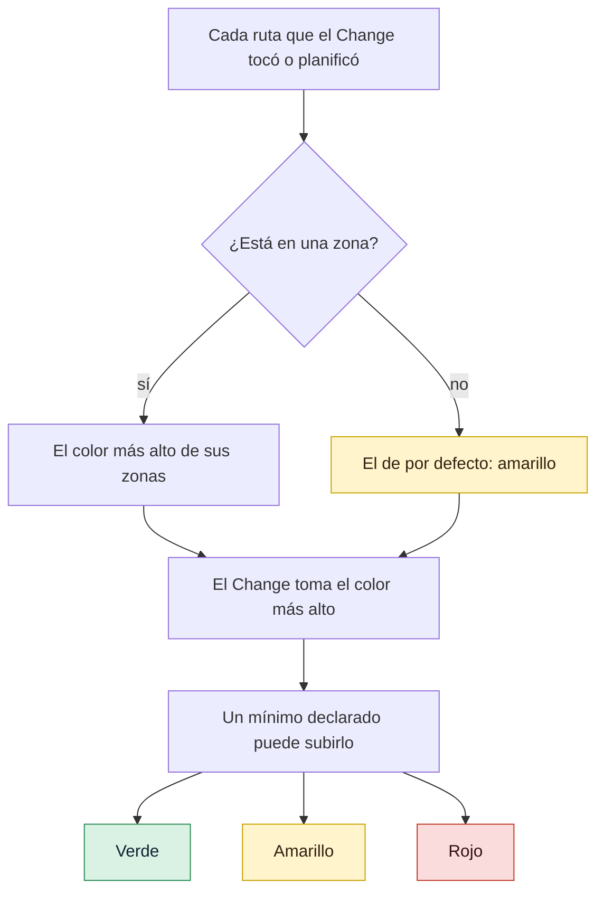

# Cómo elige el riesgo las puertas

Por qué el color de un Change decide cuántas puertas tiene que cruzar, cómo se calcula ese color
a partir de las rutas que toca y qué cambia cada color. Con esta página puedes leer cualquier
clasificación que imprima `gdd` y saber de dónde sale.

## Antes de empezar

[GDD en una página](method.md) presenta el semáforo. Las reglas de abajo salen de
`crates/gdd-core/src/classify.rs` y `rules.rs`, y los escenarios de
[`features/classify.feature`](../../../features/classify.feature) y
[`features/scope.feature`](../../../features/scope.feature) las comprueban.

## Riesgo, no tamaño

La mayoría de los procesos ajustan sus controles al tamaño del trabajo: una funcionalidad grande
recibe una revisión larga y un arreglo de una línea, ninguna. GDD los ajusta al **riesgo**: lo
que costaría que el Change estuviera mal. Una sola línea cambiada en cómo se comparan las
contraseñas merece más cuidado que cien líneas de texto de ayuda nuevo.

El tamaño es barato de medir y mal indicador. El riesgo es más difícil de medir, así que GDD te
pregunta una sola vez, durante Setup y Discover, qué partes del proyecto serían graves si
fallaran, y apunta la respuesta como un mapa de rutas. A partir de ahí, una máquina clasifica
cada Change, siempre de la misma manera.

## El mapa de zonas

`gdd/zones.toml` da un color a las rutas. Cada zona tiene un color, sus patrones de rutas y un
motivo en palabras; `**` cruza carpetas y `*` no.

```toml
default = "yellow"   # code without a zone = code without known tests

[[zone]]
color = "green"
paths = ["docs/**", "*.md"]
reason = "Documentation"

[[zone]]
color = "red"
paths = ["src/shop/auth/**"]
reason = "Logins and sessions: a hole here exposes accounts"
```

El mapa crece con el proyecto:

- **En el Setup** todavía no hay mapa del producto. `gdd init` escribe uno inicial en el que solo
  son rojos el arnés (`gdd/`, `bin/`, la CI, las carpetas de los agentes) y la cadena de
  suministro (los ficheros de bloqueo, *lock files*, y la configuración de los escáneres), y la
  documentación es verde. Las zonas sensibles que nombraste se quedan en palabras, en el
  [Brief del proyecto](../glossary.md#brief-del-proyecto).
- **Al final de Discover**, cuando ya existen carpetas reales, el Orchestrator traduce cada zona
  sensible a rutas: las zonas rojas. Las apruebas en la misma sentada que los primeros
  escenarios. Hasta que lo hagas, solo se pueden construir Spikes.
- **Más adelante**, modificar una zona roja, o añadir una nueva, vuelve a necesitar tu
  aprobación.

## El color por defecto: el código sin tests es amarillo

Una ruta que no nombra ninguna zona toma el color por defecto, y el color por defecto es
amarillo: "code without a zone = code without known tests" (código sin zona = código sin tests
conocidos). Si falta `default`, también es amarillo.

El amarillo es el término medio honesto. El verde dejaría pasar código desconocido por la vía
rápida (*Fast Lane*) con un Builder barato y sin Reviewer; el rojo haría que cada Change te
costara dos paradas. El amarillo pide tests antes de tocar código existente y un Reviewer, y a ti
no te pide nada.

## Gana el color más alto

Un Change toma el color más alto de todas las rutas que toca. Una ruta que encaja en varias zonas
también toma el más alto de ellas.

El escenario que lo comprueba lo dice sin rodeos: un Change que toca `docs/intro.md` (verde) y
`src/storage/save.rs` (rojo) es rojo. No se hace la media, porque un error en el fichero rojo es
igual de grave con o sin la documentación al lado.

Un Change sin ninguna ruta toma el color por defecto. Un Change también puede declarar un color
mínimo con `--min-color`, que sube el color y nunca lo baja: el Orchestrator lo usa cuando sabe
algo que el mapa no sabe.

El color cuenta lo que el Change **ha tocado de verdad**, no solo lo que planificó. Cuando el
modo build escribe un fichero rojo que el plan no nombraba, `gdd classify` dice rojo.

Ante la duda entre dos colores, elige el más alto. Esa es una regla para las personas y para el
Orchestrator, que son quienes dibujan el mapa; el clasificador nunca adivina.

## El color manda sobre el tipo de trabajo y la vía

GDD tiene seis tipos de trabajo: Feature, Hotfix, Refactor, Migration, Spike y No-code. Ninguno
cambia el color. Un Hotfix en una zona roja es rojo, con el plan, la revisión profunda y G4. Un
Refactor de código amarillo es amarillo.

El motivo es el mismo que con el tamaño: el tipo dice por qué cambias algo, no qué se rompe si el
Change está mal. Un arreglo urgente en el código del login es justo donde una segunda mirada sale
rentable. GDD abarata la urgencia de otra forma: un Hotfix primero revierte producción y después
el arreglo recorre su vía sin prisa.

La única excepción es el Spike, porque su código nunca llega a main. Un Spike conserva su color,
y con él su Builder, pero no tiene modo test, ni mutation testing, ni Reviewer, ni G1, ni plan que
aprobar; siempre termina en tu G4, donde solo su ADR puede llegar a main.

La vía tampoco puede bajar el color: la vía rápida solo está abierta a los Changes que no son
rojos.

## Qué cambia cada color

El color elige el modelo del Builder y las puertas. Esta tabla muestra las reglas que recibe un
proyecto nuevo con `gdd init`, en `gdd/rules.toml` y `gdd/models.toml`.

| | Verde | Amarillo | Rojo |
|---|---|---|---|
| Modelo del Builder | `[builder.green]`: barato o local | `[builder.yellow]` | `[builder.red]`: el más capaz |
| Modo test primero | Solo con escenarios nuevos | Sí: tests de caracterización antes de tocar | Sí |
| Mutation testing sobre el diff | No | Apagado; `mutation = true` lo enciende | Siempre |
| Reviewer | En la vía completa | Siempre | Siempre |
| Profundidad de la revisión | Rápida | Rápida; `review = "deep"` pide más | Profunda, seguridad incluida |
| Apruebas el plan | No | No | Sí |
| Tu G4 | Cuando el Change tiene escenarios nuevos | Cuando el Change tiene escenarios nuevos | Siempre |
| Vía rápida | Posible | Posible | Nunca |
| Tus paradas | 0, o 2 con escenarios nuevos | 0, o 2 con escenarios nuevos | 2 |

Algunos términos de la tabla:

- **El mutation testing** (pruebas de mutación) cambia el código a propósito (un `>=` pasa a ser
  `>`, un `return true` pasa a ser `return false`) y vuelve a ejecutar los tests. Si siguen
  pasando, el mutante "ha sobrevivido", y los tests no comprueban lo que parece.
  [Stryker](https://stryker-mutator.io/docs/) y [cargo-mutants](https://mutants.rs/) son
  herramientas de este tipo. GDD lo ejecuta solo sobre el diff, así que cuesta minutos, no horas.
- **Una revisión rápida** lee los ficheros que tocó el Change, su paquete y sus escenarios, y da
  los hallazgos que bloquean. **Una revisión profunda** añade el código que llama a lo que ha
  cambiado, los caminos que recorren sus datos, agujeros de seguridad, pérdida de datos, fallos de
  concurrencia y todas las zonas rojas que toca el Change.

### El rojo tiene un núcleo que ningún fichero puede apagar

En los Changes rojos, el mutation testing, el Reviewer, la revisión profunda y tu G4 son el
núcleo de GDD. Un fichero de reglas que apague cualquiera de ellos para el rojo se rechaza al
leerlo, y una clave que falte cuenta como encendida. Un equipo puede hacer el amarillo más
estricto, nunca el rojo más laxo.

En los demás colores, los controles del stack vienen encendidos por defecto y se pueden apagar, y
los extras, como el mutation testing en amarillo, son una línea que añades.
[Decisiones de diseño](design-decisions.md#mínimo-por-defecto-incremental-si-lo-eliges) explica esos
tres niveles.

> [!NOTE]
> [`GDD.md`](../../../GDD.md#gate-level-traffic-light) incluye el mutation testing en amarillo,
> igual que las reglas de este repositorio. Los proyectos nuevos empiezan con él encendido solo
> en rojo, y lo encienden en amarillo con `mutation = true`.

## Las vías

La **vía rápida** (*Fast Lane*) ejecuta G2 y G3 y no te pregunta nada. Un Change solo la toma
cuando se cumplen las tres condiciones: no es rojo, no crea ni modifica ningún escenario, y es
retomable (otro agente podría continuarlo solo con su ticket, cosa que el Orchestrator declara
con `--resumable`). Todo lo demás va por la **vía completa** (*Full Lane*).

Cambiar solo escenarios de regresión, en `features/regression/`, no necesita G1, así que el
arreglo de un bug que añade un escenario de regresión todavía puede ir por la vía rápida. El
escenario fija el bug; no hay comportamiento nuevo que tengas que aprobar.

## La regla del alcance

Cada Change planifica las rutas que va a tocar. El modo build puede necesitar un fichero fuera
del plan: una utilidad de tests, un tipo compartido. Rechazar todos esos ficheros aparcaría
Changes para nada; aceptarlos todos dejaría que un Builder barato se metiera en una zona roja que
nadie había planificado.

Así que la regla del alcance (*scope*) sigue al color:

- Una ruta fuera del plan **del color del Change o inferior** se acepta, y aparece en la Decision
  Inbox bajo "Paths outside the package, same or lower color, accepted by rule" (rutas fuera del
  paquete, de color igual o inferior, aceptadas por la regla).
- Una ruta fuera del plan **de un color superior** hace fallar G2. El Change necesitaría puertas
  que no se le dieron: un Builder más fuerte, un plan aprobado por ti, una revisión más profunda.
  Solo el Orchestrator amplía el alcance.

Con el mapa de zonas de `features/scope.feature`, donde `docs/**` es verde, `src/storage/**` es
rojo y el resto es amarillo, un Change amarillo que planifica `src/app.rs`:

| El Change también escribe | Resultado |
|---|---|
| `src/app.rs` | Dentro del plan: pasa |
| `docs/notes.md` | Fuera, verde, inferior: pasa y aparece en la lista |
| `src/storage/db.rs` | Fuera, rojo, superior: G2 falla nombrando la ruta y `red` |

## Tres Changes, tres colores

En `shop`, con `src/shop/auth/**` rojo, `web/copy/**` verde y el amarillo por defecto, un
proyecto recién creado clasifica así tres Changes:

| Change | Rutas | Color | Vía | Qué recibe |
|---|---|---|---|---|
| `checkout-copy` | `web/copy/checkout.txt`, retomable | verde | rápida | Modo build, G2, G3; sin Reviewer, sin paradas |
| `cart-total` | `src/shop/cart.py` | amarillo | completa | Modo test, modo build, G2, G3, una revisión rápida; sin paradas |
| `login-rate-limit` | `src/shop/auth/**` y un `.feature` nuevo | rojo | completa | Una sentada, modo test, el Builder de rojo, mutation testing, una revisión profunda, G4 |

`cart-total` no toca ninguna zona, así que es amarillo por defecto; no es retomable, así que va
por la vía completa, y como no tiene escenarios nuevos nunca se para a esperarte.
`login-rate-limit` es rojo por una sola ruta, diga lo que diga el fichero de escenarios que tiene
al lado.



El diagrama se lee desde arriba: cada ruta recibe un color, el Change toma el más alto, y solo un
mínimo declarado puede subirlo.

## Lo que se descartó

- **Puertas según el tipo de trabajo.** Una vía de Hotfix con menos controles es la forma clásica
  de que un arreglo con prisas rompa producción dos veces.
- **Puertas según el tamaño.** Un Change pequeño en un sitio sensible es lo más arriesgado que
  hay.
- **Más de tres colores.** Cada nivel extra es una regla más que recordar y sobre la que
  discutir. Con tres basta para decir "barato", "con cuidado" y "serio".
- **Verde por defecto.** Mandaría por el camino más barato código que nadie ha mapeado.

## Ver también

- [Mapear y aprobar zonas rojas](../how-to/red-zones.md): los pasos para dibujar el mapa.
- [Puertas](../reference/gates.md): qué comprueba cada puerta, según el color.
- [Configuración](../reference/configuration.md): todas las claves de `gdd/zones.toml` y
  `gdd/rules.toml`.
- [La vida de un Change](life-of-a-change.md): dónde se ejecuta cada paso encendido.
