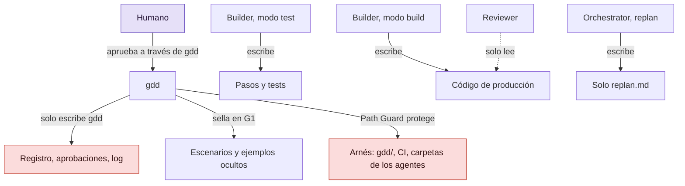

# Mantener honestos a los agentes

¿Por qué GDD no puede dejar que un Builder juzgue su propio trabajo, y cómo mantiene a los jueces
fuera de su alcance? Esta página responde a las dos preguntas: qué puede tocar cada rol, las
cuatro capas que protegen las puertas y dónde tiene todavía agujeros la protección. Léela antes
de fiarte de una puerta en verde.

## Antes de empezar

[GDD en una página](method.md) presenta los roles y las puertas, y
[La vida de un Change](life-of-a-change.md), el orden en que se ejecutan. Las reglas de esta
página salen de `crates/gdd-core/src/guard.rs`, `recipe/mod.rs`, `agents/` y `exec.rs`.

## Desconfianza por diseño

GDD trata a todos los agentes como no fiables. Los agentes no son malintencionados, pero son
optimizadores. A un Builder se le pide que ponga G2 en verde, y el camino más corto hacia el
verde a veces es debilitar el test en lugar de arreglar el código. Un agente que edita una
aserción que falla, se salta una comprobación o escribe un caso especial para los datos de
ejemplo está haciendo lo que se le pidió, pero mal. Un estudiante que pudiera editar el examen
aprobaría todos los exámenes, y la nota no diría nada de sus respuestas.

Por eso el método se apoya en una regla: **un agente nunca debe poder cambiar lo que lo juzga.**
Los tests que tiene que pasar, los escenarios que aprobaste, los comandos de las puertas, la
tabla de reglas y el registro de lo que pasó quedan todos fuera de su alcance, y gdd comprueba
después de cada llamada que siga así.

Las otras formas de conseguir una segunda opinión son más débiles. Una revisión del mismo agente
que escribió el código parte de las mismas suposiciones. Una revisión de otro modelo de la misma
familia suele compartir los puntos ciegos del Builder. Una persona que lo revisa todo detiene a
los agentes y se cansa. GDD combina comprobaciones que no dependen del Builder en absoluto, un
Reviewer de otra familia y una persona solo donde hace falta una persona.

La protección tiene cuatro capas. Cada una da por hecho que la anterior puede fallar.

## Quién puede tocar qué

El diagrama muestra dónde escribe cada rol. Fíjate en las flechas: cada rol escribe en un solo
sitio, y nada de lo que escribe un agente llega a los jueces ni al registro.



Ningún agente tiene una flecha hacia el arnés, el registro o los escenarios. Las secciones
siguientes explican cómo hace cumplir gdd cada flecha que falta.

## Capa 1: Path Guard

**Path Guard** compara los ficheros que ha tocado un Change desde que empezó su construcción con
las rutas que cada rol no puede cambiar. Esas rutas están en la sección `[protected]` de
`gdd/rules.toml`. Esta es la sección que escribe `gdd init` para un proyecto Python nuevo:

```toml
[protected]
all = ["gdd/**", ".github/**", ".claude/**", ".agents/**", ".opencode/**", ".gdd/bin/**", "AGENTS.md", "CLAUDE.md"]
builder_build = ["features/**", "tests/acceptance/**"]   # approved scenarios and the steps written in test mode
builder_test = ["src/**"]   # production code: test mode only writes tests and steps
reviewer = ["**"]
```

`all` es el arnés: la configuración, el workflow de integración continua (CI) y la carpeta de
instrucciones de cada agente. Las carpetas de los agentes están protegidas porque una sin
proteger permitiría que un Builder reescribiera las instrucciones del Reviewer.

Burlar Path Guard es difícil, por cinco razones:

- **Lee las reglas dos veces**: como están ahora y como estaban cuando empezó la construcción.
  Borrar el fichero de reglas, o una de sus protecciones, no libra a nadie de ellas.
- **Sella los escenarios.** Cuando apruebas G1, gdd registra una huella (un hash SHA-256) de cada
  fichero de escenarios del Change, ejemplos ocultos incluidos. Si un escenario sellado cambia o
  desaparece, Path Guard falla con "approved in G1", sea cual sea el rol.
- **Cuentan los ficheros commiteados**, no solo el árbol de trabajo. Un Builder no puede esconder
  una modificación en un commit.
- **Las instantáneas separan el trabajo.** Después del modo test, gdd registra los hashes de lo
  que ha tocado el Change: la instantánea de build. Al modo build solo se le juzga por lo que
  cambió después, ficheros borrados incluidos. Así, los pasos que escribió el modo test nunca se
  le achacan al modo build, y el modo build no puede editarlos a escondidas.
- **Se ejecuta antes y después de los comandos de cada puerta.** Antes, para que una puerta nunca
  ejecute comandos que un Builder haya reescrito. Después, para que un comando que cambia
  ficheros protegidos no pase sin que nadie lo vea.

Junto a Path Guard se ejecuta la **comprobación de alcance** (*scope*): una ruta fuera del plan,
de un color superior al del Change, hace fallar G2.
[Cómo elige el riesgo las puertas](risk.md#la-regla-del-alcance) lo explica.

## Capa 2: jueces que el Builder no puede tocar

Pasar los tests significa poco si el Builder escribió los tests para que pasaran. Por eso GDD
mantiene cuatro jueces apartados del Builder.

**Escenarios sellados.** El Orchestrator escribe los escenarios en el lenguaje del dominio, y tú
los apruebas en G1. El Builder en modo test escribe los pasos que los conectan con el código, y
el ejecutor tiene que fallar ante cualquier paso sin definir o pendiente (modo estricto). Nadie
puede hacer pasar un escenario borrándole una línea.

**Ejemplos ocultos.** Cada Change puede tener uno o dos ejemplos extra en `features/hidden/`.
Reutilizan las frases de los escenarios visibles con datos nuevos, y el paquete del Builder no
los incluye. G3 los ejecuta junto con todo lo demás, así que un Builder que deja fijos en el
código los ejemplos visibles falla los ocultos. G1 rechaza un ejemplo oculto con una frase que no
tiene ningún escenario visible, porque el modo test nunca lo ve y no podría haber escrito su paso.

**Mutation testing.** En los Changes rojos, y en los amarillos cuando el proyecto lo pide, G3
cambia el diff a propósito y vuelve a ejecutar los tests. Un test que sigue pasando cuando el
código está mal no comprueba nada, y la puerta falla.

**Un Reviewer de otra familia de modelos.** Los modelos de una misma familia suelen compartir
puntos ciegos, así que la preparación rechaza un Reviewer de la familia del Builder. Si solo
tienes instalada una familia, puedes aceptarlo abiertamente en el Setup: gdd registra la fecha,
y cada G4 y cada commit de fusión lo dicen. El Reviewer comprueba que cada paso hace lo que dice
su escenario, que no hay casos especiales para los ejemplos y, en los Changes rojos, la
seguridad.

El Reviewer **solo lee**. Su agente trabaja en un modo de solo lectura, y gdd compara el árbol de
trabajo antes y después de su llamada, hasta el tipo de cada ruta, sus permisos y adónde apuntan
sus enlaces. Cualquier diferencia aparca el Change: "Reviewers only read".

## Capa 3: lo que un agente puede llegar a hacer

Los agentes no se ejecutan en tu shell. gdd arranca cada uno por su cuenta, como dice su
[ficha de agente](../glossary.md#ficha-de-agente), con los argumentos de su rol. Eso le da a gdd
el control de lo que puede hacer cada agente:

- **Sin servidores MCP y con una lista corta de herramientas.** MCP, el *Model Context Protocol*,
  permite a un agente llamar a servicios externos, y gdd no les da ninguno. Un Builder puede leer
  y editar ficheros y ejecutar `gdd g2`, `gdd guard`, `gdd note` y lecturas de git. No puede
  hacer commits, cambiar de rama, hacer push, descargar nada de la web ni ejecutar `gdd gate`,
  `launch`, `resume`, `merge` o `release`. El Reviewer solo puede leer.
- **El propio gdd rechaza lo que el trabajo de un agente no necesita.** gdd arranca cada agente
  con su rol en `GDD_ROLE`, y con esa variable puesta, gdd solo ejecuta `gdd g2`, `guard`, `note`,
  `status`, `classify`, `inbox`, `report` y `scope`. Todo lo demás falla antes de hacer nada,
  aunque los permisos del propio agente lo permitan, como pasa con OpenCode, que aún no tiene
  opciones de permisos. Así, ningún agente puede arrancar, fusionar, aparcar ni publicar un
  Change, preparar ni adoptar el proyecto, ni abrir una pantalla.
  [Roles](../reference/roles.md#qué-puede-ejecutar-un-agente) tiene el mensaje que imprime.
- **Los Builders y los Reviewers no pueden registrar una decisión.** `gdd gate` y `gdd resume` los
  rechazan, así que ningún agente aprueba G1, un plan o G4.
- **Sin secretos en el entorno de los agentes.** Una variable nunca llega a un agente cuando una
  palabra de su nombre es una palabra de secreto (`AWS_SECRET_ACCESS_KEY`, `DB_PASS`,
  `SENTRY_DSN`), o cuando su valor es una URL con una contraseña dentro
  (`DATABASE_URL=postgres://app:***@db/app`). Si un proyecto necesita pasar una a propósito, la
  nombra en `[env] pass` de `gdd/models.toml`. Los agentes usan sus propias credenciales.
  [La regla completa](../reference/environment.md#qué-variables-guardan-un-secreto) da la lista de
  palabras.
- **Ningún texto de un agente en un comando de shell.** gdd solo ejecuta una shell para los
  comandos de las puertas y de salida, y esos salen de `gdd/commands.toml`, que es arnés. Git
  siempre se ejecuta con una lista fija de argumentos, nunca a través de una shell. Nada de lo
  que escribe un agente se pega jamás en una línea de comandos.
- **Cada llamada tiene un límite de tiempo**, y cuando termina, gdd mata todo su grupo de
  procesos. Nada de lo que un agente arrancó sobrevive a su turno.
- **El estado de GDD se comprueba alrededor de cada llamada.** Antes de la llamada, gdd lee el
  estado del Change y el estado que comparten todos los Changes. Después, todo lo que haya
  cambiado de una forma que gdd no permite vuelve a como estaba, y el Change se aparca nombrando
  los ficheros. Un agente solo puede añadir notas y rutas aceptadas al registro a través de
  `gdd note` y de las puertas. Todo lo demás, de las aprobaciones a las instantáneas, queda fuera
  de su alcance.

## Capa 4: un registro que solo escribe gdd

Los hechos de un Change viven en su **registro**, `.gdd/changes/<id>/change.json`, y solo gdd los
escribe: la decisión de la preparación, cada aprobación con sus hashes, cada revisión, las notas
y lo que gastó el Change.

Después de cada llamada, gdd añade al registro lo que gastó el Change, en tokens y en dólares
estadounidenses (USD), a partir de lo que informó el propio programa del agente. El **log**,
`.gdd/log.jsonl`, es un informe, no una fuente de verdad, porque los agentes pueden añadirle
líneas durante una llamada. Por eso gdd lee el presupuesto de un Spike del registro, nunca del
log. Los informes dejan fuera cualquier línea del log que no haya escrito gdd, y dicen cuántas
han dejado fuera.

En la fusión, el registro viaja a git: el commit de fusión lleva el color, tus aprobaciones, los
veredictos del Reviewer, las decisiones tomadas sin ti y los tokens. Cualquiera puede leer en el
repositorio lo que pasó.

La CI es la última comprobación. El workflow instala la versión de gdd que nombra y ejecuta con
ella `gdd ci` en la rama del Change. El workflow es arnés, así que un Change no puede tocarlo, y
un Builder no puede cambiar las puertas y que después lo juzgue su propia versión. La CI hace
fallar un Change que toca el arnés, y bloquea cuando G2 o G3 están en rojo, aunque un agente se
haya saltado un paso por el camino.

## El autotest

Nada de esto sirve si las puertas no pueden fallar. Antes de que se abra G0, `gdd selftest`
comprueba el arnés de cuatro maneras:

1. **Un test que falla pone G2 en rojo.** Primero comprueba que G2 está en verde sin el test
   plantado, para que una G2 que ya estaba en rojo por otro motivo no cuente como aprobado.
   Juzga G2 igual que lo hace la propia G2: en un proyecto adoptado, un comando sujeto a su
   deuda conocida no lo pone en rojo, así que G0 puede abrirse antes de pagar la deuda.
2. **Editar un fichero protegido queda bloqueado**, por Path Guard y por la CI.
3. **El rollback funciona en pre**, o la salida se declara simulada.
4. **Cero escenarios cuenta como fallo.**

Las máquinas solo abren G0 cuando pasan las cuatro y el Brief del proyecto está escrito.

## Límites conocidos

La protección tiene agujeros. Están en las preguntas abiertas del roadmap, o se ven en el código,
y conviene que los conozcas antes de fiarte de una puerta.

- **Los ejemplos ocultos se pueden leer.** Viven en `features/hidden/` dentro del worktree. No
  están en el paquete del Builder, pero un Builder que busca por el proyecto puede encontrarlos.
  Pasó en uno de los propios Changes de gdd: el Builder informó en la Decision Inbox de que una
  búsqueda le había mostrado dos líneas de los ejemplos ocultos. La respuesta del método está en
  [`GDD.md`](../../../GDD.md#phases-and-gates-phase-n-ends-in-gn): cuando un Builder informa de que
  los ha leído, el Orchestrator escribe ejemplos ocultos nuevos antes de G4, los ejecuta, y tú
  decides con ese resultado.
- **Las aprobaciones viven en `.gdd/`**, dentro del repositorio, junto a los agentes. Las
  comprobaciones alrededor de cada llamada devuelven a su sitio lo que un agente cambie ahí, pero
  todavía falta diseñar una copia lejos de los agentes, fuera del árbol de trabajo o firmada.
- **Los comandos de las puertas ejecutan el código del Builder tal cual.** G2 y G3 ejecutan los
  tests del proyecto, y esos tests son código que escribió el Builder. Se ejecutan en tu máquina,
  con el entorno en el que corre gdd, sin sandbox. El filtro de secretos se aplica a los agentes,
  no a los comandos de las puertas. Ejecuta gdd solo en una máquina donde ejecutar ese código
  sea seguro.
- **El gasto tiene huecos.** Codex no informa del coste, así que sus llamadas suman 0 USD al
  registro. Rellenar `[prices]` en `gdd/models.toml` le da al log una estimación, nunca al
  registro. OpenCode no informa del modelo, así que el log guarda el que se pidió. Un presupuesto
  de Spike solo en USD puede no detener nunca un Spike de Codex.
- **Un solo Reviewer para todos los colores.** El modelo del Reviewer todavía no cambia con el
  color, y solo los escáneres deterministas miran la seguridad. Está prevista una revisión de
  seguridad aparte, hecha por un agente, para las zonas rojas de seguridad.

## Ver también

- [Puertas](../reference/gates.md): qué ejecuta cada puerta, según el color.
- [Roles](../reference/roles.md): qué puede leer, escribir y ejecutar cada rol.
- [Variables de entorno](../reference/environment.md): qué les da gdd a los agentes.
- [Decisiones de diseño](design-decisions.md): por qué el Builder tiene dos modos y el Reviewer es
  de otra familia.
