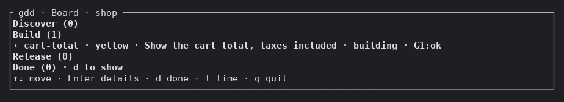
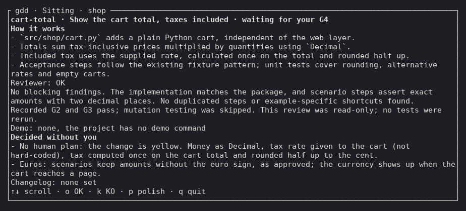
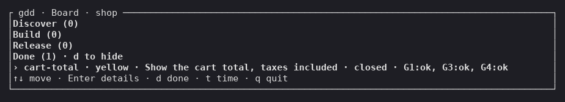

# Inicio rápido

En esta página llevas un Change de una pequeña tienda de ejemplo desde una carpeta vacía hasta
una versión publicada en producción. Usas una terminal para instalar gdd y crear el proyecto;
después, el trabajo pasa por tu agente de programación.

<!-- Every output on this page comes from one real run of gdd 0.1.0 (main at e244577) on
2026-10-31, with Claude Code as the chat agent and Codex as the Reviewer, in a throwaway
project `shop`. The whole run, from the form to G4, took about eight minutes. -->

## Antes de empezar

- Linux o macOS, con [git](https://git-scm.com) y [Rust](https://rustup.rs) 1.98 o
  posterior. Rust compila gdd.
- uv, OSV-Scanner y gitleaks, las herramientas que ejecuta el stack de Python de este ejemplo.
  [Instalar gdd](../how-to/install.md#python) enlaza cada una.
- Al menos un agente de programación instalado y con la sesión iniciada: Claude Code, Codex CLI
  u OpenCode. Mejor dos de familias de modelos distintas, uno para construir y otro para revisar,
  porque los modelos de una misma familia comparten puntos ciegos.
- git conoce tu nombre y tu correo (`git config user.name` y `git config user.email`):
  `gdd init` hace commit de lo que escribe.

## 1. Instala gdd

Instala el binario `gdd` y compruébalo:

```bash
cargo install --locked --git https://github.com/MarsGotta/gdd --tag v0.1.0 gdd
gdd --version
```

Deberías ver:

```text
gdd 0.1.0
```

Si tu shell no encuentra `gdd`, `~/.cargo/bin` no está en tu `PATH`: consulta
[Instalar gdd](../how-to/install.md).

## 2. Ejecuta gdd init

En una carpeta nueva con un repositorio git, ejecuta `gdd init`:

```bash
mkdir shop
cd shop
git init -b main
gdd init
```

Se abre un formulario en la terminal. Hace siete preguntas, una por paso, y no escribe nada
hasta el final. Deberías ver el primer paso:

```text
┌ gdd init · Step 1 of 7 · Project name ───────────────────────────────────────────────────────────┐
│What is the project called?                                                                       │
│> █                                                                                               │
│Enter: next · Ctrl-C: quit                                                                        │
└──────────────────────────────────────────────────────────────────────────────────────────────────┘
```

Responde a cada paso y pulsa `Enter`. En las listas te mueves con las flechas, y `Space` marca
una casilla. El último paso es el resumen:

```text
┌ gdd init · Summary ──────────────────────────────────────────────────────────────────────────────┐
│Every answer, before anything is written.                                                         │
│Name: shop                                                                                        │
│Description: A small online shop                                                                  │
│Platform: web                                                                                     │
│Stacks: python                                                                                    │
│Agents: claude, codex                                                                             │
│Language: en                                                                                      │
│Sensitive: Losing a customer's order                                                              │
│Enter to set up · Esc to go back                                                                  │
│Ctrl-C: quit                                                                                      │
└──────────────────────────────────────────────────────────────────────────────────────────────────┘
```

Pulsa `Enter`. gdd escribe el proyecto y hace commit. Después instala el stack y hace commit de
su fichero de bloqueo (*lock file*), el que fija la versión de cada dependencia. Al final
deberías ver:

```text
gdd/project.toml
gdd/commands.toml
...
.agents/skills/gdd-stack-python/SKILL.md
python: uv lock && uv sync --locked
...
Installed 39 packages in 61ms
...
Committed: uv.lock
Next: start your coding agent here and run the gdd-setup command (/gdd-setup in Claude Code and OpenCode, $gdd-setup in Codex).
```

Fíjate en la última línea: te dice adónde ir ahora. Si la salida se para con un error después
de la línea `python:`, probablemente falta uv.

A partir de aquí el trabajo pasa por tu agente. El Board y la sentada, más abajo, son ventanas
que abres en una terminal para mirar.

## 3. Ejecuta /gdd-setup en tu agente

Arranca tu agente en la carpeta `shop` y ejecuta la skill de preparación. En Claude Code y
OpenCode:

```text
/gdd-setup
```

En Codex, las skills empiezan por `$`: `$gdd-setup` y, más adelante, `$gdd-change`. Si el
agente no conoce la skill, lo arrancaste fuera de la carpeta `shop`.

El agente lee lo que escribió el formulario y pregunta solo lo que falta:

```text
Setup already has the basics: a web shop in Python, scenarios run with pytest-bdd, a skeleton
that runs, and one sensitive area (losing a customer's order). I need a few answers before I
write the Brief:

1. **What is the shop, in a few lines?** ...
2. **Who is it for?** ...
3. **Web framework.** I recommend **Django**. ... The alternative is **FastAPI**, if you'd
   rather have an API with a separate frontend.
4. **What else would be serious if it failed?** ...
```

Responde con tus palabras, en pocas líneas. El agente escribe el Brief del proyecto y ejecuta el
autotest del [arnés](../glossary.md#arnés), los ficheros y comandos con los que gdd comprueba tu
proyecto. Después te pide que apruebes las *zonas rojas*, las rutas que siempre reciben las
comprobaciones más estrictas:

```text
The harness self-test passes: **harness 4/4**. ...

**1. Approve the red zones.** ... For now there are only two:
- **The harness itself:** gdd's own files, the CI workflow and the agent instructions.
- **Dependencies and the toolchain:** the files that decide which outside libraries the shop
  uses.

"Losing a customer's order" is in the Brief for now. It becomes a red zone once there is real
order-storage code. Reply **"zones OK"** to approve.
...
```

Di `zones OK`. El agente abre la puerta de preparación (G0, *Setup Gate*) y termina con:

```text
Setup is done and **G0 is open**. The harness is ready: the self-test passes all four checks,
and the red zones you approved are recorded.
...
**Next step:** I recommend `/gdd-discover` before the first change. ... If you'd rather start
building now, run `/gdd-change` with one sentence, ...
```

Fíjate en **G0 is open**: el proyecto está listo para su primer Change. El agente recomienda
`/gdd-discover`, para ideas más grandes; para un Change pequeño, pasa directamente al siguiente
paso.

## 4. Describe tu primer Change con /gdd-change

Di lo que quieres en una frase:

```text
/gdd-change show the cart total, taxes included
```

El Orchestrator, el rol que hace aquí tu agente, crea el Change `cart-total`. Escribe sus
*escenarios*, ejemplos en Gherkin (frases llanas con Given, When y Then) de lo que debe pasar, y
te los enseña con el color del Change:

```text
I've drafted the scenarios for **cart-total**. It's yellow, so there's no plan for you to
approve and the red zones are unchanged. Before I commit them I need your OK and three answers.

**The scenarios** (all prices are set by you, tax already included):

> **Background:** the tax rate is 21%
>
> **1. The total adds up every piece in the cart**
> A cart with 1 × Blue mug at 24.20 and 2 × Wide bowl at 36.30.
> The total is **96.80**, and the tax included in it is **16.80**.
...
**Next step:** reply "OK" if all my recommendations stand, or give your rate, currency and any
corrections. I'll then commit the scenarios, approve G1 with your note, and launch the build.
```

Fíjate en *yellow* (amarillo), el color del código corriente: un Reviewer de otra familia de
modelos lee el Change, y tú lo encuentras dos veces, ahora y al final.

## 5. Aprueba los escenarios

Responde OK, o qué quieres cambiar, junto con las respuestas a sus preguntas. Tu OK es la
puerta de escenarios (G1, *Scenario Gate*), y sella los escenarios como el contrato que debe
cumplir el código:

```text
OK, as they are. My prices include tax, 21% is my rate and I sell in euros.
```

El agente registra G1 y lanza el Change:

```text
The **cart-total** change is now building on its own. I'll get a notification when it finishes
or stops.
...
**Next step:** wait for the build. When it pauses at G4, I'll show you the result in plain
words and you answer OK, KO, or "polish" with your notes.
```

Ahora el Builder escribe los tests y el código, las puertas lo comprueban y el Reviewer lo lee.
Para ver avanzar el Change, abre el Board en una terminal:

```bash
gdd board
```

Deberías ver el Change en Build:



El Board no se actualiza solo. Para ver dónde está ahora el Change, pulsa `q` y vuelve a
abrirlo.

## 6. Aprueba en G4

Unos dos minutos después, el Change se detiene en la puerta de salida (G4, *Release Gate*), ya
fusionado en `main` y desplegado en pre, el entorno previo a producción. El agente vuelve al
chat:

```text
The **cart-total** change is built and checked, and it's waiting for your **G4** answer.

**What it does:** a cart adds up the pieces in it and shows two figures, the total and how much
of that total is tax.
...
**Checks:**
- **All 6 scenarios pass**, including the 2 hidden examples the Builder never saw. ...
- **The Reviewer from another model family said OK** with no findings.
...
**Next step:** reply **OK** to send it to production (simulated for now), **KO** to reject it,
or **polish** with what you'd like changed.
```

Mira primero las comprobaciones. Los seis escenarios son los tres que aprobaste, dos *ejemplos
ocultos* que el Builder nunca vio, y el escenario de humo (*smoke*) que escribió Setup para
comprobar que el proyecto arranca.

La página de G4 de la sentada, `gdd sitting cart-total`, muestra la misma decisión:



Di OK:

```text
OK
```

El agente promueve el Change y lo cierra:

```text
**cart-total** is released as **v0.1.0**, and the change is closed. Production is still
simulated, so nothing is live on the web yet. The shop's core now has a cart that shows the
total and the tax included in it.
...
```

Ahora `main` tiene el Change: los dos commits de su rama, los escenarios y el trabajo, y el
commit de fusión que los unió, con el tag `v0.1.0`. Si vuelves a abrir el Board, lo muestra en
Done:



Si un Change se detiene antes, por el camino, se *aparca*: el agente te dice por qué y te
propone el siguiente paso
([Volver a poner en marcha un Change aparcado](../how-to/parked-change.md)).

Has instalado gdd, has preparado un proyecto con tu agente, has aprobado los escenarios de un
Change y su resultado, y lo has publicado como `v0.1.0`.

## Siguientes pasos

- [Tu primer Change](tutorial.md): el mismo recorrido con un Change real, con todas sus
  pantallas.
- [Describir un Change a tu agente](../how-to/run-a-change.md): tamaños, tipos y lo que te
  pregunta el Orchestrator.
- [Referencia de skills](../reference/skills/index.md): todas las skills que puedes ejecutar
  desde tu agente.
- [GDD en una página](../explanation/method.md): por qué las puertas están donde están.
