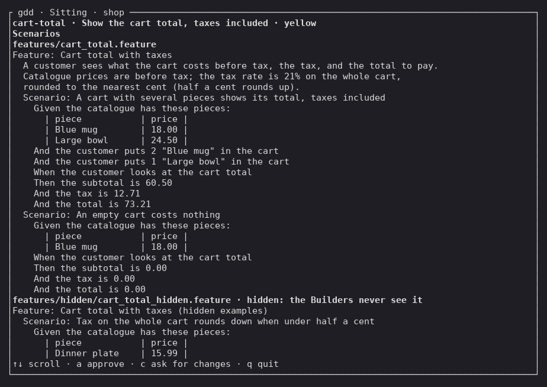
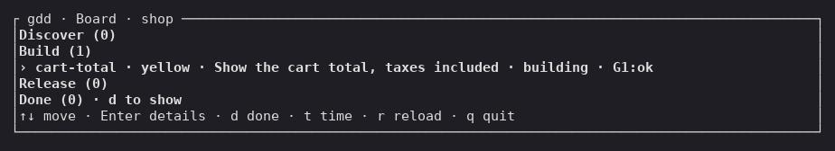
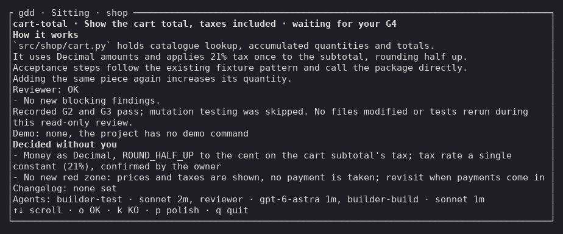
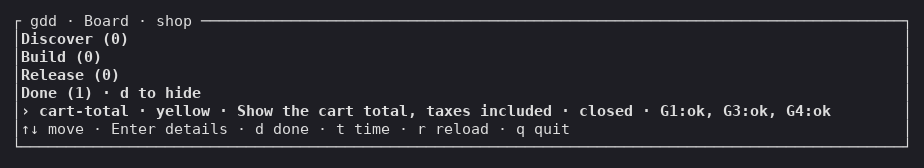

# Inicio rápido

En esta página llevas un Change de una pequeña tienda de ejemplo desde una carpeta vacía hasta
una versión publicada en producción. Usas una terminal para instalar gdd y crear el proyecto;
después, el trabajo pasa por tu agente de programación.

<!-- Every output on this page comes from one real run of gdd 0.1.1 (main at 30b50c4) on
2026-10-31, with Claude Code as the chat agent and Codex as the Reviewer, in a throwaway
project `shop`. On the way to G4 the change parked three times on gdd 0.1.1 bugs (a Reviewer
finding written as a Markdown link did not start the fix round in test mode, and two relaunch
paths that followed from it) and the agent rebuilt it; the G4 blocks trim the lines of that
detour with `...`. Without it, the launch takes about two and a half minutes to reach G4; the
whole run, parks included, took 23 minutes from the form to the release. -->

## Antes de empezar

- Linux o macOS, con [git](https://git-scm.com) y [Rust](https://rustup.rs) 1.98 o
  posterior. Rust compila gdd.
- uv, OSV-Scanner y gitleaks, las herramientas que ejecuta el stack de Python de este ejemplo.
  [Instalar gdd](../how-to/install.md#python) enlaza cada una.
- Al menos un agente de programación instalado y con la sesión iniciada: Claude Code, Codex CLI
  u OpenCode. Mejor dos de familias de modelos distintas, uno para construir y otro para revisar,
  porque los modelos de una misma familia comparten puntos ciegos.
- git conoce tu nombre y tu correo (`git config user.name` y `git config user.email`):
  `gdd init` hace commit de lo que escribe.

## 1. Instala gdd

Instala el binario `gdd` y compruébalo:

```bash
cargo install --locked --git https://github.com/MarsGotta/gdd --tag v0.1.1 gdd
gdd --version
```

Deberías ver:

```text
gdd 0.1.1
```

Si tu shell no encuentra `gdd`, `~/.cargo/bin` no está en tu `PATH`: consulta
[Instalar gdd](../how-to/install.md).

## 2. Ejecuta gdd init

En una carpeta nueva con un repositorio git, ejecuta `gdd init`:

```bash
mkdir shop
cd shop
git init -b main
gdd init
```

Se abre un formulario en la terminal. Hace siete preguntas, una por paso, y no escribe nada
hasta el final. Deberías ver el primer paso:

```text
┌ gdd init · Step 1 of 7 · Project name ───────────────────────────────────────────────────────────┐
│What is the project called?                                                                       │
│> █                                                                                               │
│Enter: next · Ctrl-C: quit                                                                        │
└──────────────────────────────────────────────────────────────────────────────────────────────────┘
```

Responde a cada paso y pulsa `Enter`. En las listas te mueves con las flechas, y `Space` marca
una casilla. El último paso es el resumen:

```text
┌ gdd init · Summary ──────────────────────────────────────────────────────────────────────────────┐
│Every answer, before anything is written.                                                         │
│Name: shop                                                                                        │
│Description: A small online shop                                                                  │
│Platform: web                                                                                     │
│Stacks: python                                                                                    │
│Agents: claude, codex                                                                             │
│Language: en                                                                                      │
│Sensitive: Losing a customer's order                                                              │
│Enter to set up · Esc to go back                                                                  │
│Ctrl-C: quit                                                                                      │
└──────────────────────────────────────────────────────────────────────────────────────────────────┘
```

Pulsa `Enter`. gdd escribe el proyecto, `CHANGELOG.md` incluido, y hace commit. Después instala
el stack y hace commit de su fichero de bloqueo (*lock file*), el que fija la versión de cada
dependencia. Al final deberías ver:

```text
gdd/project.toml
gdd/commands.toml
...
CHANGELOG.md
...
.agents/skills/gdd-stack-python/SKILL.md
python: uv lock && uv sync --locked
...
Installed 39 packages in 62ms
...
Committed: uv.lock
Next: start your coding agent here and run the gdd-setup command (/gdd-setup in Claude Code and OpenCode, $gdd-setup in Codex).
```

Fíjate en la última línea: te dice adónde ir ahora. Si la salida se para con un error después
de la línea `python:`, probablemente falta uv.

A partir de aquí el trabajo pasa por tu agente. El Board y la sentada, más abajo, son ventanas
que abres en una terminal para mirar.

## 3. Ejecuta /gdd-setup en tu agente

Arranca tu agente en la carpeta `shop` y ejecuta la skill de preparación. En Claude Code y
OpenCode:

```text
/gdd-setup
```

En Codex, las skills empiezan por `$`: `$gdd-setup` y, más adelante, `$gdd-change`. Si el
agente no conoce la skill, lo arrancaste fuera de la carpeta `shop`.

El agente lee lo que escribió el formulario y pregunta solo lo que falta. Escribe el Brief del
proyecto y ejecuta el autotest del [arnés](../glossary.md#arnés), los ficheros y comandos con
los que gdd comprueba tu proyecto. Después te pide que apruebes las *zonas rojas*, las rutas que
siempre reciben las comprobaciones más estrictas, y que revises lo que ha supuesto:

```text
The harness is ready: the self-test passed 4/4 and the machines opened G0. Everything is
committed on `main` as `gdd: setup (G0)`, and the session is recorded.
...
**What I need from you (one reply is enough):**
1. **Approve the protected zones.** These are gdd's own files, the CI and the agent
   instructions, plus the dependency and toolchain files. Any change there gets the strictest
   checks. Reply "zones OK" and I'll record your approval. No change can start until you do.
2. **Check my guesses in the Brief:**
   - The users are customers buying on the web and a shop owner who handles the orders. Is
     that right?
   - My recommendation is to leave payments out of the first version and have orders paid
     outside the shop. The alternative is to include payments from day one, which brings in
     money as a sensitive area.
...
```

Puede que tu agente haga sus preguntas antes de escribir el Brief. En los dos casos, responde
con tus palabras, en pocas líneas, y aprueba las zonas en la misma respuesta:

```text
zones OK. Your guesses are right: customers buy on the web and I run the orders. It sells
handmade ceramics: mugs, bowls and plates. Payments stay out of the first version.
```

El agente registra tu aprobación y termina con:

```text
Setup is finished. G0 is open, your approval of the protected zones is recorded, and the
self-test passed 4/4.
...
**Next step:** run `/gdd-discover`. It picks the web framework, maps where orders and customer
data live, and plans the first changes. After that, use `/gdd-change` for the first feature,
for example "customers can browse the catalogue".
```

Fíjate en **G0 is open**: la puerta de preparación (G0, *Setup Gate*) está abierta y las zonas
aprobadas, así que el proyecto está listo para su primer Change. El agente recomienda
`/gdd-discover`, para ideas más grandes; para un Change pequeño, pasa directamente al siguiente
paso.

## 4. Describe tu primer Change con /gdd-change

Di lo que quieres en una frase:

```text
/gdd-change show the cart total, taxes included
```

El Orchestrator, el rol que hace aquí tu agente, crea el Change `cart-total`. Escribe sus
*escenarios*, ejemplos en Gherkin (frases llanas con Given, When y Then) de lo que debe pasar,
hace commit de ellos en la rama del Change y te los enseña con el color del Change:

```text
I've set up the change **cart-total** and written its scenarios. It's classified **yellow**:
ordinary code outside your protected zones. So there's no plan for you to approve now; you
approve the scenarios now and the finished result at the end.

**The scenarios to approve (G1)**

*A cart with several pieces shows its total, taxes included*
- The catalogue has a Blue mug at 18.00 and a Large bowl at 24.50.
- The customer puts 2 Blue mugs and 1 Large bowl in the cart.
- The cart shows a subtotal of **60.50**, tax of **12.71** and a total of **73.21**.
...
**Two rules I built into these numbers. Please confirm or correct them:**
1. **Tax rate: 21% on everything.** ...
2. **Catalogue prices are before tax.** ...

**Next step:** reply "scenarios OK", or give me your rate and price rule, and I'll seal the
scenarios and launch the build.
```

Fíjate en *yellow* (amarillo), el color del código corriente: un Reviewer de otra familia de
modelos lee el Change, y tú lo encuentras dos veces, ahora y al final.

## 5. Aprueba los escenarios

Para leer los ficheros de escenarios tal cual, ejemplos ocultos incluidos, abre en una terminal
la *sentada*, la pantalla con todo lo que un Change necesita de ti:

```bash
gdd sitting cart-total
```

Deberías ver los escenarios de los que el agente hizo commit:



Pulsa `q` y responde en el chat: OK, o qué quieres cambiar, junto con las respuestas a sus
preguntas. Tu OK es la puerta de escenarios (G1, *Scenario Gate*), y sella los escenarios como
el contrato que debe cumplir el código:

```text
scenarios OK. 21% is my rate and my prices are before tax.
```

El agente registra G1 y lanza el Change:

```text
Your answers are recorded and the build is running in the background:

- **Scenarios approved (G1):** sealed with your rule: 21% tax on the whole cart, catalogue
  prices before tax, and half a cent rounds up.
...
**Next step:** wait. I'll be notified when it finishes or stops, and I'll come back with the
result for your OK.
```

Ahora el Builder escribe los tests y el código, las puertas lo comprueban y el Reviewer lo lee.
Para ver avanzar el Change, abre el Board en una terminal:

```bash
gdd board
```

Deberías ver el Change en Build:



El Board se recarga solo cada dos segundos, así que puedes dejarlo abierto: el Change pasa a
Release por sí mismo.

## 6. Aprueba en G4

Unos minutos después, el Change se detiene en la puerta de salida (G4, *Release Gate*), ya
fusionado en `main` y desplegado en pre, el entorno previo a producción. El agente vuelve al
chat:

```text
...
**What you'd approve:** the cart now gives three amounts: the subtotal before tax, the 21% tax
on the whole cart rounded to the cent (half a cent rounds up), and the total. Adding the same
piece again adds to its quantity. The code is merged on `main` and deployed to pre. Pre is
simulated here, so there's no video or screenshots.

**The evidence:**
- **Reviewer:** OK, with no new findings. ...
- **Full checks (G3):** all green, including security, dependencies and a scan for leaked
  secrets.
- **Demo:** I ran all 5 scenarios on `main` and they all pass:
...
**Next step:** reply "OK", "polish", or "KO" (reject; production stays untouched).
```

Mira primero las pruebas. Los cinco escenarios son los dos que aprobaste, dos *ejemplos
ocultos* que el Builder nunca vio, y el escenario de humo (*smoke*) que escribió Setup para
comprobar que el proyecto arranca.

La página de G4 de la sentada, `gdd sitting cart-total`, muestra la misma decisión:



<!-- The image leaves out four rows with the Reviewer's link to the file it had flagged (an
absolute path of the run) and the rows of the detour described at the top of the page. -->

Di OK:

```text
OK
```

El agente promueve el Change y lo cierra:

```text
The cart total is in production as **v0.1.0**, and the change is closed. Production is still
simulated, so nothing is deployed to a real server yet.

What shipped: the cart shows the subtotal, the 21% tax on the whole cart (rounded to the cent,
with half a cent rounding up), and the total. It's tagged and recorded on `main`.
...
```

Ahora `main` tiene el Change: los dos commits de su rama, los escenarios y el trabajo, el commit
de fusión que los unió y el commit de la versión que añadió su línea a `CHANGELOG.md`, con el
tag `v0.1.0`. El Board lo muestra en Done; pulsa `d` para desplegarlo:



Si un Change se detiene antes, por el camino, se *aparca*: el agente te dice por qué y te
propone el siguiente paso
([Volver a poner en marcha un Change aparcado](../how-to/parked-change.md)).

Has instalado gdd, has preparado un proyecto con tu agente, has aprobado los escenarios de un
Change y su resultado, y lo has publicado como `v0.1.0`.

## Siguientes pasos

- [Tu primer Change](tutorial.md): el mismo recorrido con un Change real, con todas sus
  pantallas.
- [Describir un Change a tu agente](../how-to/run-a-change.md): tamaños, tipos y lo que te
  pregunta el Orchestrator.
- [Referencia de skills](../reference/skills/index.md): todas las skills que puedes ejecutar
  desde tu agente.
- [GDD en una página](../explanation/method.md): por qué las puertas están donde están.
