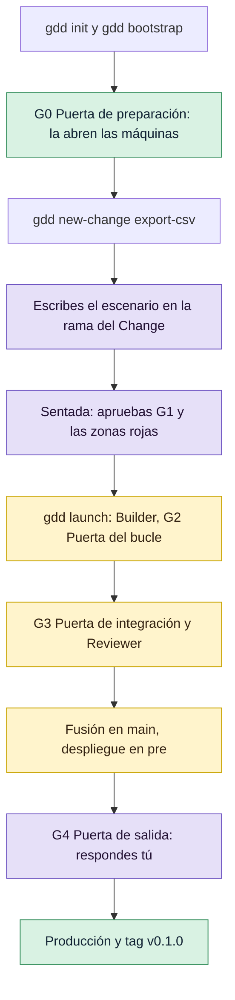

# Tu primer Change

En este tutorial preparas `notes`, una pequeña herramienta de notas de línea de comandos en
Python, y llevas un Change de la idea a la publicación: escribes y apruebas su escenario, los
agentes lo construyen y lo revisan, y tú respondes a su puerta de salida. Te lleva una media
hora.

## Antes de empezar

- gdd, uv, OSV-Scanner y gitleaks instalados: [Instalar gdd](../how-to/install.md) tiene todos
  los pasos, incluida la tabla de Python.
- Claude Code y Codex instalados y con la sesión iniciada. Aquí Claude Code construye y Codex
  revisa, porque el Reviewer debe ser de otra familia de modelos que el Builder.
- Una terminal de al menos 100 columnas de ancho, para las pantallas que dibuja gdd.

Las llamadas de los agentes de este tutorial usaron unos 73.000 tokens de entrada nuevos; con
una suscripción, eso entra en tu plan, no en una factura.

## El recorrido

Pasas una vez por las cinco puertas de GDD, en este orden. Los pasos morados son tuyos; las
máquinas y los agentes hacen el resto.



[GDD en una página](../explanation/method.md) explica cada puerta. No la necesitas para seguir
el tutorial.

## 1. Crea el proyecto

Crea una carpeta vacía con un repositorio git y prepara GDD en ella. Cada respuesta va en una
opción, así que no se abre ningún formulario:

```bash
mkdir notes && cd notes
git init -b main
gdd init --name notes --platform cli --stack python --agents claude codex \
  --description "A command-line notes tool" --sensitive "Losing or corrupting a user's notes"
```

Deberías ver todos los ficheros que ha escrito gdd y, después, qué hacer a continuación (gdd
responde en inglés):

```text
gdd/project.toml
gdd/commands.toml
gdd/rules.toml
gdd/zones.toml
gdd/models.toml
gdd/generated.toml
docs/brief.md
bin/gdd
...
.agents/skills/gdd-stack-python/SKILL.md
Next: run bin/gdd bootstrap (first install of each stack and its lock file), bin/gdd agents check, then start your agent and run the gdd-setup command (/gdd-setup in Claude Code and OpenCode, $gdd-setup in Codex).
```

`gdd init` hace commit de esos ficheros, y solo de esos, como `gdd init 0.1.0`.

Ahora instala las herramientas del proyecto. `gdd bootstrap` ejecuta la primera instalación del
stack, que escribe el fichero de bloqueo (*lock file*), y hace commit de él:

```bash
bin/gdd bootstrap
```

Deberías ver a uv trabajando y, después:

```text
python: uv lock && uv sync --locked
...
Installed 39 packages in 92ms
Committed: uv.lock
Next: bin/gdd selftest
```

A partir de aquí llamas a gdd como `bin/gdd`, el script que escribió `gdd init`. Los agentes y
la CI lo llaman igual.

## 2. Mira lo que ha escrito init

Cada fichero tiene una sola función:

```text
notes/
├── gdd/                   the rules of the method, read by gdd, the agents and CI
│   ├── project.toml       name, platform, stack and the language the agents speak
│   ├── commands.toml      the commands each gate runs, from the Python stack sheet
│   ├── rules.toml         what each color gets: lanes, limits, protected paths
│   ├── zones.toml         the zone map: which paths are red, green or yellow
│   ├── models.toml        which agent and model plays each role
│   └── generated.toml     what init was asked, for gdd upgrade
├── docs/brief.md          the Project Brief: what the project is and what must not fail
├── bin/gdd                runs the gdd on your PATH
├── .github/workflows/gdd.yml   CI: Path Guard, G2 and G3 on every pull request
├── AGENTS.md, CLAUDE.md   the first instructions every agent reads
├── .claude/skills/        the GDD commands for Claude Code (/gdd-status...)
├── .agents/skills/        the same commands for Codex ($gdd-status...)
├── features/              the Gherkin scenarios: the contract you approve
├── src/notes/             the code, with a placeholder greeting.py
├── tests/unit/            unit tests
├── tests/acceptance/      the scenario steps, run by pytest-bdd
├── pyproject.toml, uv.lock     dependencies and the tools of the gates
└── osv-scanner*.toml      security and license checks of G3
```

gdd guarda su propio estado, el log y el registro de cada Change, en `.gdd/`, que git ignora.
[Ficheros que escribe gdd](../reference/files.md) describe cada uno.

## 3. Abre G0, la puerta de preparación

Setup termina en la puerta de preparación (G0, *Setup Gate*), que abren las máquinas, no una
persona: gdd solo la registra con `--by machines`, y solo con el Brief del proyecto escrito y el
autotest del arnés a 4 de 4. En un proyecto real haces el Setup en una conversación con el
Orchestrator (`/gdd-setup` en Claude Code), que escribe el Brief contigo y ejecuta estos
comandos. Aquí el Brief que escribió `gdd init` está casi completo: rellena para quién es la
herramienta.

Abre `docs/brief.md` y sustituye la línea que hay debajo de `## Who it is for` por esta:

```markdown
People who keep short notes in the terminal and want them in a spreadsheet now and then.
```

Haz commit, ejecuta el autotest y abre G0:

```bash
git commit -am "Brief: who notes is for"
bin/gdd selftest
bin/gdd gate G0 ok --by machines
```

Deberías ver:

```text
OK a failing test turns G2 red
OK editing a protected file is blocked (Path Guard and CI)
OK rollback works in pre (simulated)
OK zero scenarios counts as a failure
harness 4/4
G0 ok (machines).
```

El autotest demuestra que las puertas pueden fallar: un test que falla pone G2 en rojo, Path
Guard bloquea a un agente que edita un fichero protegido, el rollback funciona y un proyecto sin
escenarios falla en G3. Comprueba en qué punto está el proyecto:

```bash
bin/gdd status
```

Deberías ver:

```text
Project: notes · language en · platform cli
Brief: docs/brief.md
G0: ok · G0 ok
Red zones: pending · Red zones not approved yet: the Orchestrator proposes them at the end of Discover.
Harness self-test: harness 4/4
Scenarios in features/: 0
Security exceptions: none
Known debt: none
Changes:
Log: 2 lines in .gdd/log.jsonl (gdd report)
```

Las zonas rojas siguen pendientes: las apruebas en el paso 7, en la misma sentada que tu primer
escenario.

## 4. Crea el Change

Un *Change* es una pieza pequeña de valor que pasa las puertas como una sola unidad, en su
propia rama. El tuyo permite que `notes` exporte las notas como CSV. Créalo con las rutas que
planea tocar:

```bash
bin/gdd new-change export-csv --title "Export notes as CSV" \
  --paths "src/notes/**" "tests/**" features/export_csv.feature
```

gdd crea la rama `change/export-csv` e imprime cómo ha clasificado el Change:

```text
{
  "change": "export-csv",
  "color": "yellow",
  "lane": "full",
  "reasons": [
    "features/export_csv.feature -> yellow (no zone: default color)",
    "src/notes/** -> yellow (no zone: default color)",
    "tests/** -> yellow (no zone: default color)"
  ],
  "g1": true,
  "features": [
    "features/export_csv.feature"
  ],
  "tests_first": true,
  "mutation": false,
  "reviewer": true,
  "review": "quick",
  "g4": true,
  "human_plan": false,
  "type": "Feature",
  ...
}
```

Léelo como el plan de este Change:

- `color` es amarillo (`yellow`): ninguna de sus rutas está en una zona de `gdd/zones.toml`, y el
  código sin zona es amarillo. Una ruta roja haría rojo todo el Change.
- `g1` es `true` porque añade un escenario, así que apruebas el escenario antes de que haya
  código.
- `reviewer` es `true`: un Reviewer de otra familia de modelos lee el Change entero.
- `g4` es `true`: un Change con G1 te espera en la puerta de salida.

[Cómo elige el riesgo las puertas](../explanation/risk.md) explica los colores.

## 5. Escribe el escenario

Un escenario es una frase en Gherkin que dice qué debe pasar. Va en la rama del Change, en
`features/`. Cámbiate a la rama y escríbelo:

```bash
git switch change/export-csv
mkdir -p features/hidden
cat > features/export_csv.feature <<'EOF'
Feature: Export notes as CSV
  So that I can open my notes in a spreadsheet, notes writes them as CSV: a header line,
  then one line per note, in the order they were written.

  Scenario: Each note becomes one line
    Given the notes "Buy milk" and "Call the bank"
    When I export the notes as CSV
    Then the CSV is:
      """
      note
      Buy milk
      Call the bank
      """
EOF
```

Añade también un *ejemplo oculto*: las mismas frases con otros datos, en `features/hidden/`. El
Builder nunca lo ve, así que un código que solo encaje con el ejemplo visible falla en G3:

```bash
cat > features/hidden/export_csv.feature <<'EOF'
Feature: Export notes as CSV (hidden examples)

  Scenario: Other notes, same rule
    Given the notes "Water the plants" and "Pay the rent"
    When I export the notes as CSV
    Then the CSV is:
      """
      note
      Water the plants
      Pay the rent
      """
EOF
```

Haz commit de los dos y vuelve a `main`:

```bash
git add features
git commit -m "Scenarios of export-csv"
git switch main
```

[Escribir y aprobar escenarios](../how-to/write-scenarios.md) tiene las reglas para escribir
buenos escenarios y ejemplos ocultos.

## 6. Dale al Builder su paquete

El Builder recibe solo lo que necesita su tarea: un *paquete de contexto* corto en la carpeta de
estado del Change. En un proyecto real lo escribe el Orchestrator (`/gdd-change`); aquí lo
escribes tú:

```bash
cat > .gdd/changes/export-csv/package.md <<'EOF'
# export-csv

Goal: `notes` exports the notes as CSV, a header line `note` and then one line per note.
Color: yellow. Scenario: features/export_csv.feature.
Paths: a function `export_csv(notes: list[str]) -> str` in src/notes/export.py, its unit tests in
tests/unit/, its steps in tests/acceptance/steps/. Check with `bin/gdd g2`.
EOF
```

## 7. Aprueba en la sentada

Todo lo que un Change necesita de ti antes del build se reúne en una sola *sentada*: los
escenarios (la puerta de escenarios, G1), las zonas rojas cuando están pendientes y el plan de
un Change rojo. Ábrela:

```bash
bin/gdd sitting export-csv
```

Deberías ver los escenarios de la rama del Change, el ejemplo oculto marcado como tal y las dos
zonas rojas que mapeó `gdd init`, con sus motivos:

<!-- Pantalla real de gdd 0.1.0 a 100 columnas: recortadas las líneas en blanco y parte de los escenarios. -->
```text
┌ gdd · Sitting · notes ───────────────────────────────────────────────────────────────────────────┐
│export-csv · Export notes as CSV · yellow                                                         │
│Scenarios                                                                                         │
│features/export_csv.feature                                                                       │
│Feature: Export notes as CSV                                                                      │
│  So that I can open my notes in a spreadsheet, notes writes them as CSV: a header line,          │
│  then one line per note, in the order they were written.                                         │
│  Scenario: Each note becomes one line                                                            │
│    Given the notes "Buy milk" and "Call the bank"                                                │
│    When I export the notes as CSV                                                                │
│    Then the CSV is:                                                                              │
...
│features/hidden/export_csv.feature · hidden: the Builders never see it                            │
...
│Red zones to approve                                                                              │
│gdd/**, bin/**, .github/**, .claude/**, .agents/**, .opencode/**, .gdd/bin/** · The harness       │
│itself: touching the gates is touching the safety of the method                                   │
│pyproject.toml, uv.lock, osv-scanner.toml, osv-scanner-licenses.toml · Dependencies and toolchain:│
│supply chain                                                                                      │
│Plan: not needed for a yellow change                                                              │
│↑↓ scroll · a approve · c ask for changes · q quit                                                │
└──────────────────────────────────────────────────────────────────────────────────────────────────┘
```

Pulsa `a`. Todavía no se escribe nada: gdd te muestra exactamente lo que va a registrar en tu
nombre (aquí y más abajo, sin las líneas en blanco):

```text
┌ gdd · Sitting · notes ───────────────────────────────────────────────────────────────────────────┐
│This records, as you:                                                                             │
│- G1 ok on export-csv, sealing features/export_csv.feature, features/hidden/export_csv.feature    │
│- red zones ok: 2 red zone(s)                                                                     │
│y to record · n to go back                                                                        │
│↑↓ scroll · q quit                                                                                │
└──────────────────────────────────────────────────────────────────────────────────────────────────┘
```

Pulsa `y`. Deberías ver:

```text
┌ gdd · Sitting · notes ───────────────────────────────────────────────────────────────────────────┐
│Recorded                                                                                          │
│G1 ok on export-csv (human).                                                                      │
│Red zones ok (2 red zone(s)).                                                                     │
│Next: gdd launch export-csv                                                                       │
│↑↓ scroll · q quit                                                                                │
└──────────────────────────────────────────────────────────────────────────────────────────────────┘
```

Pulsa `q` para cerrar la pantalla. Aprobar G1 *sella* los ficheros de escenarios: gdd guarda sus
hashes, y ningún agente puede cambiarlos después sin una nueva aprobación. Si pulsas `c` en vez
de `a`, pides cambios y gdd registra G1 KO con tus palabras.

> [!NOTE]
> Sin terminal, por ejemplo en un script, registra la misma sentada con dos comandos:
> `bin/gdd gate zones ok --by human` y `bin/gdd gate G1 ok export-csv --by human`.

## 8. Lanza el Change

Pasa el Change a la receta:

```bash
bin/gdd launch export-csv
```

gdd no imprime nada mientras trabaja. Con este Change tardó unos dos minutos; uno más grande
tarda más. Al final deberías ver:

```text
Paused at G4. Message: .gdd/changes/export-csv/inbox.md · To continue: gdd resume export-csv --g4 ok|ko|polish
```

Mientras tanto, gdd hizo esto, en orden:

1. Creó un worktree de git para el Change junto al proyecto, `../notes.worktrees/export-csv`,
   en la rama `change/export-csv`, y dejó tu copia de trabajo en `main`.
2. El **Builder en modo test** (Claude Code, Sonnet) escribió los pasos del escenario y los
   tests unitarios, que fallaron porque el código aún no existía.
3. El **Builder en modo build**, en una sesión aparte, escribió `src/notes/export.py` hasta que
   pasó la puerta del bucle (G2): lint, tipos, tests unitarios, el escenario y Path Guard.
4. La puerta de integración (G3) ejecutó todos los escenarios, incluido el ejemplo oculto, más
   las comprobaciones de seguridad, licencias, fichero de bloqueo y secretos.
5. El **Reviewer** (Codex) leyó el Change entero y respondió OK.
6. gdd fusionó la rama en `main`, ejecutó los pasos que la despliegan en pre y se detuvo en la
   puerta de salida (G4), porque el Change tuvo G1. Este proyecto aún no tiene pre ni
   producción, así que esos pasos se simulan: `simulated = true` en `[release]` de
   `gdd/commands.toml`.

[La vida de un Change](../explanation/life-of-a-change.md) sigue cada paso en detalle.

## 9. Síguelo

Mientras el Change se ejecuta, y después, tres comandos te dicen dónde está. `status` lista
todos los Changes con su estado y sus puertas:

```bash
bin/gdd status
```

```text
...
Scenarios in features/: 2
Security exceptions: none
Known debt: none
Changes:
  - export-csv · Export notes as CSV · in-pre · G1:ok, G3:ok
Log: 30 lines in .gdd/log.jsonl (gdd report)
```

El Board muestra los Changes por fase; lo abre `bin/gdd board`, o `gdd` sin argumentos. Solo
lee, y `Enter` muestra los detalles de un Change:

<!-- Pantalla real a 100 columnas, sin las líneas en blanco. -->
```text
┌ gdd · Board · notes ─────────────────────────────────────────────────────────────────────────────┐
│Discover (0)                                                                                      │
│Build (0)                                                                                         │
│Release (1)                                                                                       │
│› export-csv · yellow · Export notes as CSV · waiting for your G4 · G1:ok, G3:ok                  │
│Done (0) · d to show                                                                              │
│↑↓ move · Enter details · d done · t time · q quit                                                │
└──────────────────────────────────────────────────────────────────────────────────────────────────┘
```

`report` dice lo que han costado las llamadas de agente, según el log:

```bash
bin/gdd report
```

```text
role -> calls · tokens in · cache · out · cost USD · seconds
builder-build -> 1 · 23,396 · 183,870 · 1,501 · 0.1270 · 22
builder-test -> 1 · 25,843 · 288,673 · 3,123 · 0.1634 · 59
reviewer -> 1 · 23,312 · 123,264 · 1,301 · 0.0000 · 44
TOTAL -> in 72,551 · cache 595,807 · out 5,925 · 0.2904 USD
Human stops logged: 2
```

Tres llamadas de agente y dos paradas humanas: el escenario y las zonas rojas, las dos en una
sola sentada. Codex no informa de su coste, así que la línea del Reviewer marca 0 salvo que
rellenes `[prices]` en `gdd/models.toml`.

## 10. Responde a la puerta de salida

El Change está fusionado y en pre. Antes de que llegue a producción, tú eres quien lo edita:
hecho no es lo mismo que bueno. Lee su *Decision Inbox*, el único mensaje que gdd guarda
para cada Change:

```bash
bin/gdd inbox export-csv
```

```text
# Decision Inbox · export-csv · Export notes as CSV

Color yellow · lane full · state in-pre

## How it works
- `src/notes/export.py` adds the requested `export_csv` function.
- It uses Python’s CSV writer to emit the `note` header and preserve note order.
- Acceptance steps follow the existing fixture-based test structure.
- Empty input produces only the header; output includes a trailing newline.

## Needs your decision
- El escenario compara el CSV por líneas (splitlines), así que no fija si hay salto de línea final; los tests unitarios tampoco.
- G4 · Release Gate: check the pre demo and the change message, then answer with gdd resume export-csv --g4 ok (promote to production), --g4 ko (reject: production untouched) or --g4 polish --note <what to polish> (one more Builder round).

## Decided without you
- Nothing.

## Parked
- Nothing.
```

*How it works* es la explicación breve del código que escribe el Reviewer, para que sepas qué
apruebas sin leer cada línea. Tus agentes lo redactarán de otra manera.

La primera línea bajo *Needs your decision* es una nota que dejó el Builder en modo test con
`bin/gdd note`: el escenario compara el CSV línea a línea, así que no dice si el fichero termina
con un salto de línea. Salió en español: Claude Code también lee las instrucciones propias de su
usuario, escritas en español en la máquina de esta ejecución, y aquí se impusieron al `language`
del proyecto. Una nota así es para que la valores en G4: un salto de línea final no es problema
para una hoja de cálculo, así que aquí no cambia nada.

Puedes responder en una pantalla con `bin/gdd sitting export-csv`, donde `o` es OK, `k` es KO y
`p` es polish, o con un solo comando. El código hace lo que dice el escenario, así que responde
OK:

```bash
bin/gdd resume export-csv --g4 ok
```

Deberías ver:

```text
Released v0.1.0
Change export-csv closed. Message: .gdd/changes/export-csv/inbox.md · Tokens: gdd report --change export-csv
```

gdd ejecutó los pasos que promueven el mismo build de pre a producción y lo vigilan (simulados
en este proyecto), y cerró el Change. Como el Change tiene una línea de changelog (una Feature
va en Added, con su título), recibió la primera versión del proyecto, el tag `v0.1.0`. Con `ko`
se habría quedado fuera de producción, y `polish --note "..."` habría enviado tus notas al
Builder para una vuelta más. [Responder a la puerta de salida](../how-to/release-gate.md) explica
las tres respuestas.

## 11. Mira el resultado

El Change llegó a `main` como un solo commit de fusión:

```bash
git log --oneline --graph -6
```

```text
*   412bc25 gdd(export-csv): G3 Merge Gate · Export notes as CSV
|\
| * 13b016d gdd(export-csv): change work
| * 9fe1de1 Scenarios of export-csv
|/
* 4a1b193 Brief: who notes is for
* ca5c264 gdd bootstrap
* 96b1229 gdd init 0.1.0
```

El commit de fusión lleva el registro del Change, así que el historial conserva qué se decidió y
quién lo decidió, mientras los ficheros de trabajo se quedan en `.gdd/changes/export-csv/`:

```bash
git show -s --format=%B HEAD
```

```text
gdd(export-csv): G3 Merge Gate · Export notes as CSV

Color: yellow · lane full · type Feature
Approvals: G1 ok (human, 2026-10-30, 2 scenario file(s) sealed)
Reviewer: OK
Tokens: in 72,551 · cache 595,807 · out 5,925 · 0.29 USD (estimate) · 13 agent call(s)
Record: .gdd/changes/export-csv/ (local)

Changelog: Added · Export notes as CSV
Breaking: no
```

Los tokens son los de `gdd report`. La cuenta de llamadas no: gdd 0.1.0 cuenta ahí también los
diez comandos de puerta de G2 y G3, así que las tres llamadas de agente aparecen como 13.

Y ahora el proyecto lo refleja:

```bash
bin/gdd status
```

```text
...
Changes:
  - export-csv · Export notes as CSV · closed · G1:ok, G3:ok, G4:ok
Log: 34 lines in .gdd/log.jsonl (gdd report)
```

Has llevado un Change por todas las puertas, con dos paradas: una sentada antes del build y una
respuesta al final. El worktree ya no está; la rama `change/export-csv` se queda.

## Siguientes pasos

- [Ejecutar un Change](../how-to/run-a-change.md): el bucle de cada día, incluidos los Changes
  aparcados y los relanzamientos.
- [Escribir y aprobar escenarios](../how-to/write-scenarios.md): escenarios que sirven de buen
  contrato, y ejemplos ocultos.
- [Mapear y aprobar zonas rojas](../how-to/red-zones.md): convierte las áreas sensibles del Brief
  en rutas rojas.
- [GDD en una página](../explanation/method.md): las fases, puertas y colores que acabas de
  recorrer.
