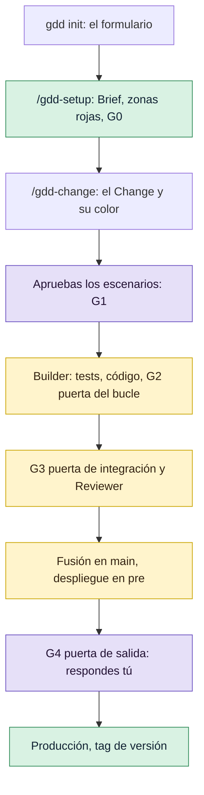

# Tu primer Change

Al final de este tutorial tendrás `shop`, una pequeña tienda online en Python, y un Change, el
total del carrito, llevado de una frase a una versión publicada en producción, con su tag. Sigue
el recorrido del [Inicio rápido](quickstart.md) con todas las pantallas a la vista, para que
puedas comparar cada resultado con el tuyo.

<!-- Every screen, message and output on this page comes from one real run of gdd 0.1.0 (main
at e244577) on 2026-10-31, in a throwaway folder, with Claude Code as the chat agent, Codex as
the Reviewer and the default models. Paths are shown under /home/me. The run took about eight
minutes from the form to G4, with no fix round. -->

## Antes de empezar

- gdd, uv, OSV-Scanner y gitleaks instalados: [Instalar gdd](../how-to/install.md) tiene todos
  los pasos, incluida la tabla de Python.
- Claude Code y Codex instalados y con la sesión iniciada. Claude Code construye y Codex revisa,
  porque el Reviewer debe ser de otra familia de modelos que el Builder.
- git conoce tu nombre y tu correo: `gdd init` hace commit de lo que escribe.
- Una terminal de al menos 100 columnas de ancho, para las pantallas que dibuja gdd.

Las llamadas del Builder en esta ejecución costaron 0,39 USD, según las contó Claude Code, y
las llamadas del Builder y del Reviewer usaron juntas unos 103.000 tokens de entrada nuevos. Con
una suscripción, las cubre tu plan.

## El recorrido

Escribes un solo comando de gdd, `gdd init`, para crear el proyecto. Después el trabajo pasa
por tu agente, y tú respondes en el chat. El Board, la sentada y `git log` son ventanas que
abres en una terminal para mirar. Los pasos morados del diagrama son tuyos:



[GDD en una página](../explanation/method.md) explica cada puerta. No la necesitas para seguir
el tutorial.

## 1. Crea el proyecto

Crea una carpeta vacía con un repositorio git y ejecuta `gdd init` en ella:

```bash
mkdir shop
cd shop
git init -b main
gdd init
```

Se abre un formulario. Hace siete preguntas, una por paso, y no escribe nada hasta el final.
Escribe el nombre y pulsa `Enter`:

```text
┌ gdd init · Step 1 of 7 · Project name ───────────────────────────────────────────────────────────┐
│What is the project called?                                                                       │
│> shop█                                                                                           │
│Enter: next · Ctrl-C: quit                                                                        │
└──────────────────────────────────────────────────────────────────────────────────────────────────┘
```

Escribe una descripción corta, o déjala vacía, y pulsa `Enter`:

```text
┌ gdd init · Step 2 of 7 · Description ────────────────────────────────────────────────────────────┐
│What is it, in a few words? It may stay empty.                                                    │
│> A small online shop█                                                                            │
│Enter: next · Esc: back · Ctrl-C: quit                                                            │
└──────────────────────────────────────────────────────────────────────────────────────────────────┘
```

Baja hasta `web` con las flechas y pulsa `Enter`:

```text
┌ gdd init · Step 3 of 7 · Platform ───────────────────────────────────────────────────────────────┐
│Where does it run?                                                                                │
│  mobile                                                                                          │
│  desktop                                                                                         │
│> web                                                                                             │
│  cli                                                                                             │
│  other                                                                                           │
│Up/Down: move · Enter: pick · Esc: back · Ctrl-C: quit                                            │
└──────────────────────────────────────────────────────────────────────────────────────────────────┘
```

Pulsa `Space` para marcar `python` y después `Enter`. Cada stack trae su *ficha de stack*, los
comandos que ejecuta cada puerta para esa tecnología:

```text
┌ gdd init · Step 4 of 7 · Stacks ─────────────────────────────────────────────────────────────────┐
│Which technology does it use? Pick one or more, or Not sure.                                      │
│  [ ] rust                                                                                        │
│  [ ] typescript                                                                                  │
│> [x] python                                                                                      │
│  [ ] Not sure                                                                                    │
│Up/Down: move · Space: check · Enter: next · Esc: back · Ctrl-C: quit                             │
└──────────────────────────────────────────────────────────────────────────────────────────────────┘
```

Los agentes de programación que encuentra en la máquina aparecen marcados, y el primero marcado
construye. Pulsa `Space` sobre `opencode` para desmarcarlo, así Claude Code construye y Codex
revisa:

```text
┌ gdd init · Step 5 of 7 · Coding agents ──────────────────────────────────────────────────────────┐
│Which coding agents? The first checked builds; those found on this machine come checked.          │
│  [x] claude                                                                                      │
│  [x] codex                                                                                       │
│> [ ] opencode                                                                                    │
│Up/Down: move · Space: check · Enter: next · Esc: back · Ctrl-C: quit                             │
└──────────────────────────────────────────────────────────────────────────────────────────────────┘
```

Deja `en`, el idioma que usan los agentes contigo, y pulsa `Enter`:

```text
┌ gdd init · Step 6 of 7 · Language ───────────────────────────────────────────────────────────────┐
│Which language do the agents use with you? (en, es...)                                            │
│> en█                                                                                             │
│Enter: next · Esc: back · Ctrl-C: quit                                                            │
└──────────────────────────────────────────────────────────────────────────────────────────────────┘
```

Escribe cada área sensible, lo que sería grave si fallara, y pulsa `Enter`. Una línea vacía
sigue adelante. Estas palabras se convierten después en *zonas rojas*, cuando haya carpetas que
proteger:

```text
┌ gdd init · Step 7 of 7 · Sensitive areas ────────────────────────────────────────────────────────┐
│What would be serious if it failed? One area per line.                                            │
│> Losing a customer's order█                                                                      │
│Enter: add, or go on when empty · Backspace: edit the last · Esc: back · Ctrl-C: quit             │
└──────────────────────────────────────────────────────────────────────────────────────────────────┘
```

Revisa el resumen. Para corregir una respuesta, pulsa `Esc` hasta volver a ella:

```text
┌ gdd init · Summary ──────────────────────────────────────────────────────────────────────────────┐
│Every answer, before anything is written.                                                         │
│Name: shop                                                                                        │
│Description: A small online shop                                                                  │
│Platform: web                                                                                     │
│Stacks: python                                                                                    │
│Agents: claude, codex                                                                             │
│Language: en                                                                                      │
│Sensitive: Losing a customer's order                                                              │
│Enter to set up · Esc to go back                                                                  │
│Ctrl-C: quit                                                                                      │
└──────────────────────────────────────────────────────────────────────────────────────────────────┘
```

Pulsa `Enter`. Deberías ver todos los ficheros que escribió gdd, después a uv trabajando y, al
final, qué hacer a continuación:

```text
gdd/project.toml
gdd/commands.toml
gdd/rules.toml
gdd/zones.toml
gdd/models.toml
gdd/generated.toml
docs/brief.md
.github/workflows/gdd.yml
AGENTS.md
CLAUDE.md
...
.agents/skills/gdd-stack-python/SKILL.md
python: uv lock && uv sync --locked
Using CPython 3.13.15
Resolved 40 packages in 329ms
...
Installed 39 packages in 61ms
...
Committed: uv.lock
Next: start your coding agent here and run the gdd-setup command (/gdd-setup in Claude Code and OpenCode, $gdd-setup in Codex).
```

Fíjate en la última línea: te dice adónde ir ahora. gdd hizo dos commits, `gdd init 0.1.0` con
sus ficheros y `gdd bootstrap` con `uv.lock`, el fichero de bloqueo (*lock file*) que fija la
versión de cada dependencia. Si la salida se para con un error después de la línea `python:`,
probablemente falta uv: consulta [Instalar gdd](../how-to/install.md#python).

## 2. Mira lo que escribió init

Cada fichero tiene un solo trabajo:

```text
shop/
├── gdd/                   the rules of the method, read by gdd, the agents and CI
│   ├── project.toml       name, platform, stack and the language the agents speak
│   ├── commands.toml      the commands each gate runs, from the Python stack sheet
│   ├── rules.toml         what each color gets: lanes, limits, protected paths
│   ├── zones.toml         the zone map: which paths are red, green or yellow
│   ├── models.toml        which agent and model plays each role
│   └── generated.toml     what init was asked, for gdd upgrade
├── docs/brief.md          the Project Brief: what the project is and what must not fail
├── .github/workflows/gdd.yml   CI: Path Guard, G2 and G3 on every pull request
├── AGENTS.md, CLAUDE.md   the first instructions every agent reads
├── .claude/skills/        the GDD skills for Claude Code (/gdd-setup, /gdd-change...)
├── .agents/skills/        the same skills for Codex ($gdd-setup, $gdd-change...)
├── features/              the Gherkin scenarios: the contract you approve
├── src/shop/              the code, with a placeholder greeting.py
├── tests/unit/            unit tests
├── tests/acceptance/      the scenario steps, run by pytest-bdd
├── pyproject.toml, uv.lock     dependencies and the tools of the gates
└── osv-scanner*.toml      security and license checks of G3
```

Fíjate en `gdd/zones.toml` y `gdd/models.toml`. El primero decide lo estricto que es cada
Change; el segundo, qué agente hace cada rol. gdd guarda su propio estado en `.gdd/`, que git
ignora. [Ficheros que escribe gdd](../reference/files.md) describe cada fichero.

## 3. Prepara el proyecto con tu agente

Arranca Claude Code en la carpeta `shop` y ejecuta la skill de preparación:

```text
/gdd-setup
```

Si Claude Code no conoce `/gdd-setup`, lo arrancaste fuera de la carpeta `shop`, que es donde
están las skills. El agente hace de *Orchestrator*, el rol que habla contigo. Ya leyó lo que
escribió el formulario, así que solo pregunta lo que falta:

```text
Setup already has the basics: a web shop in Python, scenarios run with pytest-bdd, a skeleton
that runs, and one sensitive area (losing a customer's order). I need a few answers before I
write the Brief:

1. **What is the shop, in a few lines?** What does it sell, who buys, and roughly how big is it
   (a handful of products or a catalogue)?
2. **Who is it for?** My guess is one small seller and their customers, with no marketplace of
   many sellers. Is that right?
3. **Web framework.** I recommend **Django**. It comes with an admin panel for managing
   products and orders, plus logins and a database layer, which fits a small shop with little
   code. The alternative is **FastAPI**, if you'd rather have an API with a separate frontend.
4. **What else would be serious if it failed?** I have "losing a customer's order." My
   suggestions to add are:
   - **Charging the wrong amount, or taking payment without recording the order.** I'd
     recommend Stripe hosted checkout, so we never handle card numbers ourselves.
   - **Leaking customers' personal data** (names, addresses, emails).

   Is there anything to add or remove?

**Next step:** answer these four, even in one line each, and I'll write the Brief, the
technology decision and the gate commands, and open G0.
```

Responde a cada pregunta en una o dos líneas. Cada una trae una recomendación, y no tienes por
qué aceptarla:

```text
It sells handmade ceramics: mugs, bowls and plates. One seller, me. Customers browse, put
pieces in a cart and place an order; payment comes later, it is out of scope for now. It is
for people who like handmade ceramics, and I run it day to day. I'd rather have FastAPI. Just
orders.
```

Más o menos un minuto y medio después, el agente ha escrito el Brief, un registro de decisión de
arquitectura (ADR, *architecture decision record*) para la tecnología y un esqueleto pequeño con
un primer escenario de humo (*smoke*). También ha ejecutado el autotest del *arnés*, los
ficheros y comandos con los que gdd comprueba el proyecto. Después te pide una cosa más:

<!-- The trimmed part of this message listed two checks the agent could not run: this run
drove Claude Code headless, where a command outside the allowed tools is refused instead of
asked. In a normal session Claude Code asks you to allow them. -->

```text
The harness self-test passes: **harness 4/4**. The Brief and the technology decision are
written, and the smoke scenario passes. Before I can open G0 and commit, I need two things from
you.

**1. Approve the red zones.** Red marks the parts of the project that get the strictest checks:
deeper review, mutation testing, and your sign-off before anything changes. For now there are
only two:
- **The harness itself:** gdd's own files, the CI workflow and the agent instructions.
- **Dependencies and the toolchain:** the files that decide which outside libraries the shop
  uses.

"Losing a customer's order" is in the Brief for now. It becomes a red zone once there is real
order-storage code. Reply **"zones OK"** to approve.
...
**Next step:** reply "zones OK". I'll then run the two checks, open G0, commit (`gdd: setup
(G0)`) and log the session.
```

Fíjate en las dos zonas rojas. Una *zona roja* es un conjunto de rutas que siempre recibe las
comprobaciones más estrictas. Una persona aprueba el mapa una vez, porque fija lo estricto que
será cada Change posterior ([Mapear y aprobar zonas rojas](../how-to/red-zones.md)). El carrito
no está entre las zonas, así que apruébalas:

```text
zones OK
```

El agente abre la puerta de preparación (G0, *Setup Gate*) y hace commit de la preparación en
`main`. Deberías ver:

```text
Setup is done and **G0 is open**. The harness is ready: the self-test passes all four checks,
and the red zones you approved are recorded.
...
- **Release is still simulated:** there is no test or live server yet. The Brief keeps two open
  questions for later: one-of-a-kind stock, and how you'll see new orders.

**Next step:** I recommend `/gdd-discover` before the first change. Orders are your sensitive
area, so it's worth settling first how orders get stored and how stock works for pieces that are
one of a kind. If you'd rather start building now, run `/gdd-change` with one sentence, for
example "customers can browse the pieces".
```

Fíjate en **G0 is open**: las máquinas abren G0 cuando existe el Brief y el autotest pasa las
cuatro comprobaciones. *Release is still simulated* significa que aún no hay servidor de pre ni
de producción. Si en cambio el agente dice que un comando de puerta no puede ejecutarse, falta
una herramienta del stack: consulta [Instalar gdd](../how-to/install.md#python).

El agente recomienda `/gdd-discover`, que explora ideas más grandes. Tu primer Change es
pequeño, así que sáltatelo.

Para ver el proyecto desde una terminal, abre el *Board*, la pantalla con todos los Changes por
fase. Por ahora está vacío:

```text
┌ gdd · Board · shop ──────────────────────────────────────────────────────────────────────────────┐
│No changes yet · ask your agent: /gdd-change <what you want> ($gdd-change in Codex)               │
...
│↑↓ move · Enter details · d done · t time · q quit                                                │
└──────────────────────────────────────────────────────────────────────────────────────────────────┘
```

Pulsa `q` para cerrarlo.

## 4. Describe el Change

Un *Change* es una pieza pequeña de trabajo que pasa las puertas como una unidad, en su propia
rama. Díselo al agente:

```text
/gdd-change show the cart total, taxes included
```

El Orchestrator elige un id, `cart-total`, un tipo, `Feature`, y las rutas que tocará el Change.
gdd calcula el color a partir de esas rutas y del mapa de zonas, y el agente responde con el
color primero:

```text
I've drafted the scenarios for **cart-total**. It's yellow, so there's no plan for you to
approve and the red zones are unchanged. Before I commit them I need your OK and three answers.
...
```

Por debajo, el agente ejecutó [`gdd new-change`](../reference/cli/new-change.md), que creó la
rama `change/cart-total` e imprimió esta clasificación:

```text
{
  "change": "cart-total",
  "color": "yellow",
  "lane": "full",
  "reasons": [
    "features/cart_total.feature -> yellow (no zone: default color)",
    "features/hidden/cart_total.feature -> yellow (no zone: default color)",
    "src/shop/cart.py -> yellow (no zone: default color)",
    "tests/acceptance/steps/** -> yellow (no zone: default color)",
    "tests/unit/test_cart.py -> yellow (no zone: default color)"
  ],
  "g1": true,
  ...
  "tests_first": true,
  "mutation": false,
  "reviewer": true,
  "review": "quick",
  "g4": true,
  "human_plan": false,
  "type": "Feature",
  "builder": {
    "integration": "claude",
    "model": "sonnet"
  },
  ...
  "reviewer_model": {
    "effort": "high",
    "integration": "codex",
    "model": "gpt-6-astra"
  },
  ...
}
```

Léela como el plan de este Change:

- `color` es amarillo: ninguna de sus rutas está en una zona, y el código sin zona es amarillo.
- `lane` es la vía completa (*full*) porque el Change añade escenarios, lo que descarta la
  [vía rápida](../explanation/method.md#vías).
- `tests_first` es verdadero: el Builder escribe los tests antes que el código.
- `g1` es verdadero: apruebas los escenarios antes de que exista código.
- `reviewer` es verdadero: Codex, de otra familia de modelos, lee el Change.
- `g4` es verdadero: un Change con G1 te espera en la puerta de salida.
- `builder` es Claude Code con Sonnet, el modelo que `gdd/models.toml` da a un Change amarillo.

[Cómo elige el riesgo las puertas](../explanation/risk.md) explica los colores.

## 5. Lee y aprueba los escenarios

Un *escenario* es un ejemplo de lo que debe pasar, escrito en Gherkin: frases llanas con Given,
When y Then que ejecuta una herramienta de tests. El Orchestrator te enseña sus tres escenarios
en el mismo mensaje, con sus preguntas para ti:

```text
**The scenarios** (all prices are set by you, tax already included):

> **Background:** the tax rate is 21%
>
> **1. The total adds up every piece in the cart**
> A cart with 1 × Blue mug at 24.20 and 2 × Wide bowl at 36.30.
> The total is **96.80**, and the tax included in it is **16.80**.
>
> **2. The tax is rounded to the cent**
> A cart with 1 × Small cup at 25.00.
> The total is **25.00**, and the tax included in it is **4.34**.
>
> **3. An empty cart costs nothing**
> The total is **0.00**, and the tax included is **0.00**.

I also wrote two hidden examples that the Builder won't see, to check it implemented the rule
and didn't just match the visible numbers.

**Questions:**
1. **Do your prices already include tax?** I recommend yes: the price on each piece is what the
   customer pays, and the cart shows how much of it is tax. The alternative is that you set
   prices before tax and the cart adds the tax on top. In that case scenario 1 would read
   "subtotal 80.00 + tax 16.80 = 96.80".
2. **Which tax rate, and which currency?** I used 21% as a placeholder (Spain's VAT rate) and
   left out the currency. Tell me your rate and currency and I'll put them in.
3. **Rounding:** I recommend working out the tax once on the cart total, rounded to the nearest
   cent. Working it out piece by piece can be off by a cent, for example 6.25 instead of 6.24.

**Next step:** reply "OK" if all my recommendations stand, or give your rate, currency and any
corrections. I'll then commit the scenarios, approve G1 with your note, and launch the build.
```

El fichero que hay detrás, `features/cart_total.feature`, dice:

```gherkin
Feature: Cart total, taxes included
  The customer sees what the cart costs in total, taxes included,
  and how much of that total is tax.
  Prices are set by the seller with tax already included.

  Background:
    Given the tax rate is 21%

  Scenario: The total adds up every piece in the cart
    Given a cart with
      | piece     | price | quantity |
      | Blue mug  | 24.20 | 1        |
      | Wide bowl | 36.30 | 2        |
    When the customer looks at the cart
    Then the total is 96.80
    And the tax included in the total is 16.80

  Scenario: The tax is rounded to the cent
    Given a cart with
      | piece     | price | quantity |
      | Small cup | 25.00 | 1        |
    When the customer looks at the cart
    Then the total is 25.00
    And the tax included in the total is 4.34

  Scenario: An empty cart costs nothing
    Given an empty cart
    When the customer looks at the cart
    Then the total is 0.00
    And the tax included in the total is 0.00
```

Revisa los números: son el contrato que debe cumplir el código. El Orchestrator también escribió
*ejemplos ocultos* en `features/hidden/cart_total.feature`, las mismas frases con otros datos.
El Builder nunca los ve, así que un código que solo encaja con los números visibles falla
([Aprobar los escenarios](../how-to/write-scenarios.md)).

Para ver la *sentada*, la pantalla con todo lo que un Change necesita de ti, ejecuta en una
terminal:

```bash
gdd sitting cart-total
```

Aún no muestra escenarios, porque el Orchestrator solo hace commit de ellos en la rama del
Change con tu OK:

```text
┌ gdd · Sitting · shop ────────────────────────────────────────────────────────────────────────────┐
│cart-total · Show the cart total, taxes included · yellow                                         │
│Scenarios                                                                                         │
│No scenario files on change/cart-total                                                            │
│Red zones: approved                                                                               │
│Plan: not needed for a yellow change                                                              │
│↑↓ scroll · a approve · c ask for changes · q quit                                                │
└──────────────────────────────────────────────────────────────────────────────────────────────────┘
```

Pulsa `q` y responde en el chat, con tus respuestas a sus preguntas:

```text
OK, as they are. My prices include tax, 21% is my rate and I sell in euros.
```

El agente hace commit de los escenarios, registra la puerta de escenarios (G1, *Scenario Gate*)
con tus palabras y lanza el Change. En menos de un minuto responde:

```text
The **cart-total** change is now building on its own. I'll get a notification when it finishes
or stops.

**Approved and recorded:**
- G1, with your note: prices include tax, the rate is 21%, amounts are in euros, and the tax is
  worked out once on the cart total.
- The Builder's brief for this change, with those rules. It says to use exact money arithmetic
  rather than approximate decimals, and to pass the tax rate in rather than fixing it in the
  code.

**What happens now:**
1. Tests are written first.
2. The Builder writes the code until the checks pass.
3. A Reviewer from a different model family checks it.
4. The change merges into `main` and goes to the test server, which is simulated for now.
5. The build pauses for your **G4** sign-off.

**Next step:** wait for the build. When it pauses at G4, I'll show you the result in plain
words and you answer OK, KO, or "polish" with your notes.
```

Fíjate en *Approved and recorded*. Aprobar G1 *sella* los ficheros de escenarios, así que ningún
agente puede cambiarlos sin una aprobación nueva
([Mantener honestos a los agentes](../explanation/safety.md)).

## 6. Sigue la construcción en el Board

A partir de aquí la *receta*, la secuencia fija de pasos que gdd ejecuta para un Change, sigue
sola. En orden, gdd:

1. creó un worktree de git para el Change, una segunda copia de trabajo en su propia carpeta,
   `../shop.worktrees/cart-total`, en la rama `change/cart-total`, y dejó tu copia de trabajo en
   `main`;
2. arrancó el **Builder en modo test** (Claude Code, Sonnet), que escribió los pasos de los
   escenarios y los tests unitarios, en rojo porque el código aún no existía;
3. arrancó el **Builder en modo build**, en una sesión aparte que no puede editar los
   escenarios, que escribió `src/shop/cart.py` hasta que pasó la puerta del bucle (G2, *Loop
   Gate*): lint, tipos, tests unitarios, los escenarios y Path Guard, la comprobación de qué
   ficheros puede editar cada rol;
4. ejecutó la puerta de integración (G3, *Merge Gate*): todos los escenarios, ejemplos ocultos
   incluidos, más las comprobaciones de seguridad, licencias, fichero de bloqueo y secretos;
5. arrancó el **Reviewer** (Codex), que leyó el Change entero y dijo OK;
6. fusionó el Change en `main`, lo construyó y lo desplegó en pre, el entorno previo a
   producción (ambas cosas simuladas aquí), y se detuvo en la puerta de salida (G4, *Release
   Gate*).

Para seguirlo, abre el Board en otra terminal:

```bash
gdd board
```

Deberías ver el Change en Build:

```text
┌ gdd · Board · shop ──────────────────────────────────────────────────────────────────────────────┐
│Discover (0)                                                                                      │
│Build (1)                                                                                         │
│› cart-total · yellow · Show the cart total, taxes included · building · G1:ok                    │
│Release (0)                                                                                       │
│Done (0) · d to show                                                                              │
│↑↓ move · Enter details · d done · t time · q quit                                                │
└──────────────────────────────────────────────────────────────────────────────────────────────────┘
```

El Board no se actualiza solo. Para ver dónde está ahora el Change, pulsa `q` y vuelve a
abrirlo. Unos dos minutos después del lanzamiento, está en Release:

```text
┌ gdd · Board · shop ──────────────────────────────────────────────────────────────────────────────┐
│Discover (0)                                                                                      │
│Build (0)                                                                                         │
│Release (1)                                                                                       │
│› cart-total · yellow · Show the cart total, taxes included · waiting for your G4 · G1:ok, G3:ok  │
│Done (0) · d to show                                                                              │
│↑↓ move · Enter details · d done · t time · q quit                                                │
└──────────────────────────────────────────────────────────────────────────────────────────────────┘
```

Pulsa `Enter` para ver los detalles del Change, con dónde se ha ido su tiempo:

```text
┌ gdd · Board · shop ──────────────────────────────────────────────────────────────────────────────┐
│cart-total · Show the cart total, taxes included                                                  │
│Type: Feature                                                                                     │
│Color: yellow                                                                                     │
│State: in-pre                                                                                     │
│Gates: G1:ok, G3:ok                                                                               │
│Paths: src/shop/cart.py, tests/unit/test_cart.py, features/cart_total.feature,                    │
│features/hidden/cart_total.feature, tests/acceptance/steps/**                                     │
│Inbox: .gdd/changes/cart-total/inbox.md                                                           │
│Flow time 3m · active 2m (59%) · waiting 1m · between steps 0s                                    │
│Agents: builder-test · sonnet 51s, reviewer · gpt-6-astra 30s, builder-build · sonnet 17s         │
│Gates: security 1s, secrets 0s, acceptance 0s, acceptance_full 0s, unit 0s, architecture 0s, lint │
│0s, types 0s, dependencies 0s, lockfile 0s, path-guard 0s                                         │
│Waiting: at the sitting 55s, to start 15s                                                         │
│Esc to go back · q quit                                                                           │
└──────────────────────────────────────────────────────────────────────────────────────────────────┘
```

Fíjate en la línea *Flow time*: el Change tardó tres minutos, dos de ellos activos. *Waiting at
the sitting* es el tiempo que el Change esperó tus respuestas. Si una puerta falla, el Builder
recibe otra ronda. Al llegar a su límite, el Change se *aparca* y el agente te dice por qué
([Volver a poner en marcha un Change aparcado](../how-to/parked-change.md)).

## 7. Responde a la puerta de salida

El agente vuelve al chat. El Change está fusionado y en pre, y espera tu respuesta en la puerta
de salida (G4):

```text
The **cart-total** change is built and checked, and it's waiting for your **G4** answer.

**What it does:** a cart adds up the pieces in it and shows two figures, the total and how much
of that total is tax.
- 1 Blue mug (24.20) + 2 Wide bowls (36.30 each) gives a **total of 96.80, of which 16.80 is
  tax**.
- 1 Small cup (25.00) gives **25.00, of which 4.34 is tax**, rounded to the cent.
- An empty cart gives **0.00 and 0.00**.

The rule you approved is implemented: prices already include tax, the rate is 21%, and the tax
is worked out once on the cart total.

**Checks:**
- **All 6 scenarios pass**, including the 2 hidden examples the Builder never saw. That shows
  it implemented the rule rather than copying the numbers.
- **The other merge checks pass:** lint, types, unit tests, security, secrets and dependencies.
- **Mutation testing was skipped,** as the rules say for yellow changes. It deliberately breaks
  the code to see whether the tests notice.
- **The Reviewer from another model family said OK** with no findings.
- **It's merged into `main`.** The test server is simulated, so there's no page or video to
  look at yet. For now the cart only exists in the shop's core, not on a web page.

**Two things you should know:**
- The inbox asks you to approve the cart's technical interface: how other code adds pieces and
  reads the totals. That's a code detail; I've checked it and it's fine, so you don't need to
  decide anything there.
- The cart doesn't yet refuse odd input like a quantity of 0 or a negative price. Nothing
  allows that today, but I'd add the rule when pieces are added from a real page.

**Next step:** reply **OK** to send it to production (simulated for now), **KO** to reject it,
or **polish** with what you'd like changed.
```

Mira primero las comprobaciones. Los seis escenarios son los tres que aprobaste, los dos ejemplos
ocultos y el escenario de humo de Setup.

El agente leyó todo esto de la *Decision Inbox* del Change, el único mensaje que gdd guarda para
cada Change, en `.gdd/changes/cart-total/inbox.md`:

```text
# Decision Inbox · cart-total · Show the cart total, taxes included

Color yellow · lane full · state in-pre

## How it works
- `src/shop/cart.py` adds a plain Python cart, independent of the web layer.
- Totals sum tax-inclusive prices multiplied by quantities using `Decimal`.
- Included tax uses the supplied rate, calculated once on the total and rounded half up.
- Acceptance steps follow the existing fixture pattern; unit tests cover rounding, alternative rates and empty carts.

## Needs your decision
- API expected by the tests: shop.cart.Cart(tax_rate: Decimal) with add(name: str, price: Decimal, quantity: int), and Decimal properties total and tax_included, both quantized to two places (str() shows e.g. 96.80). The rate is a percentage (Decimal(21)).
- G4 · Release Gate: check the pre demo and the change message, then answer with gdd resume cart-total --g4 ok (promote to production), --g4 ko (reject: production untouched) or --g4 polish --note <what to polish> (one more Builder round).

## Decided without you
- No human plan: the change is yellow. Money as Decimal, tax rate given to the cart (not hard-coded), tax computed once on the cart total and rounded half up to the cent.
- Euros: scenarios keep amounts without the euro sign, as approved; the currency shows up when the cart reaches a page.

## Parked
- Nothing.
```

- **How it works** es la explicación breve del código que da el Reviewer.
- **Needs your decision** reúne las notas de los agentes y la petición de G4. El agente las
  leyó por ti y ejecuta el comando en el que se convierte tu respuesta.
- **Decided without you** lista lo que el Orchestrator decidió por su cuenta, todo reversible.
- **Parked** lista lo que un agente dejó para más tarde: aquí, nada.

La página de G4 de la sentada muestra la misma decisión, con las palabras del Reviewer y dónde
se fue el tiempo (sin las líneas en blanco):

```text
┌ gdd · Sitting · shop ────────────────────────────────────────────────────────────────────────────┐
│cart-total · Show the cart total, taxes included · waiting for your G4                            │
│How it works                                                                                      │
│- `src/shop/cart.py` adds a plain Python cart, independent of the web layer.                      │
│- Totals sum tax-inclusive prices multiplied by quantities using `Decimal`.                       │
│- Included tax uses the supplied rate, calculated once on the total and rounded half up.          │
│- Acceptance steps follow the existing fixture pattern; unit tests cover rounding, alternative    │
│rates and empty carts.                                                                            │
│Reviewer: OK                                                                                      │
│No blocking findings. The implementation matches the package, and scenario steps assert exact     │
│amounts with two decimal places. No duplicated steps or example-specific shortcuts found.         │
│Recorded G2 and G3 pass; mutation testing was skipped. This review was read-only; no tests were   │
│rerun.                                                                                            │
│Demo: none, the project has no demo command                                                       │
│Decided without you                                                                               │
│- No human plan: the change is yellow. Money as Decimal, tax rate given to the cart (not          │
│hard-coded), tax computed once on the cart total and rounded half up to the cent.                 │
│- Euros: scenarios keep amounts without the euro sign, as approved; the currency shows up when the│
│cart reaches a page.                                                                              │
│Changelog: none set                                                                               │
│Flow time 3m · active 2m (59%) · waiting 1m · between steps 0s                                    │
│Agents: builder-test · sonnet 51s, reviewer · gpt-6-astra 30s, builder-build · sonnet 17s         │
│Gates: security 1s, secrets 0s, acceptance 0s, acceptance_full 0s, unit 0s, architecture 0s, lint │
│0s, types 0s, dependencies 0s, lockfile 0s, path-guard 0s                                         │
│Waiting: at the sitting 55s, to start 15s                                                         │
│↑↓ scroll · o OK · k KO · p polish · q quit                                                       │
└──────────────────────────────────────────────────────────────────────────────────────────────────┘
```

`Demo: none` significa que el proyecto aún no tiene pre. `Changelog: none set` significa que
nadie fijó una línea de changelog, así que gdd usa la línea por defecto del tipo: una Feature
lleva su título bajo `Added`. Esa línea es la que da su versión al Change en el paso 8.

El total y el impuesto son los que aprobaste, y el Reviewer no encontró nada. Pulsa `q` y di OK
en el chat:

```text
OK
```

El agente promueve el Change y lo cierra:

```text
**cart-total** is released as **v0.1.0**, and the change is closed. Production is still
simulated, so nothing is live on the web yet. The shop's core now has a cart that shows the
total and the tax included in it.

**What it cost:** the report shows **$0.39** in total. That figure covers only the Builder's
two rounds (writing the tests, then the code). The Reviewer and my own work show $0.00, which
looks like they weren't priced in the report rather than free. Your answers stopped the process
twice for a human decision: the scenarios and G4.

**Next step:** I recommend `/gdd-discover`. Orders are the area you said must never fail, so
it's worth deciding how orders are stored and how one-of-a-kind stock works before building
more. If you'd rather keep building, the natural next change is the catalogue: run
`/gdd-change customers can browse the pieces`.
```

Fíjate en **v0.1.0**. OK promovió a producción la build que se ejecutó en pre (simulada aquí) y
cerró el Change. Su worktree ya no está; su rama se queda.

## 8. Mira el resultado

Para ver el Change en `main`, ejecuta:

```bash
git log --oneline -6
```

Deberías ver:

```text
dc3c99a gdd(cart-total): G3 Merge Gate · Show the cart total, taxes included
7635ef3 gdd(cart-total): change work
394bab7 cart-total: scenarios (G1)
85aa812 gdd: setup (G0)
b356174 gdd bootstrap
5cbafa8 gdd init 0.1.0
```

Los dos commits que hay bajo el primero, los escenarios y el trabajo, vienen de la rama
`change/cart-total`. `dc3c99a` es el commit de fusión que los unió a `main`. Lleva el tag
`v0.1.0`, porque gdd da una versión a un Change promovido con línea de changelog, y la primera
versión de un proyecto es 0.1.0. Su mensaje guarda el registro del Change:

```text
gdd(cart-total): G3 Merge Gate · Show the cart total, taxes included

Color: yellow · lane full · type Feature
Approvals: G1 ok (human, 2026-10-31, 2 scenario file(s) sealed)
Reviewer: OK
Decided without the human:
  - No human plan: the change is yellow. Money as Decimal, tax rate given to the cart (not hard-coded), tax computed once on the cart total and rounded half up to the cent.
  - Euros: scenarios keep amounts without the euro sign, as approved; the currency shows up when the cart reaches a page.
Tokens: in 103,260 · cache 533,866 · out 8,817 · 0.39 USD (estimate) · 13 agent call(s)
Record: .gdd/changes/cart-total/ (local)

Changelog: Added · Show the cart total, taxes included
Breaking: no
```

Fíjate en las dos últimas líneas: la línea de changelog por defecto del paso 7. El proyecto aún
no tiene `CHANGELOG.md`, así que la línea vive en este commit
([Publicar versiones y mantener un changelog](../how-to/releases-and-changelog.md)). El
`13 agent call(s)` es un error de cuenta conocido de gdd 0.1.0, que suma también los diez
comandos de puerta que se ejecutaron.

Para las llamadas reales, el agente ejecutó [`gdd report`](../reference/cli/report.md) para el
Change y te lo leyó:

```text
role -> calls · tokens in · cache · out · cost USD · seconds
builder-build -> 1 · 23,685 · 154,625 · 1,605 · 0.1262 · 17
builder-test -> 1 · 43,025 · 296,425 · 6,017 · 0.2619 · 51
orchestrator -> 1 · 31,096 · 1,649,674 · 8,069 · 0.0000 · 0
reviewer -> 1 · 36,550 · 82,816 · 1,195 · 0.0000 · 30
TOTAL -> in 134,356 · cache 2,183,540 · out 16,886 · 0.3881 USD
Human stops logged: 2
```

Una llamada por rol, y dos paradas humanas: los escenarios y G4. La línea del Reviewer no muestra
coste porque Codex no informa de ninguno, y la línea del Orchestrator, tu sesión de chat,
tampoco tiene precio.

Abre otra vez el Board: el Change está en Done. Pulsa `d` para desplegarlo:

```text
┌ gdd · Board · shop ──────────────────────────────────────────────────────────────────────────────┐
│Discover (0)                                                                                      │
│Build (0)                                                                                         │
│Release (0)                                                                                       │
│Done (1) · d to hide                                                                              │
│› cart-total · yellow · Show the cart total, taxes included · closed · G1:ok, G3:ok, G4:ok        │
│↑↓ move · Enter details · d done · t time · q quit                                                │
└──────────────────────────────────────────────────────────────────────────────────────────────────┘
```

Has creado un proyecto, has aprobado sus zonas rojas y sus primeros escenarios, y has llevado un
Change por la construcción, la revisión y la puerta de salida hasta la versión `v0.1.0`, en unos
ocho minutos. Escribiste un solo comando de gdd; tu agente hizo el resto contigo.

## Siguientes pasos

- [Describir un Change a tu agente](../how-to/run-a-change.md): el bucle de cada día, los mismos
  pasos sin las explicaciones.
- [Revisar un Change en G4](../how-to/release-gate.md): qué comprobar antes del OK, y qué hacen
  KO y polish.
- [Aprobar los escenarios](../how-to/write-scenarios.md): escenarios que sirven de buen
  contrato, y ejemplos ocultos.
- [Mapear y aprobar zonas rojas](../how-to/red-zones.md): convierte las áreas sensibles del
  Brief en rutas rojas, como los pedidos de esta tienda.
