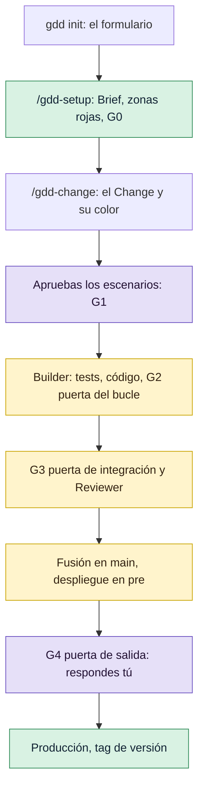

# Tu primer Change

Al final de este tutorial tendrás `shop`, una pequeña tienda online en Python, y un Change, el
total del carrito, llevado de una frase a una versión publicada en producción, con su tag. Sigue
el recorrido del [Inicio rápido](quickstart.md) con todas las pantallas a la vista, para que
puedas comparar cada resultado con el tuyo.

<!-- Every screen, message and output on this page comes from one real run of gdd 0.1.1 (main
at 30b50c4) on 2026-10-31, in a throwaway folder, with Claude Code as the chat agent, Codex as
the Reviewer and the default models. Paths are shown under /home/me. On the way to G4 the
change parked three times on gdd 0.1.1 bugs: the Reviewer wrote its finding's file as a
Markdown link, gdd did not see that it named a step only test mode may write, so the fix round
went to build mode, which may not touch it; the relaunches after the agent fixed the step by
hand then parked on Path Guard. The agent removed the worktree and launched again, and that
launch went straight to G4 in about two and a half minutes. Blocks trim the lines of that
detour with `...`, except where the page says so. The whole run, parks included, took 23
minutes from the form to the release. -->

## Antes de empezar

- gdd, uv, OSV-Scanner y gitleaks instalados: [Instalar gdd](../how-to/install.md) tiene todos
  los pasos, incluida la tabla de Python.
- Claude Code y Codex instalados y con la sesión iniciada. Claude Code construye y Codex revisa,
  porque el Reviewer debe ser de otra familia de modelos que el Builder.
- git conoce tu nombre y tu correo: `gdd init` hace commit de lo que escribe.
- Una terminal de al menos 100 columnas de ancho, para las pantallas que dibuja gdd.

El lanzamiento que llevó este Change directo a G4 costó 0,21 USD en llamadas del Builder, según
las contó Claude Code; la ejecución entera, con los aparcamientos que cuenta el paso 6, costó
0,91 USD. Codex no informa de su coste, así que las llamadas del Reviewer salen como
desconocidas. Con una suscripción, las cubre tu plan.

## El recorrido

Escribes un solo comando de gdd, `gdd init`, para crear el proyecto. Después el trabajo pasa
por tu agente, y tú respondes en el chat. El Board, la sentada y `git log` son ventanas que
abres en una terminal para mirar. Los pasos morados del diagrama son tuyos:



[GDD en una página](../explanation/method.md) explica cada puerta. No la necesitas para seguir
el tutorial.

## 1. Crea el proyecto

Crea una carpeta vacía con un repositorio git y ejecuta `gdd init` en ella:

```bash
mkdir shop
cd shop
git init -b main
gdd init
```

Se abre un formulario. Hace siete preguntas, una por paso, y no escribe nada hasta el final. El
primer paso pide el nombre:

```text
┌ gdd init · Step 1 of 7 · Project name ───────────────────────────────────────────────────────────┐
│What is the project called?                                                                       │
│> █                                                                                               │
│Enter: next · Ctrl-C: quit                                                                        │
└──────────────────────────────────────────────────────────────────────────────────────────────────┘
```

Escribe `shop` y pulsa `Enter`. El paso siguiente pide una descripción corta, que puede quedar
vacía:

```text
┌ gdd init · Step 2 of 7 · Description ────────────────────────────────────────────────────────────┐
│What is it, in a few words? It may stay empty.                                                    │
│> █                                                                                               │
│Enter: next · Esc: back · Ctrl-C: quit                                                            │
└──────────────────────────────────────────────────────────────────────────────────────────────────┘
```

Escribe `A small online shop` y pulsa `Enter`. Después elige la plataforma:

```text
┌ gdd init · Step 3 of 7 · Platform ───────────────────────────────────────────────────────────────┐
│Where does it run?                                                                                │
│> mobile                                                                                          │
│  desktop                                                                                         │
│  web                                                                                             │
│  cli                                                                                             │
│  other                                                                                           │
│Up/Down: move · Enter: pick · Esc: back · Ctrl-C: quit                                            │
└──────────────────────────────────────────────────────────────────────────────────────────────────┘
```

Baja hasta `web` con las flechas y pulsa `Enter`. Después, los stacks:

```text
┌ gdd init · Step 4 of 7 · Stacks ─────────────────────────────────────────────────────────────────┐
│Which technology does it use? Pick one or more, or Not sure.                                      │
│> [ ] rust                                                                                        │
│  [ ] typescript                                                                                  │
│  [ ] python                                                                                      │
│  [ ] Not sure                                                                                    │
│Up/Down: move · Space: check · Enter: next · Esc: back · Ctrl-C: quit                             │
└──────────────────────────────────────────────────────────────────────────────────────────────────┘
```

Baja hasta `python`, pulsa `Space` para marcarlo y después `Enter`. Cada stack trae su *ficha de
stack*, los comandos que ejecuta cada puerta para esa tecnología.

Los agentes de programación que encuentra en la máquina aparecen marcados, y el primero marcado
construye. Pulsa `Space` sobre `opencode` para desmarcarlo, así Claude Code construye y Codex
revisa:

```text
┌ gdd init · Step 5 of 7 · Coding agents ──────────────────────────────────────────────────────────┐
│Which coding agents? The first checked builds; those found on this machine come checked.          │
│  [x] claude                                                                                      │
│  [x] codex                                                                                       │
│> [ ] opencode                                                                                    │
│Up/Down: move · Space: check · Enter: next · Esc: back · Ctrl-C: quit                             │
└──────────────────────────────────────────────────────────────────────────────────────────────────┘
```

Deja `en`, el idioma que usan los agentes contigo, y pulsa `Enter`:

```text
┌ gdd init · Step 6 of 7 · Language ───────────────────────────────────────────────────────────────┐
│Which language do the agents use with you? (en, es...)                                            │
│> en█                                                                                             │
│Enter: next · Esc: back · Ctrl-C: quit                                                            │
└──────────────────────────────────────────────────────────────────────────────────────────────────┘
```

Escribe cada área sensible, lo que sería grave si fallara, y pulsa `Enter`. Cada una entra en la
lista, y una línea vacía sigue adelante. Estas palabras se convierten después en *zonas rojas*,
cuando haya carpetas que proteger:

```text
┌ gdd init · Step 7 of 7 · Sensitive areas ────────────────────────────────────────────────────────┐
│What would be serious if it failed? One area per line.                                            │
│  - Losing a customer's order                                                                     │
│> █                                                                                               │
│Enter: add, or go on when empty · Backspace: edit the last · Esc: back · Ctrl-C: quit             │
└──────────────────────────────────────────────────────────────────────────────────────────────────┘
```

Revisa el resumen. Para corregir una respuesta, pulsa `Esc` hasta volver a ella:

```text
┌ gdd init · Summary ──────────────────────────────────────────────────────────────────────────────┐
│Every answer, before anything is written.                                                         │
│Name: shop                                                                                        │
│Description: A small online shop                                                                  │
│Platform: web                                                                                     │
│Stacks: python                                                                                    │
│Agents: claude, codex                                                                             │
│Language: en                                                                                      │
│Sensitive: Losing a customer's order                                                              │
│Enter to set up · Esc to go back                                                                  │
│Ctrl-C: quit                                                                                      │
└──────────────────────────────────────────────────────────────────────────────────────────────────┘
```

Pulsa `Enter`. Deberías ver todos los ficheros que escribió gdd, después a uv trabajando y, al
final, qué hacer a continuación:

```text
gdd/project.toml
gdd/commands.toml
gdd/rules.toml
gdd/zones.toml
gdd/models.toml
gdd/generated.toml
docs/brief.md
.github/workflows/gdd.yml
AGENTS.md
CLAUDE.md
CHANGELOG.md
...
.agents/skills/gdd-stack-python/SKILL.md
python: uv lock && uv sync --locked
Using CPython 3.13.15
Resolved 40 packages in 8ms
...
Installed 39 packages in 62ms
...
Committed: uv.lock
Next: start your coding agent here and run the gdd-setup command (/gdd-setup in Claude Code and OpenCode, $gdd-setup in Codex).
```

Fíjate en la última línea: te dice adónde ir ahora. gdd hizo dos commits, `gdd init 0.1.1` con
sus ficheros y `gdd bootstrap` con `uv.lock`, el fichero de bloqueo (*lock file*) que fija la
versión de cada dependencia. Si la salida se para con un error después de la línea `python:`,
probablemente falta uv: consulta [Instalar gdd](../how-to/install.md#python).

## 2. Mira lo que escribió init

Cada fichero tiene un solo trabajo:

```text
shop/
├── gdd/                   the rules of the method, read by gdd, the agents and CI
│   ├── project.toml       name, platform, stack and the language the agents speak
│   ├── commands.toml      the commands each gate runs, from the Python stack sheet
│   ├── rules.toml         what each color gets: lanes, limits, protected paths
│   ├── zones.toml         the zone map: which paths are red, green or yellow
│   ├── models.toml        which agent and model plays each role
│   └── generated.toml     what init was asked, for gdd upgrade
├── docs/brief.md          the Project Brief: what the project is and what must not fail
├── .github/workflows/gdd.yml   CI: Path Guard, G2 and G3 on every pull request
├── AGENTS.md, CLAUDE.md   the first instructions every agent reads
├── CHANGELOG.md           the changelog, empty under [Unreleased]; each release adds to it
├── .claude/skills/        the GDD skills for Claude Code (/gdd-setup, /gdd-change...)
├── .agents/skills/        the same skills for Codex ($gdd-setup, $gdd-change...)
├── features/              the Gherkin scenarios: the contract you approve
├── src/shop/              the code, with a placeholder greeting.py
├── tests/unit/            unit tests
├── tests/acceptance/      the scenario steps, run by pytest-bdd
├── pyproject.toml, uv.lock     dependencies and the tools of the gates
└── osv-scanner*.toml      security and license checks of G3
```

Fíjate en `gdd/zones.toml` y `gdd/models.toml`. El primero decide lo estricto que es cada
Change; el segundo, qué agente hace cada rol. gdd guarda su propio estado en `.gdd/`, que git
ignora. [Ficheros que escribe gdd](../reference/files.md) describe cada fichero.

## 3. Prepara el proyecto con tu agente

Arranca Claude Code en la carpeta `shop` y ejecuta la skill de preparación:

```text
/gdd-setup
```

Si Claude Code no conoce `/gdd-setup`, lo arrancaste fuera de la carpeta `shop`, que es donde
están las skills. El agente hace de *Orchestrator*, el rol que habla contigo. Ya leyó lo que
escribió el formulario, así que solo pregunta lo que falta. Aquí el formulario bastó para un
primer Brief: el agente lo escribió, junto con un registro de decisión de arquitectura (ADR,
*architecture decision record*) para la tecnología y un esqueleto pequeño con un primer
escenario de humo (*smoke*). También ejecutó el autotest del *arnés*, los ficheros y comandos
con los que gdd comprueba el proyecto. Unos dos minutos después responde:

<!-- The trimmed part of this message listed one check the agent could not run, and the
agent could not go online: this run drove Claude Code headless, where a command outside the
allowed tools is refused instead of asked. In a normal session Claude Code asks you to allow
them. -->

```text
The harness is ready: the self-test passed 4/4 and the machines opened G0. Everything is
committed on `main` as `gdd: setup (G0)`, and the session is recorded.

What I did:
- **Brief** (`docs/brief.md`): I wrote it from your one-line description. Some of it is my own
  guesses, so please check the questions below.
- **Technology** (`docs/adr/0001-technology.md`): Python, with pytest-bdd running the
  scenarios. ... The web framework is left for Discover to decide.
- **Starting test setup**: one simple smoke scenario that passes, plus empty
  `features/regression/` and `features/hidden/` folders.
- **Gate commands**: all of them pass when run by hand. There's no real pre-production or
  production yet, so release steps are simulated. A deploy just records that it passed and
  doesn't actually run.
...
**What I need from you (one reply is enough):**
1. **Approve the protected zones.** These are gdd's own files, the CI and the agent
   instructions, plus the dependency and toolchain files. Any change there gets the strictest
   checks. Reply "zones OK" and I'll record your approval. No change can start until you do.
2. **Check my guesses in the Brief:**
   - The users are customers buying on the web and a shop owner who handles the orders. Is
     that right?
   - My recommendation is to leave payments out of the first version and have orders paid
     outside the shop. The alternative is to include payments from day one, which brings in
     money as a sensitive area.

Next step: after your OK on the zones, run `/gdd-discover` to pick the web framework and map
the sensitive areas (orders, customer data).
```

Fíjate en *the machines opened G0*: la puerta de preparación (G0, *Setup Gate*) se abre cuando
existe el Brief y el autotest pasa las cuatro comprobaciones. *Release steps are simulated*
significa que aún no hay servidor de pre ni de producción. Si en cambio el agente dice que un
comando de puerta no puede ejecutarse, falta una herramienta del stack: consulta [Instalar
gdd](../how-to/install.md#python). Puede que tu agente haga antes sus preguntas y escriba el
Brief después de tus respuestas.

Fíjate en las zonas protegidas. Una *zona roja* es un conjunto de rutas que siempre recibe las
comprobaciones más estrictas. Una persona aprueba el mapa una vez, porque fija lo estricto que
será cada Change posterior ([Mapear y aprobar zonas rojas](../how-to/red-zones.md)), y ningún
Change puede empezar antes. El carrito no está entre las zonas, así que apruébalas y responde a
lo que supuso el agente en la misma respuesta:

```text
zones OK. Your guesses are right: customers buy on the web and I run the orders. It sells
handmade ceramics: mugs, bowls and plates. Payments stay out of the first version.
```

El agente registra tu aprobación, actualiza el Brief y hace commit en `main`. Deberías ver:

```text
Setup is finished. G0 is open, your approval of the protected zones is recorded, and the
self-test passed 4/4.

I updated the Brief with your answers and committed it on `main`:
- The shop sells handmade ceramics (mugs, bowls and plates).
- Customers buy on the web and you run the orders.
- Payments are not in the first version; orders are paid outside the shop.
...
**Next step:** run `/gdd-discover`. It picks the web framework, maps where orders and customer
data live, and plans the first changes. After that, use `/gdd-change` for the first feature,
for example "customers can browse the catalogue".
```

El agente recomienda `/gdd-discover`, que explora ideas más grandes. Tu primer Change es
pequeño, así que sáltatelo.

Para ver el proyecto desde una terminal, abre el *Board*, la pantalla con todos los Changes por
fase:

```bash
gdd board
```

Por ahora está vacío:

```text
┌ gdd · Board · shop ──────────────────────────────────────────────────────────────────────────────┐
│No changes yet · ask your agent: /gdd-change <what you want> ($gdd-change in Codex)               │
│↑↓ move · Enter details · d done · t time · r reload · q quit                                     │
└──────────────────────────────────────────────────────────────────────────────────────────────────┘
```

Déjalo abierto en su terminal. El Board se recarga solo cada dos segundos, y `r` lo recarga al
momento.

## 4. Describe el Change

Un *Change* es una pieza pequeña de trabajo que pasa las puertas como una unidad, en su propia
rama. Díselo al agente:

```text
/gdd-change show the cart total, taxes included
```

El Orchestrator elige un id, `cart-total`, un tipo, `Feature`, y las rutas que tocará el Change.
gdd calcula el color a partir de esas rutas y del mapa de zonas, y el agente responde con el
color primero:

```text
I've set up the change **cart-total** and written its scenarios. It's classified **yellow**:
ordinary code outside your protected zones. So there's no plan for you to approve now; you
approve the scenarios now and the finished result at the end.
...
```

Por debajo, el agente ejecutó [`gdd new-change`](../reference/cli/new-change.md), que creó la
rama `change/cart-total` e imprimió esta clasificación:

```text
{
  "change": "cart-total",
  "color": "yellow",
  "lane": "full",
  "reasons": [
    "features/cart_total.feature -> yellow (no zone: default color)",
    "src/shop/cart.py -> yellow (no zone: default color)",
    "tests/acceptance/steps/** -> yellow (no zone: default color)",
    "tests/unit/test_cart.py -> yellow (no zone: default color)"
  ],
  "g1": true,
  ...
  "tests_first": true,
  "mutation": false,
  "reviewer": true,
  "review": "quick",
  "g4": true,
  "human_plan": false,
  "type": "Feature",
  "builder": {
    "integration": "claude",
    "model": "sonnet"
  },
  ...
  "reviewer_model": {
    "effort": "high",
    "integration": "codex",
    "model": "gpt-6-astra"
  },
  ...
}
```

Léela como el plan de este Change:

- `color` es amarillo: ninguna de sus rutas está en una zona, y el código sin zona es amarillo.
- `lane` es la vía completa (*full*) porque el Change añade escenarios, lo que descarta la
  [vía rápida](../explanation/method.md#vías).
- `tests_first` es verdadero: el Builder escribe los tests antes que el código.
- `g1` es verdadero: apruebas los escenarios antes de que exista código.
- `reviewer` es verdadero: Codex, de otra familia de modelos, lee el Change.
- `g4` es verdadero: un Change con G1 te espera en la puerta de salida.
- `builder` es Claude Code con Sonnet, el modelo que `gdd/models.toml` da a un Change amarillo.

[Cómo elige el riesgo las puertas](../explanation/risk.md) explica los colores.

El Board que dejaste abierto muestra el Change en Discover, sin volver a abrirlo:

```text
┌ gdd · Board · shop ──────────────────────────────────────────────────────────────────────────────┐
│Discover (1)                                                                                      │
│› cart-total · yellow · Show the cart total, taxes included · open · no gates yet                 │
│Build (0)                                                                                         │
│Release (0)                                                                                       │
│Done (0) · d to show                                                                              │
│↑↓ move · Enter details · d done · t time · r reload · q quit                                     │
└──────────────────────────────────────────────────────────────────────────────────────────────────┘
```

## 5. Lee y aprueba los escenarios

Un *escenario* es un ejemplo de lo que debe pasar, escrito en Gherkin: frases llanas con Given,
When y Then que ejecuta una herramienta de tests. El Orchestrator te cuenta sus dos escenarios
en el mismo mensaje, con las reglas que necesita que confirmes:

```text
**The scenarios to approve (G1)**

*A cart with several pieces shows its total, taxes included*
- The catalogue has a Blue mug at 18.00 and a Large bowl at 24.50.
- The customer puts 2 Blue mugs and 1 Large bowl in the cart.
- The cart shows a subtotal of **60.50**, tax of **12.71** and a total of **73.21**.

*An empty cart costs nothing*
- Subtotal **0.00**, tax **0.00**, total **0.00**.

I also wrote two hidden examples that the Builder doesn't see, to catch a wrong rounding rule or
a piece added twice.

**Two rules I built into these numbers. Please confirm or correct them:**
1. **Tax rate: 21% on everything.** That's the Spanish standard VAT rate, but it's only my
   example; tell me your real rate if it's different.
2. **Catalogue prices are before tax.** The shop adds the tax once, on the whole cart, and
   rounds to the cent (half a cent rounds up). The alternative is that the prices you list
   already include tax and the cart shows the tax inside them; in that case I'll redo the
   examples.

**Next step:** reply "scenarios OK", or give me your rate and price rule, and I'll seal the
scenarios and launch the build.
```

Antes de enseñarte nada, el agente hizo commit de los ficheros de escenarios en la rama
`change/cart-total`, así que puedes leerlos tal como se sellarán. Para verlos en la *sentada*,
la pantalla con todo lo que un Change necesita de ti, ejecuta en una terminal:

```bash
gdd sitting cart-total
```

Deberías ver `features/cart_total.feature` (sin las líneas en blanco):

```text
┌ gdd · Sitting · shop ────────────────────────────────────────────────────────────────────────────┐
│cart-total · Show the cart total, taxes included · yellow                                         │
│Scenarios                                                                                         │
│features/cart_total.feature                                                                       │
│Feature: Cart total with taxes                                                                    │
│  A customer sees what the cart costs before tax, the tax, and the total to pay.                  │
│  Catalogue prices are before tax; the tax rate is 21% on the whole cart,                         │
│  rounded to the nearest cent (half a cent rounds up).                                            │
│  Scenario: A cart with several pieces shows its total, taxes included                            │
│    Given the catalogue has these pieces:                                                         │
│      | piece           | price |                                                                 │
│      | Blue mug        | 18.00 |                                                                 │
│      | Large bowl      | 24.50 |                                                                 │
│    And the customer puts 2 "Blue mug" in the cart                                                │
│    And the customer puts 1 "Large bowl" in the cart                                              │
│    When the customer looks at the cart total                                                     │
│    Then the subtotal is 60.50                                                                    │
│    And the tax is 12.71                                                                          │
│    And the total is 73.21                                                                        │
│  Scenario: An empty cart costs nothing                                                           │
│    Given the catalogue has these pieces:                                                         │
│      | piece           | price |                                                                 │
│      | Blue mug        | 18.00 |                                                                 │
│    When the customer looks at the cart total                                                     │
│    Then the subtotal is 0.00                                                                     │
│    And the tax is 0.00                                                                           │
│    And the total is 0.00                                                                         │
...
│↑↓ scroll · a approve · c ask for changes · q quit                                                │
└──────────────────────────────────────────────────────────────────────────────────────────────────┘
```

Revisa los números: son el contrato que debe cumplir el código. El 21% de 60,50 es 12,705, así
que el primer escenario fija también cómo se redondea el céntimo. Baja con las flechas hasta los
*ejemplos ocultos* de `features/hidden/cart_total_hidden.feature`, las mismas frases con otros
datos:

```text
┌ gdd · Sitting · shop ────────────────────────────────────────────────────────────────────────────┐
│features/hidden/cart_total_hidden.feature · hidden: the Builders never see it                     │
│Feature: Cart total with taxes (hidden examples)                                                  │
│  Scenario: Tax on the whole cart rounds down when under half a cent                              │
│    Given the catalogue has these pieces:                                                         │
│      | piece           | price |                                                                 │
│      | Dinner plate    | 15.99 |                                                                 │
│    And the customer puts 3 "Dinner plate" in the cart                                            │
│    When the customer looks at the cart total                                                     │
│    Then the subtotal is 47.97                                                                    │
│    And the tax is 10.07                                                                          │
│    And the total is 58.04                                                                        │
...
│Red zones: approved                                                                               │
│Plan: not needed for a yellow change                                                              │
│↑↓ scroll · a approve · c ask for changes · q quit                                                │
└──────────────────────────────────────────────────────────────────────────────────────────────────┘
```

El Builder nunca ve los ejemplos ocultos, así que un código que solo encaja con los números
visibles falla ([Aprobar los escenarios](../how-to/write-scenarios.md)). `Red zones: approved` y
`Plan: not needed` significan que nada más te espera en esta sentada.

Podrías aprobar aquí con `a`. Pulsa `q` en su lugar y responde en el chat, con tus respuestas a
sus reglas:

```text
scenarios OK. 21% is my rate and my prices are before tax.
```

El agente registra la puerta de escenarios (G1, *Scenario Gate*) con tus palabras y lanza el
Change. En menos de un minuto responde:

```text
Your answers are recorded and the build is running in the background:

- **Scenarios approved (G1):** sealed with your rule: 21% tax on the whole cart, catalogue
  prices before tax, and half a cent rounds up.
- **What the Builder gets:** one short brief. Amounts are kept exact to the cent, with no
  floating-point rounding errors, and the 21% rate sits in one named place so it's easy to
  change later.
- **Decision I made myself:** this change isn't a protected zone. It shows prices and taxes but
  doesn't take any money. I'll raise it again when payments come in.

The steps: first a Builder writes tests that fail, then code that makes them pass, and the
automatic checks run. Then a reviewer from another AI vendor (gpt-6-astra) checks the work, the
full checks run including the hidden examples, and the release (simulated for now) follows.
Then it stops for your final OK (G4).

**Next step:** wait. I'll be notified when it finishes or stops, and I'll come back with the
result for your OK.
```

Fíjate en *sealed*. Aprobar G1 *sella* los ficheros de escenarios, así que ningún agente puede
cambiarlos sin una aprobación nueva ([Mantener honestos a los agentes](../explanation/safety.md)).

## 6. Sigue la construcción en el Board

A partir de aquí la *receta*, la secuencia fija de pasos que gdd ejecuta para un Change, sigue
sola. En orden, gdd:

1. crea un worktree de git para el Change, una segunda copia de trabajo en su propia carpeta,
   `../shop.worktrees/cart-total`, en la rama `change/cart-total`, y deja tu copia de trabajo en
   `main`;
2. arranca el **Builder en modo test** (Claude Code, Sonnet), que escribe los pasos de los
   escenarios y los tests unitarios, en rojo porque el código aún no existe;
3. arranca el **Builder en modo build**, en una sesión aparte que no puede editar los
   escenarios, que escribe `src/shop/cart.py` hasta que pasa la puerta del bucle (G2, *Loop
   Gate*): lint, tipos, tests unitarios, los escenarios y Path Guard, la comprobación de qué
   ficheros puede editar cada rol;
4. ejecuta la puerta de integración (G3, *Merge Gate*): todos los escenarios, ejemplos ocultos
   incluidos, más las comprobaciones de seguridad, licencias, fichero de bloqueo y secretos;
5. arranca el **Reviewer** (Codex), que lee el Change entero y dice OK o KO;
6. fusiona el Change en `main`, lo construye y lo despliega en pre, el entorno previo a
   producción (ambas cosas simuladas aquí), y se detiene en la puerta de salida (G4, *Release
   Gate*).

El Board que dejaste abierto pasa el Change a Build:

```text
┌ gdd · Board · shop ──────────────────────────────────────────────────────────────────────────────┐
│Discover (0)                                                                                      │
│Build (1)                                                                                         │
│› cart-total · yellow · Show the cart total, taxes included · building · G1:ok                    │
│Release (0)                                                                                       │
│Done (0) · d to show                                                                              │
│↑↓ move · Enter details · d done · t time · r reload · q quit                                     │
└──────────────────────────────────────────────────────────────────────────────────────────────────┘
```

Cuando el Change se detiene en G4, el mismo Board lo muestra en Release:

```text
┌ gdd · Board · shop ──────────────────────────────────────────────────────────────────────────────┐
│Discover (0)                                                                                      │
│Build (0)                                                                                         │
│Release (1)                                                                                       │
│› cart-total · yellow · Show the cart total, taxes included · waiting for your G4 · G1:ok, G3:ok  │
│Done (0) · d to show                                                                              │
│↑↓ move · Enter details · d done · t time · r reload · q quit                                     │
└──────────────────────────────────────────────────────────────────────────────────────────────────┘
```

Si una puerta falla, el Builder recibe otra ronda. Al llegar a su límite, el Change se *aparca*:
el Board lo muestra como `parked` en Build, y el agente te dice por qué y te propone el
siguiente paso ([Volver a poner en marcha un Change aparcado](../how-to/parked-change.md)).

> [!NOTE]
> En la ejecución de esta página, el Change se aparcó tres veces antes de G4, por fallos de
> gdd 0.1.1: el Reviewer pidió un arreglo en un fichero de pasos que solo puede escribir el modo
> test, y gdd mandó la ronda de arreglo al modo build. El agente quitó entonces el worktree del
> Change y lo volvió a lanzar, y ese lanzamiento llegó directo a G4 en unos dos minutos y medio.
> Los detalles de abajo conservan los aparcamientos, para que veas cómo se muestran.

Pulsa `Enter` para ver los detalles del Change, con dónde se ha ido su tiempo:

```text
┌ gdd · Board · shop ──────────────────────────────────────────────────────────────────────────────┐
│cart-total · Show the cart total, taxes included                                                  │
│Type: Feature                                                                                     │
│Color: yellow                                                                                     │
│State: in-pre                                                                                     │
│Gates: G1:ok, G3:ok                                                                               │
│Paths: src/shop/cart.py, tests/unit/test_cart.py, features/cart_total.feature,                    │
│tests/acceptance/steps/**                                                                         │
│Inbox: .gdd/changes/cart-total/inbox.md                                                           │
│Flow time 18m · active 4m (24%) · waiting 14m · between steps 0s                                  │
│Agents: builder-test · sonnet 2m, reviewer · gpt-6-astra 1m, builder-build · sonnet 1m            │
│Gates: acceptance 2s, security 2s, unit 2s, types 1s, acceptance_full 1s, secrets 1s, architecture│
│1s, lint 1s, dependencies 0s, lockfile 0s, path-guard 0s                                          │
│Waiting: parked 6m (Path Guard failed after test mode: src/shop/cart.py: protected path for       │
│builder-test), parked 4m (G3 still red after one fix), parked 2m (Reviewer KO or G3 red after one │
│fix), at the sitting 1m, to start 15s                                                             │
│Esc to go back · r reload · q quit                                                                │
└──────────────────────────────────────────────────────────────────────────────────────────────────┘
```

Fíjate en la línea *Flow time*: 18 minutos, 4 de ellos activos. La línea *Waiting* dice adónde
fue el resto: cada aparcamiento con su motivo, y *at the sitting*, el tiempo que el Change
esperó tus respuestas. Un Change que va directo solo espera en la sentada y para empezar.

## 7. Responde a la puerta de salida

El agente vuelve al chat. El Change está fusionado y en pre, y espera tu respuesta en la puerta
de salida (G4):

```text
...
**What you'd approve:** the cart now gives three amounts: the subtotal before tax, the 21% tax
on the whole cart rounded to the cent (half a cent rounds up), and the total. Adding the same
piece again adds to its quantity. The code is merged on `main` and deployed to pre. Pre is
simulated here, so there's no video or screenshots.

**The evidence:**
- **Reviewer:** OK, with no new findings. Its earlier point is fixed: subtotal, tax and total
  are now separate steps.
- **Full checks (G3):** all green, including security, dependencies and a scan for leaked
  secrets.
- **Demo:** I ran all 5 scenarios on `main` and they all pass:
  - a cart with several pieces: 60.50 + 12.71 = 73.21
  - an empty cart: 0.00
  - the two hidden examples (rounding down, and the same piece added twice)
  - the smoke test
...
**Next step:** reply "OK", "polish", or "KO" (reject; production stays untouched).
```

Mira primero las pruebas. Los cinco escenarios son los dos que aprobaste, los dos ejemplos
ocultos y el escenario de humo de Setup. El agente señaló además un hueco que dejaría para un
Change posterior: el carrito acepta una cantidad de 0 o menos.

El agente leyó todo esto de la *Decision Inbox* del Change, el único mensaje que gdd guarda para
cada Change, en `.gdd/changes/cart-total/inbox.md`:

```text
# Decision Inbox · cart-total · Show the cart total, taxes included

Color yellow · lane full · state in-pre

## How it works
`src/shop/cart.py` holds catalogue lookup, accumulated quantities and totals.
It uses Decimal amounts and applies 21% tax once to the subtotal, rounding half up.
Acceptance steps follow the existing fixture pattern and call the package directly.
Adding the same piece again increases its quantity.

## Needs your decision
- Test mode: API assumed in shop.cart: TAX_RATE=Decimal('0.21'); Cart(catalogue: dict[str, Decimal]); Cart.add(piece, quantity) raises KeyError for a piece not in the catalogue; Cart.totals() -> Totals(subtotal, tax, total) as 2-decimal Decimal. Lint I001 on the new tests fails only while src/shop/cart.py is missing (Ruff then sees shop as third-party); the blank line before the shop import follows the package and is right once the module exists.
- G4 · Release Gate: check the pre demo and the change message, then answer your agent (or the sitting screen): OK promotes to production, KO rejects it (production untouched), polish with your notes runs one more Builder round. Your agent runs gdd resume cart-total --g4 ok, --g4 ko or --g4 polish --note <your notes>.

## Decided without you
- Money as Decimal, ROUND_HALF_UP to the cent on the cart subtotal's tax; tax rate a single constant (21%), confirmed by the owner
- No new red zone: prices and taxes are shown, no payment is taken; revisit when payments come in
...

## Parked
- Nothing.
...
```

- **How it works** es la explicación breve del código que da el Reviewer.
- **Needs your decision** reúne las notas de los agentes y la petición de G4. El Builder en
  modo test describió el código que esperan sus tests; la línea de G4 dice qué hace cada
  respuesta. Tú respondes al agente con palabras, y él ejecuta el comando en el que se convierte
  tu respuesta.
- **Decided without you** lista lo que el Orchestrator decidió por su cuenta, todo reversible.
- **Parked** lista lo que un agente dejó para más tarde: aquí, nada.

La página de G4 de la sentada muestra la misma decisión, con las palabras del Reviewer y la
línea de changelog (sin las líneas en blanco):

```text
┌ gdd · Sitting · shop ────────────────────────────────────────────────────────────────────────────┐
│cart-total · Show the cart total, taxes included · waiting for your G4                            │
│How it works                                                                                      │
│`src/shop/cart.py` holds catalogue lookup, accumulated quantities and totals.                     │
│It uses Decimal amounts and applies 21% tax once to the subtotal, rounding half up.               │
│Acceptance steps follow the existing fixture pattern and call the package directly.               │
│Adding the same piece again increases its quantity.                                               │
│Reviewer: OK                                                                                      │
...
│- No new blocking findings.                                                                       │
│Recorded G2 and G3 pass; mutation testing was skipped. No files modified or tests rerun during    │
│this read-only review.                                                                            │
│Demo: none, the project has no demo command                                                       │
│Decided without you                                                                               │
│- Money as Decimal, ROUND_HALF_UP to the cent on the cart subtotal's tax; tax rate a single       │
│constant (21%), confirmed by the owner                                                            │
│- No new red zone: prices and taxes are shown, no payment is taken; revisit when payments come in │
...
│Changelog: none set                                                                               │
...
│↑↓ scroll · o OK · k KO · p polish · q quit                                                       │
└──────────────────────────────────────────────────────────────────────────────────────────────────┘
```

`Demo: none` significa que el proyecto aún no tiene pre. `Changelog: none set` significa que
nadie fijó una línea de changelog, así que gdd usa la línea por defecto del tipo: una Feature
lleva su título bajo `Added`. Esa línea es la que da su versión al Change en el paso 8.

Los totales son los que aprobaste, y el Reviewer no tiene ningún hallazgo que bloquee. Pulsa `q`
y di OK en el chat:

```text
OK
```

El agente promueve el Change y lo cierra:

```text
The cart total is in production as **v0.1.0**, and the change is closed. Production is still
simulated, so nothing is deployed to a real server yet.

What shipped: the cart shows the subtotal, the 21% tax on the whole cart (rounded to the cent,
with half a cent rounding up), and the total. It's tagged and recorded on `main`.

**Cost:** about $0.91 for the Builders. The reviewer's and my own calls aren't priced, because
gdd has no price for those two models, so the real total is higher.
...
**Next step:** I recommend `/gdd-change a quantity must be at least 1`. It's small and closes
the gap before customers can choose quantities. The alternative is `/gdd-discover` first.
```

Fíjate en **v0.1.0**. OK promovió a producción la build que se ejecutó en pre (simulada aquí) y
cerró el Change. Su worktree ya no está; su rama se queda.

## 8. Mira el resultado

Para ver el Change en `main`, ejecuta:

```bash
git log --oneline -7
```

Deberías ver:

```text
c99adb1 (HEAD -> main, tag: v0.1.0) Release v0.1.0
eece577 gdd(cart-total): G3 Merge Gate · Show the cart total, taxes included
c803a66 (change/cart-total) gdd(cart-total): change work
c4ac2ed cart-total: scenarios for G1
f24d02c gdd: setup (G0) · brief confirmed by the owner
3255fe9 gdd: setup (G0)
ceced6c gdd bootstrap
```

`c4ac2ed` y `c803a66`, los escenarios y el trabajo, vienen de la rama `change/cart-total`.
`eece577` es el commit de fusión que los unió a `main`. Su mensaje guarda el registro del
Change:

```text
gdd(cart-total): G3 Merge Gate · Show the cart total, taxes included

Color: yellow · lane full · type Feature
Approvals: G1 ok (human, 2026-10-31, 2 scenario file(s) sealed)
Reviewer: KO -> KO -> OK
...
Decided without the human:
  - Money as Decimal, ROUND_HALF_UP to the cent on the cart subtotal's tax; tax rate a single constant (21%), confirmed by the owner
  - No new red zone: prices and taxes are shown, no payment is taken; revisit when payments come in
...
Tokens: in 245,725 · cache 1,708,519 · out 22,043 · 0.91 USD (estimate) + unknown (3 call(s) with no price) · 10 agent call(s)
Record: .gdd/changes/cart-total/ (local)

Changelog: Added · Show the cart total, taxes included
Breaking: no
```

`Reviewer: KO -> KO -> OK` son todos los veredictos del Reviewer sobre este Change: los dos KO
son el rodeo de la nota del paso 6. La línea `Tokens` cuenta las llamadas a agentes, 10 aquí
porque el Change se construyó dos veces. `unknown (3 call(s) with no price)` son las llamadas
del Reviewer: Codex no informa de su coste, y `gdd/models.toml` no tiene precio para su modelo
([Medir el trabajo](../how-to/measure.md)).

Las dos últimas líneas son la línea de changelog por defecto del paso 7. Con la promoción, gdd la
escribió en `CHANGELOG.md` e hizo commit como `Release v0.1.0`, con el tag `v0.1.0`: gdd da una
versión a un Change promovido con línea de changelog, y la primera versión de un proyecto es
0.1.0 ([Publicar versiones y mantener un changelog](../how-to/releases-and-changelog.md)).
`CHANGELOG.md` queda así:

```text
# Changelog

All notable changes to this project are documented in this file. The format is based on [Keep a Changelog](https://keepachangelog.com/en/1.1.0/), and this project adheres to [Semantic Versioning](https://semver.org/spec/v2.0.0.html).

## [Unreleased]

## [0.1.0] - 2026-10-31

### Added

- Show the cart total, taxes included <!-- gdd: eece57748e08 -->
```

Para el coste de cada llamada, el agente ejecuta [`gdd report`](../reference/cli/report.md) para
el Change:

```text
role -> calls · tokens in · cache · out · cost USD · seconds
builder-build -> 4 · 69,961 · 619,797 · 6,456 · 0.4063 · 74
builder-test -> 3 · 76,160 · 755,282 · 12,381 · 0.5039 · 103
orchestrator -> 1 · 66,390 · 4,350,540 · 25,029 · unknown · 0
reviewer -> 3 · 99,604 · 333,440 · 3,206 · unknown · 75
TOTAL -> in 312,115 · cache 6,059,059 · out 47,072 · 0.9102 USD + unknown (4 call(s) with no price)
unknown: no price in gdd/models.toml for claude-opus-5-5, gpt-6-astra
Human stops logged: 2
```

Un Change que va directo muestra una llamada por cada rol del Builder y una del Reviewer. La
línea `orchestrator` es tu sesión de chat, que el agente registra al final. Su coste y el del
Reviewer salen como `unknown`, nunca 0, y la línea de leyenda nombra los modelos sin precio. Dos
paradas humanas: los escenarios y G4.

El Board, todavía abierto, muestra el Change en Done. Pulsa `d` para desplegarlo:

```text
┌ gdd · Board · shop ──────────────────────────────────────────────────────────────────────────────┐
│Discover (0)                                                                                      │
│Build (0)                                                                                         │
│Release (0)                                                                                       │
│Done (1) · d to hide                                                                              │
│› cart-total · yellow · Show the cart total, taxes included · closed · G1:ok, G3:ok, G4:ok        │
│↑↓ move · Enter details · d done · t time · r reload · q quit                                     │
└──────────────────────────────────────────────────────────────────────────────────────────────────┘
```

Has creado un proyecto, has aprobado sus zonas rojas y sus primeros escenarios, y has llevado un
Change por la construcción, la revisión y la puerta de salida hasta la versión `v0.1.0`.
Escribiste un solo comando de gdd; tu agente hizo el resto contigo.

## Siguientes pasos

- [Describir un Change a tu agente](../how-to/run-a-change.md): el bucle de cada día, los mismos
  pasos sin las explicaciones.
- [Revisar un Change en G4](../how-to/release-gate.md): qué comprobar antes del OK, y qué hacen
  KO y polish.
- [Aprobar los escenarios](../how-to/write-scenarios.md): escenarios que sirven de buen
  contrato, y ejemplos ocultos.
- [Mapear y aprobar zonas rojas](../how-to/red-zones.md): convierte las áreas sensibles del
  Brief en rutas rojas, como los pedidos de esta tienda.

