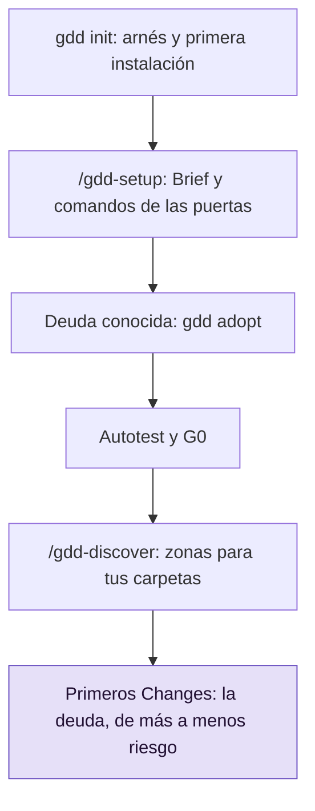

# Llevar gdd a un proyecto existente

Usa esta guía cuando un repositorio ya tiene código y quieres trabajar en él con GDD. Ejecutas
`gdd init` una vez en el terminal y la skill de setup de tu agente hace el resto; las
comprobaciones que hoy fallan pasan a ser deuda conocida, que avisa en vez de bloquear.

## Antes de empezar

- gdd, tus agentes de programación y las herramientas de tu stack están instalados: consulta
  [Instalar gdd](install.md).
- El repositorio es un repositorio git con todo guardado en commits, en su rama main.
- Si las palabras puerta, zona y Change son nuevas para ti, lee antes
  [GDD en una página](../explanation/method.md).

Los ejemplos usan `shop`, una pequeña tienda web en Python que ya tenía código: un catálogo, un
carrito, un test de pytest, Ruff y un import sin usar del que avisa Ruff. El recorrido completo
es este:



La skill de setup hace B, C y D en una sola conversación contigo.

## 1. Ejecuta gdd init

Desde la raíz del repositorio:

```bash
gdd init
```

El formulario de Setup hace siete preguntas: el nombre, una descripción, la plataforma, los
stacks, los agentes de programación, el idioma en que te hablan y qué sería grave si fallara.
En el stack, elige aquel en que está escrito el proyecto. Un resumen muestra todas las
respuestas antes de escribir nada, y `Enter` prepara el proyecto.
[Instalar gdd](install.md#4-prepara-un-proyecto) muestra el formulario.

gdd escribe el [arnés](../glossary.md#arnés), los ficheros que usa para comprobar el proyecto,
junto a tu código. Nunca sobrescribe un fichero, se niega a ejecutarse en una carpeta que ya es
un proyecto GDD y solo hace commit de lo que ha escrito (`gdd init 0.1.0`). Después ejecuta la
primera instalación del stack, que escribe el fichero de bloqueo (*lock file*), y hace commit de
él (`gdd bootstrap`). Deberías ver los ficheros que ha escrito, la instalación y, después, el
siguiente paso:

```text
gdd/project.toml
gdd/commands.toml
gdd/rules.toml
gdd/zones.toml
gdd/models.toml
gdd/generated.toml
docs/brief.md
.github/workflows/gdd.yml
AGENTS.md
CLAUDE.md
.gitignore
.claude/skills/gdd-build/SKILL.md
...
.agents/skills/gdd-stack-python/SKILL.md
python: uv lock && uv sync --locked
Using CPython 3.13.15
Resolved 8 packages in 3ms
Using CPython 3.13.15
Creating virtual environment at: .venv
Resolved 8 packages in 0.91ms
Installed 7 packages in 10ms
Committed: uv.lock
Next: start your coding agent here and run the gdd-setup command (/gdd-setup in Claude Code and OpenCode, $gdd-setup in Codex).
```

En la lista no hay ningún fichero de `src/` ni de `tests/`. El proyecto ya tenía un
`pyproject.toml`, así que gdd no escribió ningún esqueleto, y los ficheros que ya tenías siguen
siendo tuyos.

- `AGENTS.md`: si el proyecto ya tiene uno, gdd no lo toca y te indica la línea que debes
  añadir, la que envía a los agentes a GDD.
- Fichero de bloqueo: si el proyecto ya tenía uno en un commit, obtienes
  `Nothing new to commit.` en lugar de `Committed: uv.lock`.

## 2. Ejecuta /gdd-setup

Arranca tu agente en la carpeta del proyecto y ejecuta la skill de setup:

```text
/gdd-setup
```

En Codex, ejecuta `$gdd-setup`. El agente hace de Orchestrator, el rol que habla contigo. Lee
tus respuestas al formulario en `gdd/project.toml` y `docs/brief.md`, después el código, y solo
pregunta lo que esos ficheros no cuentan. En `shop` quedaba una pregunta: para quién es la
tienda. Su mensaje, recortado:

<!-- Real output: one headless Claude Code session (claude -p '/gdd-setup', then --resume with
     the answer), gdd 0.1.0, on the example project. Trimmed with "..."; not edited. -->

```text
I've done all the technical setup. I need one answer from you before I can finish the Project Brief and open G0.

**What's ready**
- **Test runner:** pytest-bdd runs the scenarios (plain-language descriptions of what the shop should do). It's actively maintained; its last release was a month ago. I checked by hand that it fails when a step has no code behind it, that it can run only some scenarios, and that it runs the hidden ones only when asked.
...
- **Gates:** I ran every check command by hand. While doing that I fixed two problems:
  - The newest pytest (9.2) breaks pytest-bdd, so I held pytest below 9.2.
  - Mutation testing (a check that your tests catch deliberately planted bugs) crashed on files that give it nothing to test. It now skips them.
- **Existing debt:** the current code has one unused line, which fails the style check. I recorded it as known debt rather than fixing it now. It will get its own small Refactor later.
- **Harness self-test:** 4/4.
- **No real hosting yet:** there's no test or live server, so for now release steps are marked as simulated.

**One question**
- **Who is the shop for?** I'm guessing a small independent seller with customers buying online. Is that right, or is it something else, such as an internal tool or a demo?

...
**Next step:** answer the question. I'll then finish the Brief, open G0 and commit the setup on `main`.
```

Dos líneas importan más: `Existing debt`, la deuda registrada en vez de arreglada (paso 3), y la
única pregunta del final (paso 4).

Antes de preguntar, el Orchestrator ajusta los comandos de las puertas a tu estructura, para que
ningún comando falle solo porque un fichero no está donde lo espera la
[ficha de stack](../reference/stacks.md). Cambia `gdd/commands.toml` o el proyecto, y prueba
cada comando a mano. En `shop`:

- añadió las herramientas que faltaban como dependencias de desarrollo, con pytest por debajo
  de 9.2, porque pytest 9.2 rompe pytest-bdd 9.0.0 (issue 850 de pytest-bdd);
- movió `tests/test_cart.py` a `tests/unit/` y escribió `tests/acceptance/` y un primer
  escenario de humo (*smoke*), `features/smoke.feature`;
- añadió a `pyproject.toml` la configuración que leen las herramientas (`[tool.mypy]`,
  `[tool.mutmut]`, un contrato de import-linter);
- cambió el comando `mutation` de `gdd/commands.toml` para que un fichero sin nada que mutar no
  lo haga fallar.

Antes de responder, lee lo que ha cambiado el Orchestrator. Estos ficheros son arnés, así que
cambian en main, nunca dentro de un Change.

> [!NOTE]
> Un comando que no llega a arrancar no es deuda, es un error de preparación, y sale más barato
> arreglarlo ahora. El Orchestrator los arregla antes de registrar la deuda.

## 3. Deuda conocida: lo que hoy falla

La [deuda conocida](../glossary.md#deuda-conocida) es la lista de comprobaciones que el código
antiguo ya no pasa y que te comprometes a pagar con Refactors; hasta entonces, avisan en vez de
bloquear. Cuando los comandos encajan, el Orchestrator ejecuta
[`gdd adopt`](../reference/cli/adopt.md) para registrarla en
[`gdd/debt.toml`](../reference/configuration.md#debttoml), en un commit aparte
(`gdd adopt: known debt in lint`). En `shop`, gdd imprimió:

```text
Passed: architecture, types, unit, dependencies, lockfile, security
Known debt: lint (1)
Proposed Refactors, riskiest first:
  1. debt-lint · Pay the known debt of lint · .gdd/adoption/lint.txt
Ask your agent for each one: /gdd-change pay the debt of <name> ($gdd-change in Codex).
```

Fíjate en la segunda línea: `lint` es deuda, con un problema. Debajo, gdd propone un Refactor
por cada deuda, de más a menos riesgo. Un Refactor es un Change que mejora el código sin cambiar
lo que hace. El Orchestrator te cuenta en dos líneas qué ha pasado a ser deuda y propone un
Refactor para cada una, como en su mensaje de arriba. La última línea es para el Orchestrator,
no para ti.

- Los escenarios, el mutation testing y los secretos nunca se convierten en deuda: los comandos
  cuyo nombre empieza por `acceptance`, `mutation` o `secrets` bloquean desde el principio.
- El recuento que sigue a `lint` es un techo que solo puede bajar;
  [Ajustar las puertas](gates-and-commands.md#6-cuenta-la-deuda-conocida-con-el-trinquete)
  explica cómo lo cuenta gdd.
- Lo que imprimió cada comando que falló está en `.gdd/adoption/<name>.txt`, para el Refactor
  que lo pague.

Un proyecto se adopta una sola vez. Un segundo `gdd adopt` se detiene y no escribe nada:

```text
error: this project was already adopted on 2026-10-31 (gdd/debt.toml)
```

Si todos los comandos pasan, adopt no escribe nada.

## 4. Responde y deja que el setup termine

Responde a la pregunta en el chat. El Orchestrator termina el Brief y ejecuta el
[autotest](../glossary.md#autotest). Con 4/4 abre la puerta de preparación (G0, *Setup Gate*),
aunque la deuda siga abierta, hace commit del setup en main (`gdd: setup (G0)`) y te avisa de
que el arnés está listo.

En `shop`, la respuesta fue `Yes: a small independent seller, and their customers who buy
online.` Su mensaje final, recortado:

```text
Setup is finished and G0 is open. The machines opened it because the Brief is written and the harness self-test passes 4/4.

- **Project Brief (`docs/brief.md`):** now lists the shop's two audiences: the small independent seller who runs it, and their customers who buy online. It also records the platform, the technology, the sensitive areas (payments and customer data) and three open questions for Discover:
...
- **Known debt:** one style error in the existing code, which will be fixed by its own small Refactor.
- **Release steps:** still simulated, because there is no real hosting yet.
- **Commit:** everything is committed on `main` as `gdd: setup (G0)`, and the session is logged.

**Next step:** run `/gdd-discover`. It starts from the open questions in the Brief and ends by proposing which parts of the code to protect around payments and customer data.
```

Lo que imprimieron el autotest y G0 en esa sesión:

```text
OK a failing test turns G2 red
OK editing a protected file is blocked (Path Guard and CI)
OK rollback works in pre (simulated)
OK zero scenarios counts as a failure
harness 4/4
G0 ok (machines).
```

La primera comprobación pasa aunque `lint` siga fallando, porque la comprobación mide `lint`
contra su deuda conocida. Si un comando de G2 (puerta del bucle, *Loop Gate*) informa de más que
su deuda conocida, o falla sin tener ninguna, la comprobación falla:

```text
KO a failing test turns G2 red (G2 is red without it: lint)
```

La comprobación también falla, indicando el motivo, si no se puede leer `gdd/debt.toml`. En los
dos casos, el Orchestrator arregla la causa y vuelve a ejecutar el autotest.

## 5. Asigna tus carpetas a zonas

El código que no coincide con ninguna zona es amarillo, código sin tests conocidos;
[Cómo elige el riesgo las puertas](../explanation/risk.md) explica qué cambia cada color. Para
asignar tus carpetas, ejecuta después `/gdd-discover`. Al final, el Orchestrator convierte las
áreas sensibles del Brief en rutas de `gdd/zones.toml`. En `shop`, podría ser:

```toml
[[zone]]
color = "red"
paths = ["src/shop/cart.py"]
reason = "Payments: the cart computes what the customer pays"

[[zone]]
color = "green"
paths = ["tests/**"]
reason = "Tests: a wrong test fails loudly and costs nothing in production"
```

Apruebas las zonas rojas en la [sentada](../glossary.md#sentada) del primer Change, junto con
sus escenarios. Al aprobarlas se registra:

```text
Red zones ok (3 red zone(s)).
```

El recuento incluye las dos zonas rojas que escribió `gdd init`: el arnés y la cadena de
suministro. Los detalles están en [Mapear y aprobar zonas rojas](red-zones.md).

## 6. Planifica los primeros Changes

Empieza por la deuda, de más a menos riesgo, y por tests alrededor del código amarillo que vas
a tocar. Para pagar una deuda, pide al Orchestrator el Refactor que propuso la adopción:

```text
/gdd-change pay the known debt of lint, as the adoption proposed (debt-lint)
```

- Tests de caracterización: si un Change amarillo o rojo toca código sin tests, pídelos. Fijan
  lo que hace hoy el código y se escriben antes de cambiarlo.
- Escenarios: un proyecto adoptado empieza con el único escenario de humo que escribió la skill
  de setup. Cada Change que añade un fichero `.feature` te trae sus escenarios para que los
  apruebes; consulta [Aprobar los escenarios](write-scenarios.md).

Mientras la deuda siga abierta, todas las puertas informan de ella. Un Change que mantiene lint
en su techo pasa con `known_debt` en el informe. Un Change que añade problemas falla, como aquí,
en un proyecto cuya deuda de lint era 4:

```text
lint reports 7, the known debt is 4: 3 more
```

## Por dentro

[`gdd init`](../reference/cli/init.md) escribe el arnés (su página de referencia lista las
opciones que dan las respuestas del formulario sin un terminal), y su formulario ejecuta la
primera instalación igual que [`gdd bootstrap`](../reference/cli/bootstrap.md). La
[skill de setup](../reference/skills/setup.md) edita `docs/brief.md`, `gdd/commands.toml` y la
configuración del proyecto, ejecuta `gdd bootstrap` si falta el fichero de bloqueo y después
[`gdd adopt`](../reference/cli/adopt.md), [`gdd selftest`](../reference/cli/selftest.md) y
[`gdd gate`](../reference/cli/gate.md) para G0. [`gdd status`](../reference/cli/status.md)
muestra la deuda que sigue abierta.

## Siguientes pasos

- [Describir un Change a tu agente](run-a-change.md): el primer Refactor, de principio a fin.
- [Ajustar las puertas](gates-and-commands.md): qué ejecuta cada puerta, según el color, y cómo
  cuenta el trinquete.
- [Ejecutar las puertas en CI](ci.md): CI avisa de la deuda conocida igual que las puertas.
- [Mapear y aprobar zonas rojas](red-zones.md): el mapa de zonas a fondo.
