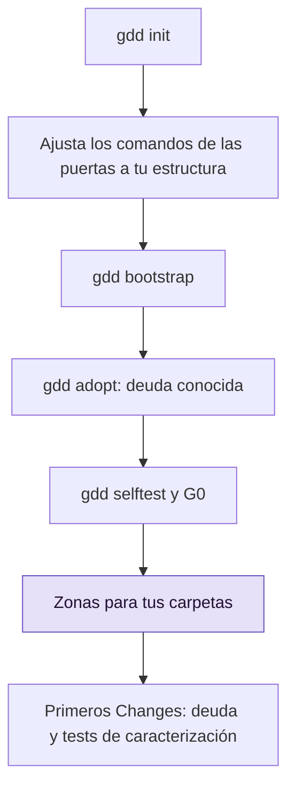

# Llevar gdd a un proyecto existente

Prepara GDD en un repositorio que ya tiene código, registra lo que hoy falla como deuda
conocida para que avise en vez de bloquear, asigna tus carpetas a colores de riesgo y planifica
los primeros Changes.

## Antes de empezar

- gdd y las herramientas de tu stack están instalados: consulta [Instalar gdd](install.md).
- El repositorio es un repositorio git con todo guardado en commits, en su rama main.
- Sabes qué ficha de stack encaja con el proyecto: `python`, `rust` o `typescript` (consulta
  [Stacks](../reference/stacks.md)).
- Lee [GDD en una página](../explanation/method.md) si las palabras puerta, zona y Change son
  nuevas para ti.

El recorrido completo es este. Los pasos de abajo lo siguen en orden.



## 1. Ejecuta gdd init

`gdd init` escribe el arnés junto a tu código. Nunca sobrescribe un fichero, se niega a
ejecutarse en una carpeta que ya es un proyecto GDD y solo hace commit de lo que ha escrito.
Indica el stack con `--stack`: gdd usa el fichero de detección de un stack (`pyproject.toml`,
`Cargo.toml`, `package.json`) solo para decidir si escribe un esqueleto, y se salta el
esqueleto de cualquier stack del que la carpeta ya tenga un proyecto.

```bash
gdd init --name notes --platform cli --stack python --agents claude codex \
  --description "A command-line notes tool" --sensitive "Losing notes"
```

Deberías ver los ficheros que ha escrito y, después, el siguiente paso:

```text
gdd/project.toml
gdd/commands.toml
gdd/rules.toml
gdd/zones.toml
gdd/models.toml
gdd/generated.toml
docs/brief.md
bin/gdd
.github/workflows/gdd.yml
AGENTS.md
CLAUDE.md
.gitignore
.claude/skills/gdd-build/SKILL.md
...
.agents/skills/gdd-stack-python/SKILL.md
Next: run bin/gdd bootstrap (first install of each stack and its lock file), bin/gdd agents check, then start your agent and run the gdd-setup command (/gdd-setup in Claude Code and OpenCode, $gdd-setup in Codex).
```

En la lista no aparece ningún fichero de `src/` ni de `tests/`: el proyecto ya tenía un
`pyproject.toml`, así que gdd no escribió ningún esqueleto. Los ficheros que ya tenías siguen
siendo tuyos. Cuando el proyecto ya tiene un `AGENTS.md`, gdd no lo toca y te indica la línea
que debes añadir:

```text
AGENTS.md is yours: add to AGENTS.md a line that sends agents to GDD:
This project works with **GDD · Gate-Driven Development**: work moves forward by passing gates, and
risk decides how many gates and how strict. `bin/gdd` runs the gates.
```

Todas las opciones de `gdd init` están en la [referencia de comandos](../reference/cli.md#gdd-init).
Si todos tus agentes son de una sola familia de modelos, añade `--accept-same-family`; consulta
[Elegir agentes y modelos](agents-and-models.md).

## 2. Ajusta los comandos de las puertas a tu estructura

La ficha de stack da por hecha su propia estructura. En Python, eso es el código en
`src/<package>/`, los tests unitarios en `tests/unit/`, los pasos de los escenarios en
`tests/acceptance/` y las herramientas de las puertas (mypy, Bandit, import-linter, pytest-bdd,
mutmut, vulture) en las dependencias de desarrollo. Un proyecto existente rara vez coincide en
todo, y un comando que falle por ese motivo quedaría registrado como deuda en el paso 4.

1. Muestra lo que espera la ficha, desde dentro del proyecto:

   ```bash
   bin/gdd stacks show python
   ```

2. Para cada diferencia, cambia el proyecto o cambia el comando en `gdd/commands.toml`. Por
   ejemplo, para mantener los tests unitarios en `tests/`, apunta a esa carpeta `unit` en
   `[g2]` y el `file` de `[selftest]`. Las claves y las variables están en
   [Configuración](../reference/configuration.md#commandstoml).
3. Añade al proyecto las herramientas que llaman los comandos. El proyecto de ejemplo ya tenía
   pytest y Ruff; añade las demás y mantiene pytest por debajo de 9.2, porque pytest 9.2 rompe
   pytest-bdd 9.0.0 (issue 850 de pytest-bdd). El esqueleto de un proyecto nuevo tiene el mismo
   límite.

   ```bash
   uv add --dev mypy bandit import-linter pytest-bdd mutmut vulture "pytest>=9.1.1,<9.2"
   ```

   El proyecto de ejemplo tampoco tenía pasos de escenarios. Tomó `tests/acceptance/` del
   esqueleto que recibe un proyecto Python nuevo (`__init__.py`, `steps/__init__.py` y
   `test_features.py`, que vincula las features con los pasos), y la configuración de pytest
   que necesitan, en `pyproject.toml`:

   ```toml
   [tool.pytest.ini_options]
   pythonpath = ["."]
   bdd_features_base_dir = "features/"
   ```

4. Haz commit en la rama main. Estos ficheros son arnés: los cambia una persona en main, nunca
   dentro de un Change.

> [!NOTE]
> Prueba cada comando a mano una vez (`uv run mypy src`, `cargo clippy ...`). Un comando que no
> llega a arrancar no es deuda, es un error de preparación, y sale más barato arreglarlo ahora.

## 3. Ejecuta gdd bootstrap

`gdd bootstrap` hace la primera instalación de cada stack, que escribe el fichero de bloqueo
(*lock file*), y hace commit de los ficheros de la cadena de suministro que ha creado o
cambiado, y de nada más.

```bash
bin/gdd bootstrap
```

Deberías ver:

```text
python: uv lock && uv sync --locked
...
Nothing new to commit.
Next: bin/gdd selftest
```

Aquí `uv add` ya había escrito el fichero de bloqueo, que entró en el commit del paso 2, así que
no había nada nuevo para hacer commit. Un proyecto sin fichero de bloqueo obtiene
`Committed: uv.lock`. Ejecútalo una sola vez. Las instalaciones posteriores pasan por el comando
`install` de `gdd/commands.toml`.

## 4. Registra la deuda conocida con gdd adopt

`gdd adopt` ejecuta una vez cada comando de G2 y G3 que juzga el proyecto entero. Los que fallan
pasan a ser deuda conocida en [`gdd/debt.toml`](../reference/configuration.md#debttoml), en un
commit aparte. Un comando con deuda conocida se ejecuta y avisa en cada puerta, pero no bloquea,
hasta que un Change lo hace pasar.

```bash
bin/gdd adopt
```

Deberías ver algo parecido a esto (de un proyecto con tres imports sin usar, un `noqa` que su
configuración de Ruff no necesita y sin configuración de import-linter):

```text
Passed: types, unit, dependencies, lockfile, security
Known debt: architecture, lint (4)
Proposed Refactors, riskiest first:
  1. debt-architecture · Pay the known debt of architecture · .gdd/adoption/architecture.txt
  2. debt-lint · Pay the known debt of lint · .gdd/adoption/lint.txt
Create one with: bin/gdd new-change debt-<name> --type Refactor --title "..." --paths ...
```

Qué ha pasado:

- Los comandos cuyo nombre empieza por `acceptance`, `mutation` o `secrets` nunca se convierten
  en deuda. Juzgan el Change o sus escenarios, no el código antiguo, así que bloquean desde el
  primer día.
- `lint (4)` lleva un recuento: `[count]` en `gdd/commands.toml` le dice a gdd cómo leer el
  número de problemas en lo que imprimió el comando. Ese recuento es un techo, un trinquete. Un
  Change que informa de más problemas hace fallar la puerta con la diferencia; uno que informa de
  menos baja el techo cuando se fusiona.
- `architecture` no tiene recuento, porque la ficha no tiene textos de `[count]` para él. Un
  Change puede aumentar esa deuda sin que se note, y `gdd status` lo advierte.
- Lo que imprimió cada comando que falló está en `.gdd/adoption/<name>.txt`, para el Refactor
  que lo pague.

Un proyecto se adopta una sola vez: un segundo `gdd adopt` se detiene con
`this project was already adopted on <day> (gdd/debt.toml)`. Cuando todos los comandos pasan,
adopt no escribe nada.

Consulta la deuda en cualquier momento:

```bash
bin/gdd status
```

```text
...
Known debt: architecture (no count: a change can add to it unseen), lint (4)
  - architecture · since 2026-10-30 · Refactor debt-architecture
  - lint · since 2026-10-30 · Refactor debt-lint
...
```

## 5. Ejecuta el autotest y abre G0

La puerta de preparación (G0, *Setup Gate*) se abre cuando el Brief está escrito y el autotest
del arnés pasa 4/4. Ejecuta las dos cosas justo después de la adopción: no hace falta pagar la
deuda antes.

```bash
bin/gdd selftest
bin/gdd gate G0 ok --by machines
```

Deberías ver:

```text
OK a failing test turns G2 red
OK editing a protected file is blocked (Path Guard and CI)
OK rollback works in pre (simulated)
OK zero scenarios counts as a failure
harness 4/4
G0 ok (machines).
```

La primera comprobación juzga G2 igual que lo hace G2: `architecture` y `lint` siguen fallando,
pero cada uno se mide contra su deuda conocida, así que G2 sigue en verde hasta que el autotest
planta su test que falla, y entonces se pone en rojo. La comprobación falla igualmente cuando un
comando de G2 informa de más que su deuda conocida, o falla sin tener ninguna:

```text
KO a failing test turns G2 red (G2 is red without it: lint)
```

También falla, indicando el motivo, cuando no se puede leer `gdd/debt.toml`. Arregla el fichero
y vuelve a ejecutar el autotest.

También puedes dejar este paso a tu agente: el comando `gdd-setup` ejecuta el autotest y abre
G0 por ti.

## 6. Asigna tus carpetas a zonas

El código que no coincide con ninguna zona es amarillo: código sin tests conocidos. Convierte en
rutas, en `gdd/zones.toml`, las áreas sensibles que escribiste con `--sensitive`. Gana el color
más alto, y una persona aprueba cada zona roja antes de que ningún Change pueda construir.

```toml
[[zone]]
color = "red"
paths = ["src/notes/store.py"]
reason = "Losing notes: the store writes the user's notes"

[[zone]]
color = "green"
paths = ["tests/**"]
reason = "Tests: a wrong test fails loudly and costs nothing in production"
```

Haz commit en main y después aprueba las zonas rojas:

```bash
bin/gdd gate zones ok --note "store.py red: it writes the notes"
```

```text
Red zones ok (3 red zone(s)).
```

El recuento incluye las dos zonas rojas que escribió `gdd init`: el arnés y la cadena de
suministro. El procedimiento completo, con cómo propone zonas el Orchestrator al final de
Discover, está en [Mapear y aprobar zonas rojas](red-zones.md).

## 7. Planifica los primeros Changes

Empieza por la deuda, de más a menos riesgo, y por tests alrededor del código amarillo que vas
a tocar.

1. Crea un Refactor por cada deuda que propuso la adopción:

   ```bash
   bin/gdd new-change debt-lint --type Refactor --title "Pay the known debt of lint" --paths src/notes/store.py
   ```

   Planifica rutas concretas. En gdd 0.1.0, un patrón planificado como `src/**` se clasifica
   por el propio patrón, no por los ficheros que abarca, así que sale amarillo aunque dentro
   haya un fichero rojo. Las puertas vuelven a clasificar a partir de las rutas que el Change
   tocó de verdad.

2. Los Changes amarillos y rojos llevan `tests_first = true`: los tests de caracterización, que
   fijan lo que hace hoy el código, se escriben antes de cambiar el código. Pídelos en el título
   y en los escenarios del Change cuando el código no tenga ninguno.
3. Añade el primer escenario. Un proyecto adoptado no tiene ninguno, y G3 falla hasta que haya
   al menos uno:

   ```text
   {"name":"scenarios","tail":"Zero scenarios counts as a failure."}
   ```

   El primer Change que añade un fichero `.feature` pasa por la puerta de escenarios (G1,
   *Scenario Gate*); consulta [Escribir y aprobar escenarios](write-scenarios.md).

Mientras la deuda siga abierta, todas las puertas informan de ella. Un Change que mantiene lint
en su techo pasa con `known_debt` en el informe. Uno que añade problemas falla:

```text
lint reports 7, the known debt is 4: 3 more
```

## Siguientes pasos

- [Ejecutar un Change](run-a-change.md): lanza el primer Refactor y síguelo en el Board.
- [Ajustar las puertas](gates-and-commands.md): qué ejecuta cada puerta, según el color, y cómo
  cuenta el trinquete.
- [Ejecutar las puertas en CI](ci.md): CI avisa de la deuda conocida igual que las puertas.
- [Mapear y aprobar zonas rojas](red-zones.md): el mapa de zonas a fondo.
