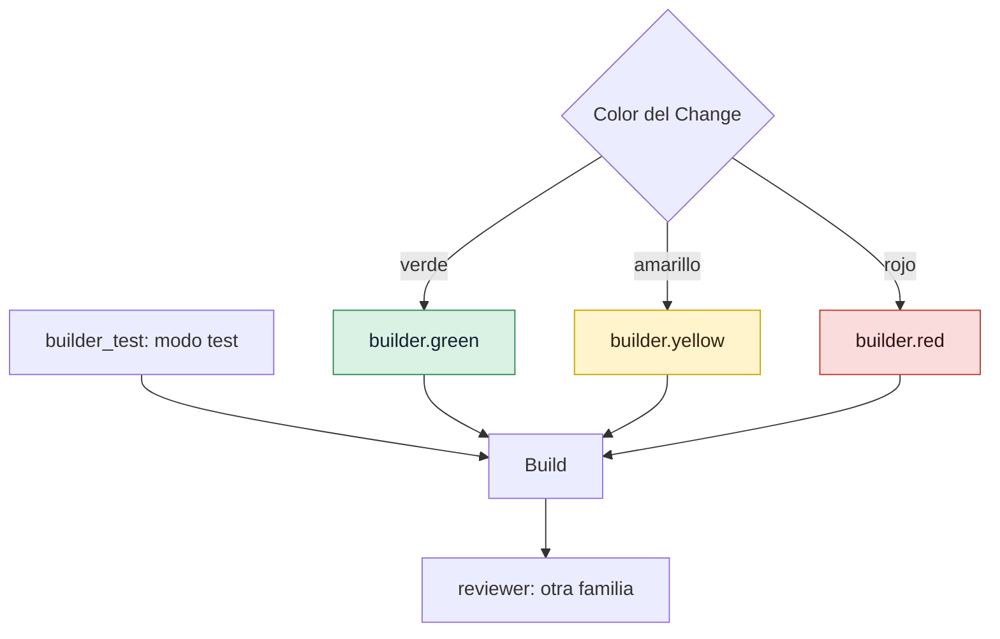

# Elegir agentes y modelos

Decide qué agente de programación y qué modelo hace cada rol, según el color de riesgo, mantén
al Reviewer en otra familia de modelos, instala los comandos de GDD en la carpeta de cada agente
e indica a gdd cómo calcular el precio de las llamadas que no informan de su coste.

## Antes de empezar

- Un proyecto GDD: consulta [Llevar gdd a un proyecto existente](adopt-existing-project.md) o
  [Tu primer Change](../getting-started/tutorial.md).
- Los agentes que quieres usar están instalados y con la sesión iniciada: Claude Code
  (`claude`), Codex (`codex`) u OpenCode (`opencode`). Consulta [Instalar gdd](install.md).
- Los roles se describen en [Roles](../reference/roles.md).

`gdd/models.toml` guarda todas las decisiones de esta página. Es arnés, protegido frente a todos
los agentes: cámbialo en la rama main, como persona, entre un Change y otro.

## 1. Mira quién hace cada rol

`gdd init` rellena `gdd/models.toml` a partir de los agentes que indicaste con `--agents`, o de
los que tienen su programa en el `PATH`. El primer agente orquesta y construye; el Reviewer es el
primer agente de otra familia de modelos. Con `--agents claude codex`:

```toml
[orchestrator]
integration = "claude"
model = "opus"

[builder.green]
integration = "claude"
model = "haiku"

[builder.yellow]
integration = "claude"
model = "sonnet"

[builder.red]
integration = "claude"
model = "opus"

[builder_test]
integration = "claude"
model = "sonnet"

[reviewer]
integration = "codex"
model = "gpt-6-astra"
effort = "high"

[families]
"claude" = "anthropic"
"codex" = "openai"
```

El color de un Change elige al Builder en modo build: un modelo ligero para el trabajo verde,
uno estándar para el amarillo y el más potente para el rojo. El modo test, el Reviewer y el
Orchestrator tienen un solo modelo cada uno, sea cual sea el color.



Para ver qué recibirá un Change concreto, clasifícalo:

```bash
bin/gdd classify CHANGE
```

El JSON nombra la tabla de cada rol: `builder`, `builder_test`, `reviewer_model`,
`orchestrator`, y además `builder_session`.

## 2. Cambia un agente o un modelo

Edita la tabla del rol. `integration` es el agente (`claude`, `codex` u `opencode`) y `model` es
un nombre que ese agente acepte: un alias como `sonnet` en Claude Code, un id de modelo en Codex,
`provider/model` en OpenCode. Por ejemplo, un Builder más barato para el trabajo verde a través
de OpenCode:

```toml
[builder.green]
integration = "opencode"
model = "minimax/MiniMax-M3"
```

Después añade a `[families]` la familia de cualquier prefijo o agente nuevo (paso 3) e instala
los comandos de cualquier agente nuevo (paso 5).

`effort` fija el esfuerzo de razonamiento de Codex (`low`, `medium`, `high`, `xhigh`), que gdd
pasa como `-c model_reasoning_effort=<effort>`. Solo la ficha de Codex dice cómo pasarlo: en
otro agente, la clave se ignora.

## 3. Mantén al Reviewer en otra familia de modelos

El Reviewer no debe compartir los puntos ciegos del Builder, así que tiene que ser de otra
familia de modelos. gdd busca la familia de un modelo en `[families]`: la primera clave por la
que empieza el nombre de su modelo, o que coincide con su integración.

```toml
[families]
"claude" = "anthropic"
"codex" = "openai"
"minimax" = "minimax"
```

`gdd prepare`, el primer paso de cada lanzamiento, rechaza un Change cuyo Reviewer sea de la
familia del Builder:

```text
error: Reviewer and Builder are the same model family: edit gdd/models.toml.
```

Si solo tienes agentes de una familia, acéptalo una vez, a sabiendas. Al hacer init:

```bash
gdd init --name notes --platform cli --stack python --agents claude --accept-same-family
```

Sin la opción, init se detiene:

```text
error: one model family only (anthropic): the Reviewer would share the Builder's blind spots. Install an agent of another family (OpenCode takes models from many providers) or run again with --accept-same-family.
```

Con ella, la tabla del Reviewer registra el día en que lo aceptaste:

```toml
[reviewer]
integration = "claude"
model = "opus"
same_family_accepted = "2026-10-30"   # the human accepted one model family only
```

En un proyecto existente, añade a mano la misma línea `same_family_accepted = "YYYY-MM-DD"`.
Sustituye al Reviewer en cuanto tengas disponible una segunda familia. `gdd status` avisa cuando
detecta una en la máquina:

```text
A second model family is on this machine (codex, opencode): set it as the Reviewer in gdd/models.toml
```

## 4. Comparte una sesión del Builder (opcional)

Por defecto, el modo test y el modo build se ejecutan en sesiones separadas: el modo build
empieza de cero y lee lo que escribió el modo test. Puedes hacer que el modo build continúe la
conversación del modo test, y que cada ronda posterior la continúe también:

```toml
[session]
builder = "shared"   # or "separate", the default
```

Path Guard sigue comprobando cada modo, y el mutation testing y el Reviewer no cambian. El
Reviewer nunca se une a la sesión del Builder.

Solo funciona cuando el modo test y el modo build usan el mismo agente y la ficha de ese agente
dice cómo reanudar una sesión, algo que hoy solo cumple Claude Code. Si no, las sesiones siguen
separadas y `gdd status` explica por qué:

```text
Builder session: shared is set, but test mode (claude) and build mode (codex) use different agents: the sessions stay separate
```

Cualquier otro valor detiene todos los comandos que leen el fichero:

```text
error: gdd/models.toml: invalid TOML: session.builder must be separate or shared, not "one"
```

> [!NOTE]
> Medido en el propio repositorio de gdd (40 ejecuciones): la sesión compartida usó un 21 %
> menos de tokens nuevos y un 7 % menos de tiempo, con una calidad dentro del ruido. Por eso es
> una opción y no el valor por defecto.
> Consulta [features/builder-session.feature](../../../features/builder-session.feature).

## 5. Instala los comandos de GDD en cada agente

Cada agente encuentra los comandos de GDD (`gdd-setup`, `gdd-change`, `gdd-build`,
`gdd-review`...) y las instrucciones de cada stack (`gdd-stack-<name>`) en su propia carpeta.
`gdd init` los escribió una vez; vuelve a escribirlos después de editar `gdd/models.toml` o de
actualizar gdd:

```bash
bin/gdd agents install
```

Sin `--agent`, escribe para cada `integration` de `gdd/models.toml`. Imprime las rutas como JSON
y no escribe ningún otro fichero: tus propias skills y tus comandos se quedan como están.

| Agente | Ficheros que recibe | Cómo llamas a un comando |
|---|---|---|
| Claude Code | `.claude/skills/gdd-<command>/SKILL.md` | `/gdd-status` |
| Codex | `.agents/skills/gdd-<command>/SKILL.md` | `$gdd-status` |
| OpenCode | `.opencode/commands/gdd-<command>.md` | `/gdd-status` |

Para añadir un agente que el fichero de modelos todavía no usa:

```bash
bin/gdd agents install --agent opencode
```

```text
{"ok":true,"written":[".opencode/commands/gdd-build.md",".opencode/commands/gdd-build-test.md",...,".opencode/commands/gdd-stack-python.md"]}
```

`install` no hace commit. Estas carpetas son arnés (zona roja): revísalas y haz commit de ellas
en main.

Comprueba que no se ha editado ni perdido nada:

```bash
bin/gdd agents check
```

```text
error: .claude/skills/gdd-report/SKILL.md: missing
error: .claude/skills/gdd-status/SKILL.md: differs from what gdd writes
```

Sale con 1 y nombra cada fichero; después de `install` imprime `{"ok":true}`. Cada fichero avisa
al principio de que está generado: lo que edites ahí se pierde. Las fichas de agente en sí (dónde
guarda cada agente sus comandos, cómo lo lanza gdd, qué puede hacer cada rol) vienen integradas
en gdd; un agente sin ficha se rechaza (`no agent sheet`).

## 6. Rellena los precios para las estimaciones

Cada agente informa a su manera de lo que gastó una llamada. gdd lo registra por llamada:

| Agente | Tokens | Coste |
|---|---|---|
| Claude Code | sí | sí, su propia estimación en el cliente |
| Codex | sí | no |
| OpenCode | sí | sí (no informa del modelo: el registro guarda el que pidió gdd) |

Para un agente que no informa del coste, gdd lo calcula a partir de `[prices.<model>]`, en
dólares estadounidenses por millón de tokens:

```toml
[prices.gpt-6-astra]
input = 0.0    # per million input tokens not read from the cache
cache = 0.0    # per million input tokens read from the cache
output = 0.0   # per million output tokens
```

Copia las cifras de la página de precios del proveedor; nunca te las inventes. Sin precios, esas
llamadas registran 0 USD. Con una suscripción, el coste es teórico de todos modos: compara
tokens. Consulta [Medir el trabajo](measure.md).

## 7. Otros ajustes de los agentes

- **Secretos.** Los agentes nunca reciben una variable cuyo nombre contenga una palabra de
  secreto (`KEY`, `TOKEN`, `SECRET`, `PASS`, `PASSWORD`, `CREDENTIALS`, `DSN` y unas pocas más)
  ni una URL con una contraseña como valor. Para pasar una a propósito, usa
  `[env] pass = ["NAME"]` en `gdd/models.toml`.
  [Variables de entorno](../reference/environment.md#qué-variables-guardan-un-secreto) tiene la
  regla completa.
- **Tiempo de respuesta.** Una llamada de agente puede durar `agent_timeout_s` segundos, 3600 por
  defecto, que se configura en `[limits]` de `gdd/rules.toml`.

Todas las claves están en [Configuración](../reference/configuration.md#modelstoml).

## Siguientes pasos

- [Ajustar las puertas](gates-and-commands.md): lo que comprueban las máquinas alrededor de los
  agentes.
- [Medir el trabajo](measure.md): tokens y coste por rol, modelo y agente.
- [Mantener honestos a los agentes](../explanation/safety.md): por qué el Reviewer es de otra
  familia y qué puede tocar cada rol.
