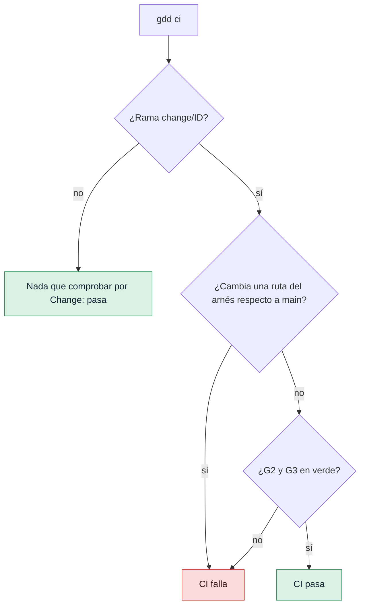

# Ejecutar las puertas en CI

Usa esta guía para ejecutar las puertas en CI (integración continua) con GitHub Actions, en cada
push y cada pull request. Así las puertas bloquean un Change aunque un agente o una persona se
salte un paso en su máquina.

## Antes de empezar

- Un proyecto GDD preparado con [`gdd init`](../reference/cli/init.md) y subido a un
  repositorio de GitHub.
- Su autotest pasa en local: [`gdd selftest`](../reference/cli/selftest.md) dice
  `harness 4/4`.
- Los Changes se ejecutan en ramas llamadas `change/<id>`, tal como las crea
  [`gdd new-change`](../reference/cli/new-change.md): consulta [Describir un Change a tu
  agente](run-a-change.md).

## 1. Mira el workflow que escribió gdd init

`gdd init` ya escribió el workflow, `.github/workflows/gdd.yml`. En un proyecto Python es así:

```yaml
name: gdd
# Written by gdd init 0.1.0. G2 and G3 in CI: they block even if an agent skips a step.
on:
  pull_request:
  push:
    branches: ["main", "change/**"]

jobs:
  gates:
    runs-on: ubuntu-latest
    steps:
      - uses: actions/checkout@v4
        with:
          fetch-depth: 0
      - uses: astral-sh/setup-uv@v7
      - name: Install the Python dependencies
        run: uv sync --locked
      - name: Install OSV-Scanner (checksum verified)
        run: |
          ...
      - name: Install gitleaks (checksum verified)
        run: |
          ...
      - name: Install gdd 0.1.0
        run: cargo install --locked --git https://github.com/MarsGotta/gdd --tag v0.1.0 gdd
      - name: GDD gates (Path Guard, G2, G3)
        run: gdd ci
```

Dos líneas importan más:

- `gdd ci`, la última línea, ejecuta las puertas.
- `fetch-depth: 0` descarga todo el historial, que [`gdd ci`](../reference/cli/ci.md) necesita
  para comparar la rama con la rama main.

Los pasos anteriores a `Install gitleaks` salen del `[ci] setup` de cada ficha de stack: Rust
recibe su toolchain, cargo-deny y cargo-mutants, y TypeScript recibe Node.

El workflow forma parte del [arnés](../glossary.md#arnés), los ficheros que gdd usa para
comprobar tu proyecto, así que está en una zona roja que ningún agente puede editar. Si lo
cambias, cámbialo tú, en main, y conserva la línea `gdd ci`: el autotest comprueba que CI
ejecuta las puertas.

## 2. Asegúrate de que CI puede instalar gdd

El workflow instala gdd desde la etiqueta git `v<version>` del repositorio de gdd, donde
`<version>` es la versión de gdd que escribió el fichero. El paso siguiente ejecuta ese `gdd`. Un
workflow escrito por un gdd anterior conserva su antigua línea de las puertas, que el autotest
sigue aceptando.

> [!WARNING]
> El paso de instalación necesita que exista la etiqueta `v0.1.0` en el repositorio de gdd.
> Hasta que se publique, el paso falla. Mientras tanto, instala desde un commit de confianza:
> `cargo install --locked --git https://github.com/MarsGotta/gdd --rev COMMIT gdd`.

Cuando actualizas gdd, [`gdd upgrade`](../reference/cli/upgrade.md) propone la nueva versión de
esta línea junto con el resto del fichero; consulta [Actualizar gdd en un proyecto](upgrade.md).

## 3. Entiende qué comprueba gdd ci

`gdd ci` ejecuta [Path Guard](../glossary.md#path-guard), la puerta del bucle (G2, *Loop Gate*)
y la puerta de integración (G3, *Merge Gate*), pero solo en las ramas de Change. Lee la rama de
`GITHUB_HEAD_REF` (que se define en las pull requests) o, si no está, toma la rama actual:



1. **Cualquier otra rama** pasa en el acto:

   ```text
   Branch main: nothing to check per change.
   ```

2. **En `change/<id>`**, lista lo que la rama ha incluido en sus commits desde que salió de la
   rama main (`origin/main` cuando el repositorio la tiene). Falla ante cualquier ruta del
   arnés: `gdd/`, `.github/`, las carpetas de los agentes y las demás rutas de
   `[protected] all`. La primera línea nombra el fichero:

   ```text
   gdd/rules.toml: harness path changed inside a change
   G2 red: acceptance
   G3 red: acceptance_full
   CI failed
   ```

3. Después ejecuta G2 y G3 igual que las ejecutan [`gdd g2`](../reference/cli/g2.md) y
   [`gdd g3`](../reference/cli/g3.md), sobre un Change clasificado a partir de esas rutas. Un
   Change verde:

   ```text
   G2 green
   G3 green
   CI passed
   ```

`gdd ci` solo usa lo que guarda el repositorio, nunca tus registros locales, tus aprobaciones ni
tu log de `.gdd/`. Por eso, en CI, las rutas del arnés sustituyen al Path Guard por rol.
`gdd ci` sale con 1 cuando CI falla.

La [deuda conocida](../glossary.md#deuda-conocida) avisa en CI igual que en las puertas. Con un
problema de lint frente a un techo registrado de 3:

```text
G2 green · known debt still failing: lint
```

Si un comando informa de más problemas que su techo, la puerta se pone en rojo. Consulta
[Ajustar las puertas](gates-and-commands.md#6-cuenta-la-deuda-conocida-con-el-trinquete).

## 4. Pruébalo antes de hacer push

Para detectar un fallo antes que CI, ejecuta la misma comprobación en tu máquina:

1. Haz commit de todo: `gdd ci` solo juzga lo que la rama tiene en sus commits.
2. Si gdd está ejecutando el Change, ve en su lugar a su worktree (por defecto, la carpeta
   hermana `<repo>.worktrees/CHANGE`), donde la rama ya está activa.
3. Cambia a la rama del Change y ejecuta `gdd ci`:

```bash
git switch change/CHANGE
gdd ci
```

En una pull request, GitHub no hace checkout de la rama sino de un commit de fusión, así que
pone el nombre de la rama en `GITHUB_HEAD_REF` para que `gdd ci` lo lea.

## 5. Añade tus propias comprobaciones (opcional)

Si quieres más comprobaciones, añade tú los pasos al workflow, en main. Por ejemplo, para
comprobar que `CHANGELOG.md` recoge todos los Changes en main, después de las puertas:

```yaml
      - name: Changelog covers every change
        if: github.ref == 'refs/heads/main'
        run: gdd changelog --check
```

Consulta [Publicar versiones y mantener un
changelog](releases-and-changelog.md#6-comprueba-el-changelog-en-ci-opcional).

Si quieres que gdd haga push de main después de la puerta de integración, pon
`push_main = true` en `gdd/rules.toml` cuando el repositorio tenga un remoto y este workflow. El
valor por defecto es `false`.

## Siguientes pasos

- [Ajustar las puertas](gates-and-commands.md): los comandos que ejecuta CI son los mismos que en
  local.
- [Actualizar gdd en un proyecto](upgrade.md): una nueva versión de gdd actualiza este workflow
  en una rama.
- [Mantener honestos a los agentes](../explanation/safety.md): por qué un Change nunca edita el
  arnés.
