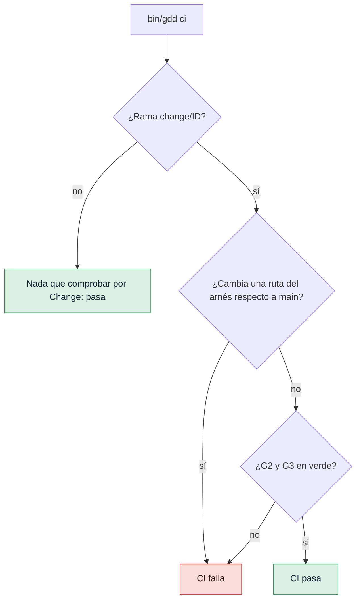

# Ejecutar las puertas en CI

Haz que cada push y cada pull request ejecuten Path Guard, G2 y G3 en GitHub Actions, para que
las puertas bloqueen aunque un agente o una persona se salte un paso en su máquina.

## Antes de empezar

- Un proyecto GDD preparado con `gdd init` y subido a un repositorio de GitHub.
- Su autotest pasa en local: `bin/gdd selftest` dice `harness 4/4`.
- Los Changes se ejecutan en ramas llamadas `change/<id>`, tal como las crea `gdd new-change`:
  consulta [Ejecutar un Change](run-a-change.md).

## 1. Mira el workflow que escribió gdd init

`gdd init` escribió `.github/workflows/gdd.yml`. En un proyecto Python es así:

```yaml
name: gdd
# Written by gdd init 0.1.0. G2 and G3 in CI: they block even if an agent skips a step.
on:
  pull_request:
  push:
    branches: ["main", "change/**"]

jobs:
  gates:
    runs-on: ubuntu-latest
    steps:
      - uses: actions/checkout@v4
        with:
          fetch-depth: 0
      - uses: astral-sh/setup-uv@v7
      - name: Install the Python dependencies
        run: uv sync --locked
      - name: Install OSV-Scanner (checksum verified)
        run: |
          ...
      - name: Install gitleaks (checksum verified)
        run: |
          ...
      - name: Install gdd 0.1.0
        run: cargo install --locked --git https://github.com/MarsGotta/gdd --tag v0.1.0 gdd
      - name: GDD gates (Path Guard, G2, G3)
        run: bin/gdd ci
```

Los pasos anteriores a `Install gitleaks` salen del `[ci] setup` de cada ficha de stack: Rust
recibe su toolchain, cargo-deny y cargo-mutants; TypeScript recibe Node. `fetch-depth: 0` es
importante: `gdd ci` compara la rama con la rama main, así que necesita el historial.

El workflow es arnés, está en una zona roja y protegido frente a todos los agentes. Cámbialo en
main, como persona. Conserva la línea `bin/gdd ci`: el autotest comprueba que CI ejecuta las
puertas.

## 2. Asegúrate de que CI puede instalar gdd

El workflow instala gdd desde su etiqueta git `v<version>` en el repositorio de gdd, la de la
versión que escribió el fichero. Después, `bin/gdd` ejecuta el `gdd` que haya en el `PATH` (o el
programa que indique `GDD_BIN`).

> [!WARNING]
> El paso de instalación necesita que exista la etiqueta `v0.1.0` en el repositorio de gdd.
> Hasta que se publique, el paso falla. Mientras tanto, instala desde un commit de confianza:
> `cargo install --locked --git https://github.com/MarsGotta/gdd --rev COMMIT gdd`.

Cuando actualizas gdd, `gdd upgrade` propone la nueva versión de esta línea junto con el resto
del fichero; consulta [Actualizar gdd en un proyecto](upgrade.md).

## 3. Entiende qué comprueba gdd ci

`gdd ci` decide según la rama. Lee la rama de `GITHUB_HEAD_REF` (que se define en las pull
requests) o, si no está, toma la rama actual.



1. **Cualquier otra rama** pasa en el acto:

   ```text
   Branch main: nothing to check per change.
   ```

2. **En `change/<id>`**, lista lo que la rama ha incluido en sus commits desde que salió de la
   rama main (`origin/main` cuando el repositorio la tiene), y falla ante cualquier ruta del
   arnés: `gdd/`, `bin/`, `.github/`, las carpetas de los agentes y las demás rutas de
   `[protected] all`. Un Change nunca edita las puertas que lo juzgan.

   ```text
   bin/gdd: harness path changed inside a change
   G2 green
   G3 red: scenarios
   CI failed
   ```

3. Después ejecuta G2 y G3 igual que las ejecutan `gdd g2` y `gdd g3`, sobre un Change
   clasificado a partir de esas rutas. Un Change verde:

   ```text
   G2 green
   G3 green
   CI passed
   ```

`gdd ci` no lee ni escribe nada bajo `.gdd/`: CI solo tiene lo que guarda el repositorio, nunca
tus registros locales, tus aprobaciones ni tu log. Sin el registro del Change no hay Path Guard
por rol; las rutas del arnés hacen sus veces. Sale con 1 cuando CI falla.

La deuda conocida avisa en CI igual que en las puertas. Con un problema de lint frente a un techo
registrado de 3:

```text
G2 green · known debt still failing: lint
```

Un comando que informa de más problemas que su techo pone la puerta en rojo. Consulta
[Ajustar las puertas](gates-and-commands.md#6-cuenta-la-deuda-conocida-con-el-trinquete).

## 4. Pruébalo antes de hacer push

Ejecuta la misma comprobación en tu máquina, en la rama del Change, con todo guardado en commits.
Mientras la receta ejecuta un Change, su rama está activa en su propio worktree (por defecto, la
carpeta hermana `<repo>.worktrees/CHANGE`): en ese caso, ejecútala allí.

```bash
git switch change/CHANGE
bin/gdd ci
```

`gdd ci` juzga lo que la rama tiene en sus commits, así que haz commit primero. En una pull
request, GitHub pone el nombre de la rama en `GITHUB_HEAD_REF`, porque allí el checkout no está
en la propia rama.

## 5. Añade tus propias comprobaciones (opcional)

Añade pasos al workflow, en main, como persona. Por ejemplo, para mantener `CHANGELOG.md`
completo en main, después de las puertas:

```yaml
      - name: Changelog covers every change
        if: github.ref == 'refs/heads/main'
        run: bin/gdd changelog --check
```

Consulta [Publicar versiones y mantener un changelog](releases-and-changelog.md#6-comprueba-el-changelog-en-ci-opcional).

`push_main = false` en `gdd/rules.toml` impide que gdd haga push de main después de la puerta de
integración (G3, *Merge Gate*). Ponlo a `true` cuando el repositorio tenga un remoto y este
workflow.

## Siguientes pasos

- [Ajustar las puertas](gates-and-commands.md): los comandos que ejecuta CI son los mismos que en
  local.
- [Actualizar gdd en un proyecto](upgrade.md): una nueva versión de gdd actualiza este workflow
  en una rama.
- [Mantener honestos a los agentes](../explanation/safety.md): por qué un Change nunca edita el
  arnés.
