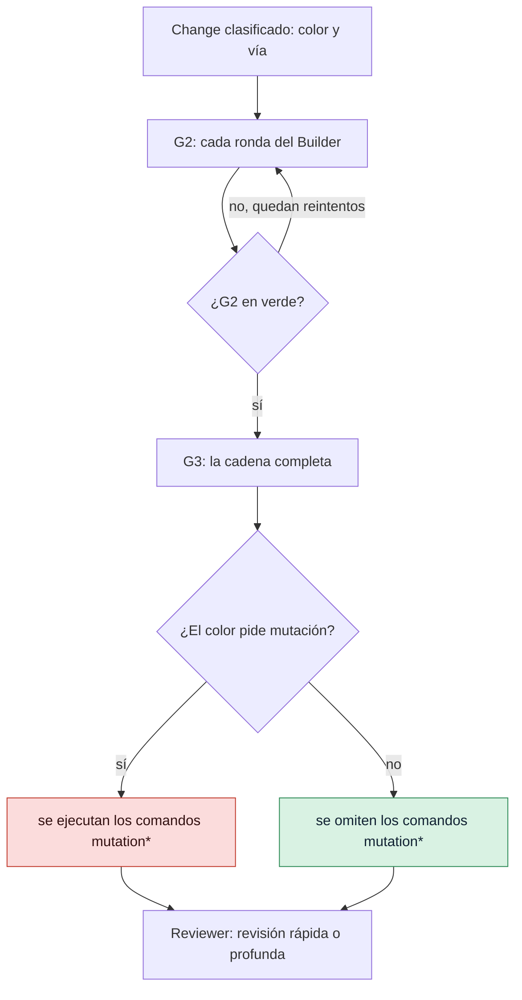

# Ajustar las puertas

Elige los comandos que ejecutan la puerta del bucle (G2, *Loop Gate*) y la puerta de integración
(G3, *Merge Gate*), qué recibe cada color de riesgo, cuánto puede durar un comando y cómo se
comportan el mutation testing, la deuda conocida y las excepciones de seguridad.

## Antes de empezar

- Un proyecto GDD cuyo autotest pasa: `bin/gdd selftest` dice `harness 4/4`.
- Sabes para qué sirve cada puerta: consulta [Puertas](../reference/gates.md) y
  [Cómo elige el riesgo las puertas](../explanation/risk.md).

Las puertas viven en dos ficheros: `gdd/commands.toml` dice qué se ejecuta y `gdd/rules.toml`
dice qué recibe cada color. Los dos son arnés, protegidos frente a todos los agentes: cámbialos
en la rama main, como persona, y ejecuta `bin/gdd selftest` después.



## 1. Mira qué ejecutan hoy las puertas

`gdd init` compuso `gdd/commands.toml` a partir de tus fichas de stack. Cada clave de `[g2]` y
`[g3]` es el nombre de un comando, y cada valor, un comando de shell:

```toml
[g2]
lint = "uv run ruff check . && uv run ruff format --check ."
types = "uv run mypy src"
unit = "uv run pytest -q tests/unit"
acceptance = "uv run pytest -q tests/acceptance || [ $? -eq 5 ]"
architecture = "uv run lint-imports"

[g3]
acceptance_full = "GDD_FEATURES= GDD_HIDDEN=1 uv run pytest -q tests/acceptance || [ $? -eq 5 ]"
lockfile = "uv lock --check"
security = "uv run bandit -q -r src && osv-scanner scan source -L uv.lock"
dependencies = "..."
secrets = "BASE=$(git rev-parse -q --verify main || git rev-parse origin/main) && ..."
mutation = "set -f; P=$(printf '%s\n' \"$GDD_DIFF_FILES\" | ...)"
```

Para compararlo con lo que da una ficha de stack, desde dentro del proyecto:

```bash
bin/gdd stacks show python
bin/gdd stacks compose python typescript
```

`compose` imprime como TOML los comandos que dan varias fichas juntas, y no escribe nada. Con más
de un stack, cada nombre lleva el de su stack: `lint-python`, `lint-typescript`.

## 2. Cambia un comando de una puerta

1. Edita el comando en `gdd/commands.toml`. Cada comando se ejecuta con `sh -c` desde la raíz
   del proyecto y recibe estas variables:

   | Variable | Qué contiene |
   |---|---|
   | `GDD_CHANGE` | El id del Change |
   | `GDD_COLOR` | `green`, `yellow` o `red` |
   | `GDD_DIFF_FILES` | Las rutas que tocó el Change (o las que planifica, mientras no haya tocado ninguna), una por línea |
   | `GDD_FEATURES` | Los ficheros `.feature` del Change, uno por línea; vacía significa ninguno |

2. Respeta las reglas que lleva el nombre de un comando:
   - Un comando cuyo nombre empieza por `mutation` solo se ejecuta cuando el color pide
     mutation testing; si no, el informe lo incluye en `skipped`.
   - Los nombres que empiezan por `acceptance`, `mutation` o `secrets` nunca pueden convertirse
     en deuda conocida.
   - Un comando vacío (`types = ""`) no está configurado y no se ejecuta. Una puerta sin ningún
     comando falla.
3. Prueba el comando a mano, haz commit en main y después:

   ```bash
   bin/gdd selftest
   ```

   La primera comprobación planta un test que falla y espera que G2 se ponga en rojo: una G2
   que no puede fallar se rechaza.

G2 también ejecuta Path Guard antes y después de los comandos, y la comprobación del alcance
(*scope*) en modo build. G3 añade Path Guard, el recuento de escenarios
(`[acceptance] required = true` hace que cero escenarios cuente como fallo) y la comprobación de
las excepciones de seguridad. Una puerta imprime su informe como JSON:

```text
{"ok":true,"gate":"G3","color":"yellow","passed":["acceptance_full","dependencies","lockfile","secrets","security","path-guard","scenarios (1)","exceptions"],"skipped":["mutation"],"failures":[],"out_of_scope":[]}
```

## 3. Decide qué recibe cada color

`gdd/rules.toml` tiene una tabla por cada color y vía. Un proyecto nuevo empieza con estos
valores:

| Clave | verde, rápida | verde, completa | amarillo, rápida | amarillo, completa | rojo, completa |
|---|---|---|---|---|---|
| `tests_first` | false | true | true | true | true |
| `mutation` | false | false | false | false | **true** |
| `reviewer` | false | true | true | true | **true** |
| `g4_if_g1` | false | true | false | true | **true** |
| `review` | quick | quick | quick | quick | **deep** |

Las celdas en negrita son el núcleo de GDD: lo que te protege frente a los agentes. GDD tiene
tres niveles:

1. **El núcleo**, siempre activo: las puertas G1 a G4, los colores, Path Guard, los ejemplos
   ocultos, un Reviewer de otra familia de modelos y, en los Changes rojos, mutation testing, el
   Reviewer, una revisión profunda y la G4 humana.
2. **Las comprobaciones del stack**, activas por defecto: los comandos de la ficha. Deja uno
   vacío para desactivarlo.
3. **Los extras**, desactivados hasta que añades su sección: `[learn]` en `gdd/commands.toml`,
   `[session]` en `gdd/models.toml`, `[versions]` en `gdd/rules.toml`, y otros.

Para ejecutar mutation testing también en los Changes amarillos, actívalo en las dos tablas del
amarillo:

```toml
[color.yellow.full]
tests_first = true
mutation = true
reviewer = true
g4_if_g1 = true
review = "quick"
```

`review = "deep"` pide una revisión profunda también en verde o en amarillo. Una revisión rápida
(`quick`) mira los ficheros que tocó el Change, su paquete y sus escenarios; una profunda
(`deep`) añade el código de alrededor del Change y lo que puede salir muy mal ahí.

Todos los comandos que leen el fichero de reglas rechazan uno que desactive el núcleo en el rojo:

```text
error: gdd/rules.toml: red changes always get mutation testing, the Reviewer and the human G4 (the core of GDD): remove color.red.full.mutation = false from gdd/rules.toml
```

También se rechaza una profundidad distinta de `quick` o `deep`:

```text
error: gdd/rules.toml: review must be quick or deep: color.yellow.full.review = "medium" in gdd/rules.toml
```

Comprueba el resultado en un Change real:

```bash
bin/gdd classify CHANGE
```

El JSON muestra `tests_first`, `mutation`, `reviewer`, `review` y `g4` para ese Change.

## 4. Fija los reintentos y los límites de tiempo

En `[limits]` de `gdd/rules.toml`:

```toml
[limits]
builder_retries = 3      # Builder rounds against G2
replans = 1              # Orchestrator replans per stuck change
command_seconds = 1800   # how long each gate and release command may run
```

Cuando un comando pasa de `command_seconds`, gdd lo mata junto con todo lo que haya arrancado, y
la puerta falla con:

```text
# The failure text, as features/mutation-speed.feature checks it with command_seconds = 1
timed out (1s): raise limits.command_seconds in gdd/rules.toml
```

El valor tiene que ser un número entero de segundos mayor que 0. En una máquina lenta u ocupada,
súbelo en vez de quitar comprobaciones. Las llamadas de agente tienen su propio límite,
`agent_timeout_s` (3600 por defecto).

## 5. Mantén rápido el mutation testing

El mutation testing modifica el código que tocó el Change y espera que algún test falle con cada
mutante. Es la comprobación más lenta de G3, así que las fichas lo ejecutan solo sobre el diff
del Change.

- **Python** (mutmut): los módulos de `src/` que aparecen en `GDD_DIFF_FILES`.
- **Rust** (cargo-mutants): el diff respecto a la rama main, con estas aceleraciones, todas en el
  comando de la ficha:
  - mutantes compilados sin información de depuración (`CARGO_PROFILE_TEST_DEBUG=0`);
  - enlazados con mold cuando está instalado y `RUSTFLAGS` no está definida;
  - cada proceso de test limitado a 2 GB donde existe `prlimit`, para que un mutante que
    convierte un bucle en una reserva de memoria sin fin no pueda tumbar la máquina;
  - una segunda oportunidad para los que agotan el tiempo. Cuando lo único que queda son
    mutantes que agotaron el tiempo, se vuelven a ejecutar de uno en uno con al menos 120 s por
    test. Un mutante que vuelve a colgarse cuenta como detectado; uno que ahora sobrevive es un
    mutante no detectado y hace fallar la puerta. Los mutantes no detectados no tienen segunda
    oportunidad.

Cuando el proyecto no tiene comando de mutation testing, los Changes rojos pasan sin él, y
`gdd status` lo advierte:

```text
no mutation testing command in [g3] of gdd/commands.toml: red changes go without it
```

## 6. Cuenta la deuda conocida con el trinquete

Un proyecto adoptado con `gdd adopt` tiene deuda conocida en `gdd/debt.toml`: comandos que
fallaron el primer día. Avisan en vez de bloquear. `[count]` en `gdd/commands.toml` le dice a
gdd cómo leer cuántos problemas ha encontrado un comando, para que la deuda no pueda crecer sin
que se note:

```toml
[count]
lint = ["Found {n} error", "{n} file would be reformatted", "{n} files would be reformatted"]
types = ["Found {n} error"]
unit = ["{n} failed", "{n} error"]
```

Un texto con `{n}` suma el número de cada sitio donde coincide; un texto sin `{n}` cuenta las
líneas que lo contienen. Con un recuento registrado:

- un Change que informa de más problemas hace fallar la puerta:
  `lint reports 5, the known debt is 3: 2 more`;
- uno que informa de los mismos pasa, con el comando en `known_debt` en el informe;
- uno que informa de menos baja el techo cuando se fusiona, y uno con el que el comando pasa
  paga la deuda;
- un comando que falla y cuyo recuento gdd no puede leer hace fallar la puerta:
  `lint failed and gdd cannot count what it reported`.

Consulta [Llevar gdd a un proyecto existente](adopt-existing-project.md) para ver cómo se
registra la deuda.

## 7. Permite una excepción de seguridad

Una vulnerabilidad conocida bloquea G3. Para aceptar una bajo tu responsabilidad, escribe la
excepción en el propio fichero del escáner, con un motivo:

```toml
# osv-scanner.toml
[[IgnoredVulns]]
id = "GHSA-xxxx-xxxx-xxxx"
ignoreUntil = 2027-01-31   # it blocks again after this date
reason = "dev tool only, never shipped; reviewed by the team"
```

En Rust, `[advisories] ignore = [{ id = "RUSTSEC-...", reason = "..." }]` en `deny.toml`.

- Estos ficheros son zona roja, así que añadir una excepción es un Change rojo, aprobado en una
  sentada.
- G3 rechaza una excepción sin motivo: `osv-scanner.toml: GHSA-... has no reason`.
- G3 nombra las excepciones que añade un Change, para que las veas en G4.
- `gdd status` lista todas las que están activas, con su fecha de fin o `expired`.

## 8. Añade herramientas de Learn

Las herramientas que solo avisan, como las de código duplicado o sin usar, van en `[learn]`.
Nunca bloquean una puerta; las ejecuta `gdd learn`. Consulta
[Medir el trabajo](measure.md#5-ejecuta-learn).

Todas las claves y sus valores por defecto están en
[Configuración](../reference/configuration.md#commandstoml).

## Siguientes pasos

- [Medir el trabajo](measure.md): qué comandos de las puertas se llevan el tiempo, por Change.
- [Ejecutar las puertas en CI](ci.md): las mismas G2 y G3 en cada pull request.
- [Llevar gdd a un proyecto existente](adopt-existing-project.md): deuda conocida desde el
  principio.
- [Mantener honestos a los agentes](../explanation/safety.md): por qué el núcleo no se puede
  desactivar.
