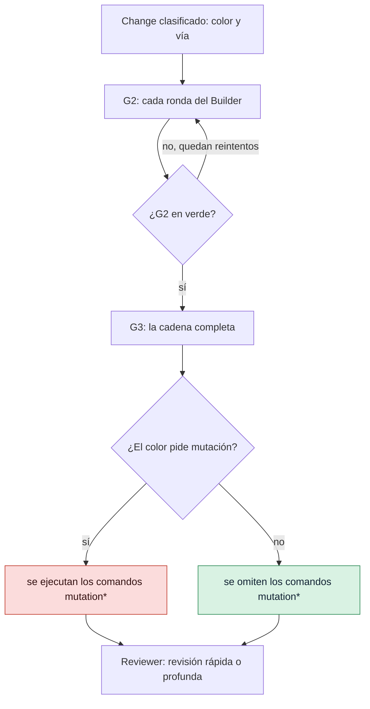

# Ajustar las puertas

Cambia qué comprueban la puerta del bucle (G2, *Loop Gate*) y la puerta de integración (G3,
*Merge Gate*), lo estricto que es cada color de riesgo y cuánto puede durar una comprobación.
Usa esta guía cuando una puerta sea demasiado lenta, no detecte un tipo de fallo que tiene tu
proyecto o bloquee algo que has decidido aceptar.

## Antes de empezar

- Un proyecto GDD cuyo autotest pasa: [`gdd selftest`](../reference/cli/selftest.md) dice
  `harness 4/4`.
- Sabes para qué sirve cada puerta: consulta [Puertas](../reference/gates.md) y
  [Cómo elige el riesgo las puertas](../explanation/risk.md).

## Qué protege cada comando de las puertas

Cada comando de una [puerta](../glossary.md#puerta) protege frente a un problema. G2 ejecuta los
rápidos después de cada ronda del Builder, y G3 ejecuta los lentos antes de la fusión:

| Comando | Puerta | De qué te protege |
|---|---|---|
| `lint` | G2 | Del estilo incoherente y de los fallos sencillos que detecta un linter (una herramienta que lee el código sin ejecutarlo) |
| `types` | G2 | De valores del tipo equivocado, detectados antes de ejecutar nada |
| `unit` | G2 | De romper una función que funcionaba |
| `acceptance` | G2 | De un Change que no hace lo que dicen sus escenarios |
| `architecture` | G2 | De código que cruza un límite que no debe, como un paquete que importa sus tests |
| `acceptance_full` | G3 | De romper otro escenario, o de pasar solo los ejemplos que el Builder podía ver |
| `lockfile` | G3 | De un fichero de bloqueo (las versiones exactas de cada dependencia) que no coincide con el manifiesto |
| `security` | G3 | De patrones de código inseguros y de dependencias con vulnerabilidades conocidas |
| `dependencies` | G3 | De distribuir una dependencia cuya licencia no puedes usar |
| `secrets` | G3 | De una contraseña o un token incluidos en el Change |
| `mutation` | G3 | De tests que ejecutan el código sin comprobar lo que hace |

Todas las [fichas de stack](../reference/stacks.md), las herramientas que gdd guarda para cada
lenguaje, usan estos nombres. [Puertas](../reference/gates.md) lista las comprobaciones que
ejecuta una puerta además de ellos.

Las puertas viven en dos ficheros: `gdd/commands.toml` dice qué se ejecuta y `gdd/rules.toml`
dice qué recibe cada color. Los dos son [arnés](../glossary.md#arnés), los ficheros que usa gdd
para comprobar tu proyecto, así que ningún agente puede tocarlos. Cámbialos tú en la rama main
y luego ejecuta `gdd selftest`.

En el diagrama, sigue un Change desde G2 hasta el Reviewer: el color decide si se ejecutan los
comandos de mutación.



## 1. Mira qué ejecutan hoy las puertas

[`gdd init`](../reference/cli/init.md) compuso `gdd/commands.toml` a partir de tus fichas de
stack. Cada clave de `[g2]` y `[g3]` es el nombre de un comando, y cada valor, un comando de
shell:

```toml
[g2]
lint = "uv run ruff check . && uv run ruff format --check ."
types = "uv run mypy src"
unit = "uv run pytest -q tests/unit"
acceptance = "uv run pytest -q tests/acceptance || [ $? -eq 5 ]"
architecture = "uv run lint-imports"

[g3]
acceptance_full = "GDD_FEATURES= GDD_HIDDEN=1 uv run pytest -q tests/acceptance || [ $? -eq 5 ]"
lockfile = "uv lock --check"
security = "uv run bandit -q -r src && osv-scanner scan source -L uv.lock"
dependencies = "..."
secrets = "BASE=$(git rev-parse -q --verify main || git rev-parse origin/main) && ..."
mutation = "set -f; P=$(printf '%s\n' \"$GDD_DIFF_FILES\" | ...)"
```

Para comparar tu fichero con lo que da una ficha de stack, ejecuta
[`gdd stacks`](../reference/cli/stacks.md) desde dentro del proyecto:

```bash
gdd stacks show python
gdd stacks compose python typescript
```

`compose` imprime como TOML los comandos que dan varias fichas juntas, y no escribe nada. Con más
de un stack, cada nombre lleva el de su stack: `lint-python`, `lint-typescript`.

## 2. Cambia un comando de una puerta

1. Edita el comando en `gdd/commands.toml`. Cada comando se ejecuta con `sh -c` desde la raíz
   del proyecto y recibe estas variables:

   | Variable | Qué contiene |
   |---|---|
   | `GDD_CHANGE` | El id del Change |
   | `GDD_COLOR` | `green`, `yellow` o `red` |
   | `GDD_DIFF_FILES` | Las rutas que tocó el Change (o las que planifica, mientras no haya tocado ninguna), una por línea |
   | `GDD_FEATURES` | Los ficheros `.feature` del Change, uno por línea; vacía significa ninguno |

2. Respeta las reglas que lleva el nombre de un comando:
   - Un comando cuyo nombre empieza por `mutation` solo se ejecuta cuando el color pide
     mutation testing. Si no, el informe lo incluye en `skipped`.
   - Los nombres que empiezan por `acceptance`, `mutation` o `secrets` nunca pueden convertirse
     en deuda conocida.
   - Un comando vacío (`types = ""`) no está configurado y no se ejecuta. Una puerta sin ningún
     comando falla.
3. Prueba el comando a mano, haz commit en main y después ejecuta:

   ```bash
   gdd selftest
   ```

   La primera comprobación planta un test que falla y espera que G2 se ponga en rojo. Una G2
   que no puede fallar se rechaza.

Una puerta imprime su informe como JSON. Además de tus comandos, lista sus propias
comprobaciones, como `path-guard`:

```text
{"ok":true,"gate":"G3","color":"yellow","passed":["acceptance_full","dependencies","lockfile","secrets","security","path-guard","scenarios (1)","exceptions"],"skipped":["mutation"],"failures":[],"out_of_scope":[]}
```

`ok` dice si la puerta pasó, y `failures` dice por qué cuando no pasó. Aquí `mutation` está en
`skipped` porque un Change amarillo no lo pide.

## 3. Decide qué recibe cada color

`gdd/rules.toml` tiene una tabla por cada color y vía. Un proyecto nuevo empieza con estos
valores:

| Clave | verde, rápida | verde, completa | amarillo, rápida | amarillo, completa | rojo, completa |
|---|---|---|---|---|---|
| `tests_first` | false | true | true | true | true |
| `mutation` | false | false | false | false | **true** |
| `reviewer` | false | true | true | true | **true** |
| `g4_if_g1` | false | true | false | true | **true** |
| `review` | quick | quick | quick | quick | **deep** |

Las celdas en negrita son el [núcleo](../glossary.md#núcleo) de GDD: ningún fichero de reglas
puede desactivarlas. [El rojo tiene un núcleo que ningún fichero puede
apagar](../explanation/risk.md#el-rojo-tiene-un-núcleo-que-ningún-fichero-puede-apagar) explica
por qué.

Para ejecutar mutation testing también en los Changes amarillos, actívalo en las dos tablas del
amarillo:

```toml
[color.yellow.full]
tests_first = true
mutation = true
reviewer = true
g4_if_g1 = true
review = "quick"
```

Para pedir una revisión profunda también en verde o en amarillo, pon `review = "deep"`. Una
revisión rápida (`quick`) lee los ficheros que tocó el Change, su paquete y sus escenarios. Una
profunda (`deep`) lee además el código de alrededor del Change.

Todos los comandos que leen el fichero de reglas rechazan uno que desactive el núcleo en el rojo:

```text
error: gdd/rules.toml: red changes always get mutation testing, the Reviewer and the human G4 (the core of GDD): remove color.red.full.mutation = false from gdd/rules.toml
```

También rechazan una profundidad distinta de `quick` o `deep`:

```text
error: gdd/rules.toml: review must be quick or deep: color.yellow.full.review = "medium" in gdd/rules.toml
```

Comprueba el resultado en un Change real con
[`gdd classify`](../reference/cli/classify.md):

```bash
gdd classify CHANGE
```

El JSON muestra `tests_first`, `mutation`, `reviewer`, `review` y `g4` para ese Change.

## 4. Fija los reintentos y los límites de tiempo

Los límites están en `[limits]` de `gdd/rules.toml`:

```toml
[limits]
builder_retries = 3      # Builder rounds against G2
replans = 1              # Orchestrator replans per stuck change
command_seconds = 1800   # how long each gate and release command may run
```

Cuando un comando pasa de `command_seconds`, gdd lo mata junto con todo lo que haya arrancado, y
la puerta falla con:

```text
# The failure text, as features/mutation-speed.feature checks it with command_seconds = 1
timed out (1s): raise limits.command_seconds in gdd/rules.toml
```

El valor tiene que ser un número entero de segundos mayor que 0. En una máquina lenta u ocupada,
súbelo en vez de quitar comprobaciones. Las llamadas de agente tienen su propio límite,
`agent_timeout_s` (3600 por defecto).

## 5. Mantén rápido el mutation testing

El mutation testing (pruebas de mutación), que planta pequeños fallos y espera que un test
detecte cada uno, es la comprobación más lenta de G3. Las fichas ya lo ejecutan solo sobre el
diff del Change:

- Python (mutmut) muta los módulos de `src/` que aparecen en `GDD_DIFF_FILES`.
- Rust (cargo-mutants) muta el diff respecto a la rama main. Va más rápido con mold instalado,
  y da una segunda oportunidad a los mutantes que solo agotaron el tiempo; consulta la
  [ficha de rust](../reference/stacks.md#rust).

Si el mutation testing sigue pasándose del límite de tiempo, sube `command_seconds` (paso 4) o
evita tener dos Changes en G3 a la vez.

Cuando el proyecto no tiene comando de mutation testing, los Changes rojos pasan sin él, y
[`gdd status`](../reference/cli/status.md) lo advierte:

```text
no mutation testing command in [g3] of gdd/commands.toml: red changes go without it
```

## 6. Cuenta la deuda conocida con el trinquete

La [deuda conocida](../glossary.md#deuda-conocida) es lo que falló el primer día en un proyecto
adoptado con [`gdd adopt`](../reference/cli/adopt.md), registrado en `gdd/debt.toml`; avisa en
vez de bloquear. El [trinquete](../glossary.md#trinquete) deja que esa deuda baje, pero nunca que
suba. Para que funcione, dile a gdd en `[count]` de `gdd/commands.toml` cómo leer cuántos
problemas ha encontrado un comando:

```toml
[count]
lint = ["Found {n} error", "{n} file would be reformatted", "{n} files would be reformatted"]
types = ["Found {n} error"]
unit = ["{n} failed", "{n} error"]
```

Un texto con `{n}` suma el número de cada sitio donde coincide. Un texto sin `{n}` cuenta las
líneas que lo contienen. Con un recuento registrado:

- un Change que informa de más problemas hace fallar la puerta:
  `lint reports 5, the known debt is 3: 2 more`;
- uno que informa de los mismos pasa, con el comando en `known_debt` en el informe;
- uno que informa de menos baja el techo cuando se fusiona, y uno con el que el comando pasa
  paga la deuda;
- un comando que falla y cuyo recuento gdd no puede leer hace fallar la puerta:
  `lint failed and gdd cannot count what it reported`.

Consulta [Llevar gdd a un proyecto existente](adopt-existing-project.md) para ver cómo se
registra la deuda.

## 7. Permite una excepción de seguridad

Para aceptar bajo tu responsabilidad una vulnerabilidad conocida que bloquea G3, escribe la
excepción en el propio fichero del escáner, con un motivo:

```toml
# osv-scanner.toml
[[IgnoredVulns]]
id = "GHSA-xxxx-xxxx-xxxx"
ignoreUntil = 2027-01-31   # it blocks again after this date
reason = "dev tool only, never shipped; reviewed by the team"
```

En Rust, escribe `[advisories] ignore = [{ id = "RUSTSEC-...", reason = "..." }]` en
`deny.toml`.

gdd lleva la cuenta de cada excepción:

- Rojo: los ficheros del escáner son una [zona roja](../glossary.md#zona-roja), así que añadir
  una excepción es un Change rojo, aprobado en una sentada.
- Motivo: G3 rechaza una excepción sin él (`osv-scanner.toml: GHSA-... has no reason`).
- G4: G3 nombra las excepciones que añade un Change, para que las veas en G4.
- Estado: `gdd status` lista todas las que están activas, con su fecha de fin o `expired`.

## 8. Añade herramientas de Learn

Para añadir una herramienta que solo avisa, como una que busca código duplicado o sin usar,
ponla en `[learn]`. Nunca bloquea una puerta. La ejecuta [`gdd learn`](../reference/cli/learn.md):
consulta [Ejecutar Learn](measure.md#5-ejecuta-learn).

Todas las claves y sus valores por defecto están en
[Configuración](../reference/configuration.md#commandstoml).

## Siguientes pasos

- [Medir el trabajo](measure.md): qué comandos de las puertas se llevan el tiempo, por Change.
- [Ejecutar las puertas en CI](ci.md): las mismas G2 y G3 en cada pull request, en
  integración continua (CI).
- [Llevar gdd a un proyecto existente](adopt-existing-project.md): deuda conocida desde el
  principio.
- [Mantener honestos a los agentes](../explanation/safety.md): por qué el núcleo no se puede
  desactivar.
