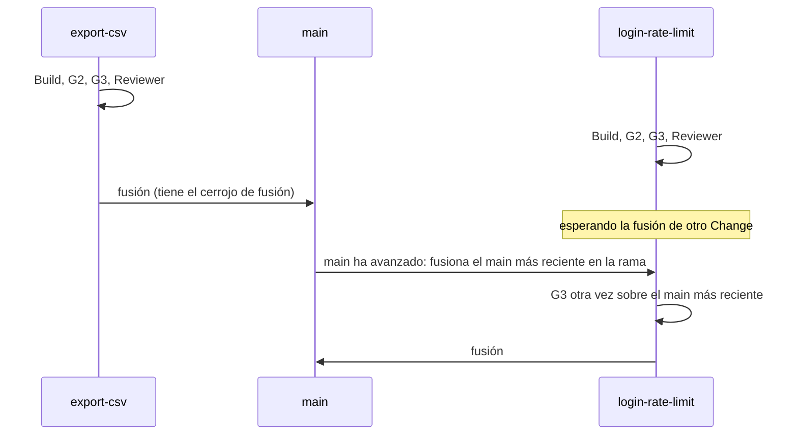

# Ejecutar Changes en paralelo

Se pueden construir varios Changes a la vez, cada uno en su propio worktree de git, y se
fusionan de uno en uno. Esta página muestra cómo fijar el límite, leer los avisos de rutas que
se solapan, seguir la cola de fusión y planificar los Changes para que choquen pocas veces.

## Antes de empezar

- Un proyecto con Changes listos para lanzar: consulta [Ejecutar un Change](run-a-change.md).
- Recursos suficientes en tu máquina para dos builds a la vez, y suscripciones de agentes que
  admitan dos sesiones simultáneas. El mutation testing (pruebas de mutación) y la ejecución
  completa de escenarios de G3 son los pasos más pesados.

Los ejemplos usan el proyecto `notes` y los Changes `export-csv` y `login-rate-limit`.

## Cómo comparten un proyecto varios Changes

Cada `gdd launch` crea un worktree para su Change, una segunda carpeta de trabajo del mismo
repositorio en la rama `change/<id>`, por defecto junto al proyecto
(`../notes.worktrees/export-csv`). El checkout principal se queda en main, así que tú y el
Orchestrator seguís trabajando ahí. Todos comparten un único estado: el `.gdd/` del checkout
principal guarda los registros, el log y las aprobaciones de todos los worktrees.

Lee el diagrama de arriba abajo: los dos Changes se construyen a la vez, y el segundo en
terminar toma el main más reciente y vuelve a pasar G3 antes de fusionarse.



## 1. Fijar cuántos Changes se construyen a la vez

El límite es `[parallel] max` en `gdd/rules.toml`, 2 por defecto. `gdd init` no escribe esa
tabla: añádela en main para cambiar el límite y, si quieres, también la carpeta de los
worktrees:

```toml
[parallel]
max = 3                 # changes building at once; a whole number from 1
folder = "../trees"     # where the worktrees go, from the project root
```

Solo cuentan los Changes que se están construyendo: `prepared`, `building` y `polishing`. Un
Change aparcado o que espera en G4 no ocupa plaza. Un lanzamiento que supera el límite se
rechaza antes de ejecutar nada, con la lista de los Changes que se están construyendo y lo que
le permitiría empezar. El mensaje tiene esta forma (ilustrativo: montado a partir del código,
no de una ejecución real):

```text
2 change(s) building, the cap is 2: cart-total, export-csv
login-rate-limit can launch once one of those building reaches G4 or is parked, or with a higher [parallel] max in gdd/rules.toml.
```

Los límites reales suelen estar por debajo del número que escribes: la memoria (dos ejecuciones
de G3 a la vez pueden llenar una máquina pequeña), las cuotas de las suscripciones de los
agentes y lo rápido que haces las sentadas.

## 2. Leer los avisos de solapamiento

Cuando lanzas un Change, gdd compara las rutas que planea con las rutas de todos los Changes en
curso: en construcción, aparcados o esperando en G4 (los Changes cerrados no cuentan). Un
solapamiento no detiene el lanzamiento: gdd avisa, nombra las rutas y guarda el aviso en la
Decision Inbox, en "Decided without you". Uno real, del propio repositorio de gdd:

```text
builder-session overlaps mutation-speed (in-pre): crates/gdd-acceptance/tests/acceptance.rs with crates/gdd-acceptance/tests/acceptance.rs; git settles it when builder-session merges.
```

Cómo se comparan las rutas:

| Rutas planeadas | ¿Se solapan? |
|---|---|
| `src/export.rs` y `src/export.rs` | Sí: es el mismo fichero |
| `src/export.rs` y `src/store.rs` | No: dos rutas simples solo se solapan cuando son la misma |
| `src/lib/**` y `src/lib/parse.rs` | Sí: un patrón de carpeta se solapa con todas las rutas que contiene |
| `src/**` y `docs/**` | No: se separan antes del primer comodín |

gdd solo compara las rutas planeadas. Un Change que toca un fichero que no había planeado puede
chocar igualmente con otro en la fusión.

## 3. Seguir la cola de fusión

Las fusiones van de una en una, bajo un cerrojo. Un Change que llega a su fusión mientras otro
se está fusionando dice `waiting for the merge of another change` y continúa cuando el cerrojo
queda libre.

Cuando main ha avanzado desde que un Change pasó G3, el Change no se fusiona sobre un main
antiguo:

1. gdd hace commit del trabajo del Change y fusiona el main más reciente en su rama, nunca con
   un rebase.
2. Dice `main moved under export-csv: G3 again on top of it` y vuelve a ejecutar G3 ahí.
3. Si está en verde, el Change se fusiona. Si está en rojo, se aparca con
   `G3 red on top of the latest main`. Cuando git no puede fusionar main en la rama, se aparca
   con `main moved under it and the merge has conflicts in <paths>` y la forma de salir:
   consulta
   [Resolver los conflictos de fusión con main](parked-change.md#6-resolver-los-conflictos-de-fusión-con-main).

Cualquier commit en main mientras se construye un Change cuenta como que main ha avanzado,
incluido un commit de documentación: ese Change ejecuta entonces G3 una segunda vez antes de
fusionarse.

## 4. Aprobar cosas mientras trabajan los agentes

Aprobar las zonas rojas, abrir G0 o guardar el autotest escribe un estado que comparten todos
los Changes. Mientras hay una llamada de agente en marcha, esa escritura espera a que termine,
y entretanto no empieza ninguna llamada nueva. Verás:

```text
waiting for the agents at work to end their call
G0 ok (machines).
```

Aprobar las zonas rojas tal como ya están no escribe nada, así que nunca espera.

## Buenas prácticas

- **No ejecutes a la vez dos Changes que tocan los mismos ficheros centrales.** Antes de lanzar
  un segundo Change, compara las `paths` de los dos registros. Los ficheros que toca casi
  cualquier Change (el punto de entrada de la línea de comandos, el fichero de pasos de los
  escenarios) son el origen de los conflictos: dos Changes que añaden pasos al final del mismo
  fichero siempre entran en conflicto.
- **Encadena los Changes que reestructuran la misma función.** Si los dos remodelan una misma
  función, quedarte con un lado del conflicto hace perder una funcionalidad. Lanza el segundo
  cuando el primero ya se haya fusionado.
- **Planifica las rutas con honestidad.** Los avisos de solapamiento y la comprobación de
  alcance solo conocen lo que el Change planea.
- **Agrupa los commits en main.** Cada commit mientras se construyen Changes obliga a cada uno
  a pasar G3 una segunda vez. Deja aparte el trabajo no relacionado (una rama de documentación,
  por ejemplo) y fusiónalo en un momento tranquilo.
- **No reinstales gdd mientras trabaja un agente.** gdd comprueba `.gdd/bin/` antes y después
  de cada llamada de agente, en todos los Changes: un `.gdd/bin/gdd-rust` nuevo en mitad de una
  llamada aparca el Change. Instálalo cuando no se esté construyendo ningún Change.

## Siguientes pasos

- [Volver a poner en marcha un Change aparcado](parked-change.md): qué hacer cuando una fusión
  aparca un Change.
- [Ejecutar un Change](run-a-change.md): lanzar, seguir en el Board y relanzar.
- [Configuración, rules.toml](../reference/configuration.md#parallel): `[parallel]`, el límite
  y la carpeta de los worktrees.
- [La vida de un Change](../explanation/life-of-a-change.md): en qué punto de la receta está la
  cola de fusión.
