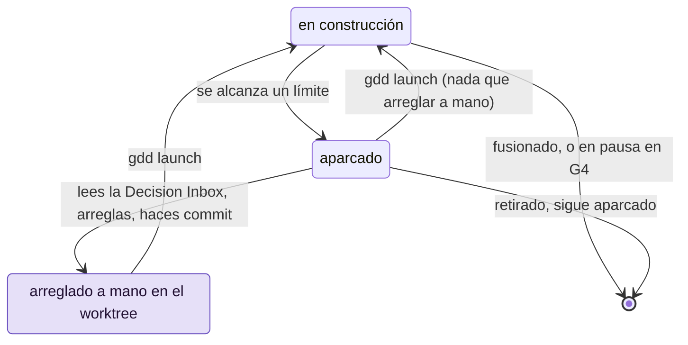

# Volver a poner en marcha un Change aparcado

Un Change se aparca cuando llega a un límite que solo una persona puede levantar: las puertas
siguen en rojo después de todos los reintentos, el Reviewer sigue diciendo KO, o main ha
avanzado por debajo y hay conflictos. Esta página muestra cómo leer el motivo, arreglarlo y
volver a lanzar el Change, o retirarlo.

## Antes de empezar

- Un Change que `bin/gdd status` lista como `parked`. Cuando un Change se aparca, `gdd launch`
  sale con 1 e imprime el motivo:
  `Change export-csv parked: <reason>. Message in .gdd/changes/export-csv/inbox.md`.
- Su worktree: un Change aparcado lo conserva, por defecto junto al proyecto
  (`../notes.worktrees/export-csv` en el proyecto `notes`), o en la carpeta `[parallel] folder`
  de `gdd/rules.toml`. Ahí está el trabajo de los agentes.

Los ejemplos usan el Change `export-csv` del proyecto `notes`.

## El ciclo de aparcar y relanzar

Un Change aparcado te espera; cada relanzamiento vuelve a ejecutar la receta desde el
principio, y el Change puede aparcarse otra vez por otro motivo.



## Por qué se aparcan los Changes

Cada bucle de la receta tiene un límite (`[limits]` de `gdd/rules.toml`), y el motivo nombra el
que se ha alcanzado:

| Motivo | Qué ha pasado | Salida habitual |
|---|---|---|
| `G2 still red after 3 retries and 1 replan` | El Builder no ha conseguido poner en verde la puerta del bucle (G2, *Loop Gate*): lint, tipos, tests, Path Guard o el alcance. La replanificación del Orchestrator tampoco ha ayudado. | Lee `g2.json`. Arregla lo que el Builder no pudo: el paquete, un escenario, un paso, el arnés. |
| `G3 still red after one fix` | La puerta de integración (G3, *Merge Gate*) ha fallado, y una ronda más del Builder no lo ha arreglado. | Lee `g3.json`: un escenario, un ejemplo oculto, el análisis de seguridad o un mutante superviviente. |
| `Reviewer KO or G3 red after one fix` | El Reviewer ha dicho KO dos veces, o G3 se ha roto durante el arreglo. | Lee el último `outputs/reviewer-<n>.md`. Un hallazgo que solo se arregla en los pasos necesita un arreglo a mano: el modo build no puede tocarlos. |
| `main moved under it and the merge has conflicts in ...` | Otro Change se ha fusionado antes y git no puede fusionar main en este. | [Resuelve los conflictos](#6-resolver-los-conflictos-de-fusión-con-main). |
| `G3 red on top of the latest main` | main se ha fusionado sin problemas, pero G3 falla con él. | Arréglalo en la rama, igual que con G3 en rojo. |
| `Path Guard failed after test mode: ...` | El Builder en modo test ha escrito lo que solo puede escribir el modo build, como código de producción. | Quita esos ficheros del worktree. |
| `the Builder in build mode changed GDD state: ...` | Un agente ha escrito en `.gdd/`. gdd ha restaurado el estado. | Lee la salida del agente; revisa sus instrucciones. |
| `the Reviewer changed ...: Reviewers only read` | El Reviewer ha editado un fichero. | Quita sus ediciones; revisa su ficha de agente. |
| `the Builder in build mode did not answer within 3600 seconds` | Al agente se le ha acabado el tiempo y se le ha detenido. | Revisa el inicio de sesión y la cuota del agente; `[limits] agent_timeout_s` fija el tiempo. |
| `the spike spent ... USD of its budget of ... USD` | Un Spike ha llegado a `[spike] max_usd`. | Consulta [Explorar con un Spike](spikes.md). |
| `the merge needs the main checkout (...) without uncommitted changes in tracked files: commit or stash them.` | Alguien ha editado un fichero versionado en el checkout principal mientras el Change se ejecutaba. | Haz commit o stash de la edición y después relanza. |
| `production may have it, but gdd cannot go on with it (...)` | El Change se ha quedado a mitad de una promoción. | Mira primero producción: consulta [Responder a la puerta de salida](release-gate.md). |

Una ruta fuera del plan con un color más alto que el del Change también hace fallar G2, en
`scope`:

```text
src/store/index.rs: outside the package and red (the change is yellow); remove it, or the Orchestrator widens the scope
```

`gdd classify` cuenta lo que el Change ha tocado de verdad, así que, después de un aparcamiento
así, muestra el Change en rojo. Para conservar la ruta, relanza: el Change ahora es rojo y
`gdd launch` se para en `Red change: a human must approve the plan (gate 'plan').` hasta que
apruebes su plan (`bin/gdd gate plan ok export-csv --by human`). Para descartar la ruta, borra
el fichero en el worktree y relanza.

## 1. Leer la Decision Inbox

```bash
bin/gdd inbox export-csv
```

Deberías ver algo parecido a esto (aquí, un Change aparcado con `gdd park`):

```text
# Decision Inbox · export-csv · Export notes as CSV

Color yellow · lane full · state parked

## Needs your decision
- Tags with spaces: one field joined by spaces, or one column per tag? I recommend one field.

## Decided without you
- The header stays in English whatever the language of the notes.

## Parked
- Waiting for the bank's CSV format before going on
```

La bandeja es un único mensaje por Change, que también se guarda en
`.gdd/changes/export-csv/inbox.md`:

- **Needs your decision** (necesita tu decisión): preguntas que han dejado los agentes, cada
  una con una recomendación.
- **Decided without you** (decidido sin ti): lo que han decidido los agentes y por qué,
  incluidas las rutas fuera del plan que ha aceptado la comprobación de alcance y los avisos de
  que el Change se solapa con otro.
- **Parked** (aparcado): cada motivo por el que se ha aparcado el Change, el más reciente al
  final.
- **How it works** (cómo funciona), al principio, cuando el Reviewer la ha escrito: una
  explicación breve del código.

Así se ve un conflicto de fusión en una bandeja real (con las rutas reescritas):

```text
## Parked
- Reviewer KO or G3 red after one fix
- main moved under it and the merge has conflicts in crates/gdd-core/src/change.rs, crates/gdd-core/src/recipe/mod.rs: merge main into change/builder-session in its worktree (/home/me/gdd/../gdd.worktrees/builder-session), settle the conflicts, commit, then gdd launch builder-session
```

## 2. Leer lo que han dicho las puertas y los agentes

Todo lo que ha dejado la ejecución está en `.gdd/changes/export-csv/`, en el checkout
principal:

| Fichero | Qué contiene |
|---|---|
| `g2.json`, `g3.json` | El último informe de cada puerta: qué ha pasado, qué se ha omitido y las líneas de error de cada comando que ha fallado. |
| `review.md` | El veredicto del Reviewer y sus hallazgos. |
| `replan.md` | La replanificación del Orchestrator: la causa y el nuevo enfoque. |
| `outputs/<role>-<n>.md` | Lo que ha dicho cada llamada de agente, numerado en orden (`builder-build-3.md`, `reviewer-2.md`). |
| `package.md` | El paquete de contexto con el que ha trabajado el Builder. |

`bin/gdd report --change export-csv` muestra lo que ha costado la ejecución hasta ahora.

## 3. Responder a lo que te necesita

Resuelve cada pregunta de la bandeja. Cuando la respuesta cambia el trabajo, ponla donde la
leen los agentes: el paquete, un escenario (que necesita G1 otra vez, consulta
[Escribir y aprobar escenarios](write-scenarios.md#8-cambia-un-escenario-después-de-aprobarlo)), el
plan o el mapa de zonas en main. Deja una nota de lo que has decidido:

```bash
bin/gdd note export-csv decided "Tags go in one field, joined by spaces."
```

Deberías ver:

```text
noted
```

Las notas son `needs`, `decided` o `parked`. En el siguiente lanzamiento, las preguntas de esta
ejecución se marcan como resueltas: la bandeja las guarda en `change.json` y solo muestra
cuántas había, por ejemplo
`_1 earlier request(s) were resolved before the last launch (kept in change.json)._`

## 4. Arreglar a mano en el worktree

Algunas causas necesitan un arreglo a mano: un paso que solo podía escribir el modo test, un
escenario que contradice el Change, un problema del arnés. Trabaja en el worktree del Change,
nunca en main:

```bash
cd ../notes.worktrees/export-csv
git status
```

> [!WARNING]
> Haz commit en la rama del trabajo pendiente de los agentes antes de cualquier commit a mano.
> Un Change aparcado conserva sin commit ese trabajo en el worktree, y el relanzamiento empieza
> su fase Build en el commit que haya en el worktree. Si solo haces commit de tus propios
> ficheros, el trabajo de los agentes queda después de ese punto de partida: Path Guard culpa
> entonces al modo build de los pasos que escribió el modo test, y el Change se vuelve a
> aparcar.

```bash
git add -A
git commit -m "export-csv: the agents' work before the hand fix"
# now your fix
git add tests/acceptance/export_csv.rs
git commit -m "export-csv: hand fix of the export step"
git log --oneline -3
```

Comprueba con `git log` y `git status` que los dos commits están ahí y que el árbol está
limpio. Después, vuelve al checkout principal:

```bash
cd ../../notes
```

Si no haces ningún commit a mano, el propio relanzamiento hace commit del trabajo de los
agentes, como `gdd(export-csv): work of the earlier run, before relaunch`, en cuanto lo aceptan
las puertas que lo juzgaron.

## 5. Lanzarlo otra vez

Desde el checkout principal, en main, sin cambios sin commit en ficheros versionados:

```bash
bin/gdd launch export-csv
```

Un relanzamiento vuelve a comprobar el Change (G0, las zonas rojas, G1, el plan de un Change
rojo, las familias de modelos) y ejecuta G2 sobre el código de la rama, juzgado con Path Guard
desde el punto en que la rama salió de main. Si G2 ya está en verde, se salta el Builder y la
receta sigue con G3 y el Reviewer (`resume_green` en el registro,
`G2 already green: Builder skipped` en el log). Si está en rojo, la fase Build vuelve a empezar
desde el principio, con todos los reintentos y una replanificación.

`gdd launch` se niega a ejecutarse desde el worktree de un Change
(`run gdd launch from the main checkout (...)`) y cuando hay cambios sin commit fuera de la
rama del Change
(`The working tree has uncommitted changes. Commit them before launching a change.`).

## 6. Resolver los conflictos de fusión con main

Las fusiones van de una en una. Cuando main ha avanzado desde que el Change pasó G3, gdd
fusiona el main más reciente en la rama del Change y vuelve a ejecutar G3 encima. Cuando git no
puede fusionar, gdd abandona la fusión, deja la rama con su trabajo en un commit
(`gdd(export-csv): change work`) y aparca el Change. gdd no resuelve los conflictos por ti. En
el worktree:

```bash
cd ../notes.worktrees/export-csv
git merge main
# settle every file git names, keeping what both sides added
git add -A
git commit --no-edit
```

Antes de relanzar, ejecuta los tests de los ficheros que has resuelto; después, lanza desde el
checkout principal:

```bash
cd ../../notes
bin/gdd launch export-csv
```

El relanzamiento ejecuta G3 sobre la fusión, y el Reviewer también la lee. Para evitar el
conflicto la próxima vez, consulta [Ejecutar Changes en paralelo](parallel-changes.md).

## 7. Retirar un Change

Para detener un Change definitivamente, apárcalo con el motivo, que va a su Decision Inbox:

```bash
bin/gdd park export-csv "Waiting for the bank's CSV format before going on"
```

Deberías ver:

```text
Change export-csv parked: Waiting for the bank's CSV format before going on. Message in .gdd/changes/export-csv/inbox.md
```

`gdd park` siempre sale con 1, así que un script que lo ejecute se detiene ahí. El Change
conserva su registro, su rama y su worktree, y `gdd launch` puede retomarlo más adelante.
Mientras siga aparcado, un Change que planee una ruta que se solape con la suya se lanza con un
aviso que lo nombra (consulta [Ejecutar Changes en paralelo](parallel-changes.md)).

## Siguientes pasos

- [Solución de problemas](troubleshooting.md): más mensajes, con sus causas y cómo arreglarlos.
- [Ejecutar Changes en paralelo](parallel-changes.md): la cola de fusión y cómo conseguir que
  los conflictos sean raros.
- [Ficheros que escribe gdd](../reference/files.md): el registro, el log y la Decision Inbox.
- [La vida de un Change](../explanation/life-of-a-change.md): cada paso que vuelve a ejecutar
  un relanzamiento.
