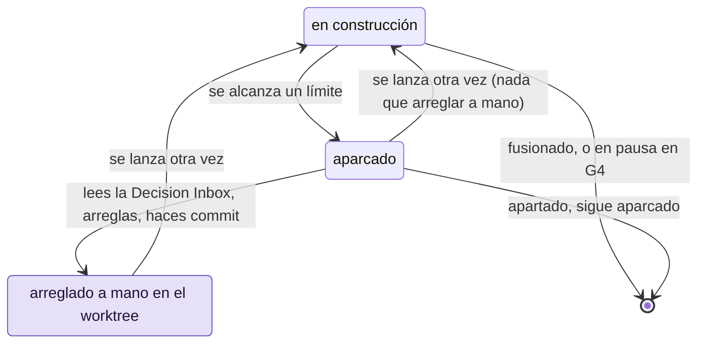

# Volver a poner en marcha un Change aparcado

Usa esta página cuando un Change se aparca. Cada bucle de la receta tiene un límite, así que un
Change que no consigue pasar se detiene y espera a una persona en lugar de reintentar, y gastar,
sin fin. Las causas habituales: las puertas han seguido en rojo después de todos los reintentos, el
Reviewer ha vuelto a decir KO, u otro Change se ha fusionado antes en main y los dos chocan. El Orchestrator te dice por qué y
propone el siguiente paso. Tú decides, arreglas lo que solo tú puedes arreglar, y el Change
vuelve a ejecutarse.

## Antes de empezar

- Un Change aparcado. El Orchestrator te avisa cuando se aparca uno, el Board lo muestra en
  Build y `/gdd-status` lo nombra.
- Su worktree: un Change aparcado lo conserva, por defecto junto al proyecto
  (`../notes.worktrees/export-csv` en el proyecto `notes`). Ahí está el trabajo de los agentes.

Los ejemplos usan el Change `export-csv` del proyecto `notes`.

## El ciclo de aparcar y relanzar

Un Change aparcado te espera. Cada relanzamiento vuelve a ejecutar la receta desde el
principio, y el Change puede aparcarse otra vez por otro motivo.



## Por qué se aparcan los Changes

Cada bucle de la receta tiene un límite (`[limits]` de `gdd/rules.toml`), y el motivo nombra el
que se ha alcanzado:

| Motivo | Qué ha pasado | Salida habitual |
|---|---|---|
| `G2 still red after 3 retries and 1 replan` | El Builder no ha conseguido poner en verde la puerta del bucle (G2, *Loop Gate*) en sus 3 rondas del modo build, los 3 reintentos: lint, tipos, tests, Path Guard o el alcance. La replanificación del Orchestrator y una ronda más tampoco han ayudado. | Lee `g2.json`. Arregla lo que el Builder no pudo: el paquete, un escenario, un paso, el arnés. |
| `G3 still red after one fix` | La puerta de integración (G3, *Merge Gate*) ha fallado, y una ronda más del Builder no lo ha arreglado. | Lee `g3.json`: un escenario, un ejemplo oculto, el análisis de seguridad o un mutante superviviente. |
| `Reviewer KO or G3 red after one fix` | El Reviewer ha dicho KO, y otra vez KO después de una ronda de arreglo, o G3 se ha roto durante ese arreglo. La ronda de arreglo es una ronda del Builder en modo build. Cuando un hallazgo nombra un fichero que solo puede escribir el modo test, como un paso, el Builder en modo test tiene antes una ronda, que comprueba Path Guard. | Lee el último `outputs/reviewer-<n>.md`. Arregla lo que el Builder no pudo, o responde al hallazgo. |
| `main moved under it and the merge has conflicts in ...` | Otro Change se ha fusionado antes y git no puede fusionar main en este. | [Resuelve los conflictos](#6-resuelve-los-conflictos-de-fusión-con-main). |
| `G3 red on top of the latest main` | main se ha fusionado sin problemas, pero G3 falla con él. | Arréglalo en la rama, igual que con G3 en rojo. |
| `Path Guard failed after test mode: ...` | El Builder en modo test ha escrito lo que solo puede escribir el modo build, como código de producción. | Quita esos ficheros del worktree. |
| `the Builder in build mode changed GDD state: ...` | Un agente ha escrito en `.gdd/`. gdd ha restaurado el estado. | Lee la salida del agente; revisa sus instrucciones. |
| `the Reviewer changed ...: Reviewers only read` | El Reviewer ha editado un fichero. | Quita sus ediciones; revisa su ficha de agente. |
| `the Builder in build mode did not answer within 3600 seconds` | Al agente se le ha acabado el tiempo y se le ha detenido. | Revisa el inicio de sesión y la cuota del agente; `[limits] agent_timeout_s` fija el tiempo. |
| `the spike spent ... USD of its budget of ... USD` | Un Spike ha llegado a `[spike] max_usd`. | Consulta [Explorar con un Spike](spikes.md). |
| `the merge needs the main checkout (...) without uncommitted changes in tracked files: commit or stash them.` | Alguien ha editado un fichero versionado en el checkout principal mientras el Change se ejecutaba. | Haz commit o stash de la edición y después relanza. |
| `production may have it, but gdd cannot go on with it (...)` | El Change se ha quedado a mitad de una promoción. | Mira primero producción: consulta [Revisar un Change en G4](release-gate.md). |

Una ruta fuera del plan con un color más alto que el del Change también hace fallar G2, en
`scope`:

```text
src/store/index.rs: outside the package and red (the change is yellow); remove it, or the Orchestrator widens the scope
```

gdd cuenta lo que el Change ha tocado de verdad, así que, después de un aparcamiento así, el
Change es rojo. Para conservar la ruta, relanza: ahora el Change necesita que se apruebe su
plan, y el Orchestrator te lo trae como en cualquier sentada. Para descartar la ruta, borra el
fichero en el worktree y después relanza.

## 1. Lee la Decision Inbox

Cuando un Change se aparca, gdd imprime una línea: el Change, el motivo y dónde está su mensaje.
El Orchestrator que lo lanzó te pasa esa línea en el chat, lee la Decision Inbox del Change y
propone el siguiente paso. Dos aparcamientos reales, de Changes del propio repositorio de gdd
(con las rutas reescritas):

<!-- Real output of gdd launch, gdd 0.1.0, in gdd's own repository. The Orchestrator's own
     words around it are not reproduced here: they vary with the agent and the language of the
     project. -->

```text
Change one-gdd parked: Reviewer KO or G3 red after one fix. Message in .gdd/changes/one-gdd/inbox.md
```

```text
Change role-guard parked: main moved under it and the merge has conflicts in crates/gdd/src/lib.rs: merge main into change/role-guard in its worktree (/home/me/gdd.worktrees/role-guard), settle the conflicts, commit, then gdd launch role-guard. Message in .gdd/changes/role-guard/inbox.md
```

El comando del final de la segunda línea (`gdd launch role-guard`) lo ejecuta el Orchestrator,
una vez resueltos los conflictos: le pides que vuelva a lanzar el Change (paso 5).

La bandeja en sí es un único mensaje por Change, que también está en el Board (`Enter` sobre el
Change) y en `.gdd/changes/export-csv/inbox.md`. La de un Change aparcado a mano:

```text
# Decision Inbox · export-csv · Export notes as CSV

Color yellow · lane full · state parked

## Needs your decision
- Tags with spaces: one field joined by spaces, or one column per tag? I recommend one field.

## Decided without you
- The header stays in English whatever the language of the notes.

## Parked
- Waiting for the bank's CSV format before going on
```

- **Needs your decision** (necesita tu decisión): preguntas que han dejado los agentes, cada
  una con una recomendación.
- **Decided without you** (decidido sin ti): lo que han decidido los agentes y por qué,
  incluidas las rutas fuera del plan que ha aceptado la comprobación de alcance y los avisos de
  que el Change se solapa con otro.
- **Parked** (aparcado): cada motivo por el que se ha aparcado el Change, el más reciente al
  final.
- **How it works** (cómo funciona), al principio, cuando el Reviewer la ha escrito: una
  explicación breve del código.

Así se ve un conflicto de fusión en una bandeja real (con las rutas reescritas):

```text
## Parked
- Reviewer KO or G3 red after one fix
- main moved under it and the merge has conflicts in crates/gdd-core/src/change.rs, crates/gdd-core/src/recipe/mod.rs: merge main into change/builder-session in its worktree (/home/me/gdd/../gdd.worktrees/builder-session), settle the conflicts, commit, then gdd launch builder-session
```

## 2. Lee lo que han dicho las puertas y los agentes

Cuando la bandeja no basta, todo lo que ha dejado la ejecución está en
`.gdd/changes/export-csv/`, en el checkout principal. Pide al Orchestrator que lo lea contigo,
o ábrelo tú:

| Fichero | Qué contiene |
|---|---|
| `g2.json`, `g3.json` | El último informe de cada puerta: qué ha pasado, qué se ha omitido y las líneas de error de cada comando que ha fallado. |
| `review.md` | El veredicto del Reviewer y sus hallazgos. |
| `replan.md` | La replanificación del Orchestrator: la causa y el nuevo enfoque. |
| `outputs/<role>-<n>.md` | Lo que ha dicho cada llamada de agente, numerado en orden (`builder-build-3.md`, `reviewer-2.md`). |
| `package.md` | El paquete de contexto con el que ha trabajado el Builder. |

## 3. Responde a lo que te necesita

Responde a cada pregunta de la bandeja en el chat, con palabras. Cuando tu respuesta cambia el
trabajo, el Orchestrator la pone donde la leen los agentes: el paquete, un escenario (que
necesita otra vez tu OK, consulta [Aprobar los
escenarios](write-scenarios.md#5-cambia-un-escenario-después-de-aprobarlo)), el plan o el mapa
de zonas en main. También deja en la bandeja una nota de lo que has decidido.

En el siguiente lanzamiento, las preguntas de esta ejecución se marcan como resueltas. gdd las
guarda en el registro del Change, `change.json`, y la bandeja solo muestra cuántas había, por
ejemplo `_1 earlier request(s) were resolved before the last launch (kept in change.json)._`

## 4. Arregla a mano en el worktree

Algunas causas necesitan un arreglo a mano: un paso que solo podía escribir el modo test, un
escenario que contradice el Change, un problema del arnés (los ficheros con los que gdd
comprueba tu proyecto). Trabaja en el worktree del Change,
nunca en main:

```bash
cd ../notes.worktrees/export-csv
git status
```

> [!WARNING]
> Si arreglas algo a mano, haz antes commit en la rama del trabajo de los agentes. Un Change
> aparcado conserva ese trabajo sin commit, y el relanzamiento empieza su construcción en el
> commit que haya en el worktree. Path Guard juzga todo lo que venga detrás de ese commit como
> trabajo del modo build. Así que, si solo haces commit de tus propios ficheros, los pasos que
> escribió el modo test quedan detrás de ese punto de partida, Path Guard culpa de ellos al modo
> build y el Change se vuelve a aparcar.

```bash
git add -A
git commit -m "export-csv: the agents' work before the hand fix"
# now your fix
git add tests/acceptance/export_csv.rs
git commit -m "export-csv: hand fix of the export step"
git log --oneline -3
```

Comprueba con `git log` y `git status` que los dos commits están ahí y que el árbol está
limpio. Después, vuelve al checkout principal:

```bash
cd ../../notes
```

Si no haces ningún commit a mano, el propio relanzamiento hace commit del trabajo de los
agentes, como `gdd(export-csv): work of the earlier run, before relaunch`, en cuanto lo aceptan
las puertas que lo juzgaron.

## 5. Lánzalo otra vez

Para volver a ejecutar el Change, dile al Orchestrator que lo lance. Un relanzamiento vuelve a comprobar el
Change (G0, las zonas rojas, G1, el plan de un Change rojo, las familias de modelos) y ejecuta
G2 sobre el código de la rama. Si G2 ya está en verde, se salta el Builder y la receta sigue con
G3 y el Reviewer (`G2 already green: Builder skipped` en el log). Si está en rojo, la
construcción vuelve a empezar desde el principio, con todos los reintentos y una
replanificación.

El relanzamiento se ejecuta desde el checkout principal, en main, sin modificaciones sin commit
en ficheros versionados. Si no, se rechaza con `run gdd launch from the main checkout (...)` o
`The working tree has uncommitted changes. Commit them before launching a change.`

## 6. Resuelve los conflictos de fusión con main

Las fusiones van de una en una. Cuando main ha avanzado desde que el Change pasó G3, gdd
fusiona el main más reciente en la rama del Change y vuelve a ejecutar G3 encima. Cuando git no
puede fusionar, gdd abandona la fusión, deja la rama con su trabajo en un commit
(`gdd(export-csv): change work`) y aparca el Change. gdd no resuelve los conflictos por ti. En
el worktree:

```bash
cd ../notes.worktrees/export-csv
git merge main
# settle every file git names, keeping what both sides added
git add -A
git commit --no-edit
```

Ejecuta los tests de los ficheros que has resuelto, vuelve al checkout principal y dile al
Orchestrator que vuelva a lanzar el Change. El relanzamiento ejecuta G3 sobre la fusión, y el
Reviewer también la lee. Para evitar el conflicto la próxima vez, consulta [Ejecutar Changes en
paralelo](parallel-changes.md).

## 7. Aparta un Change

Para detener un Change por ahora, por ejemplo mientras esperas algo de fuera del proyecto, pide
al Orchestrator que lo aparque con el motivo. El motivo va a su Decision Inbox. gdd imprime:

```text
Change export-csv parked: Waiting for the bank's CSV format before going on. Message in .gdd/changes/export-csv/inbox.md
```

El Change conserva su registro, su rama y su worktree. Sigue aparcado hasta que pidas al
Orchestrator que lo vuelva a lanzar. Mientras espera, un Change que planee una ruta que se
solape con la suya se lanza con un aviso que lo nombra (consulta [Ejecutar Changes en
paralelo](parallel-changes.md)).

## Por dentro

Los motivos salen de la receta de [`gdd launch`](../reference/cli/launch.md), que sale con 1
cuando un Change se aparca; un relanzamiento es el mismo comando.
[`gdd inbox`](../reference/cli/inbox.md) imprime la Decision Inbox,
[`gdd note`](../reference/cli/note.md) le añade una nota `needs`, `decided` o `parked`, y
[`gdd park`](../reference/cli/park.md) aparca un Change a mano (siempre sale con 1).
[`gdd report --change CHANGE`](../reference/cli/report.md) muestra lo que ha costado la
ejecución hasta ahora.

## Siguientes pasos

- [Solución de problemas](troubleshooting.md): más mensajes, con sus causas y cómo arreglarlos.
- [Ejecutar Changes en paralelo](parallel-changes.md): la cola de fusión y cómo conseguir que
  los conflictos sean raros.
- [Ficheros que escribe gdd](../reference/files.md): el registro, el log y la Decision Inbox.
- [La vida de un Change](../explanation/life-of-a-change.md): cada paso que vuelve a ejecutar
  un relanzamiento.
