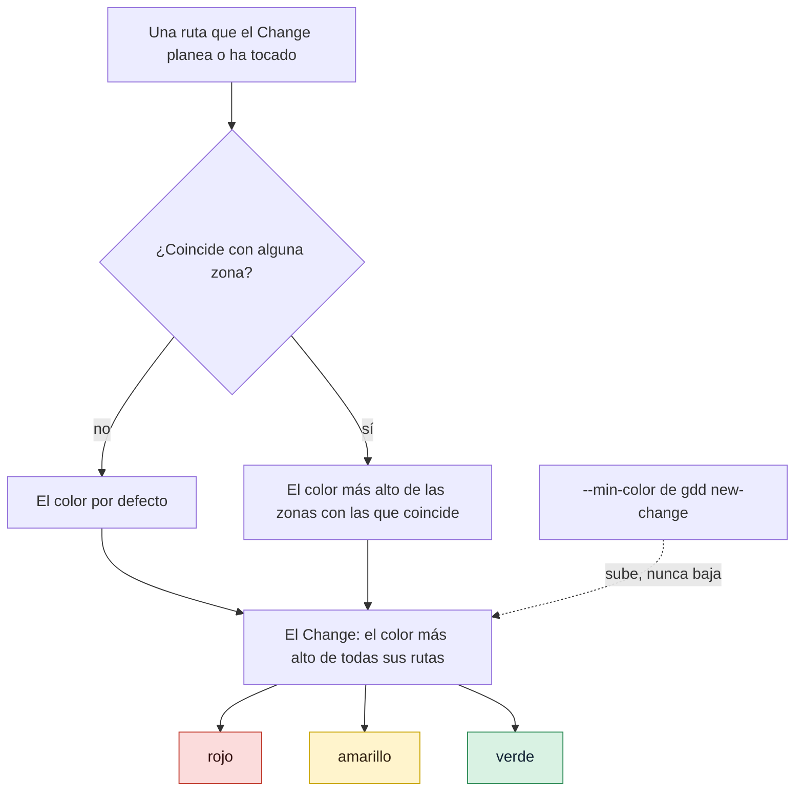

# Mapear y aprobar zonas rojas

Una zona roja es un conjunto de rutas donde un error sería grave: todo Change que toca una es
rojo, y los Changes rojos pasan las puertas más estrictas. Esta página muestra cómo convertir
las áreas sensibles de tu Project Brief en zonas de `gdd/zones.toml`, comprobar el color que
recibe un Change y aprobar las zonas rojas para que se puedan construir Changes.

## Antes de empezar

- Un proyecto preparado con `gdd init`, con las áreas sensibles descritas con palabras en
  `docs/brief.md`. Consulta [Llevar gdd a un proyecto existente](adopt-existing-project.md) o
  el [tutorial](../getting-started/tutorial.md).
- Carpetas reales que mapear. GDD mapea las zonas rojas al final de Discover, cuando ya existen
  la arquitectura y los primeros escenarios; antes de eso, el código sin mapear es amarillo.

Los ejemplos usan `shop`, una pequeña tienda web con el stack de TypeScript. Ejecuta todos los
comandos desde la raíz del proyecto, en main.

## Cómo recibe su color una ruta

Sigue una ruta desde arriba: las zonas con las que coincide deciden su color, y el color más
alto de todas las rutas decide el color del Change.



## 1. Leer las áreas sensibles del Brief

`gdd init --sensitive` las escribe en el Brief, un área cada vez. En `shop`:

```text
## What would be serious if it failed (sensitive areas, in words)

These become red zones at the end of Discover, once there are real folders:

1. Someone logs in as another customer
2. Charging a customer twice
```

Cada área se convierte en una zona roja, con el área como motivo.

## 2. Escribir las zonas en `gdd/zones.toml`

`gdd init` ya escribe dos zonas rojas que tiene todo proyecto: el propio arnés (`gdd/**`,
`bin/**`, el workflow de CI y las carpetas de los agentes) y la cadena de suministro de cada
stack (en TypeScript, `package.json`, `package-lock.json`, `.npmrc` y los ficheros de
osv-scanner). Añade las tuyas al final:

```toml
[[zone]]
color = "red"
paths = ["src/auth/**"]
reason = "Someone logs in as another customer"

[[zone]]
color = "red"
paths = ["src/payments/**"]
reason = "Charging a customer twice"
```

| Clave | Dónde | Qué dice |
|---|---|---|
| `default` | al principio del fichero | El color de una ruta que no coincide con ninguna zona. `yellow` por defecto: código sin zona es código sin pruebas conocidas. |
| `color` | en cada `[[zone]]` | `green`, `yellow` o `red`. Cualquier otra palabra es un error. |
| `paths` | en cada `[[zone]]` | Patrones desde la raíz del proyecto. |
| `reason` | en cada `[[zone]]` | Por qué la zona tiene su color, con palabras. Lo muestran `gdd classify` y la sentada. |

Los patrones siguen tres reglas:

| Patrón | Coincide con | No coincide con |
|---|---|---|
| `docs/**` | `docs/a.md`, `docs/guide/deep/page.txt` | `notes/readme.md` |
| `*.md` | `readme.md` | `notes/readme.md`: un asterisco no sale de su carpeta |
| `src/*/mod.rs` | `src/a/mod.rs` | `src/a/b/mod.rs` |
| `**/secrets.toml` | `secrets.toml` en la raíz, `config/secrets.toml` | |

`?` coincide con un carácter cualquiera salvo `/`. Cuando una ruta coincide con varias zonas,
gana el color más alto, sea cual sea su orden en el fichero: una zona verde dentro de una roja
no vuelve verdes sus rutas. Si dudas entre dos colores, elige el más alto.

Un color que no sea uno de los tres detiene todos los comandos que leen el mapa:

```text
error: gdd/zones.toml: unknown color "crimson" (use green, yellow or red)
```

## 3. Comprobar el color que recibe un Change

Haz commit del mapa en main:

```bash
git add gdd/zones.toml
git commit -m "Zone map: red zones from the Brief"
```

Cada `gdd new-change` imprime su clasificación, con el motivo de cada ruta:

```bash
bin/gdd new-change login-rate-limit --title "Limit login attempts" --paths src/auth/login.ts src/ui/login-form.ts docs/security.md
```

Deberías ver:

```text
{
  "change": "login-rate-limit",
  "color": "red",
  "lane": "full",
  "reasons": [
    "docs/security.md -> green (Documentation)",
    "src/auth/login.ts -> red (Someone logs in as another customer)",
    "src/ui/login-form.ts -> yellow (no zone: default color)"
  ],
  ...
```

En un Change que ya existe, `bin/gdd classify login-rate-limit` imprime lo mismo, y cuenta
tanto las rutas planeadas como las que el Change ha tocado de verdad en su rama. Un Change rojo
necesita un plan aprobado por la persona, la revisión profunda del Reviewer, mutation testing
(pruebas de mutación) y la puerta de salida (G4, *Release Gate*), diga lo que diga la tabla de
reglas: consulta [Cómo elige el riesgo las puertas](../explanation/risk.md).

> [!NOTE]
> El mapa de zonas forma parte del arnés: `gdd/**` es rojo y está protegido frente a todos los
> agentes. Modifícalo en main, fuera de cualquier Change. Una rama de Change que lo edita es un
> Change rojo, y Path Guard hace fallar a cualquier Builder que lo toque.

## 4. Aprobar las zonas rojas

Solo una persona aprueba las zonas rojas, una vez para todo el proyecto. Normalmente ocurre en la
sentada del primer Change: `gdd sitting CHANGE` muestra las zonas pendientes, cada una con su
motivo, y al aprobarlas ahí quedan registradas junto con los escenarios (consulta
[Escribir y aprobar escenarios](write-scenarios.md#5-apruébalos-en-la-sentada)). Sin
sentada:

```bash
bin/gdd gate zones ok --by human --note "Mapped from the Brief"
```

Deberías ver:

```text
Red zones ok (4 red zone(s)).
```

La cuenta incluye las dos zonas que escribió `gdd init`. Si vuelves a aprobarlas sin que nada
haya cambiado, gdd solo lo indica:

```text
Red zones ok (4 red zone(s)): already approved, nothing changed.
```

Las máquinas no pueden aprobarlas: `--by machines` se rechaza con
`error: Red zones are approved by a human (--by human).` La aprobación se guarda en
`.gdd/zones.json`, con un hash de las zonas rojas tal como estaban.

## 5. Saber qué espera a la aprobación

`bin/gdd status` muestra en qué punto están las zonas:

```text
Red zones: pending · Red zones not approved yet: the Orchestrator proposes them at the end of Discover.
```

Hasta que una persona las apruebe, solo se pueden construir Spikes: un Spike explora y nunca
fusiona su código (consulta [Explorar con un Spike](spikes.md)). Cualquier otro Change se
rechaza al prepararlo, antes de que se ejecute ningún agente:

```text
error: Red zones not approved yet: the Orchestrator proposes them at the end of Discover. (bin/gdd gate zones ok --by human)
```

## 6. Volver a aprobar cuando cambian las zonas rojas

Añadir, quitar o editar una zona roja (sus rutas, su motivo, cualquier clave) retira la
aprobación. Aquí `src/refunds/**` se une a la zona de pagos:

```toml
[[zone]]
color = "red"
paths = ["src/payments/**", "src/refunds/**"]
reason = "Charging a customer twice"
```

Entonces `bin/gdd status` dice:

```text
Red zones: pending · Red zones changed after their approval: a human must approve them again.
```

y ningún Change, salvo un Spike, arranca hasta que vuelvas a ejecutar
`bin/gdd gate zones ok --by human` o las apruebes en la siguiente sentada. Cuando el
Orchestrator encuentra un área sensible nueva mientras prepara un Change, primero añade la zona
en main, para que la apruebes en la sentada de ese Change.

La aprobación solo cubre las zonas rojas. Cambiar una zona verde o amarilla, o el color
`default`, no la vuelve a pedir, aunque puede bajar el color de algunas rutas: revisa esas
ediciones en el commit que las introduce.

## Siguientes pasos

- [Escribir y aprobar escenarios](write-scenarios.md): la sentada en la que se aprueban juntos
  las zonas, los escenarios y el plan rojo.
- [Cómo elige el riesgo las puertas](../explanation/risk.md): qué recibe cada color y por qué
  manda el color.
- [Explorar con un Spike](spikes.md): el único trabajo que empieza antes de que se aprueben las
  zonas.
- [Configuración: zones.toml](../reference/configuration.md#zonestoml): todas las claves del
  mapa de zonas.
