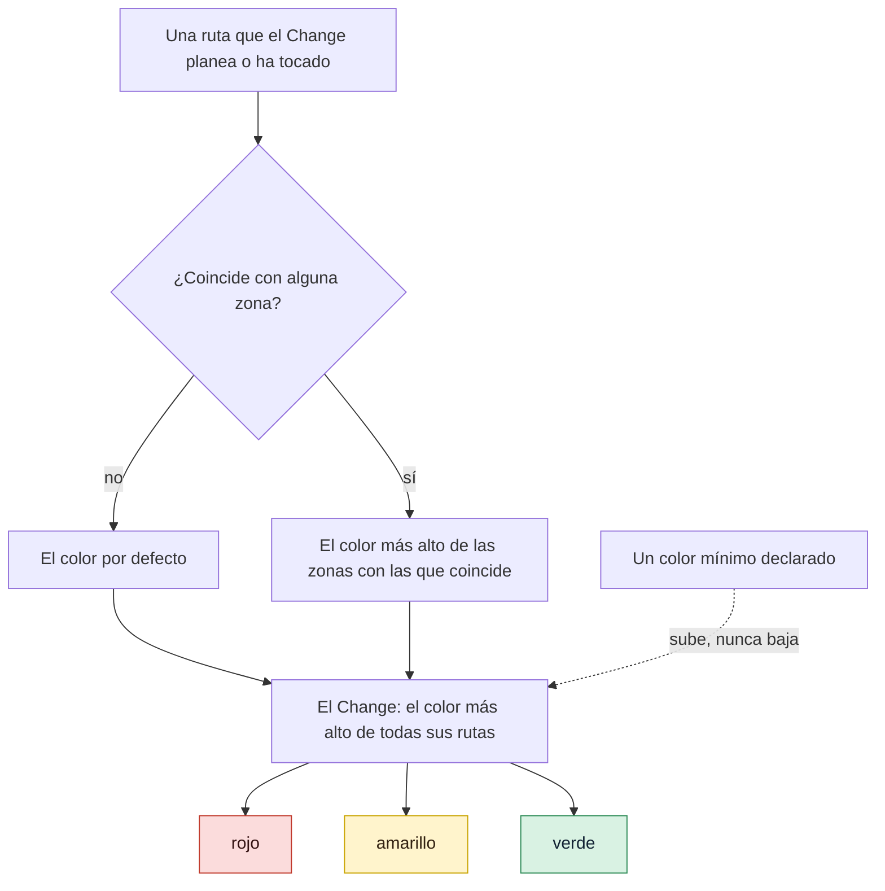

# Mapear y aprobar zonas rojas

Usa esta página para decirle a gdd qué partes de tu proyecto son arriesgadas. Una zona roja es
un conjunto de rutas donde un error sería grave, como el inicio de sesión o los pagos: todo
Change que toca una es rojo y pasa las puertas más estrictas, así que las comprobaciones
estrictas van donde está el riesgo. Tú nombras las áreas sensibles con palabras, el
Orchestrator las convierte en zonas y tú apruebas las rojas una vez.

## Antes de empezar

- Un proyecto preparado con `gdd init`, cuyo Brief (`docs/brief.md`) nombra las áreas sensibles
  con palabras. Consulta el [inicio rápido](../getting-started/quickstart.md) o
  [Llevar gdd a un proyecto existente](adopt-existing-project.md).
- Carpetas reales que mapear. GDD mapea las zonas rojas al final de Discover, cuando ya existen
  la arquitectura y los primeros escenarios; antes de eso, el código sin mapear es amarillo.

Los ejemplos usan `shop`, una pequeña tienda web con el stack de TypeScript.

## Cómo recibe su color una ruta

Sigue una ruta desde arriba: las zonas con las que coincide deciden su color, y el color más
alto de todas las rutas decide el color del Change.



## 1. Nombra las áreas sensibles

El último paso del formulario de Setup pregunta qué sería grave si fallara, y `/gdd-setup` lo
vuelve a preguntar. Las respuestas van al Brief, con palabras. En `shop`:

```text
## What would be serious if it failed (sensitive areas, in words)

These become red zones at the end of Discover, once there are real folders:

1. Someone logs in as another customer
2. Charging a customer twice
```

Cada área se convierte en una zona roja, con el área como motivo. Si quieres añadir una más
adelante, díselo al Orchestrator.

## 2. Deja que el Orchestrator las mapee

Al final de `/gdd-discover`, cuando ya existen la arquitectura y los primeros escenarios, el
Orchestrator traduce las áreas sensibles a rutas en `gdd/zones.toml`: rojas, y verdes donde es
evidente. Cuando el Orchestrator duda entre dos colores, elige el más alto; si editas tú el
mapa, haz lo mismo. `gdd init` ya escribió dos zonas rojas que tiene todo proyecto: el arnés,
los ficheros con los que gdd comprueba tu proyecto (`gdd/**`, el workflow de integración
continua (CI) y las carpetas de los agentes, entre otras rutas) y la cadena de suministro de cada stack (en TypeScript,
`package.json`, `package-lock.json`, `.npmrc` y los ficheros de osv-scanner). El Orchestrator
añade las tuyas al final:

```toml
[[zone]]
color = "red"
paths = ["src/auth/**"]
reason = "Someone logs in as another customer"

[[zone]]
color = "red"
paths = ["src/payments/**"]
reason = "Charging a customer twice"
```

Cuando encuentra un área sensible nueva mientras prepara un Change, primero añade la zona en
main, para que la apruebes en la sentada de ese Change.

Cómo leer el mapa:

| Clave | Dónde | Qué dice |
|---|---|---|
| `default` | al principio del fichero | El color de una ruta que no coincide con ninguna zona. `yellow` por defecto: código sin zona es código sin pruebas conocidas. |
| `color` | en cada `[[zone]]` | `green`, `yellow` o `red`. Cualquier otra palabra es un error. |
| `paths` | en cada `[[zone]]` | Patrones desde la raíz del proyecto. |
| `reason` | en cada `[[zone]]` | Por qué la zona tiene su color, con palabras. Lo muestran la clasificación y la sentada. |

| Patrón | Coincide con | No coincide con |
|---|---|---|
| `docs/**` | `docs/a.md`, `docs/guide/deep/page.txt` | `notes/readme.md` |
| `*.md` | `readme.md` | `notes/readme.md`: un asterisco no sale de su carpeta |
| `src/*/mod.rs` | `src/a/mod.rs` | `src/a/b/mod.rs` |
| `**/secrets.toml` | `secrets.toml` en la raíz, `config/secrets.toml` | |

`?` coincide con un carácter cualquiera salvo `/`. Cuando una ruta coincide con varias zonas,
gana el color más alto, sea cual sea su orden en el fichero: una zona verde dentro de una roja
no vuelve verdes sus rutas. Un color que no sea uno de los tres detiene todos los comandos que
leen el mapa:

```text
error: gdd/zones.toml: unknown color "crimson" (use green, yellow or red)
```

> [!NOTE]
> El mapa de zonas forma parte del arnés: `gdd/**` es rojo y está protegido frente a todos los
> agentes que construyen o revisan. Se modifica en main, fuera de cualquier Change. Una rama de
> Change que lo edita es un Change rojo, y Path Guard hace fallar a cualquier Builder que lo
> toque.

## 3. Mira el color que recibe un Change

Cuando el Orchestrator crea un Change, te dice su color. Por detrás, gdd da un motivo para cada
ruta; esto es lo que imprimió para `login-rate-limit`:

```text
{
  "change": "login-rate-limit",
  "color": "red",
  "lane": "full",
  "reasons": [
    "docs/security.md -> green (Documentation)",
    "src/auth/login.ts -> red (Someone logs in as another customer)",
    "src/ui/login-form.ts -> yellow (no zone: default color)"
  ],
  ...
```

Un Change rojo necesita un plan que tú apruebas, la revisión profunda del Reviewer, mutation
testing (pruebas de mutación) y la puerta de salida (G4, *Release Gate*), diga lo que diga la
tabla de reglas: consulta [Cómo elige el riesgo las puertas](../explanation/risk.md). Si
sabes que un Change es más arriesgado de lo que dicen sus rutas, díselo al Orchestrator: puede
subir el color, nunca bajarlo.

## 4. Aprueba las zonas rojas

Solo una persona aprueba las zonas rojas, una vez para todo el proyecto. Ocurre en la sentada
del primer Change: el Orchestrator enumera las zonas pendientes, cada una con su motivo, junto a
los escenarios, y tu OK las registra también. En la pantalla de la sentada
(`gdd sitting CHANGE`) aparecen bajo `Red zones to approve` (consulta
[Aprobar los escenarios](write-scenarios.md#4-aprueba)). Al aprobar se registra:

```text
Red zones ok (4 red zone(s)).
```

La cuenta incluye las dos zonas que escribió `gdd init`. Si vuelves a aprobarlas sin que nada
haya cambiado, gdd solo lo indica:

```text
Red zones ok (4 red zone(s)): already approved, nothing changed.
```

Las máquinas no pueden aprobarlas: `--by machines` se rechaza con
`error: Red zones are approved by a human (--by human).` La aprobación se guarda en
`.gdd/zones.json`, con un hash de las zonas rojas tal como estaban.

## 5. Ten claro qué espera a la aprobación

`/gdd-status` te avisa cuando las zonas rojas están pendientes: te llegan con los escenarios del
siguiente Change. `gdd status` dice:

```text
Red zones: pending · Red zones not approved yet: the Orchestrator proposes them at the end of Discover.
```

Hasta que una persona las apruebe, solo se pueden construir Spikes: un Spike explora y nunca
fusiona su código (consulta [Explorar con un Spike](spikes.md)). Cualquier otro Change se
rechaza antes de que se ejecute ningún agente:

```text
error: Red zones not approved yet: the Orchestrator proposes them at the end of Discover. (gdd gate zones ok --by human)
```

## 6. Vuelve a aprobar cuando cambian las zonas rojas

Añadir, quitar o editar una zona roja (sus rutas, su motivo, cualquier clave) retira la
aprobación. Aquí `src/refunds/**` se une a la zona de pagos:

```toml
[[zone]]
color = "red"
paths = ["src/payments/**", "src/refunds/**"]
reason = "Charging a customer twice"
```

Entonces `gdd status` dice:

```text
Red zones: pending · Red zones changed after their approval: a human must approve them again.
```

y ningún Change, salvo un Spike, arranca hasta que vuelvas a aprobarlas, en la siguiente
sentada.

La aprobación solo cubre las zonas rojas. Cambiar una zona verde o amarilla, o el color
`default`, no la vuelve a pedir, aunque puede bajar el color de algunas rutas: revisa esas
ediciones en el commit que las introduce.

## Por dentro

El mapa es `gdd/zones.toml` ([todas las claves](../reference/configuration.md#zonestoml)).
[`gdd new-change`](../reference/cli/new-change.md) y
[`gdd classify`](../reference/cli/classify.md) imprimen el color y los motivos; `--min-color` es
como el Orchestrator sube un color. Tu OK ejecuta
[`gdd gate zones ok --by human`](../reference/cli/gate.md), y
[`gdd status`](../reference/cli/status.md) dice si las zonas rojas están aprobadas.

## Siguientes pasos

- [Aprobar los escenarios](write-scenarios.md): la sentada en la que se aprueban juntos las
  zonas, los escenarios y el plan rojo.
- [Cómo elige el riesgo las puertas](../explanation/risk.md): qué recibe cada color y por qué
  manda el color.
- [Explorar con un Spike](spikes.md): el único trabajo que empieza antes de que se aprueben las
  zonas.
- [La skill discover](../reference/skills/discover.md): donde el Orchestrator mapea las zonas.
