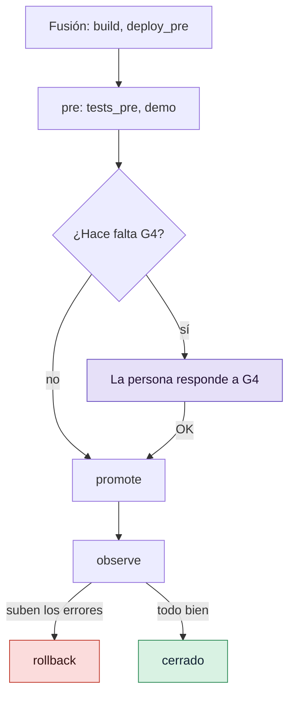

# Publicar versiones y mantener un changelog

Dale a cada Change una línea para las personas que usan tu proyecto, mantén `CHANGELOG.md` al
día con lo que se ha fusionado, etiqueta versiones automáticamente o por lotes, y configura los
pasos de publicación que llevan un Change a producción y lo revierten.

## Antes de empezar

- Un proyecto GDD con al menos un Change fusionado: consulta [Ejecutar un Change](run-a-change.md).
- Conoces la puerta de salida (G4, *Release Gate*): consulta
  [Responder a la puerta de salida](release-gate.md).

## 1. Dale a cada Change su línea del changelog

Cada Change lleva una línea en su commit de fusión, como trailers de git:

```text
Changelog: Added · The cart shows its total
Breaking: no
```

Si no tiene línea, el título del Change va a la sección de su tipo: Feature a `Added`, Hotfix a
`Fixed`, Migration a `Changed`. Los Changes de tipo Refactor, Spike y No-code se quedan fuera.
El Orchestrator propone una línea mejor en la sentada; también puedes fijarla tú antes de la
fusión:

```bash
bin/gdd changelog-line cart-total Added The cart shows its total
```

```text
Changelog line of cart-total: Added · The cart shows its total
```

La sección es una de las de Keep a Changelog: `Added`, `Changed`, `Deprecated`, `Removed`,
`Fixed` o `Security`. Cualquier otra se rechaza:

```text
error: the section must be one of Added, Changed, Deprecated, Removed, Fixed, Security
```

Marca un Change que rompe algo que antes funcionaba, o deja uno fuera a propósito:

```bash
bin/gdd changelog-line export-csv Changed Orders export as CSV instead of JSON --breaking
bin/gdd changelog-line tidy-cart --none
```

El commit de fusión de `export-csv` termina entonces con:

```text
Changelog: Changed · Orders export as CSV instead of JSON
Breaking: yes
```

Los Builders y los Reviewers no pueden fijar la línea. En gdd 0.1.0, una línea cuyas palabras
empiezan por `--` necesita un `--` antes de las palabras:
`gdd changelog-line CHANGE Changed -- --time is faster`.

## 2. Pon al día CHANGELOG.md

`CHANGELOG.md` es tuyo: gdd nunca borra ni reescribe ni una palabra. `gdd changelog` compara el
fichero con las líneas que llevan los commits de fusión de main, versión a versión, y muestra lo
que falta. Lo que todavía no ha publicado ninguna etiqueta `v<semver>` va en Unreleased.

```bash
bin/gdd changelog
```

Deberías ver:

```text
Missing from CHANGELOG.md:

## [Unreleased]

### Added

- The cart shows its total <!-- gdd: 2dabea449211 -->

Nothing written: gdd changelog --write adds them.
```

Añade lo que falta y después haz tú el commit:

```bash
bin/gdd changelog --write
git add CHANGELOG.md
git commit -m "Update CHANGELOG.md"
```

```text
CHANGELOG.md: 1 line(s) added, nothing else changed.
```

Cada línea añadida lleva un comentario que nombra su commit, así que una línea que reescribas
más tarde sigue contando como presente. Una línea con las mismas palabras también cuenta. En una
terminal, `gdd changelog` sin `--write` pregunta antes de escribir.

gdd entiende los estilos de encabezado habituales y escribe con el estilo de tu fichero:

| Tu fichero tiene | gdd lo lee como |
|---|---|
| `## [Unreleased]`, `## Unreleased` (en mayúsculas o minúsculas) | la sección Unreleased |
| `## [0.1.0] - 2026-10-30` | Keep a Changelog |
| `## 0.1.0 - 2026-10-30` | sin corchetes |
| `## v0.1.0` | con una `v` |
| `## [0.1.0](<compare link>) (2026-10-30)` | un encabezado con enlace |

Las versiones nuevas siguen el estilo de tu encabezado de versión más reciente, y un fichero sin
secciones `###` recibe líneas sueltas.

## 3. Elige cómo se crean las versiones

Una versión es una etiqueta git `v<major>.<minor>.<patch>`. La siguiente sale de las líneas de
los Changes desde la etiqueta más reciente:

| Línea | Siguiente versión |
|---|---|
| `Fixed`, `Security` | patch |
| `Added`, `Changed`, `Deprecated`, `Removed` | minor |
| cualquier línea con `--breaking` | major, o minor mientras la major sea 0 |

La primera versión de un proyecto es `0.1.0`. Elige uno de estos dos modos en `gdd/rules.toml`:

- **auto** (el predeterminado, sin sección `[versions]`): cada Change con línea de changelog
  recibe su versión cuando se promueve a producción. El paso de promoción la recibe en
  `GDD_VERSION`; la etiqueta se crea solo cuando la promoción sale bien. Cuando el proyecto tiene
  un `CHANGELOG.md` en git, su sección Unreleased se convierte en esa versión en un commit
  `Release v<x.y.z>`, que es al que apunta la etiqueta.
- **manual**: las promociones no crean etiquetas; publicas por lotes con `gdd release`.

  ```toml
  [versions]
  mode = "manual"   # release in batches with gdd release
  ```

En modo auto, un Change promovido en un proyecto que tiene su changelog en git se ve así en main:

```text
d78a276 Release v0.1.0
06118e8 Start CHANGELOG.md
2dabea4 gdd(cart-total): G3 Merge Gate · Cart total
```

## 4. Publica a mano

`gdd release` sin paso muestra la siguiente versión de lo que main ha fusionado desde su
etiqueta más reciente, y no publica nada:

```bash
bin/gdd release
```

```text
Next version: v0.2.0 (from v0.1.0)

### Changed

- **Breaking:** Orders export as CSV instead of JSON

### Security

- Repeated failed logins are slowed down

Nothing released: gdd release --yes releases it.
```

Publícala:

```bash
bin/gdd release --yes
```

```text
Released v0.2.0
```

Funciona en los dos modos. Añade a `CHANGELOG.md` las líneas que faltan, convierte Unreleased en
`## [0.2.0] - <day>` en un commit propio (`Release v0.2.0`) cuando main tiene el fichero en git,
y crea una etiqueta anotada `v0.2.0`. No se hace push de nada: sube tú el commit y la etiqueta.

Para elegir la versión, añade `--version`. Sin `--yes`, muestra lo que publicaría:

```bash
bin/gdd release --version 1.0.0
```

```text
Next version: v1.0.0 (from v0.2.0)

### Added

- Receipt

Nothing released: gdd release --yes releases it.
```

La versión tiene que ir después de la etiqueta más reciente. `bin/gdd release --version 0.1.0`
en un proyecto que ya está en `v0.1.0` responde:

```text
error: the version must come after v0.1.0
```

Si no se ha fusionado nada desde la etiqueta más reciente, `gdd release` dice
`Nothing to release since v0.2.0`. Los Builders y los Reviewers no pueden publicar.

## 5. Configura los pasos de publicación

Después de la fusión, la receta lleva un Change por estos pasos, cada uno un comando de la
sección `[release]` de `gdd/commands.toml`:



`gdd init` los escribe vacíos, con `simulated = true`: los pasos vacíos pasan y se registran
como simulados hasta que tengas un pre y una producción reales. Rellénalos y pon
`simulated = false`:

```toml
[release]
simulated = false
build = "uv build -q"                                       # build the artifact once
deploy_pre = "mkdir -p .gdd/pre && cp dist/*.whl .gdd/pre/"
tests_pre = "ls .gdd/pre/*.whl"
demo = "mkdir -p .gdd/changes/$GDD_CHANGE/demo && GDD_FEATURES= uv run pytest -q tests/acceptance > .gdd/changes/$GDD_CHANGE/demo/scenarios.txt"
promote = "./deploy.sh production $GDD_VERSION"             # the same artifact, to production
observe = "./check-error-rate.sh"                           # fails if errors rise
rollback = "./deploy.sh production previous"
rollback_pre = "./deploy.sh pre previous"                   # used by the self-test
```

Arriba, `promote`, `observe` y `rollback` llaman a scripts propios; el resto es un ejemplo que
funciona para un paquete Python. Promueve el mismo artefacto que construiste una vez: nunca lo
vuelvas a construir para producción. Cada paso puede durar lo que marque `command_seconds` en
`[limits]`. Además, cada paso se puede ejecutar por separado, y así es como se prueban:

```bash
bin/gdd release pre CHANGE
bin/gdd release promote CHANGE
bin/gdd release observe CHANGE
```

Un Change que necesita la G4 humana nunca se promueve sin ella
(`This change needs a human G4 before promotion.`). Una promoción que falla deja producción
intacta y el Change esperando en G4; el mismo OK la reintenta.

Cuando `observe` falla, se ejecuta el `rollback` y el Change pide un Hotfix. Con un `observe`
que imprimió `error rate up` y salió con 1:

```text
error: release.observe failed (exit code 1):
error rate up
--- end of output ---
error rate up
Rollback: ok
Production failed while observing: rolled back to the previous version. A hotfix is needed. Message in .gdd/changes/receipt/inbox.md
```

El Change queda en `rolled-back`, y su Decision Inbox dice lo que tienes que decidir:

```text
## Needs your decision
- Production failed while observing: rolled back to the previous version. A hotfix is needed.
```

Todas las claves están en [Configuración](../reference/configuration.md#commandstoml).

## 6. Comprueba el changelog en CI (opcional)

`gdd changelog --check` no escribe nada y falla cuando al fichero le falta alguna línea:

```text
error: CHANGELOG.md misses 1 line(s): gdd changelog shows them, gdd changelog --write adds them
```

Cuando no falta nada, imprime `CHANGELOG.md covers every change on main.`. Añádelo como paso de
tu workflow en main si mantienes el fichero a mano; consulta
[Ejecutar las puertas en CI](ci.md).

## Siguientes pasos

- [Responder a la puerta de salida](release-gate.md): OK, KO o polish en G4, antes de la
  promoción.
- [Ejecutar las puertas en CI](ci.md): qué bloquea un Change antes de que se fusione.
- [Medir el trabajo](measure.md): frecuencia de despliegue y tasa de fallo de los cambios
  (*change fail rate*) con `--dora`.
