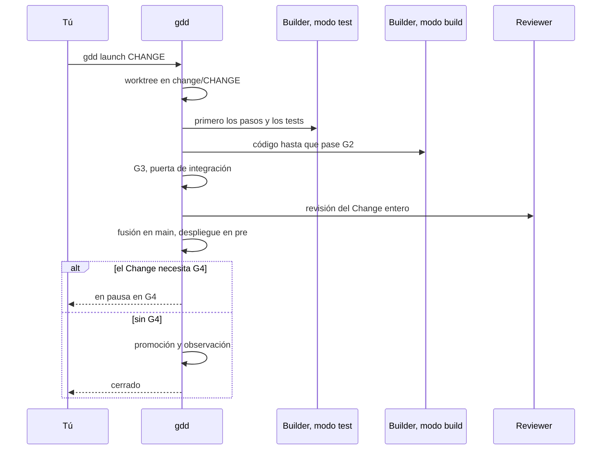

# Ejecutar un Change

Crea un Change, lee cómo lo ha clasificado gdd, lánzalo y síguelo hasta que se cierre, se
aparque o te espere en la puerta de salida (G4, *Release Gate*).

## Antes de empezar

- Un proyecto preparado con [`gdd init`](../reference/cli.md#gdd-init) y
  [`gdd bootstrap`](../reference/cli.md#gdd-bootstrap), con G0 abierta: `bin/gdd status` dice
  `G0: ok`. [Tu primer Change](../getting-started/tutorial.md#3-abre-g0-la-puerta-de-preparación)
  muestra cómo hacerlo.
- Todo guardado en commits en `main`.

En un proyecto con agentes, lo normal es dejar que el Orchestrator haga los pasos 1 a 3 en una
conversación (`/gdd-change` en Claude Code, `$gdd-change` en Codex): ejecuta los mismos
comandos. Esta página muestra los comandos, para que sepas qué hace y puedas hacerlo tú.

## 1. Crea el Change

```bash
bin/gdd new-change CHANGE --title "TITLE" --paths PATH...
```

- `CHANGE` es el id: letras minúsculas, dígitos y guiones, como `export-csv`.
- `--title` dice de qué trata el Change, en pocas palabras. Se convierte en la línea del
  changelog, salvo que pongas otra con [`gdd changelog-line`](../reference/cli.md#gdd-changelog-line).
- `--paths` lista las rutas que el Change tiene previsto tocar. Se admiten patrones
  (`"src/notes/**"`; ponlos entre comillas para que la shell no los expanda). Las rutas deciden
  el color, y la comprobación de alcance (*scope*) de G2 compara con ellas lo que ha tocado el
  Builder.
- `--type` es el tipo de trabajo: `Feature` (el valor por defecto), `Hotfix`, `Refactor`,
  `Migration`, `Spike` o `No-code`. Un `Spike` sigue una receta propia: consulta
  [Explorar con un Spike](spikes.md).
- `--min-color red` sube el color cuando sabes que el riesgo es mayor de lo que dicen las
  rutas. Nunca lo baja.
- `--resumable` indica que otro agente podría retomar el Change solo con su registro, que es una
  de las tres condiciones de la vía rápida (*Fast Lane*).

Por ejemplo:

```bash
bin/gdd new-change export-csv --title "Export notes as CSV" \
  --paths "src/notes/**" "tests/**" features/export_csv.feature
```

gdd escribe el registro del Change en `.gdd/changes/export-csv/change.json`, crea la rama
`change/export-csv` a partir de `main`, lo anota en el log e imprime la clasificación.

## 2. Lee la clasificación

El JSON que imprime `new-change` es el plan de puertas de este Change. Puedes volver a
imprimirlo cuando quieras, a partir de las rutas previstas más lo que la rama ha tocado hasta
ahora:

```bash
bin/gdd classify export-csv
```

```text
{
  "change": "export-csv",
  "color": "yellow",
  "lane": "full",
  "reasons": [
    "features/export_csv.feature -> yellow (no zone: default color)",
    "features/hidden/export_csv.feature -> yellow (no zone: default color)",
    "src/notes/** -> yellow (no zone: default color)",
    "tests/** -> yellow (no zone: default color)"
  ],
  "g1": true,
  "features": [
    "features/export_csv.feature",
    "features/hidden/export_csv.feature"
  ],
  "tests_first": true,
  "mutation": false,
  "reviewer": true,
  "review": "quick",
  "g4": true,
  "human_plan": false,
  "type": "Feature",
  ...
  "builder_session": "separate",
  "retries": 3
}
```

| Campo | Qué indica |
|---|---|
| `color` | verde, amarillo o rojo: el color más alto de todas las rutas, según `gdd/zones.toml`. Las rutas que no están en ninguna zona toman el `default` del mapa. |
| `lane` | `fast` (G2 y G3, sin parada humana) o `full`. |
| `reasons` | por qué cada ruta recibió su color. |
| `g1` | el Change crea o modifica un `.feature`, así que una persona aprueba los escenarios antes de construir. |
| `features` | los ficheros de escenarios del Change, que ejecuta G2. |
| `tests_first` | el Builder escribe los pasos y los tests en modo test antes que cualquier código. |
| `mutation` | G3 ejecuta mutation testing sobre el diff. Siempre es true en rojo. |
| `reviewer`, `review` | un Reviewer lee el Change, y con qué profundidad: `quick` o `deep` (siempre deep en rojo). |
| `g4` | el Change espera a una persona en la puerta de salida. |
| `human_plan` | un Change rojo: la persona aprueba su plan en la sentada. |
| `builder`, `builder_test`, `reviewer_model`, `orchestrator` | el agente y el modelo de cada rol, según `gdd/models.toml`. |
| `retries` | vueltas del Builder contra G2 antes de que el Orchestrator replanifique. |

Lo que recibe cada color sale de `gdd/rules.toml`; [Puertas](../reference/gates.md) lo
recoge todo y [Cómo elige el riesgo las puertas](../explanation/risk.md) explica por qué.

## 3. Prepara lo que necesita el Builder

En la rama del Change, escribe los escenarios cuando el Change tenga comportamiento visible, y
después vuelve a `main`:

```bash
git switch change/export-csv
# write features/export_csv.feature and features/hidden/export_csv.feature
git add features
git commit -m "Scenarios of export-csv"
git switch main
```

[Escribir y aprobar escenarios](write-scenarios.md) explica cómo. Después, en la carpeta de
estado del Change, `.gdd/changes/CHANGE/`:

- `package.md`, el paquete de contexto del Builder: el objetivo en tres líneas, el color, los
  escenarios que cubre, las rutas que puede tocar y qué reutilizar. Nada más.
- `plan.md`, solo para un Change rojo: qué, cómo, los riesgos y cómo revertirlo, con palabras,
  nunca con código. Lo apruebas en la sentada.

Todo lo que se decida por el camino va al Decision Inbox del Change:

```bash
bin/gdd note export-csv decided Kept one column
bin/gdd note export-csv needs Should the header say note or text
```

Cada uno imprime `noted`.

## 4. Aprueba en la sentada

```bash
bin/gdd sitting export-csv
```

La sentada muestra los escenarios de la rama, los ejemplos ocultos, las zonas rojas pendientes
y el plan de un Change rojo. `a` lo aprueba todo y `c` pide cambios; las dos teclas piden
confirmación antes. Sin terminal, registra lo mismo con `gdd gate`:

```bash
bin/gdd gate G1 ok export-csv --by human
bin/gdd gate zones ok --by human
bin/gdd gate plan ok export-csv --by human
```

La segunda línea, solo cuando hay zonas rojas pendientes; la tercera, solo para un Change rojo.
[El tutorial](../getting-started/tutorial.md#7-aprueba-en-la-sentada) muestra las pantallas.

## 5. Lánzalo

Desde la copia principal del repositorio, con tu trabajo guardado en un commit:

```bash
bin/gdd launch export-csv
```

Antes de arrancar nada, gdd comprueba que el Change puede entrar en Build: G0 abierta, las zonas
rojas aprobadas, G1 registrada cuando el Change tiene escenarios, el plan aprobado cuando es
rojo y un Reviewer de una familia de modelos distinta a la del Builder. Se niega si queda algún
fichero con seguimiento sin commit:

```text
error: The working tree has uncommitted changes. Commit them before launching a change.
```

También rechaza un Change cuando ya hay `[parallel] max` Changes construyéndose (2 por defecto,
en `gdd/rules.toml`), y avisa cuando otro Change en curso tiene previsto tocar las mismas rutas:
git lo resuelve cuando se fusiona el segundo. [Ejecutar Changes en paralelo](parallel-changes.md)
tiene los detalles.

Después ejecuta la receta. El diagrama muestra quién actúa, y en qué orden:



1. **Un worktree.** El Change se ejecuta en su propio worktree de git, una carpeta hermana
   `PROJECT.worktrees/CHANGE` en la rama `change/CHANGE` (`[parallel] folder` en
   `gdd/rules.toml` la cambia de sitio). Tu copia se queda en `main`, y todos los worktrees
   comparten el `.gdd/` de la copia principal.
2. **Build.** Cuando `tests_first` es true, el Builder en modo test escribe primero los pasos y
   los tests. Después el Builder en modo build escribe el código, y cada vuelta va seguida de la
   puerta del bucle (G2, *Loop Gate*). Si tras 3 vueltas sigue en rojo, el Orchestrator
   replanifica una vez, lo que puede devolver el Change al modo test, y el Builder tiene una
   vuelta más.
3. **Integrate.** La puerta de integración (G3, *Merge Gate*) ejecuta todos los escenarios,
   ejemplos ocultos incluidos, y las comprobaciones de seguridad, dependencias, secretos y,
   cuando al Change le toca, mutación. Si sale en rojo, el Builder tiene una corrección. Después
   viene el Reviewer: un KO da lugar a una corrección y a una segunda revisión.
4. **Fusión.** gdd fusiona la rama en `main`, de un Change en uno, con el registro del Change en
   el commit de fusión. Si `main` ha avanzado mientras tanto, el Change lo incorpora y antes
   vuelve a pasar G3.
5. **Pre.** Ejecuta los pasos de publicación `build`, `deploy_pre`, `tests_pre` y `demo` de
   `gdd/commands.toml`. Un proyecto sin un pre real tiene ahí `simulated = true`: los pasos
   vacíos pasan y el log dice que se simularon.
6. **G4 o producción.** Un Change con `g4` se detiene a esperarte; cualquier otro lo promueven y
   lo observan las máquinas.

En cada llamada de agente, antes y después, gdd comprueba que el agente no ha tocado el estado
de GDD y que el Reviewer no ha cambiado ningún fichero. Cualquiera de las dos cosas aparca el
Change. [La vida de un Change](../explanation/life-of-a-change.md) sigue cada paso en detalle.

`gdd launch` no imprime nada mientras trabaja, y al terminar imprime una sola línea. Un Change
que te espera:

```text
Paused at G4. Message: .gdd/changes/export-csv/inbox.md · To continue: gdd resume export-csv --g4 ok|ko|polish
```

Un Change que no necesitaba G4 sigue hasta producción y termina igual que tras un OK en G4,
después de una línea `Released vX.Y.Z` cuando ha recibido versión:

```text
Change export-csv closed. Message: .gdd/changes/export-csv/inbox.md · Tokens: gdd report --change export-csv
```

Un Change que se ha aparcado, con código de salida 1:

```text
Change export-csv parked: G2 still red after 3 retries and 1 replan. Message in .gdd/changes/export-csv/inbox.md
```

## 6. Síguelo

Desde otra terminal, mientras se ejecuta, o en cualquier momento después:

```bash
bin/gdd status
```

lista cada Change con su estado y las puertas que ha pasado:

```text
...
Changes:
  - export-csv · Export notes as CSV · in-pre · G1:ok, G3:ok
Log: 30 lines in .gdd/log.jsonl (gdd report)
```

Un Change pasa de `open` a `prepared` y a `building` (`polishing` en una vuelta de polish),
luego a `in-pre`, donde espera en G4, y termina en `closed`. Por el camino puede acabar
`parked`, `rejected` en G4 o `rolled-back` tras una observación fallida.

El Board muestra todos los Changes por fase: Discover para los que no se han lanzado, Build para
los que se están construyendo o están aparcados, Release para los que están en pre o esperan tu
G4, y Done, plegada. No escribe nada.

```bash
bin/gdd board
```

| Tecla | Qué hace |
|---|---|
| `↑` `↓` | mueve la selección |
| `Enter` | muestra los detalles del Change seleccionado: tipo, color, estado, puertas, rutas, su inbox y en qué se le fue el tiempo; `Esc` vuelve atrás |
| `d` | muestra o pliega Done |
| `t` | muestra el informe de tiempo del proyecto |
| `q` | cierra el Board |

El Decision Inbox del Change es el único mensaje que guarda para ti: lo que necesita tu
decisión, lo que se decidió sin ti y por qué se aparcó, si es que se aparcó. También se guarda
en `.gdd/changes/CHANGE/inbox.md`:

```bash
bin/gdd inbox export-csv
```

Lo que han costado las llamadas de agente de un Change, por rol y modelo:

```bash
bin/gdd report --change export-csv --by role,model
```

```text
role · model -> calls · tokens in · cache · out · cost USD · seconds
builder-build · sonnet -> 1 · 19,650 · 144,619 · 1,385 · 0.1069 · 32
builder-test · sonnet -> 1 · 24,440 · 241,757 · 3,083 · 0.1527 · 29
reviewer · gpt-6-astra -> 1 · 22,312 · 88,320 · 975 · 0.0000 · 32
TOTAL -> in 66,402 · cache 474,696 · out 5,443 · 0.2596 USD
Human stops logged: 1
```

## 7. Cuando se aparca

Un Change *se aparca* cuando un bucle agota sus intentos o una comprobación lo detiene: G2
todavía en rojo tras los reintentos y la replanificación, G3 o el Reviewer todavía diciendo que
no tras su única corrección, un agente que ha tocado el estado de GDD o se ha quedado sin
tiempo, un conflicto de fusión. No se pierde nada: el worktree y la rama se quedan, y el
Decision Inbox dice por qué.

Este es un aparcamiento real. El código del Builder era correcto, pero las herramientas del
proyecto no podían ejecutar el escenario, y la replanificación del Orchestrator lo dijo. Viene
de una compilación anterior de gdd 0.1.0, cuyo esqueleto de Python dejaba que pytest llegara a
la 9.2; ahora el esqueleto mantiene pytest por debajo de la 9.2, así que un proyecto nuevo no se
aparca de esta forma:

```bash
bin/gdd inbox export-csv
```

```text
# Decision Inbox · export-csv · Export notes as CSV

Color yellow · lane full · state parked

## Needs your decision
...
- Replan: G2 acceptance is blocked by the harness, not by this change. uv.lock (from gdd bootstrap, 3639758) pins pytest 9.2.0 with pytest-bdd 9.0.0; pytest-bdd 9.0.0 reads FixtureManager._arg2fixturedefs, which pytest 9.2.0 no longer has, so every pytest-bdd scenario fails before its first step. pyproject.toml has only lower bounds (pytest>=9.1.1, pytest-bdd>=9.0.0). The human must pick a compatible pair (cap pytest below 9.2, or a pytest-bdd release that supports pytest 9.2; I did not verify either), then relock and sync, outside this change. After that, rerun the build round; no code change is needed before it.
...

## Parked
- G2 still red after 3 retries and 1 replan
```

Para ponerlo en marcha otra vez:

1. Lee el inbox y corrige la causa. Cuando la corrección queda fuera del Change, como aquí, haz
   commit de ella en `main`.
2. Vuelve a lanzarlo: `bin/gdd launch CHANGE`. Un relanzamiento conserva el worktree, hace
   commit del trabajo de la ejecución anterior en cuanto sus puertas lo aceptan e incorpora las
   peticiones que dejó esa ejecución. Si el código ya pasa G2, se salta el Builder y la receta
   sigue desde G3.

[Reactivar un Change aparcado](parked-change.md) cubre cada motivo para aparcar, conflictos de
fusión incluidos.

También puedes aparcar un Change tú, por ejemplo mientras esperas una respuesta. Siempre sale
con 1:

```bash
bin/gdd park export-csv Waiting for a decision on the CSV header
```

```text
Change export-csv parked: Waiting for a decision on the CSV header. Message in .gdd/changes/export-csv/inbox.md
```

## 8. Cuando espera en G4

Un Change que se detiene en la puerta de salida ya está fusionado en `main` y desplegado en pre.
Conserva su worktree, se queda en el estado `in-pre` y deja de contar para `[parallel] max`, así
que otros Changes pueden construirse mientras tanto. Espera tu respuesta todo el tiempo que haga
falta:

```bash
bin/gdd resume export-csv --g4 ok
```

`ok` lo promueve, `ko` lo deja fuera de producción y `polish --note "..."` ejecuta una vuelta
más del Builder con tus notas. [Responder a la puerta de salida](release-gate.md) explica qué
revisar antes.

## Siguientes pasos

- [Responder a la puerta de salida](release-gate.md): OK, KO o polish, y qué mirar antes.
- [Reactivar un Change aparcado](parked-change.md): cada motivo para aparcar y cómo salir de él.
- [Ejecutar Changes en paralelo](parallel-changes.md): el límite, los solapamientos y la cola de
  fusión.
- [La vida de un Change](../explanation/life-of-a-change.md): cada paso de un lanzamiento, en
  orden.
