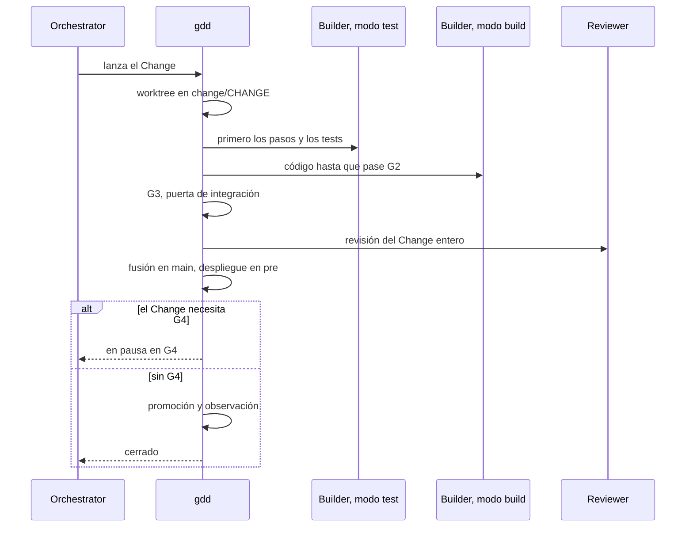

# Describir un Change a tu agente

Usa esta página siempre que quieras que se construya, se arregle o se reorganice algo. Dices
lo que quieres en una frase. El Orchestrator lo convierte en un Change, te pide tu OK una vez,
lo lanza y vuelve cuando el Change te necesita otra vez.

## Antes de empezar

- Un proyecto con la fase Setup terminada: la puerta de preparación (G0, *Setup Gate*) está
  abierta. El [inicio rápido](../getting-started/quickstart.md) te lleva hasta ahí.
- Tu agente de programación, arrancado en la carpeta del proyecto.

Los ejemplos usan `shop`, una pequeña tienda online, y el Change `cart-total`.

## 1. Di lo que quieres

Ejecuta la skill de Change con lo que quieres, con tus propias palabras. En Claude Code y
OpenCode:

```text
/gdd-change show the cart total, taxes included
```

En Codex:

```text
$gdd-change show the cart total, taxes included
```

Di qué y por qué, no cómo: quién lo usa, qué debería poder hacer, qué no debe pasar. Deja el
código a los agentes. Si ya tienes en mente un id corto, ponlo al principio
(`/gdd-change cart-total ...`).

Si lo que tienes en mente es más grande que una pieza pequeña de valor, empieza mejor con
`/gdd-discover`. Explora las opciones contigo y propone los siguientes Changes en
orden, cada uno pequeño. Consulta [la skill de discover](../reference/skills/discover.md).

## 2. Lee lo que ha decidido el Orchestrator

El Orchestrator es el rol que hace tu agente en esta conversación. Convierte tu frase en un
Change y decide cuatro cosas por ti:

| Decide | Qué es |
|---|---|
| El id | letras minúsculas, dígitos y guiones, como `cart-total` |
| El título | de qué trata el Change, en pocas palabras; la línea del changelog de una Feature, un Hotfix o una Migration |
| El tipo | `Feature` (el valor por defecto), `Hotfix`, `Refactor`, `Migration`, `Spike` o `No-code` |
| Las rutas | las carpetas y los ficheros que el Change tiene previsto tocar |

A partir de esas rutas, gdd calcula el color del Change, su riesgo, según el
[mapa de zonas](red-zones.md). El color decide las [puertas](../glossary.md#puerta) que se
encuentra el Change: las comprobaciones que tiene que pasar antes de avanzar. El Orchestrator
te cuenta el resultado con sus palabras. Para `cart-total`, el agente respondió:

<!-- The chat excerpts of this page come from one real run of gdd 0.1.0 (main at e244577) on
2026-10-31 with Claude Code: the run of the tutorial. -->

```text
I've drafted the scenarios for **cart-total**. It's yellow, so there's no plan for you to
approve and the red zones are unchanged. Before I commit them I need your OK and three answers.
...
```

Fíjate en el color y en lo que necesita de ti. El id, el tipo, la vía y cada puerta están en la
clasificación que gdd imprimió para él (consulta [Por dentro](#por-dentro)). Pídeselos al
agente si los quieres.

Con las reglas por defecto, te encuentras con el Change en estos momentos:

| El Change... | Te lo encuentras |
|---|---|
| crea o modifica escenarios (comportamiento visible) | en la sentada, para aprobarlos, y después en la puerta de salida (G4, *Release Gate*) |
| es rojo | en la sentada, para aprobar su plan, y después siempre en G4 |
| ninguna de las dos cosas | nunca: las máquinas lo publican en cuanto pasa todas las puertas |

El color también decide lo estrictas que son las puertas: un Change rojo recibe mutation
testing y una revisión a fondo. [Cómo elige el riesgo las puertas](../explanation/risk.md)
explica por qué.

Cuando una elección es reversible, el Orchestrator la toma en lugar de preguntarte. La deja
escrita en *Decided without you* de la Decision Inbox del Change, el único mensaje que gdd
guarda para ti por cada Change. Las preguntas que sí te hace llegan agrupadas, cada una con su
recomendación primero.

## 3. Aprueba lo que te necesita

El Orchestrator escribe los escenarios del Change y, en un Change rojo, su plan. Después hace
una *sentada* contigo: un solo mensaje con todo lo que necesita tu aprobación. Es decir, los
escenarios en texto llano, las zonas rojas cuando esperan y el plan de un Change rojo.

Las zonas rojas suelen estar ya aprobadas, al final de la fase Setup. Solo vuelven a una
sentada cuando el mapa de zonas ha cambiado. Responde con palabras: OK, o qué hay que cambiar,
con las respuestas a las preguntas del Orchestrator. Para `cart-total`:

```text
OK, as they are. My prices include tax, 21% is my rate and I sell in euros.
```

Con tu OK, el Orchestrator registra la puerta de escenarios (G1, *Scenario Gate*), y las zonas
rojas y el plan cuando esperan. [Aprobar los escenarios](write-scenarios.md) dice qué buscar,
cómo pedir cambios y cómo leer la misma sentada en una pantalla.

## 4. Deja que lo lance

Con tu OK, el Orchestrator escribe el paquete de contexto del Builder (el objetivo en tres
líneas, el color, los escenarios, las rutas que puede tocar, qué reutilizar), hace commit de lo
pendiente en `main` y lanza el Change. A partir de aquí la receta va sola. Lee el diagrama de
arriba abajo: quién actúa, en orden.



1. **Un worktree.** El Change se ejecuta en su propio worktree de git, una carpeta hermana
   `PROJECT.worktrees/CHANGE` en la rama `change/CHANGE`. Tu copia se queda en `main`.
2. **Build.** El Builder en modo test escribe primero los pasos y los tests. Después el Builder
   en modo build escribe el código, y la puerta del bucle (G2, *Loop Gate*) comprueba cada
   ronda. El modo build tiene 3 rondas. Si G2 sigue en rojo, el Orchestrator replanifica una vez
   y el Builder tiene una ronda más. Si G2 sigue en rojo después, el Change se aparca con
   `G2 still red after 3 retries and 1 replan`: los 3 reintentos son esas 3 rondas.
3. **Integrate.** La puerta de integración (G3, *Merge Gate*) ejecuta todos los escenarios,
   ejemplos ocultos incluidos, y las comprobaciones de seguridad, dependencias y secretos, más
   mutation testing en un Change rojo. Después un Reviewer de otra familia de modelos lee el
   Change entero.
4. **Fusión y pre.** gdd fusiona el Change en `main`, de un Change en uno, lo construye y lo
   despliega en pre, la copia de tu proyecto que se ejecuta antes de producción. Un proyecto
   sin un pre real tiene `simulated = true`, y esos pasos pasan vacíos.
5. **G4 o producción.** Un Change que te necesita se detiene en la puerta de salida. Las
   máquinas promueven y observan cualquier otro.

[La vida de un Change](../explanation/life-of-a-change.md) explica cada paso y por qué está
ahí.

## 5. Síguelo en el Board

Una construcción tarda minutos, más en un Change grande. Si quieres seguirla, abre el Board en
otra terminal:

```bash
gdd board
```

Muestra cada Change por fase: Discover para los que aún no se han lanzado, Build para los que
se están construyendo o están aparcados, Release para los que están en pre o esperan tu G4, y
Done, plegada. Solo lee, y lee el proyecto al abrirse: ciérralo con `q` y ábrelo otra vez para
ver un estado posterior. Un Board real, con `cart-total` en construcción:

<!-- Real screen at 100 columns, blank lines trimmed, from the same run. -->
```text
┌ gdd · Board · shop ──────────────────────────────────────────────────────────────────────────────┐
│Discover (0)                                                                                      │
│Build (1)                                                                                         │
│› cart-total · yellow · Show the cart total, taxes included · building · G1:ok                    │
│Release (0)                                                                                       │
│Done (0) · d to show                                                                              │
│↑↓ move · Enter details · d done · t time · q quit                                                │
└──────────────────────────────────────────────────────────────────────────────────────────────────┘
```

La línea que hay que leer es la del propio Change: su color, su estado (`building`) y las
puertas que ha pasado (`G1:ok`). `Enter` muestra los detalles del Change seleccionado: su tipo,
color, estado, puertas, rutas, su Decision Inbox y en qué se le fue el tiempo. Todas las teclas
están en [Pantallas](../reference/screens.md).

## 6. Responde cuando vuelva

El Change vuelve al chat de una de estas tres formas:

- **Espera en G4.** El Orchestrator trae al chat su Decision Inbox y su demo, y respondes OK,
  KO o polish con palabras. Consulta [Revisar un Change en G4](release-gate.md).
- **Se ha cerrado.** Un Change que no necesitaba G4 ha llegado a producción por su cuenta. El
  Orchestrator te lo dice, con lo que ha costado.
- **Se ha aparcado.** Un bucle ha agotado sus intentos o una comprobación lo ha detenido. El
  Orchestrator lee por qué y propone el siguiente paso en una línea. Consulta
  [Volver a poner en marcha un Change aparcado](parked-change.md).

Dos minutos después del lanzamiento, `cart-total` volvió esperando en G4:

```text
The **cart-total** change is built and checked, and it's waiting for your **G4** answer.
...
**Next step:** reply **OK** to send it to production (simulated for now), **KO** to reject it,
or **polish** with what you'd like changed.
```

Si has cerrado el chat mientras tanto, arranca otra vez tu agente y ejecuta `/gdd-status`
(`$gdd-status` en Codex). Dice en qué punto está el proyecto y da un siguiente paso, como el
Change que espera tu G4.

## Sin agente

Cada paso de arriba es un comando de gdd que el Orchestrator ejecuta por ti, y puedes
ejecutarlos tú: [`gdd new-change`](../reference/cli/new-change.md) crea el Change e imprime su
clasificación, [`gdd sitting`](../reference/cli/sitting.md) o
[`gdd gate`](../reference/cli/gate.md) registra la sentada,
[`gdd launch`](../reference/cli/launch.md) ejecuta la receta y
[`gdd resume`](../reference/cli/resume.md) responde a G4. Entonces también escribes tú los
escenarios en la rama del Change y el paquete en `.gdd/changes/CHANGE/package.md`, como
describe la [skill de Change](../reference/skills/change.md).

## Por dentro

La skill de Change ejecuta [`gdd status`](../reference/cli/status.md) para comprobar que G0
está abierta, y después [`gdd new-change`](../reference/cli/new-change.md), que escribe el
registro en `.gdd/changes/CHANGE/change.json`, crea la rama `change/CHANGE` e imprime la
clasificación ([`gdd classify`](../reference/cli/classify.md) la vuelve a imprimir). Tu OK se
convierte en líneas de [`gdd gate`](../reference/cli/gate.md), lo que decidió por su cuenta en
[`gdd note`](../reference/cli/note.md), y [`gdd launch`](../reference/cli/launch.md) ejecuta
la receta. [`gdd inbox`](../reference/cli/inbox.md) imprime la Decision Inbox y
[`gdd report`](../reference/cli/report.md), lo que han costado las llamadas de agente.

## Siguientes pasos

- [Aprobar los escenarios](write-scenarios.md): qué leer en la sentada y cómo pedir cambios.
- [Revisar un Change en G4](release-gate.md): la Decision Inbox, la demo y tu respuesta.
- [Ejecutar Changes en paralelo](parallel-changes.md): un segundo Change mientras el primero
  se construye.
- [La skill de Change](../reference/skills/change.md): todo lo que hace el Orchestrator, paso a
  paso.
