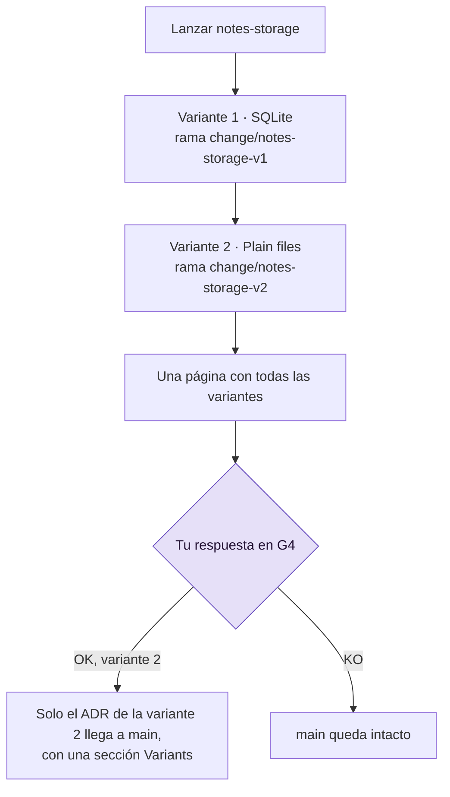

# Explorar con un Spike

Usa un Spike cuando una pregunta bloquea una decisión, como "¿dónde se guardan las notas?". El
Builder escribe código desechable para averiguarlo, con un presupuesto fijo, así que tienes la
respuesta antes de construir nada que vayas a conservar. Lo único que llega a main es la
decisión, en un registro de decisión de arquitectura (ADR, *architecture decision record*). Si
la pregunta tiene varias opciones, puedes construir una variante por opción y elegir una.

## Antes de empezar

- Un proyecto con la fase Setup terminada: la puerta de preparación (G0, *Setup Gate*) está
  abierta. Un Spike es el único Change que se puede construir antes de que se aprueben las
  zonas rojas (consulta [Mapear y aprobar zonas rojas](red-zones.md)).
- Una pregunta. Los Spikes nacen en Discover: `/gdd-discover` propone uno cuando una pregunta
  bloquea una decisión. Consulta [GDD en una página](../explanation/method.md).

Los ejemplos usan el proyecto `notes`.

## Qué recibe un Spike y qué se salta

Un Spike ejecuta una receta propia. Como su código nunca se fusiona, se salta lo que protege al
código en su camino hacia main:

| Un Spike... | Porque |
|---|---|
| no tiene modo test, ni mutation testing, ni Reviewer, ni G3, ni fusión, ni pre | solo su ADR llega a main |
| lo construye el Builder en modo build, con `mode=spike` | escribe código para responder a una pregunta, no para conservarlo |
| pasa G2 con Path Guard y un ADR: un `docs/adr/*.md` nuevo o modificado con una línea `## Decision` | los comandos de G2 del proyecto no se ejecutan sobre código desechable |
| siempre espera a una persona en la puerta de salida (G4, *Release Gate*) | tú decides lo que dice el ADR |
| tiene un presupuesto, `[spike] max_usd` | un coste fijo, como pide Discover |
| no necesita plan, ni siquiera cuando es rojo | conserva el Builder de un Change rojo, y tú apruebas el ADR en G4 |

## 1. Fija el presupuesto

`gdd init` escribe el presupuesto en `gdd/rules.toml`:

```toml
[spike]
max_usd = 5   # a spike parks when its agent calls cost this much (USD)
```

El presupuesto va en dólares estadounidenses (USD). Si 5 USD no encaja con tus Spikes, cámbialo
en main (consulta [Configuración](../reference/configuration.md#spike)). Tiene que ser un número positivo: `0` se
rechaza con `spike.max_usd must be a positive number of USD, not 0`.

gdd guarda lo que ha gastado cada Change en su registro, que solo escribe gdd: después de cada
llamada de agente, suma el coste que ha informado el agente a `spent_usd` y los tokens a
`spent_tokens`, en `.gdd/changes/<id>/change.json`. El presupuesto se lee de ahí, no del log,
así que una línea que un agente añada al log no puede ampliarlo. El presupuesto se comprueba
entre llamadas: una llamada nunca se corta a mitad, así que un Spike puede acabar gastando un
poco más.

> [!NOTE]
> El presupuesto cuenta lo que informan los agentes. Codex no informa de ningún coste: sus
> llamadas cuentan como 0 USD salvo que `[prices.<model>]` en `gdd/models.toml` dé el precio de
> su modelo. Con una suscripción, el coste es teórico, así que compara también los tokens
> (consulta [Medir el trabajo](measure.md)).

## 2. Pide el Spike

Para empezar un Spike, describe la pregunta al Orchestrator y dile que es un Spike:

```text
/gdd-change a spike: how should notes sync between laptops?
```

Crea un Change de tipo Spike, escribe en el paquete del Builder la pregunta y lo que la
respondería, y te dice la clasificación. Por detrás, gdd imprimió esto para `notes-sync`:

```text
{
  "change": "notes-sync",
  "color": "yellow",
  "lane": "full",
  "reasons": [
    "docs/adr/0003-sync.md -> green (Documentation)",
    "src/sync/** -> yellow (no zone: default color)"
  ],
  "g1": false,
  "features": [],
  "tests_first": false,
  "mutation": false,
  "reviewer": false,
  "review": "quick",
  "g4": true,
  "human_plan": false,
  "type": "Spike",
  ...
```

Un Spike no tiene escenarios ni plan que aprobar, así que el Orchestrator puede lanzarlo en el
acto.

## 3. Deja que se ejecute

El Builder trabaja en la rama `change/notes-sync`, en su propio worktree, y escribe la decisión
en un fichero nuevo bajo `docs/adr/`, con una sección `## Decision`. Cuando G2 pasa, el
lanzamiento dice qué ficheros ADR llevaría OK a main y se para en G4. Todavía no llega nada a
main.

En cambio, un Spike se aparca cuando:

- no deja ningún ADR: G2 falla con
  `a Spike leaves its decision in a new file under docs/adr/ with a ## Decision section`, y
  después de los reintentos el Change se aparca con `G2 still red`;
- llega a su presupuesto: `parked: the spike spent 0.02 USD of its budget of 0.02 USD` (aquí
  con `max_usd = 0.02`).

Consulta [Volver a poner en marcha un Change aparcado](parked-change.md) para saber qué hacer
después.

## 4. Responde a su puerta de salida

El Orchestrator te trae el Spike de vuelta en G4 con su ADR. Lee la decisión y responde con
palabras, como en cualquier G4:

```text
OK: plain files and git, no server to run.
```

| Tu respuesta | Qué pasa |
|---|---|
| OK | Solo los ficheros ADR de la rama llegan a main, en un único commit `gdd(notes-sync): Spike ADR · How notes sync between laptops`. El código se queda en `change/notes-sync`, que gdd conserva. |
| KO, y por qué | main se queda como estaba. |
| Polish, y qué pulir | Una ronda más del Builder con tus palabras, sin reintentos ni replanificación, y después G2. Si sigue en rojo, el Change se aparca. |

No hay demo, ni promoción, ni línea de changelog: un Spike entrega una decisión, no una
funcionalidad. El trabajo real viene después, como un Change nuevo construido con todas sus
puertas.

## 5. Prueba varias opciones a la vez con variantes

Si la pregunta tiene de 2 a 4 opciones, pide una variante por opción y compáralas en una
sola página (diseño basado en conjuntos, *set-based design*: explorar un conjunto de
alternativas y después ir descartando):

```text
/gdd-change a spike: where do the notes live? One variant for SQLite and one for plain files.
```

Si no hay opciones que distinguir, pide en su lugar un número de variantes del mismo encargo. El
registro enumera las variantes, cada una con su rama:

```json
"variants": [
  {
    "option": "SQLite",
    "branch": "change/notes-storage-v1"
  },
  {
    "option": "Plain files",
    "branch": "change/notes-storage-v2"
  }
]
```

Lee el diagrama de arriba abajo: un lanzamiento construye todas las variantes, y tú eliges en
G4.



Lo que hace un lanzamiento con variantes:

- Construye las variantes una detrás de otra, cada una con su propio Builder
  (`mode=spike variant=<n>`), en su propia rama `change/<id>-v<n>`, con la puerta de un Spike.
- Cada variante tiene su propio presupuesto: `[spike] max_usd` cuenta lo que han gastado las
  llamadas de esa variante (`usd` y `tokens` de cada variante en el registro), y la que se
  aparca es la variante. Dos variantes pueden gastar hasta el doble del presupuesto.
- Una variante que falla su puerta o llega a su presupuesto no detiene a las demás. Si no pasa
  ninguna, el Spike se aparca con `no variant passed its gate`.

gdd rechaza un Spike con 5 variantes (`error: a spike has 2 to 4 variants, not 5`), las opciones
y un número de variantes a la vez, y las variantes en un Change que no es un Spike.

## 6. Compara las variantes y elige una

Cuando se ha construido la última variante, el Spike espera en G4. Su página, en la Decision
Inbox que te trae el Orchestrator y en la pantalla de la sentada (`gdd sitting notes-storage`),
tiene una línea por variante: si está lista o aparcada y por qué, sus ficheros ADR, la primera
línea de su decisión, cuántos ficheros ha cambiado, sus minutos y su coste. Las líneas tienen
este aspecto (ilustrativo, no sale de una ejecución real):

```text
## Variants
- Variant 1 · SQLite · ready · ADR: docs/adr/0002-storage.md · decision: SQLite, one file per notebook. · 4 files · 6.1 min · 0.84 USD
- Variant 2 · Plain files · ready · ADR: docs/adr/0002-storage.md · decision: One Markdown file per note. · 3 files · 4.8 min · 0.52 USD
```

Tú comparas y eliges; ningún agente juzga las variantes. Nombra la variante en tu respuesta:

```text
OK, variant 2: plain files keep working with git.
```

En la sentada, `o` (OK) y `p` (polish) preguntan `Which variant? Its number:`. Solo los ficheros
ADR de la variante 2 llegan a main, en el commit
`gdd(notes-storage): Spike ADR · Where the notes live`, y gdd añade al ADR una sección
`## Variants` que nombra la elección y cada variante no elegida con su rama, por ejemplo:

```text
## Variants
Chosen: variant 2 (Plain files), branch change/notes-storage-v2. Plain files keep working with git
Variant 1 (SQLite): not chosen, branch change/notes-storage-v1
```

El código de cada variante se queda en su rama. Un OK sin variante se rechaza con
`pick a variant: gdd resume notes-storage --g4 ok --variant 1|2`, y no se puede elegir una
variante que no ha pasado su puerta. Un polish con una variante vuelve a construir esa variante
con tus palabras; un KO las rechaza todas.

## Por dentro

El Orchestrator crea el Spike con
[`gdd new-change --type Spike`](../reference/cli/new-change.md), añadiendo `--option` una vez
por opción o `--variants N` para N variantes del mismo encargo, y después ejecuta
[`gdd launch`](../reference/cli/launch.md). Tu respuesta se convierte en
[`gdd resume CHANGE --g4 ok|ko|polish`](../reference/cli/resume.md), con `--variant N` para
elegir una variante y `--note` para tus palabras.

## Siguientes pasos

- [Revisar un Change en G4](release-gate.md): la página de G4, OK, KO y polish.
- [Medir el trabajo](measure.md): lo que cuestan los Spikes y los Changes, en tokens y en USD.
- [Describir un Change a tu agente](run-a-change.md): construye como un Change real lo que
  decide el ADR.
- [La skill discover](../reference/skills/discover.md): de dónde salen los Spikes.
