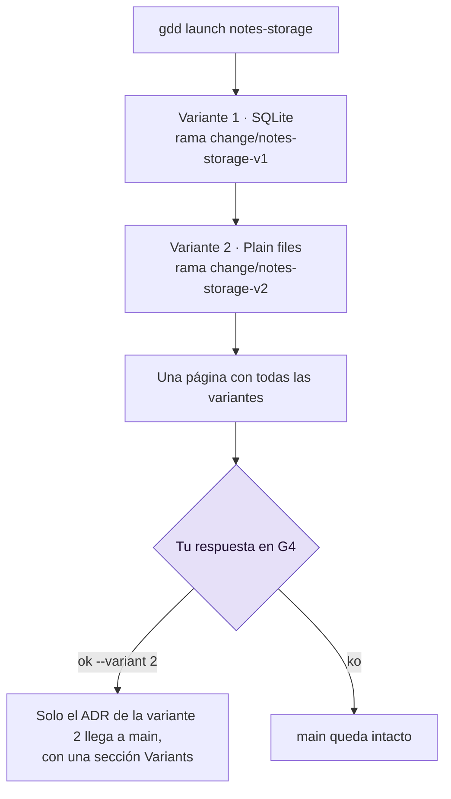

# Explorar con un Spike

Un Spike responde a una pregunta antes del trabajo real, con un presupuesto fijo: el Builder
escribe código desechable para averiguarlo, y lo único que llega a main es la decisión, en un
ADR. Esta página muestra cómo ejecutar un Spike, mantenerlo dentro de su presupuesto y
construir varias variantes en paralelo para elegir una.

## Antes de empezar

- Un proyecto con la fase Setup terminada (`G0: ok` en `bin/gdd status`). Un Spike es el único
  Change que se puede construir antes de que se aprueben las zonas rojas (consulta
  [Mapear y aprobar zonas rojas](red-zones.md)).
- Una pregunta que bloquea una decisión, como "¿dónde se guardan las notas?". Los Spikes nacen
  en Discover: consulta [GDD en una página](../explanation/method.md).

Los ejemplos usan el proyecto `notes`.

## Qué recibe un Spike y qué se salta

Un Spike ejecuta una receta propia. Como su código nunca se fusiona, se salta lo que protege al
código en su camino hacia main:

| Un Spike... | Porque |
|---|---|
| no tiene modo test, ni mutation testing, ni Reviewer, ni G3, ni fusión, ni pre | solo su ADR llega a main |
| lo construye el Builder en modo build, con `mode=spike` | escribe código para responder a una pregunta, no para conservarlo |
| pasa G2 con Path Guard y un ADR: un `docs/adr/*.md` nuevo o modificado con una línea `## Decision` | los comandos de G2 del proyecto no se ejecutan sobre código desechable |
| siempre espera a una persona en la puerta de salida (G4, *Release Gate*) | tú decides lo que dice el ADR |
| tiene un presupuesto, `[spike] max_usd` | un coste fijo, como pide Discover |
| no necesita plan, ni siquiera cuando es rojo | conserva el Builder de un Change rojo, y tú apruebas el ADR en G4 |

## 1. Fijar el presupuesto

`gdd init` escribe el presupuesto en `gdd/rules.toml`:

```toml
[spike]
max_usd = 5   # a spike parks when its agent calls cost this much (USD)
```

Cámbialo en main si 5 USD no encaja con tus Spikes (consulta
[Configuración](../reference/configuration.md#spike)). Tiene que ser un número positivo: `0` se
rechaza con `spike.max_usd must be a positive number of USD, not 0`.

gdd guarda lo que ha gastado cada Change en su registro, que solo escribe gdd: después de cada
llamada de agente, suma el coste que ha informado el agente a `spent_usd` y los tokens a
`spent_tokens`, en `.gdd/changes/<id>/change.json`. El presupuesto se lee de ahí, no del log,
así que una línea que un agente añada al log no puede ampliarlo. El presupuesto se comprueba
entre llamadas: una llamada nunca se corta a mitad, así que un Spike puede acabar gastando un
poco más.

> [!NOTE]
> El presupuesto cuenta lo que informan los agentes. Codex no informa de ningún coste: sus
> llamadas cuentan como 0 USD salvo que `[prices.<model>]` en `gdd/models.toml` dé el precio de
> su modelo. Con una suscripción, el coste es teórico, así que compara también los tokens
> (`bin/gdd report --change <id>`).

## 2. Crear el Spike

```bash
bin/gdd new-change notes-sync --type Spike --title "How notes sync between laptops" --paths "src/sync/**" docs/adr/0003-sync.md
```

Deberías ver:

```text
{
  "change": "notes-sync",
  "color": "yellow",
  "lane": "full",
  "reasons": [
    "docs/adr/0003-sync.md -> green (Documentation)",
    "src/sync/** -> yellow (no zone: default color)"
  ],
  "g1": false,
  "features": [],
  "tests_first": false,
  "mutation": false,
  "reviewer": false,
  "review": "quick",
  "g4": true,
  "human_plan": false,
  "type": "Spike",
  ...
```

Escribe la pregunta y lo que la respondería en el paquete del Change
(`.gdd/changes/notes-sync/package.md`), como en cualquier Change: el comando `gdd-change` del
Orchestrator lo hace por ti.

## 3. Lanzarlo

```bash
bin/gdd launch notes-sync
```

El Builder trabaja en la rama `change/notes-sync`, en su propio worktree, y escribe la decisión
en un fichero nuevo bajo `docs/adr/`, con una sección `## Decision`. Cuando G2 pasa, el
lanzamiento dice qué ficheros ADR llevaría OK a main y se para en G4. Todavía no llega nada a
main.

En cambio, un Spike se aparca cuando:

- no deja ningún ADR: G2 falla con
  `a Spike leaves its decision in a new file under docs/adr/ with a ## Decision section`, y
  después de los reintentos el Change se aparca con `G2 still red`;
- llega a su presupuesto: `parked: the spike spent 0.02 USD of its budget of 0.02 USD` (aquí
  con `max_usd = 0.02`).

Consulta [Volver a poner en marcha un Change aparcado](parked-change.md) para saber qué hacer
después.

## 4. Responder a su puerta de salida

Lee el ADR en la rama del Spike y después responde, en la sentada
(`bin/gdd sitting notes-sync`) o desde la línea de comandos:

```bash
bin/gdd resume notes-sync --g4 ok --note "Plain files and git: no server to run"
```

| Respuesta | Qué pasa |
|---|---|
| `--g4 ok` | Solo los ficheros ADR de la rama llegan a main, en un único commit `gdd(notes-sync): Spike ADR · How notes sync between laptops`. El código se queda en `change/notes-sync`, que gdd conserva. |
| `--g4 ko --note ...` | main se queda como estaba. |
| `--g4 polish --note ...` | Una ronda más del Builder con tus notas, sin reintentos ni replanificación, y después G2. Si sigue en rojo, el Change se aparca. |

No hay demo, ni promoción, ni línea de changelog: un Spike entrega una decisión, no una
funcionalidad. El trabajo real viene después, como un Change nuevo construido con todas sus
puertas.

## 5. Probar varias opciones a la vez con variantes

Cuando la pregunta tiene de 2 a 4 opciones, construye una variante por opción y compáralas en
una sola página (diseño basado en conjuntos, *set-based design*: explorar un conjunto de
alternativas y después ir descartando). Indica cada opción con `--option`:

```bash
bin/gdd new-change notes-storage --type Spike --title "Where the notes live" --paths "src/store/**" docs/adr/0002-storage.md --option SQLite --option "Plain files"
```

El registro enumera las variantes, cada una con su rama:

```json
"variants": [
  {
    "option": "SQLite",
    "branch": "change/notes-storage-v1"
  },
  {
    "option": "Plain files",
    "branch": "change/notes-storage-v2"
  }
]
```

Si no hay opciones que distinguir, `--variants N` construye N variantes del mismo encargo. gdd
rechaza todo lo demás antes de escribir nada. Por ejemplo, `--variants 5`, los dos flags a la
vez y las variantes en un Change que no es un Spike
(`gdd new-change x1 --title X --variants 2`):

```text
error: a spike has 2 to 4 variants, not 5
error: --option and --variants do not go together: one variant for each option, or n variants of the same brief
error: only a Spike has variants, and x1 is a Feature: add --type Spike, or leave out --option and --variants
```

Lee el diagrama de arriba abajo: un lanzamiento construye todas las variantes, y tú eliges en
G4.



Lo que hace un lanzamiento con variantes:

- Construye las variantes una detrás de otra, cada una con su propio Builder
  (`mode=spike variant=<n>`), en su propia rama `change/<id>-v<n>`, con la puerta de un Spike.
- Cada variante tiene su propio presupuesto: `[spike] max_usd` cuenta lo que han gastado las
  llamadas de esa variante (`usd` y `tokens` de cada variante en el registro), y la que se
  aparca es la variante. Dos variantes pueden gastar hasta el doble del presupuesto.
- Una variante que falla su puerta o llega a su presupuesto no detiene a las demás. Si no pasa
  ninguna, el Spike se aparca con `no variant passed its gate`.

## 6. Comparar las variantes y elegir una

Cuando se ha construido la última variante, el Spike espera en G4. Su página, en
`bin/gdd sitting notes-storage` y en la Decision Inbox, tiene una línea por variante: si está
lista o aparcada y por qué, sus ficheros ADR, la primera línea de su decisión, cuántos ficheros
ha cambiado, sus minutos y su coste. Las líneas tienen este aspecto (ilustrativo, no sale de
una ejecución real):

```text
## Variants
- Variant 1 · SQLite · ready · ADR: docs/adr/0002-storage.md · decision: SQLite, one file per notebook. · 4 files · 6.1 min · 0.84 USD
- Variant 2 · Plain files · ready · ADR: docs/adr/0002-storage.md · decision: One Markdown file per note. · 3 files · 4.8 min · 0.52 USD
```

Tú comparas y eliges; ningún agente juzga las variantes. En la sentada, `o` (OK) y `p` (polish)
preguntan `Which variant? Its number:`. Desde la línea de comandos:

```bash
bin/gdd resume notes-storage --g4 ok --variant 2 --note "Plain files keep working with git"
```

Solo los ficheros ADR de la variante 2 llegan a main, en el commit
`gdd(notes-storage): Spike ADR · Where the notes live`, y gdd añade al ADR una sección
`## Variants` que nombra la elección y cada variante no elegida con su rama, por ejemplo:

```text
## Variants
Chosen: variant 2 (Plain files), branch change/notes-storage-v2. Plain files keep working with git
Variant 1 (SQLite): not chosen, branch change/notes-storage-v1
```

El código de cada variante se queda en su rama. Sin `--variant`, OK se rechaza con
`pick a variant: gdd resume notes-storage --g4 ok --variant 1|2`, y no se puede elegir una
variante que no ha pasado su puerta. `--g4 polish --variant <n> --note ...` vuelve a construir
esa variante con tus notas; `--g4 ko` las rechaza todas.

## Siguientes pasos

- [Responder a la puerta de salida](release-gate.md): la página de G4, OK, KO y polish.
- [Medir el trabajo](measure.md): lo que cuestan los Spikes y los Changes, en tokens y en USD.
- [Ejecutar un Change](run-a-change.md): construye como un Change real lo que decide el ADR.
- [Referencia de comandos: gdd new-change](../reference/cli.md#gdd-new-change): `--option` y
  `--variants`.
