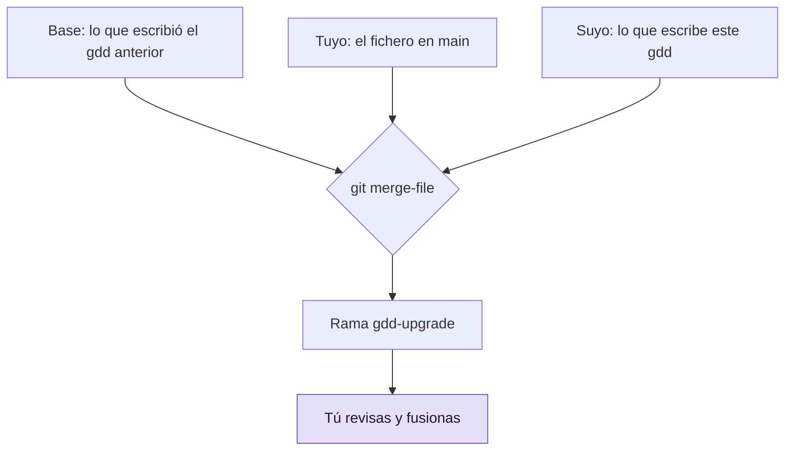

# Actualizar gdd en un proyecto

Usa esta guía cuando sale una versión nueva de gdd y quieres que un proyecto la use. gdd
propone sus ficheros nuevos en una rama, fusionados con tus propias ediciones, así que revisas
la actualización antes de que llegue a main.

## Antes de empezar

- El proyecto se preparó con [`gdd init`](../reference/cli/init.md), así que tiene
  [`gdd/generated.toml`](../reference/configuration.md#generatedtoml): el registro de los
  ficheros que gdd escribió una vez y de las respuestas que recibió.
- Estás en la rama main con todo guardado en commits, y no hay ningún Change en ejecución.
- La actualización la ejecutas tú. Los Builders y los Reviewers no pueden ejecutarla.

`gdd init` escribe algunos ficheros una vez y después te los deja a ti: `gdd/project.toml`,
`gdd/commands.toml`, `gdd/rules.toml`, `gdd/zones.toml`, `gdd/models.toml`, `docs/brief.md`
y `.github/workflows/gdd.yml`. [`gdd upgrade`](../reference/cli/upgrade.md) nunca los escribe en
main. En una rama, fusiona tres versiones de cada fichero, igual que git fusiona dos ramas y que
Copier actualiza un proyecto a partir de su plantilla:



La base es el último commit que tocó `gdd/generated.toml`. "El suyo" (*theirs*) es lo que este
gdd escribe a partir de las respuestas registradas ahí.

## 1. Instala el nuevo gdd

Instala la nueva versión en tu `PATH`, de la misma forma en que instalaste gdd (consulta
[Instalar gdd](install.md)). Después comprueba que tu shell la ejecuta:

```bash
gdd --version
```

## 2. Propón la actualización

Desde la raíz del proyecto, en main:

```bash
gdd upgrade
```

Deberías ver una línea por fichero y, después, qué hacer a continuación. Esta ejecución pasó un
proyecto de 0.0.9 a 0.1.0. La versión anterior se simuló igual que la simula
`features/upgrade.feature`, editando lo que escribió `gdd init` y la versión que figura en
`gdd/generated.toml`:

```text
gdd upgrade 0.0.9 to 0.1.0, on the branch gdd-upgrade:
  gdd/project.toml: yours, gdd writes it as before
  gdd/commands.toml: yours, gdd writes it as before
  gdd/rules.toml: updated (you had not changed it)
  gdd/zones.toml: conflict, settle the marks (1)
  gdd/models.toml: yours, gdd writes it as before
  docs/brief.md: yours, gdd writes it as before
  .github/workflows/gdd.yml: merged with your changes
Conflicts: git switch gdd-upgrade, settle the marks, commit, then git switch main.
Review it: git diff main gdd-upgrade
Take it: git merge gdd-upgrade, git branch -d gdd-upgrade, then gdd agents install
```

En el ejemplo, fíjate en `gdd/zones.toml`: es el único fichero que tienes que resolver a mano
(paso 3). La tabla explica cada línea:

| Línea | Significado |
|---|---|
| `yours, gdd writes it as before` | El nuevo gdd escribe lo mismo que el anterior: tu fichero se queda como está |
| `updated (you had not changed it)` | Nunca lo editaste: recibe el texto nuevo |
| `merged with your changes` | Lo habéis cambiado los dos, en líneas distintas: la rama tiene ambas ediciones |
| `conflict, settle the marks (N)` | Los dos habéis cambiado las mismas líneas: hay N conflictos que resolver |
| `added` | El gdd anterior no escribía este fichero |

En main no cambia nada, y no se hace push de nada. La rama tiene dos commits: primero lo que
escribe este gdd, sin cambios (la base de la próxima actualización), y después la fusión con tus
ediciones.

Si no hay nada que proponer, ves:

```text
Already up to date with gdd 0.1.0: nothing to propose.
```

La actualización se detiene antes de escribir nada si hay modificaciones sin commit
(`commit or stash`), si ya existe una rama `gdd-upgrade` o si falta `gdd/generated.toml`.

> [!NOTE]
> Los proyectos preparados antes de que gdd registrara `gdd/generated.toml` todavía no se pueden
> actualizar así. Compara a mano sus ficheros con lo que `gdd init` escribe en una carpeta
> temporal.

## 3. Revisa y resuelve los conflictos

1. Mira todo lo que propone la actualización:

   ```bash
   git diff main gdd-upgrade
   ```

   En el ejemplo, `gdd/rules.toml` gana el comentario sobre `command_seconds` y su nuevo valor
   por defecto. El workflow pasa a `actions/checkout@v4` y conserva tu `runs-on: ubuntu-24.04`.

2. Si hay conflictos, cambia a la rama y edita las líneas marcadas:

   ```bash
   git switch gdd-upgrade
   ```

   ```text
   <<<<<<< yours
   reason = "Documentation and help pages"
   =======
   reason = "Documentation"
   >>>>>>> gdd 0.1.0
   ```

   Tus líneas están encima de `=======`, y lo que escribe este gdd, debajo. Quédate con lo que
   quieras, quita las marcas y después haz commit y vuelve:

   ```bash
   git commit -am "Settle the upgrade's conflicts"
   git switch main
   ```

## 4. Incorpora la actualización

```bash
git merge gdd-upgrade
git branch -d gdd-upgrade
```

Estos ficheros forman parte del [arnés](../glossary.md#arnés), los ficheros que gdd usa para
comprobar tu proyecto. Fusiónalos tú en main, nunca a través de un Change.

## 5. Renueva los comandos de los agentes

Los comandos de GDD de `.claude/`, `.agents/` y `.opencode/` salen del binario de gdd, no de la
rama de la actualización. Vuelve a escribirlos y haz commit:

```bash
gdd agents install
gdd agents check
git add .claude .agents .opencode
git commit -m "GDD commands of gdd 0.1.0"
```

`agents check` imprime `{"ok":true}` cuando cada fichero es lo que escribe este gdd. Consulta
[Elegir agentes y modelos](agents-and-models.md#5-instala-los-comandos-de-gdd-en-cada-agente).

## 6. Comprueba el arnés

Ejecuta el [autotest](../glossary.md#autotest) con el nuevo gdd:

```bash
gdd selftest
```

```text
OK a failing test turns G2 red
OK editing a protected file is blocked (Path Guard and CI)
OK rollback works in pre (simulated)
OK zero scenarios counts as a failure
harness 4/4
```

Si las cuatro líneas dicen `OK`, haz push de main. CI instala la versión de gdd que indica el
workflow actualizado; consulta
[Ejecutar las puertas en CI](ci.md#2-asegúrate-de-que-ci-puede-instalar-gdd).

> [!NOTE]
> Un proyecto preparado por un gdd anterior puede tener un script `bin/gdd`, que ejecutaban sus
> agentes y su CI. Sigue funcionando: ejecuta el `gdd` de tu `PATH`, y el autotest acepta un
> workflow que ejecute `bin/gdd ci`. Los proyectos nuevos no tienen ese script, porque las
> personas, los agentes y CI ejecutan `gdd`. Cuando el workflow ejecute `gdd ci` y los comandos
> de los agentes estén renovados, borra `bin/gdd` en main.

## Siguientes pasos

- [Ejecutar las puertas en CI](ci.md): el workflow que la actualización puede haber cambiado.
- [Ajustar las puertas](gates-and-commands.md): las claves nuevas que una versión añade a
  `gdd/commands.toml` y `gdd/rules.toml`.
- [Changelog](../../../CHANGELOG.md): qué cambió en cada versión de gdd.
