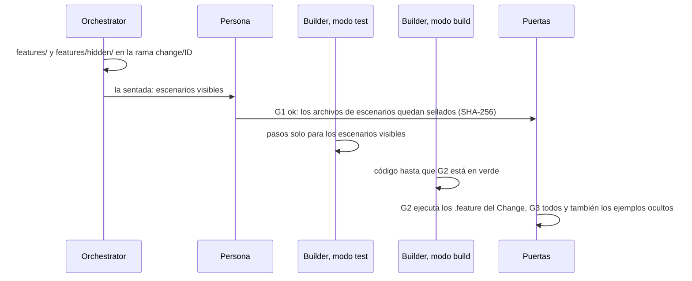

# Escribir y aprobar escenarios

Los escenarios son el contrato de un Change: frases en Gherkin dentro de `features/` que dicen
qué tiene que pasar. Esta página muestra cómo escribir buenos escenarios, cómo añadir ejemplos
ocultos y cómo aprobarlos en la puerta de escenarios (G1, *Scenario Gate*), que los sella para
que ningún agente pueda cambiarlos después.

## Antes de empezar

- Un proyecto GDD con el Setup terminado (`bin/gdd status` dice `G0: ok`). Consulta
  [Tu primer Change](../getting-started/tutorial.md).
- Un Change que tenga previsto su fichero `.feature`. Consulta [Ejecutar un Change](run-a-change.md).
- El listón de calidad de tu proyecto para los escenarios, en
  [`docs/standards.md`](../../standards.md) (el del propio gdd sirve de ejemplo).

Los ejemplos de esta página construyen el Change `export-csv` de una herramienta de notas de
línea de comandos, `notes`, sobre el stack de Rust. Todos los comandos se ejecutan desde la raíz
del proyecto, en la copia principal.

## Cómo recorren los escenarios un Change

Lee el diagrama de arriba abajo: quién escribe cada fichero, quién lo ve y qué puerta lo
ejecuta.



## 1. Incluye el fichero de escenarios en el Change

Pon el fichero `.feature` en `--paths` al crear el Change, para que gdd sepa que el Change
necesita G1:

```bash
bin/gdd new-change export-csv --title "Export notes as CSV" --paths src/export.rs features/export_csv.feature
```

Deberías ver, dentro de la clasificación:

```text
  "color": "yellow",
  "lane": "full",
  ...
  "g1": true,
  "features": [
    "features/export_csv.feature"
  ],
  ...
  "g4": true,
```

`"g1": true` significa que una persona aprueba los escenarios antes de construir, y
`"g4": true`, que esa misma persona vuelve a encontrarse con el Change en la
[puerta de salida](release-gate.md) (G4, *Release Gate*): con la tabla de reglas por defecto, un
Change con escenarios nuevos se detiene en G4. Un Change que toca un fichero `.feature` que no
tenía previsto recibe las mismas puertas: gdd también cuenta las rutas que el Change ha tocado
de verdad.

## 2. Escribe los escenarios en la rama del Change

Los escenarios viven en la rama `change/<id>`, nunca en main, hasta que el Change se fusiona:

```bash
git switch change/export-csv
```

Escribe `features/export_csv.feature`:

```gherkin
Feature: Export notes as CSV
  `notes export --csv` writes the notes as CSV, one row per note under a header, so they open
  in a spreadsheet. Private notes stay out unless the user asks for them.

  Background:
    Given a notebook with the notes:
      | title         | tags | written    | private |
      | Groceries     | home | 2026-10-01 | no      |
      | Rent, October | home | 2026-10-03 | no      |
      | Salary review | work | 2026-10-12 | yes     |

  Scenario: Every public note becomes one row
    When I export the notebook as CSV
    Then the CSV is:
      """
      title,tags,written
      Groceries,home,2026-10-01
      "Rent, October",home,2026-10-03
      """
    And the CSV leaves out "Salary review"

  Scenario: Private notes join the export only when asked for
    When I export the notebook as CSV with private notes
    Then row 3 of the CSV starts with "Salary review"
```

Qué hace buenos a estos escenarios:

- **Los pasos hablan el idioma del dominio.** Cuadernos, notas y exportaciones, nunca funciones,
  ficheros ni opciones de la implementación. El Builder decide cómo llega un paso al código.
- **Todo `Then` puede fallar.** `the CSV is:` compara la salida entera, y `leaves out` nombra la
  nota que tiene que faltar. Un paso que no puede fallar es un bug, como dice
  [`docs/standards.md`](../../standards.md).
- **Ejemplos concretos, pocos escenarios.** Títulos y fechas reales muestran los casos límite
  (una coma dentro de un título) mejor que una frase que hable de ellos.
- **El Background deja claro todo aquello de lo que depende el comportamiento.** Aquí es el
  cuaderno. Para un comportamiento que depende de la configuración, como la tabla de reglas o el
  mapa de zonas, el Background fija esa configuración, para que el escenario no dependa de lo
  que tenga el proyecto en ese momento. Los escenarios del propio gdd lo hacen en todas sus
  features:

  ```gherkin
  Background:
    Given a GDD project in a git repository with the protected paths:
      """
      [protected]
      all = ["gdd/**", "bin/**"]
      """
    And the zone map:
      """
      default = "yellow"
      """
  ```

  Cualquier cambio en la configuración protegida va antes del paso que arranca la construcción.
  Si se escribe después, Path Guard culpa al Builder, con razón, y ninguna vuelta del Builder
  puede arreglarlo.

Solo unos pocos escenarios pasan por la interfaz de usuario, etiquetados `@ui`. Por defecto los
pasos hablan con el núcleo de la aplicación, que es más rápido y menos frágil; la demo en pre
comprueba la interfaz real.

## 3. Añade ejemplos ocultos

Un ejemplo oculto es un escenario de `features/hidden/` que el Builder nunca recibe: comprueba
que el código hace lo que dicen los escenarios, no solo lo que muestran sus datos. Escribe
`features/hidden/export_csv.feature`:

```gherkin
@hidden
Feature: Hidden examples for exporting notes as CSV

  Scenario: Private notes stay out, with other notes
    Given a notebook with the notes:
      | title     | tags   | written    | private |
      | Dentist   | health | 2026-09-30 | yes     |
      | Book club | fun    | 2026-10-20 | no      |
    When I export the notebook as CSV
    Then the CSV is:
      """
      title,tags,written
      Book club,fun,2026-10-20
      """
    And the CSV leaves out "Dentist"
```

Los ejemplos ocultos reutilizan las frases de los escenarios visibles con datos nuevos. El modo
test nunca los ve, así que solo puede escribir sus pasos si sus frases ya están en un escenario
visible. G1 compara las frases con sus datos en blanco: el texto entre comillas, los números y
los marcadores de los Scenario Outline (`<name>`) cuentan como datos; las tablas y los doc
strings se dejan fuera. Si una frase no aparece en ningún escenario visible, G1 se niega. Añade
este escenario al fichero oculto:

```gherkin
  Scenario: A note without tags
    Given a notebook with one note "Call mum" and no tags
    When I export the notebook as CSV
    Then the tags field of row 1 is empty
```

y G1 nombra las dos frases que el modo test nunca podría escribir:

```text
error: G1 refused: hidden examples use step phrasings that no visible scenario has, so test mode can never write them. Reuse visible sentences with new data:
  - a notebook with one note "…" and no tags
  - the tags field of row # is empty
```

La etiqueta `@hidden` importa en el stack de TypeScript: su comando de G2 se salta los
escenarios `@hidden`. Las fichas de Rust y Python dejan fuera `features/hidden/` por carpeta, y
solo la ejecutan en G3, con `GDD_HIDDEN=1`. Ahí la etiqueta no hace ningún daño.

> [!NOTE]
> Un ejemplo oculto está oculto en las instrucciones de los agentes, no guardado bajo llave: un
> Builder que se ponga a buscarlo puede leerlo. Si un Builder informa de que los ha leído, el
> Orchestrator escribe ejemplos ocultos nuevos antes de G4 y los ejecuta, y tú decides en G4 con
> ese resultado ([`GDD.md`](../../../GDD.md)).

## 4. Haz commit y vuelve a main

```bash
git add features/export_csv.feature features/hidden/export_csv.feature
git commit -m "export-csv: scenarios"
git switch main
```

Haz commit antes de aprobar. Al aprobar desde main, G1 sella los ficheros tal como están en el
último commit de la rama; una edición sin commit no queda sellada, y después Path Guard la ve
como un cambio en un escenario aprobado.

## 5. Apruébalos en la sentada

La sentada es una pantalla por Change con todo lo que necesita de ti antes de construir: los
escenarios tal como están en la rama, los ejemplos ocultos (marcados con
`hidden: the Builders never see it`), las zonas rojas que esperan aprobación con sus motivos y
el plan de un Change rojo.

```bash
bin/gdd sitting export-csv
```

| Tecla | Qué hace |
|---|---|
| `↑` `↓` | Desplaza el contenido |
| `a` | Aprueba: muestra exactamente lo que va a registrar en tu nombre |
| `c` | Pide cambios: escribe qué cambiar y pulsa `Enter`; registra G1 KO con tus palabras |
| `y` / `n` | Registra lo que muestra la confirmación, o vuelve atrás sin registrar nada |
| `q` | Sale; no se ha escrito nada |

Al aprobar se registran G1 desde la rama del Change (lo que sella sus ficheros de escenarios),
las zonas rojas cuando están pendientes y el plan de un Change rojo. La sentada termina con
`Next: gdd launch export-csv`. No se escribe nada antes de `y`.

Sin terminal (desde un script o desde el chat de un agente), la sentada te dice qué ejecutar en
su lugar:

```text
error: gdd sitting needs a terminal; without one, record the sitting with gdd gate G1 ok export-csv --by human (and gdd gate zones ok --by human, gdd gate plan ok export-csv --by human for a red change)
```

```bash
bin/gdd gate G1 ok export-csv --by human --note "Two scenarios, one hidden example"
```

Deberías ver:

```text
G1 ok on export-csv (human).
```

Para pedir cambios, registra G1 KO con lo que tiene que cambiar:

```bash
bin/gdd gate G1 ko export-csv --by human --note "Say what happens to a note without tags"
```

Solo una persona aprueba G1: si un Builder o un Reviewer ejecuta `gdd gate`, se le rechaza con
`A Builder or Reviewer cannot open or close gates.`

## 6. Comprueba lo que selló G1

El registro del Change guarda el SHA-256 de cada fichero de escenarios que selló, ejemplos
ocultos incluidos. En `.gdd/changes/export-csv/change.json`:

```json
"G1": {
  "by": "human",
  "decision": "ok",
  "hashes": {
    "features/export_csv.feature": "0658d1978f1549c0b2a63c08b60b698c734f55206bef27a73c575aa868171fe3",
    "features/hidden/export_csv.feature": "4cf81ea487a1ada4601534eb5aa7980c752f1e75888fa3eb9e681b1c10ec4f65"
  },
  "note": "Two scenarios, one hidden example",
  "ts": "2026-10-30T13:15:22+00:00"
}
```

`bin/gdd status` lista el Change con `G1:ok`. Ahora lánzalo: `bin/gdd launch export-csv`
(consulta [Ejecutar un Change](run-a-change.md)).

## 7. Deja que el Builder escriba los pasos

El primer agente del lanzamiento es el Builder en modo test. Recibe un paquete de contexto con
los escenarios visibles, nunca con los ocultos, y:

- escribe una definición de paso por frase, en el lenguaje del dominio, con aserciones reales;
- reutiliza un paso que ya dice lo mismo, y solo añade uno general (con los valores como
  parámetros) cuando ninguno encaja;
- conecta cada paso con la capa más baja que muestra el comportamiento: una función del dominio,
  luego la línea de comandos, luego la pantalla;
- comprueba con `bin/gdd g2 --role builder-test` que los tests nuevos fallan porque falta el
  comportamiento, no por un error de sintaxis o de configuración.

El modo test no puede escribir código de producción, y el modo build, que viene después, no
puede tocar los ficheros `.feature` ni los pasos: ambos son rutas protegidas en
`gdd/rules.toml` (`builder_test` y `builder_build`). El runner de cada ficha de stack se ejecuta
en **modo estricto**: una frase sin paso, o un paso pendiente, hace fallar la ejecución, así que
un escenario no puede pasar porque alguien se lo salte.

Cada puerta ejecuta un conjunto distinto:

| Puerta | Qué ejecuta | Cómo lo sabe |
|---|---|---|
| G2, en cada vuelta del Builder | los ficheros de escenarios del Change | `GDD_FEATURES`, una ruta por línea; vacío significa todos |
| G3, antes de la fusión | todos los escenarios, ejemplos ocultos incluidos | `GDD_FEATURES` vacío y `GDD_HIDDEN=1` en las fichas de Rust y Python; sin filtro de etiquetas en TypeScript |

## 8. Cambia un escenario después de aprobarlo

Path Guard detiene a cualquiera que cambie un fichero sellado, tenga el rol que tenga. Edita
`features/export_csv.feature` en la rama, y la siguiente puerta dice:

```text
{"ok":false,"failures":["features/export_csv.feature: scenario approved in G1 and modified afterwards"]}
```

Ninguna vuelta del Builder puede arreglar eso, así que un Change con un escenario aprobado que se
ha modificado se aparca. Cuando lo que tiene que cambiar es el propio escenario, la decisión es
tuya: edítalo en la rama, haz commit y vuelve a aprobar G1. La nueva aprobación sella los nuevos
hashes:

```bash
git switch change/export-csv
# edit features/export_csv.feature
git commit -am "export-csv: clearer scenario title"
bin/gdd gate G1 ok export-csv --by human --note "Reworded one title"
git switch main
```

Deberías ver `G1 ok on export-csv (human).`, y Path Guard vuelve a pasar. Si el Change está
aparcado, lee [Reactivar un Change aparcado](parked-change.md) antes de hacer commit de nada en
su rama.

## Escenarios de regresión: sin G1

Un escenario de `features/regression/` deja fijado un bug que ya se ha corregido. Describe un
comportamiento que ya estaba aprobado, así que no necesita sentada:

```bash
bin/gdd new-change empty-title --type Hotfix --title "An empty title no longer breaks the export" --paths src/export.rs features/regression/empty_title.feature
```

Deberías ver:

```text
  "g1": false,
  "features": [],
```

La carpeta es `regression` en `[acceptance]` de `gdd/rules.toml`. Los escenarios de regresión se
ejecutan en G3 con todos los demás, y no hacen que un Change salga de la vía rápida
(*Fast Lane*).

## Siguientes pasos

- [Ejecutar un Change](run-a-change.md): lanza el Change que acabas de aprobar y síguelo.
- [Responder a la puerta de salida](release-gate.md): vuelves a encontrarte con este Change en
  G4.
- [Mantener honestos a los agentes](../explanation/safety.md): por qué los hashes, los ejemplos
  ocultos y Path Guard funcionan juntos.
- [Referencia de comandos: gdd gate](../reference/cli.md#gdd-gate): cada puerta y cada opción.
