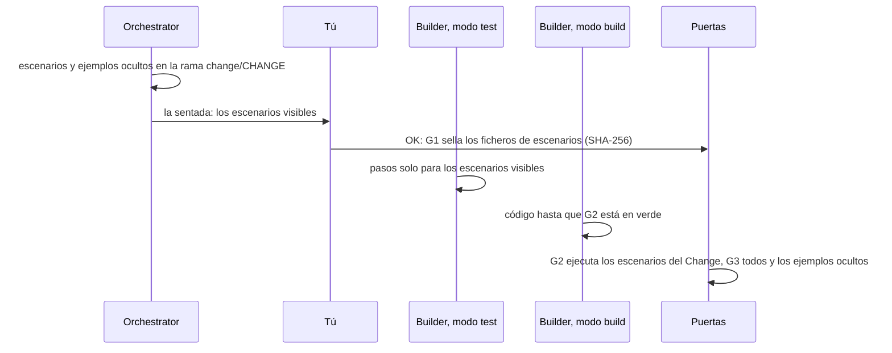

# Aprobar los escenarios

Usa esta página cuando el Orchestrator te enseñe los escenarios de un Change. Los escenarios
son el contrato del Change: ejemplos breves que dicen lo que tiene que pasar, escritos en
Gherkin, un formato sencillo de líneas `Given`, `When` y `Then`. Los lees, pides cambios con
palabras normales y los apruebas en la puerta de escenarios (G1, *Scenario Gate*). Tu OK los
sella, así que ningún agente puede cambiar a escondidas lo que has aprobado.

<!-- The chat excerpts and the sitting screens up to the confirmation come from one real run of
gdd 0.1.1 (main at 30b50c4) on 2026-10-31 with Claude Code and Codex: the run of the tutorial.
The Recorded screen, the G1 refusal and the sealed-file message were reproduced the same day
with gdd 0.1.1 in a throwaway copy of that project, with the same scenario files, without
agents and without a launch. -->

## Antes de empezar

- Un Change que el Orchestrator está preparando: consulta [Describir un Change a tu
  agente](run-a-change.md).
- El listón de calidad de tu proyecto para los escenarios, si lo tiene, en `docs/standards.md`
  (el [de gdd](../../standards.md) sirve de ejemplo).

Los ejemplos usan el Change `cart-total` de `shop`, una pequeña tienda online.

## Cómo recorren los escenarios un Change

Lee el diagrama de arriba abajo: quién escribe cada fichero, quién lo ve y qué puerta lo
ejecuta.



## 1. Lee lo que te enseña el Orchestrator

Después de crear el Change, el Orchestrator hace una [sentada](../glossary.md#sentada)
contigo: un solo mensaje con todo lo que necesita tu aprobación. Es decir, los escenarios en
texto llano, las zonas rojas cuando esperan y el plan cuando el Change es rojo. Para
`cart-total`, el agente escribió:

```text
I've set up the change **cart-total** and written its scenarios. It's classified **yellow**:
ordinary code outside your protected zones. So there's no plan for you to approve now; you
approve the scenarios now and the finished result at the end.

**The scenarios to approve (G1)**

*A cart with several pieces shows its total, taxes included*
- The catalogue has a Blue mug at 18.00 and a Large bowl at 24.50.
- The customer puts 2 Blue mugs and 1 Large bowl in the cart.
- The cart shows a subtotal of **60.50**, tax of **12.71** and a total of **73.21**.

*An empty cart costs nothing*
- Subtotal **0.00**, tax **0.00**, total **0.00**.

I also wrote two hidden examples that the Builder doesn't see, to catch a wrong rounding rule or
a piece added twice.

**Two rules I built into these numbers. Please confirm or correct them:**
1. **Tax rate: 21% on everything.** That's the Spanish standard VAT rate, but it's only my
   example; tell me your real rate if it's different.
2. **Catalogue prices are before tax.** The shop adds the tax once, on the whole cart, and
   rounds to the cent (half a cent rounds up). The alternative is that the prices you list
   already include tax and the cart shows the tax inside them; in that case I'll redo the
   examples.

**Next step:** reply "scenarios OK", or give me your rate and price rule, and I'll seal the
scenarios and launch the build.
```

El agente cuenta los escenarios con palabras sencillas y añade las reglas que necesita que
confirmes. Hizo commit del fichero de escenarios en la rama del Change antes de escribir este
mensaje, así que el fichero que aprobarías ya existe (el paso 4 lo enseña en una pantalla). Dice:

```gherkin
Feature: Cart total with taxes
  A customer sees what the cart costs before tax, the tax, and the total to pay.
  Catalogue prices are before tax; the tax rate is 21% on the whole cart,
  rounded to the nearest cent (half a cent rounds up).

  Scenario: A cart with several pieces shows its total, taxes included
    Given the catalogue has these pieces:
      | piece           | price |
      | Blue mug        | 18.00 |
      | Large bowl      | 24.50 |
    And the customer puts 2 "Blue mug" in the cart
    And the customer puts 1 "Large bowl" in the cart
    When the customer looks at the cart total
    Then the subtotal is 60.50
    And the tax is 12.71
    And the total is 73.21

  Scenario: An empty cart costs nothing
    Given the catalogue has these pieces:
      | piece           | price |
      | Blue mug        | 18.00 |
    When the customer looks at the cart total
    Then the subtotal is 0.00
    And the tax is 0.00
    And the total is 0.00
```

- `Feature` nombra el comportamiento, y las líneas de debajo dicen para qué sirve. Aquí también
  enuncian las reglas: precios sin impuesto, 21 % sobre todo el carrito, medio céntimo redondea
  hacia arriba.
- Cada `Scenario` es un ejemplo. `Given` es el punto de partida, `When` lo que hace alguien,
  `Then` lo que tiene que ser cierto después. `And` continúa la línea anterior. Una tabla bajo
  un `Given` da los datos de un paso, aquí las piezas del carrito.

Comprueba estas cinco cosas:

- **Es lo que pediste.** Cada caso que te importa tiene un escenario, y no hay nada que no
  quisieras.
- **Las palabras son las del dominio.** Carritos, piezas, precios e impuestos, nunca funciones,
  ficheros ni clases del código. El Builder decide cómo llega un paso al código.
- **Cada `Then` puede fallar.** `the total is 73.21` nombra un importe exacto. Un `Then` que no
  puede fallar no promete nada.
- **Ejemplos concretos, pocos escenarios.** Los precios reales muestran los casos límite mejor
  que una frase sobre ellos: el 21 % de 60.50 es 12.705, así que el ejemplo también fija cómo se
  redondea el céntimo.
- **El punto de partida está completo.** Todo aquello de lo que depende el comportamiento está
  en un `Given`, o en un `Background` que comparten todos los escenarios del fichero, no se da
  por supuesto. Aquí el catálogo y sus precios están en un `Given`, pero el 21 % solo aparece en
  la descripción: el código lo toma del proyecto. Vale mientras la tienda tenga un único tipo;
  si puede cambiar, pide un paso como `Given the tax rate is 21%`.

Solo unos pocos escenarios pasan por la interfaz de usuario, con la etiqueta `@ui`. Los demás
hablan con el núcleo de la aplicación, que es más rápido y menos frágil; la demo en pre
comprueba la interfaz real.

## 2. Pide cambios con palabras normales

Di lo que falta o lo que está mal, como se lo dirías a alguien de tu equipo. Por ejemplo:

```text
My prices already include tax: show how much of the total is tax.
Add a cart with three plates of the same kind, so I see a quantity above one.
```

El Orchestrator reescribe los escenarios en la rama del Change y te los vuelve a enseñar. No
se registra nada hasta que dices OK, así que pide tantas veces como necesites. Un escenario que
apruebas es difícil de cambiar después: sale más barato corregirlo ahora que después de la
construcción.

## 3. Entiende qué son los ejemplos ocultos

Los ejemplos ocultos comprueban que el código hace lo que dicen los escenarios, no solo lo que
muestran sus datos. Junto a los escenarios que lees, el Orchestrator escribe uno o dos en
`features/hidden/`, y el Builder nunca los recibe. El Orchestrator no los enseña en el chat; la
pantalla de la sentada sí, marcados como ocultos (consulta el paso 4). Uno de los de
`cart-total`:

```gherkin
Feature: Cart total with taxes (hidden examples)

  Scenario: Tax on the whole cart rounds down when under half a cent
    Given the catalogue has these pieces:
      | piece           | price |
      | Dinner plate    | 15.99 |
    And the customer puts 3 "Dinner plate" in the cart
    When the customer looks at the cart total
    Then the subtotal is 47.97
    And the tax is 10.07
    And the total is 58.04
```

Un ejemplo oculto reutiliza las frases de los escenarios visibles con datos nuevos. El Builder
en modo test escribe un paso por cada frase visible, así que nunca podría escribir una frase
que solo tiene un ejemplo oculto. G1 rechaza un ejemplo así y nombra las frases. Por ejemplo,
una tarjeta regalo oculta con dos frases propias:

```text
error: G1 refused: hidden examples use step phrasings that no visible scenario has, so test mode can never write them. Reuse visible sentences with new data:
  - no tax is charged on the gift card
  - the cart holds a gift card worth #
```

Entonces el Orchestrator reescribe el ejemplo oculto, o añade la frase a un escenario visible
para que la apruebes.

> [!NOTE]
> Un ejemplo oculto está oculto en las instrucciones de los agentes, no bajo llave: un Builder
> que busque en el proyecto puede leerlo. Si un Builder informa de que los ha leído, el Orchestrator
> escribe ejemplos ocultos nuevos antes de G4 y los ejecuta, y tú decides en G4 con ese
> resultado ([`GDD.md`](../../../GDD.md)).

## 4. Aprueba

En el chat, di OK, con las respuestas a las preguntas que haya hecho el Orchestrator:

```text
scenarios OK. 21% is my rate and my prices are before tax.
```

El Orchestrator registra G1 con tus palabras, además de las zonas rojas y el plan cuando
formaban parte de la sentada. G1 sella los ficheros de escenarios tal como los tiene el último
commit de la rama del Change. Después lanza el Change. El agente responde:

```text
Your answers are recorded and the build is running in the background:

- **Scenarios approved (G1):** sealed with your rule: 21% tax on the whole cart, catalogue
  prices before tax, and half a cent rounds up.
...
```

Para leerlo todo antes en una pantalla, ejemplos ocultos incluidos, usa la pantalla de la
sentada. Lee los escenarios de la rama del Change, donde el Orchestrator les hace commit antes
de enseñártelos en el chat. Si la abres antes de ese commit, dice `No scenarios on
change/cart-total yet: they show here once your agent commits them`. Abre la sentada en una
terminal:

```bash
gdd sitting cart-total
```

Deberías ver:

```text
┌ gdd · Sitting · shop ────────────────────────────────────────────────────────────────────────────┐
│cart-total · Show the cart total, taxes included · yellow                                         │
│                                                                                                  │
│Scenarios                                                                                         │
│features/cart_total.feature                                                                       │
│Feature: Cart total with taxes                                                                    │
│  A customer sees what the cart costs before tax, the tax, and the total to pay.                  │
│  Catalogue prices are before tax; the tax rate is 21% on the whole cart,                         │
│  rounded to the nearest cent (half a cent rounds up).                                            │
│                                                                                                  │
│  Scenario: A cart with several pieces shows its total, taxes included                            │
│    Given the catalogue has these pieces:                                                         │
...
│↑↓ scroll · a approve · c ask for changes · q quit                                                │
└──────────────────────────────────────────────────────────────────────────────────────────────────┘
```

Las flechas desplazan hasta los ejemplos ocultos y después hasta las zonas rojas y el plan (sin
las líneas en blanco):

```text
┌ gdd · Sitting · shop ────────────────────────────────────────────────────────────────────────────┐
│features/hidden/cart_total_hidden.feature · hidden: the Builders never see it                     │
│Feature: Cart total with taxes (hidden examples)                                                  │
│  Scenario: Tax on the whole cart rounds down when under half a cent                              │
│    Given the catalogue has these pieces:                                                         │
...
│Red zones: approved                                                                               │
│Plan: not needed for a yellow change                                                              │
│↑↓ scroll · a approve · c ask for changes · q quit                                                │
└──────────────────────────────────────────────────────────────────────────────────────────────────┘
```

`Red zones: approved` significa que se firmaron en la fase Setup; cuando esperan, la sentada
las lista en `Red zones to approve` y tu aprobación también las cubre. `a` aprueba y `c` pide
cambios: escribe qué cambiar y después `Enter`. Las dos muestran primero exactamente lo que van
a registrar, en tu nombre, y no se escribe nada antes de `y`:

```text
┌ gdd · Sitting · shop ────────────────────────────────────────────────────────────────────────────┐
│This records, as you:                                                                             │
│- G1 ok on cart-total, sealing features/cart_total.feature,                                       │
│features/hidden/cart_total_hidden.feature                                                         │
│y to record · n to go back                                                                        │
│↑↓ scroll · q quit                                                                                │
└──────────────────────────────────────────────────────────────────────────────────────────────────┘
```

Después de `y`:

```text
┌ gdd · Sitting · shop ────────────────────────────────────────────────────────────────────────────┐
│Recorded                                                                                          │
│G1 ok on cart-total (human).                                                                      │
│Next: tell your agent it is approved (it runs gdd launch cart-total)                              │
│↑↓ scroll · q quit                                                                                │
└──────────────────────────────────────────────────────────────────────────────────────────────────┘
```

Después dile al Orchestrator en el chat que has aprobado, para que siga con el lanzamiento.
Todas las teclas de la sentada están en [Pantallas](../reference/screens.md).

Solo una persona aprueba G1. A un Builder o un Reviewer que lo intente se le rechaza con
`A Builder or Reviewer cannot open or close gates.`

## 5. Cambia un escenario después de aprobarlo

Los ficheros sellados se comparan en cada puerta. Tu OK guarda una huella de cada fichero de
escenarios del Change, ejemplos ocultos incluidos, en el registro del Change. A partir de ahí,
[Path Guard](../glossary.md#path-guard) compara cada fichero sellado con su huella en cada
puerta. Si un fichero no coincide, sea quien sea quien lo editó, la puerta falla:

```text
{"ok":false,"failures":["features/cart_total.feature: scenario approved in G1 and modified afterwards"]}
```

Ninguna ronda del Builder puede arreglar eso, así que un Change así se aparca. Un escenario
aprobado solo cambia con una G1 nueva. Si un escenario tiene que cambiar, dile al Orchestrator
qué cambiar. Edita el escenario en la rama del Change y vuelve a hacer la sentada. Tu nuevo OK
registra una G1 nueva, cuyas huellas sustituyen a las anteriores, así que la siguiente puerta
comprueba la nueva versión. Si el Change está aparcado, lee antes [Volver a poner en marcha un
Change aparcado](parked-change.md).

El escenario de regresión de un Hotfix, en `features/regression/`, no necesita sentada: comprueba la
corrección de un fallo, un comportamiento que ya estaba aprobado. Se ejecuta en G3 con todos
los demás.

## Escribir tú los escenarios

Puedes escribir tú los escenarios y el Orchestrator sigue haciendo la sentada. Escríbelos en la
rama del Change, nunca en `main`, haz commit y vuelve a `main`:

```bash
git switch change/cart-total
# write features/cart_total.feature and features/hidden/cart_total.feature
git add features/cart_total.feature features/hidden/cart_total.feature
git commit -m "cart-total: scenarios"
git switch main
```

Haz commit antes de aprobar: G1 sella los ficheros tal como están en el último commit de la
rama, y una edición sin commit no queda sellada. Tres reglas más:

- **Los ejemplos ocultos reutilizan frases visibles** con datos nuevos. G1 compara las frases
  con los datos borrados: el texto entre comillas, los números y los marcadores de un outline
  (`<name>`) cuentan como datos; las tablas y los doc strings se dejan fuera.
- **Etiqueta los ficheros ocultos con `@hidden`.** La G2 de la ficha de TypeScript se salta los
  escenarios `@hidden`; las fichas de Rust y Python dejan fuera `features/hidden/` por carpeta
  y solo lo ejecutan en G3, con `GDD_HIDDEN=1`. Ahí la etiqueta no hace daño.
- **Fija en el `Background` la configuración de la que depende un comportamiento.** Cuando el
  comportamiento depende de la configuración, el `Background` la fija, para que el escenario no
  dependa de lo que tenga hoy el proyecto. Los propios escenarios de gdd lo hacen en cada
  feature:

  ```gherkin
  Background:
    Given a GDD project in a git repository with the protected paths:
      """
      [protected]
      all = ["gdd/**", "bin/**"]
      """
    And the zone map:
      """
      default = "yellow"
      """
  ```

  Pon cualquier modificación de la configuración protegida antes del paso que arranca la
  construcción. Si va después, Path Guard culpa con razón al Builder, y ninguna ronda del
  Builder puede arreglar eso.

## Por dentro

Aprobar ejecuta [`gdd gate G1 ok CHANGE --by human`](../reference/cli/gate.md) desde la rama
del Change, más `gdd gate zones ok` y `gdd gate plan ok` cuando esperan; pedir cambios en la
pantalla ejecuta `gdd gate G1 ko` con tus palabras. [`gdd sitting`](../reference/cli/sitting.md)
registra lo mismo, y sin terminal dice qué líneas de `gdd gate` ejecutar en su lugar. Después
de G1, el Builder en modo test escribe un paso por frase y comprueba que cada uno falla por el
motivo correcto; el modo build no puede tocar los ficheros `.feature` ni los pasos
(`builder_build` y `builder_test` en `gdd/rules.toml`). El runner se ejecuta en modo estricto,
así que una frase sin paso falla. G2 ejecuta los ficheros de escenarios del Change
(`GDD_FEATURES`); G3 los ejecuta todos, ejemplos ocultos incluidos.

## Siguientes pasos

- [Describir un Change a tu agente](run-a-change.md): qué pasa cuando apruebas.
- [Revisar un Change en G4](release-gate.md): vuelves a encontrarte con este Change en la
  puerta de salida.
- [Mantener honestos a los agentes](../explanation/safety.md): por qué los hashes, los ejemplos
  ocultos y Path Guard funcionan juntos.
- [La skill de Change](../reference/skills/change.md): cómo escribe y registra el Orchestrator
  los escenarios.
