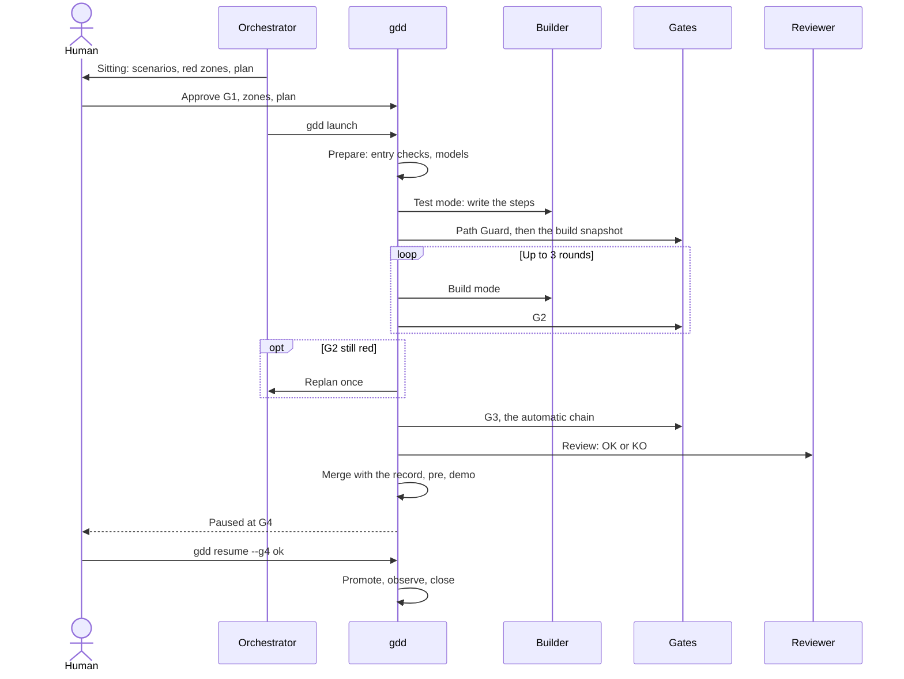
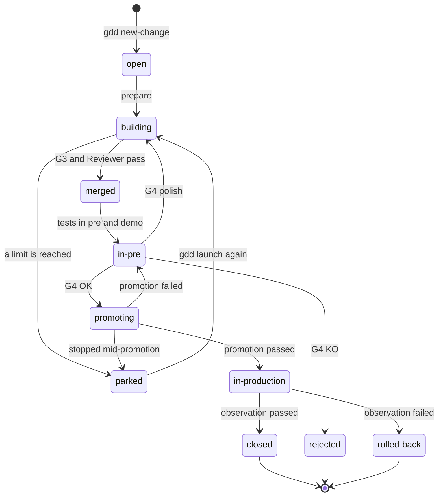

# The life of a change

Every step `gdd launch` and `gdd resume` take with a change, in the order the recipe runs
them, and why each step is there. Read it once and the messages of a launch, a park or a pause
at G4 will make sense.

## Before you start

This page builds on [GDD in one page](method.md): phases, gates, colors and roles. The order
below comes from the recipe in `crates/gdd-core/src/recipe/mod.rs`, and the scenarios in
[`features/recipe.feature`](../../features/recipe.feature) check it.

## The recipe is fixed

A change does not decide its own path. `gdd` runs the same recipe for every change, and the
color only switches steps on or off: test mode, mutation testing, the Reviewer and your G4.
That is what makes a run predictable. An agent cannot skip a gate, reorder the steps or decide
it is done.

This follows a distinction Anthropic draws in
[Building effective agents](https://www.anthropic.com/engineering/building-effective-agents):
*workflows* orchestrate models "through predefined code paths", while *agents* direct their own
process. Inside each step an agent works freely; between steps, the recipe is a workflow, with
"stopping conditions (such as a maximum number of iterations)" at every loop.

The sequence below shows who talks to whom in a red change, the one with every step. Follow
the arrows from top to bottom; the loop is the Builder's rounds against G2.

## 1. Launch

`gdd launch CHANGE` starts from the main checkout, never from a worktree. It refuses
uncommitted changes in tracked files outside the change's branch, and refuses when
`[parallel] max` changes are building already (2 by default): the agents' subscriptions are
shared. A refusal touches nothing.

The change then gets its own git worktree, a sibling folder `<repo>.worktrees/<id>` by default,
on the branch `change/<id>`. The main checkout stays on the main branch, so you and the
Orchestrator keep working there while the agents build. All state stays in `.gdd/` of the main
checkout, so `gdd status` sees every change wherever it runs.

When the change plans paths that overlap a change already in flight, the launch warns, in the
output and in the Decision Inbox, and goes on: git settles the overlap at the merge.
[Run changes in parallel](../how-to/parallel-changes.md) covers the cap and the overlaps.

## 2. Prepare

Prepare checks that the change may enter Build, in this order, and refuses with the reason:

1. **G0 is open**: the Setup is done and the self-test passed.
2. **The red zones are approved.** Only a spike may start before.
3. **G1** is approved when the change creates or changes scenarios.
4. **The plan** is approved when the change is red.
5. **The Reviewer is of another model family** than the Builder, when the change has a
   Reviewer, or you accepted the same family at the Setup, which the Decision Inbox then says.
6. **The change's own branch** is checked out.

Then it writes the decision into the change's record: color, lane, gates, and the agent and
model of each role for that color, from `gdd/models.toml`. The state becomes `building`, and the
build starts at the current commit: from now on, Path Guard judges everything after it.

A relaunch whose code already passes G2 skips the Builder: it would only spend tokens.

## 3. Test mode

When the change needs tests first (new scenarios, or a yellow or red color), the Builder runs
in test mode. It writes the step definitions of the scenarios against the domain language,
with real assertions, and, in yellow or red, characterization tests that pin down what existing
code does today. The new tests must fail because the behavior is missing, not because of a
typo.

Test mode may not write production code or touch the approved `.feature` files. Path Guard
checks that right after the call; a failure parks the change.

Then gdd takes the **build snapshot**: the hashes of everything the change touched so far. From
now on, build mode is judged only on its own work.

## 4. Build mode and G2

The Builder runs in build mode: the domain, the wiring and the unit tests, until G2 is green.
Each round is one Builder call followed by G2: linter, types, unit tests, the change's own
scenarios, architecture rules, Path Guard and the scope check. There are three rounds
(`builder_retries = 3` in `gdd/rules.toml`); the Builder sees the failures of the previous
round in `g2.json`.

Build mode may not touch the steps written in test mode, the scenarios or the harness. It may
step outside the planned paths only at the change's color or lower; a path of a higher color
fails G2. [How risk picks the gates](risk.md#the-scope-rule) explains why.

When the three rounds end red, the Orchestrator **replans** once (`replans = 1`). It reads the
package, the failures and the Builder's outputs, writes the cause and a new approach to
`replan.md`, and ends with one line: `NEXT: build`, or `NEXT: test` when the fault is in the
steps or tests that test mode wrote. With `NEXT: test`, test mode runs once more to fix only
what the replan names, judged from a new round snapshot. Then one more build round and G2.

Still red, the change parks with `G2 still red after 3 retries and 1 replan`, and the Decision
Inbox says why.

## 5. G3, the Merge Gate

G3 runs the whole automatic chain: every scenario in strict mode, hidden examples included,
static security analysis, new dependency checks, secrets in the diff and, when the color asks
for it, mutation testing on the diff. Path Guard runs before the commands and again after.

G3 red gets one fix: a build-mode round with `fix=g3`, G2, and G3 again, which decides. Still
red, the change parks.

## 6. The Reviewer

When the change has a Reviewer, it reads the package, the scenarios, the whole diff, the gate
reports and `docs/standards.md`, and answers with findings and a last line, `VERDICT: OK` or
`VERDICT: KO`. Its depth follows the color: quick for green and yellow, deep for red.

A KO gets one fix: a build-mode round with `fix=review`, G2, G3 and a second review that checks
only the earlier findings, plus anything new that is blocking. A second KO, or G3 red, parks the
change. The record keeps every review, with the files that changed since the one before, so a
relaunch's Reviewer never repeats a settled finding.

An OK review ends with a short `## How it works` section in plain words. It is the first thing
you read at G4.

When both pass, the machines record G3 as `ok`: "automatic chain and Reviewer".

## 7. Merge, then pre

Merges go one at a time, under a merge lock. When the main branch moved while the change was
building, G3 closes, the change takes the latest main, and G3 runs again on top of it. A conflict
or a red G3 parks the change. Nothing reaches main that only worked with an older main.

The merge commit carries the change's **record**: color, lane and type, your approvals, every
Reviewer verdict with its findings, what was decided without you, and the tokens spent. The
working files stay in `.gdd/changes/<id>/`, which git does not track. The record's state becomes
`merged`.

Then the release steps of `gdd/commands.toml`: build, deploy to pre, the tests in pre and the
demo. The demo is video or screenshots of the scenarios, or, for a library or a tool without a
screen, the readable run of its scenarios. The state becomes `in-pre`.

## 8. G4, the Release Gate

A change that needs you (it is red, or it had a G1) pauses here. `gdd` leaves a request in the
Decision Inbox and prints `Paused at G4`. You answer with `gdd resume CHANGE --g4 ok|ko|polish`,
or from the [sitting](human-stops.md#the-g4-sitting) screen.

- **OK** promotes the change.
- **KO** rejects it: production stays as it is, and the state becomes `rejected`. The merge stays
  on main, so main and pre keep the change and production does not.
- **Polish** keeps your notes for the Builder and runs the recipe again from build mode, the
  notes in its first round, through G2, G3, the Reviewer and pre, until it pauses at G4 again.
  Polish replaces a KO; it is not one more stop.

Any other change skips the pause: the machines record G4 as `ok` ("automatic promotion: pre is
green") and promote it.

## 9. Promote, observe, close

Promotion takes **the same artifact** from pre to production, without rebuilding it. The state
is `promoting` while it runs, then `in-production`. With automatic versions, the default, a
change with a changelog line gets its git tag `v<semver>` once the promotion passed.

A promotion that fails leaves production untouched and the change paused at G4: the same OK
retries it. A change caught in the middle of a promotion, because gdd stopped before it recorded
the result, parks with a message: look at production first, so nothing is deployed twice.

Then the observation. Green, the change is `closed`, its worktree goes and its branch stays.
`gdd` prints `Change <id> closed.` with where to read its message and its tokens. If errors
rise, the rollback runs back to the previous version and the change is `rolled-back`, with a
request for a hotfix in the Decision Inbox.

## Around every agent call

Each agent call has its own checks, whatever step it belongs to:

- The agent runs in the change's worktree, started by gdd with the arguments of its role and an
  environment without secrets.
- It has a time limit; when its turn ends, its whole process group is killed.
- Afterwards gdd compares the GDD state with how it was before. Anything an agent changed
  outside what gdd lets it write goes back as it was, and the change parks.
- The Reviewer must leave the working tree exactly as it found it.
- What the call spent, in tokens and USD, is added to the record by gdd alone.

[Keeping agents honest](safety.md) explains each check.

## The states of a change

The record's `state` field says where a change is. The diagram shows the states the code writes
and the step that moves a change from one to the next. Look at `parked`: every limit leads
there, and a new `gdd launch` leads back.

The [Board](../glossary.md#board) groups them by phase: `open` under Discover, `in-pre` under
Release, `closed`, `rejected` and `rolled-back` under Done, and the rest under Build.

## Relaunching a parked change

A parked change keeps its worktree and branch. Its Decision Inbox says why it parked and what
to do. Once the cause is fixed, `gdd launch CHANGE` again runs the recipe from prepare.

The work an earlier run left uncommitted in the worktree is committed first, but only when the
gates accept it as they judged it; otherwise it stays as it is and the gates of the relaunch
judge it. Either way, what test mode wrote before is never blamed on build mode.
[Get a parked change going again](../how-to/parked-change.md) has the steps.

## A spike's recipe

A spike answers one question so that you can decide; its code never reaches main. It has no
test mode, no G3, no Reviewer and no merge. Build mode works in `mode=spike` within a fixed
budget (`[spike] max_usd`, 5 USD by default), against a G2 of its own: Path Guard, and an ADR in
`docs/adr/` with a `## Decision` section. Green, it pauses at G4. OK brings only its ADR to main;
its branch keeps the code. A spike may build two to four variants, each on its own branch, for
you to compare on one page. [Explore with a spike](../how-to/spikes.md) shows how.

## See also

- [Command reference](../reference/cli.md#gdd-launch): `gdd launch`, `gdd resume` and the single
  steps they run.
- [How risk picks the gates](risk.md): which of these steps a color switches on.
- [Keeping agents honest](safety.md): Path Guard, snapshots and the checks around each call.
- [Few stops for the human](human-stops.md): the sitting, G4 and the Decision Inbox.
