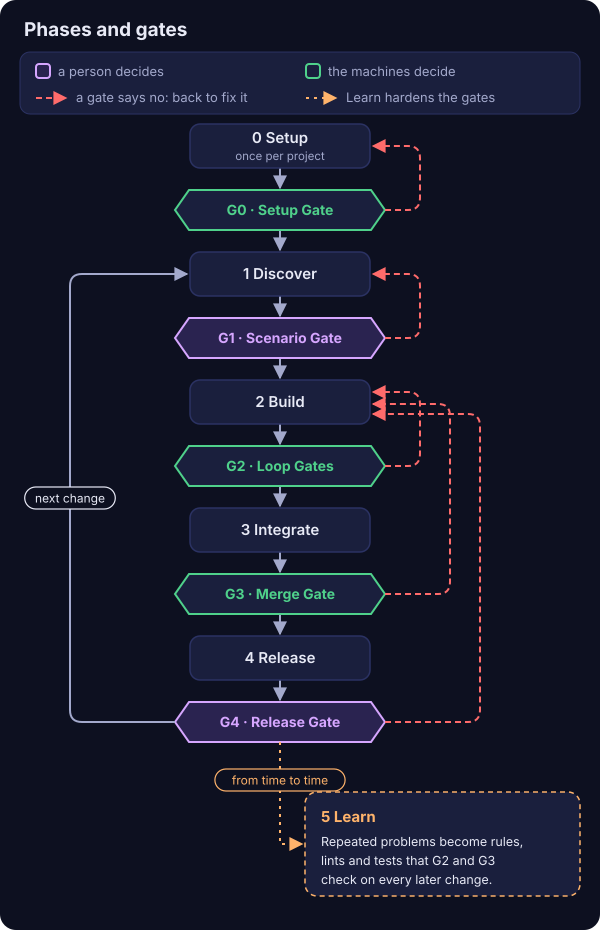
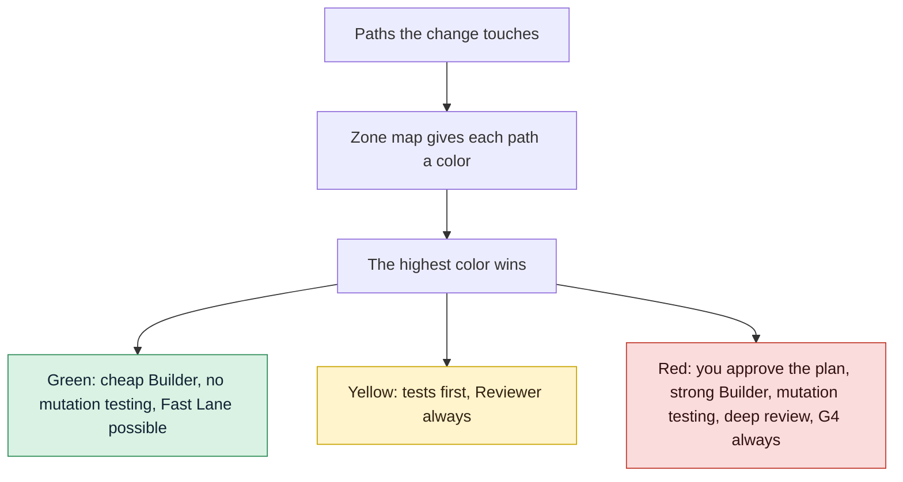

# GDD in one page

Why does GDD, Gate-Driven Development, make every change pass gates, and why does risk decide
how many? Because agents produce work that looks finished faster than anyone can check it, and
gates let machines do the checking. Read this page first: it gives you the whole method, from
the problem to the roles, and two changes side by side.

## The problem

Coding agents make work look finished fast. In minutes you get green tests, tidy code and a
confident summary. What is often missing is the last part, the one that makes the work correct
for *your* case, and it goes missing because the work already looks done.

This is common, not rare. In the
[2025 Stack Overflow Developer Survey](https://survey.stackoverflow.co/2025/ai), 66% of
developers named "AI solutions that are almost right, but not quite" as their biggest
frustration with AI tools.

You also cannot read every line. An agent writes code faster than a person reads it. If you
review everything, you become the bottleneck and the agents wait for you. If you review nothing,
you ship code that is almost right.

The usual ways of working with agents do not solve this. With one long prompt, the agent plans,
builds and declares itself done, so it judges its own work. A second agent of the same model
helps less than it seems, because it tends to share the first one's blind spots. And you,
reading every line, are the bottleneck described above.

GDD takes another way: machines check everything that can be checked, an agent of another model
family reviews, and you are asked only what needs a person.

## The idea

A **gate** is a checkpoint a change must pass to move on. It answers yes or no, and says why.
Machines run most gates: the linter, the tests, the scenarios, mutation testing (breaking the
code on purpose to see whether the tests notice), the security scanners, and a second agent that
reviews the work. Two gates are yours: approving what the change must do, and accepting the
result.

**Risk decides the gates.** Not every change deserves the same care. A garden shed and a
hospital both need a building permit, but nobody inspects them the same way. In GDD, a zone map
gives each path of the project a risk color: green, yellow or red. A change takes the highest
color among the paths it touches, and that color decides which gates it meets and how strict
they are.

The rules of the method live in [`GDD.md`](../../GDD.md). `gdd` is the tool that runs them: it
starts the agents, runs the gates in a fixed order and stops the change when it reaches a limit.

## Principles

The principles are the rules the GDD method never bends. They do not depend on the gdd tool, on
a stack or on a model, and they would hold with any other tool. Every mechanism in these docs
exists because of one of them. Their source is [`GDD.md`](../../GDD.md#principles).

1. **Nothing moves forward without passing a gate.** No one, person or agent, skips a gate or
   loosens one. *Holds up:* the [phases and gates](#phases-and-gates).
2. **Risk decides the gates, not size.** A change takes the color of the riskiest path it
   touches; the color decides how many gates it meets and how strict they are. *Holds up:*
   [the traffic light and the red zones](risk.md).
3. **Machines check; people decide.** A gate answers yes or no with its reason, never an
   opinion. You do not read code: you decide what is sensitive, what the product must do and
   whether the result is good, in as few sittings as possible. *Holds up:* G0, G2 and G3 run by
   machines, G1 and G4 [by you](human-stops.md).
4. **Behavior is agreed before code.** The scenarios you approve are the contract, and whoever
   builds cannot change them. *Holds up:* [G1, executable Gherkin and hidden
   examples](../how-to/write-scenarios.md).
5. **Whoever builds does not judge their own work.** The checks are independent of the
   builder: gates the agent cannot edit, and a Reviewer of another model family. *Holds up:*
   [Path Guard and the review](safety.md).
6. **Everyone gets the minimum context.** Each agent receives only what its task needs.
   *Holds up:* the package of each change and [the roles](../reference/roles.md).
7. **Every loop has a limit.** What gets stuck stops and asks; nothing iterates forever.
   *Holds up:* rounds, the replan and [parking a change](../how-to/parked-change.md).
8. **Done is not good.** A change that passes every gate can still be unfinished. You are the
   editor at the end, and the project writes its quality bar in `docs/standards.md`. *Holds
   up:* [G4 and polish](../how-to/release-gate.md).
9. **What repeats becomes a rule, and outcomes are measured, not output.** A repeated error
   becomes a rule, a lint, a hook or a test. Delivery metrics and GDD's own signals are
   measured; tokens measure cost, not productivity. *Holds up:* Learn and
   [measuring](measuring.md).

## Phases and gates

Work goes through six phases. Phase N ends in gate GN, except Learn, which has no gate. In the
drawing, look at the colors first: a person opens the purple gates, and the machines open the
others.

<p align="center">
  
</p>

Then read the three kinds of arrow.

The gray arrows are a change's path. Setup happens once per project, and after G4 the next
change starts again at Discover.

The red dashed arrows are a gate saying no: the change goes back to the phase that can fix it.
A G1 KO sends the scenarios back to Discover. A red G2 gives the Builder another round, and
after a few rounds the Orchestrator replans once. A red G3 or a Reviewer KO gets one fix. Polish
at G4 is one more pass of the Builder with your notes. When a change still does not pass after
those tries, it does not loop forever: it *parks* and waits for you in its Decision Inbox.

The dotted arrow is Learn, which is not a step of each change. From time to time you look at
what keeps coming back, such as polish notes and Reviewer findings, and turn it into rules,
lints and tests. From then on, the gates of every change catch it on their own.

The table says what happens in each phase. Two words in it: the **harness** is the set of files
gdd uses to check your project (configuration, gate commands, the continuous integration (CI)
workflow, agent instructions), and its **self-test** proves those checks can fail.

| Phase | What happens | Its gate | Who opens it |
|---|---|---|---|
| 0 Setup | Once per project: what it is, platform, technology, what would be serious if it failed. Out come the [Project Brief](../glossary.md#project-brief), the harness and its self-test. | G0 Setup Gate | The machines, once the Brief exists and the self-test passes 4 of 4 |
| 1 Discover | Research, options, [spikes](../glossary.md#spike), the MVP (minimum viable product) and its [kill rule](../glossary.md#kill-rule), the next changes. At the end, the sensitive areas become [red zones](../glossary.md#red-zone). | G1 Scenario Gate | You, when a change creates or changes scenarios |
| 2 Build | The Builder writes the scenario steps (test mode), then the code (build mode), round after round. | G2 Loop Gates | The machines: linter, types, tests, Path Guard, architecture rules, on every round |
| 3 Integrate | The full automatic chain, then a Reviewer of another model family. If it passes, it merges and deploys only to pre, the pre-production environment. | G3 Merge Gate | The machines |
| 4 Release | Tests and a demo in pre. The same artifact is promoted to production. | G4 Release Gate | You, when there was a G1 or the change is red; otherwise the machines |
| 5 Learn | Repeated problems become rules, lints, tests and lines of `docs/standards.md`. | None | |

A mnemonic from [`GDD.md`](../../GDD.md#human-stops): *the machines open 0; the human opens 1
and sometimes 4; the machines guard 2 and 3.*

[The life of a change](life-of-a-change.md) follows one change through every step of Build,
Integrate and Release, in the order `gdd` runs them.

## The traffic light

The color of a change is its Gate Level. There are only three colors, and the highest one among
the paths a change touches wins. Read the diagram from the top: the checks a change gets grow
with its color.



- **Green**: a cheap or local Builder, no mutation testing, and the Fast Lane is possible.
- **Yellow**: characterization tests (tests that pin down what existing code does today) before
  anyone touches existing code, and the Reviewer always. Mutation testing on the diff when the
  project turns it on for yellow. Code that no zone names is yellow by default: code without
  known tests.
- **Red**: you approve the plan (not the code), a more capable Builder, mutation testing on the
  diff, a deep review that also looks at security, and G4 always. Never the Fast Lane.

**Color beats work type and lane.** A one-line Hotfix in a red zone is red. When in doubt, the
higher color. [How risk picks the gates](risk.md) explains each rule and why.

## Lanes

A change travels one of two lanes.

- **Fast Lane**: G2 and G3, no human stop. A change takes it only when all three hold: it is not
  red, it creates or changes no scenario, and it passes the resumption test (another agent could
  pick it up with the ticket alone). The Orchestrator judges the last one, and gdd logs it.
- **Full Lane**: everything else, with the gates the rules table (`gdd/rules.toml`) gives its
  color.

## Roles

| Role | Who | What it does | What it never does |
|---|---|---|---|
| **Human** | You | Answers the Setup, takes part in Discover, approves scenarios, red zones and red plans in one sitting, answers G4 when it applies | Reads code to approve it |
| **Orchestrator** | A strong model | Holds the map: architecture, zones, scenarios, state. Splits work into changes, writes each change's small context package, replans a stuck change once, groups what needs you | Writes code, resolves merge conflicts, loosens gates |
| **Builder** | Cheap or local in green, more capable in red | Two modes, in separate sessions by default: *test mode* writes the steps of the scenarios with real assertions; *build mode* writes the code and its unit tests until G2 is green | Edits approved tests or protected files, silences warnings |
| **Reviewer** | A model of another family than the Builder | Reads the whole change and the gate results; says OK or KO with reasons; checks every step does what its scenario says | Changes a file, opens new rounds |
| **Machines** | The gates | Say yes or no, and why | Judge what a command cannot check |

[Roles](../reference/roles.md) lists what each role reads, writes and may run.

## Words you will meet

- A **change** is one small piece of value that goes through the gates as a unit, on its own
  branch `change/<id>`. It may cover one scenario, several, or none.
- A **scenario** is a sentence in Gherkin, the `Given... When... Then...` language, that says
  what must happen. The scenarios are the contract you approve at G1.
- A **red zone** is a path where a mistake would be serious. A **sitting** is the one moment
  you approve everything a change needs from you.
- The **Decision Inbox** is the single message a change leaves you: what needs you, what was
  decided without you, what was parked.
- To **park** a change is to stop it with a message for you. **Polish** is your third answer at
  G4: one more Builder round with your notes.

The [glossary](../glossary.md) has every term, each linked to the page that owns it.

## Two changes side by side

Take `shop`, a small web shop. Its zone map says that the words on the screen are green and the
login code is red. Everything else is yellow by default:

```toml
default = "yellow"   # code without a zone = code without known tests

[[zone]]
color = "red"
paths = ["src/shop/auth/**"]
reason = "Logins and sessions: a hole here exposes accounts"

[[zone]]
color = "green"
paths = ["web/copy/**"]
reason = "Words on the screen"
```

Two changes arrive on the same morning. `checkout-copy` rewords a button label in
`web/copy/checkout.txt`, and any agent could pick it up from its ticket alone.
`login-rate-limit` blocks an account for a while after too many failed logins. It touches
`src/shop/auth/**` and adds a scenario file, `features/login-rate-limit.feature`.

When the Orchestrator creates each change, `gdd new-change` classifies it and prints the
classification as JSON, a structured text format. On a fresh `shop` project the two
classifications say:

| Field of the classification | `checkout-copy` | `login-rate-limit` |
|---|---|---|
| `color` | `green` | `red` |
| `lane` | `fast` | `full` |
| `g1` (scenarios to approve) | `false` | `true` |
| `tests_first` (test mode) | `false` | `true` |
| `mutation` | `false` | `true` |
| `reviewer` | `false` | `true`, with `review` `deep` |
| `g4` (your Release Gate) | `false` | `true` |
| `human_plan` | `false` | `true` |

One path in a red zone switches on every field for `login-rate-limit`. This is what each
change meets, step by step:

| Step | `checkout-copy` (green, Fast Lane) | `login-rate-limit` (red, Full Lane) |
|---|---|---|
| Before Build | Nothing to approve | One sitting: you approve the scenarios (G1), the red zones if they are new or changed, and the plan |
| Builder | The green model, in build mode only | Test mode writes the steps first; then the red model, the most capable, in build mode |
| G2, every round | Linter, types, unit tests, architecture rules, Path Guard and the scope check | The same, plus the change's own scenarios |
| G3 | The automatic chain, without mutation testing | The automatic chain with mutation testing on the diff, including the hidden examples |
| Reviewer | None | A deep review by another model family, security included |
| Merge and pre | Merged with its record, deployed to pre | The same |
| G4 | The machines promote it once pre is green | Paused for you: the demo, the Reviewer's "How it works", then OK, KO or polish |
| Your stops | 0 | 2: the sitting and G4 |

Both changes go through the same recipe. What differs is how many gates they meet and how
strict each one is. The copy fix costs a few cheap agent calls and none of your time. The rate
limit costs more tokens and two short sittings, because a mistake there opens accounts to
password guessing.

## What GDD asks of a project, and what it does not

GDD imposes the method, not the tools. It requires Gherkin scenarios, but each project picks a
runner, the program that executes them, among those its community supports. It requires gate
commands, but they are the project's own linter, tests and scanners, written in
`gdd/commands.toml`. [Design decisions](design-decisions.md) explains these choices and the ones
that were rejected.

## See also

- [The life of a change](life-of-a-change.md): every step of `gdd launch`, in order.
- [How risk picks the gates](risk.md): zones, colors and the scope rule.
- [Keeping agents honest](safety.md): why a Builder cannot change what judges it.
- [Few stops for the human](human-stops.md): sittings, the Decision Inbox and polish.
