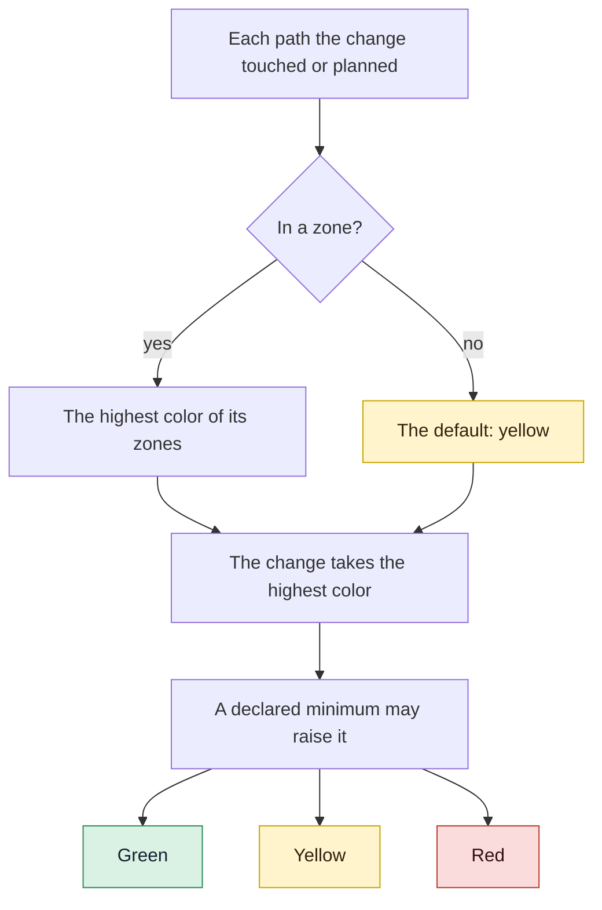

# How risk picks the gates

Why a change's color decides how many gates it meets, how that color is computed from the
paths it touches, and what each color changes. With this page you can read any classification
`gdd` prints and know where it came from.

## Before you start

[GDD in one page](method.md) introduces the traffic light. The rules below come from
`crates/gdd-core/src/classify.rs` and `rules.rs`, and the scenarios in
[`features/classify.feature`](../../features/classify.feature) and
[`features/scope.feature`](../../features/scope.feature) check them.

## Risk, not size

Most processes scale their checks with the size of the work: a big feature gets a long review,
a one-line fix gets none. GDD scales them with **risk**: what it would cost if the change were
wrong. A one-line change to how passwords are compared deserves more care than a hundred lines
of new help text.

Size is cheap to measure and a poor guide. Risk is harder to measure, so GDD asks you once,
during Setup and Discover, which parts of the project would be serious if they failed, and
writes the answer down as a map of paths. After that, every change is classified by a machine,
the same way every time.

## The zone map

`gdd/zones.toml` gives paths a color. Each zone has a color, its path patterns and a reason in
words; `**` crosses folders and `*` does not.

```toml
default = "yellow"   # code without a zone = code without known tests

[[zone]]
color = "green"
paths = ["docs/**", "*.md"]
reason = "Documentation"

[[zone]]
color = "red"
paths = ["src/shop/auth/**"]
reason = "Logins and sessions: a hole here exposes accounts"
```

The map grows with the project:

- **At the Setup** there is no map of the product yet. `gdd init` writes a first one where only
  the harness (`gdd/`, `bin/`, CI, the agents' folders) and the supply chain (lock files and
  scanner configuration) are red, and documentation is green. The sensitive areas you named
  stay in words, in the [Project Brief](../glossary.md#project-brief).
- **At the end of Discover**, once real folders exist, the Orchestrator maps each sensitive area
  to paths: the red zones. You approve them in the same sitting as the first scenarios. Until
  you do, only spikes can be built.
- **Later**, a change to a red zone, or a new one, needs your approval again.

## The default color: code without tests is yellow

A path that no zone names takes the default color, and the default is yellow: "code without a
zone = code without known tests". A missing `default` is yellow too.

Yellow is the honest middle. Green would let unknown code through the Fast Lane with a cheap
Builder and no Reviewer; red would make every change cost two of your stops. Yellow asks for
tests before touching existing code and for a Reviewer, and nothing from you.

## The highest color wins

A change takes the highest color among all the paths it touches. A path that matches several
zones takes the highest of them too.

The scenario that checks it says it plainly: a change that touches `docs/intro.md` (green) and
`src/storage/save.rs` (red) is red. There is no averaging, because a mistake in the red file is
as serious with or without the documentation next to it.

A change with no paths at all takes the default color. A change may also declare a minimum
color with `--min-color`, which raises the color and never lowers it: the Orchestrator uses it
when it knows something the map does not.

The color counts what the change **really** touched, not only what it planned. When build mode
writes a red file the plan did not name, `gdd classify` says red.

When in doubt between two colors, pick the higher one. That is a rule for the people and the
Orchestrator who draw the map; the classifier itself never guesses.

## Color beats work type and lane

GDD has six kinds of work: Feature, Hotfix, Refactor, Migration, Spike and No-code. None of them
changes the color. A Hotfix in a red zone is red, with the plan, the deep review and G4. A
Refactor of yellow code is yellow.

The reason is the same as for size: the type says why you change something, not what breaks if
the change is wrong. An urgent fix to the login code is exactly where a second look pays off.
GDD makes urgency cheap a different way: a Hotfix first rolls production back, then the fix
goes through its lane with no hurry.

The one exception is the Spike, because its code never reaches main. A spike keeps its color,
and so its Builder, but gets no test mode, no mutation testing, no Reviewer, no G1 and no plan
to approve; it always ends at your G4, where only its ADR can reach main.

The lane cannot lower the color either: the Fast Lane is only open to changes that are not red.

## What each color changes

The color picks the Builder's model and the gates. This table shows the rules a new project
gets from `gdd init`, in `gdd/rules.toml` and `gdd/models.toml`.

| | Green | Yellow | Red |
|---|---|---|---|
| Builder model | `[builder.green]`: cheap or local | `[builder.yellow]` | `[builder.red]`: the most capable |
| Test mode first | Only with new scenarios | Yes: characterization tests before touching | Yes |
| Mutation testing on the diff | No | Off; `mutation = true` turns it on | Always |
| Reviewer | In the Full Lane | Always | Always |
| Review depth | Quick | Quick; `review = "deep"` asks for more | Deep, security included |
| You approve the plan | No | No | Yes |
| Your G4 | When the change has new scenarios | When the change has new scenarios | Always |
| Fast Lane | Possible | Possible | Never |
| Your stops | 0, or 2 with new scenarios | 0, or 2 with new scenarios | 2 |

Some terms in the table:

- **Mutation testing** changes the code on purpose (a `>=` becomes `>`, a `return true` becomes
  `return false`) and runs the tests again. If they still pass, the mutant "survived", and the
  tests do not check what they seem to. [Stryker](https://stryker-mutator.io/docs/) and
  [cargo-mutants](https://mutants.rs/) are tools of this kind. GDD runs it on the diff only, so
  it costs minutes, not hours.
- **A quick review** reads the files the change touched, its package and its scenarios, and
  gives the blocking findings. **A deep review** adds the code that calls what changed, the paths
  its data takes, security holes, data loss, concurrency faults and every red zone the change
  touches.

### Red has a core that no file can switch off

For red changes, mutation testing, the Reviewer, the deep review and your G4 are the core of
GDD. A rules file that switches any of them off for red is refused when it is read, and a key it
leaves out counts as on. A team can make yellow stricter, never red looser.

For the other colors, the stack's checks are on by default and can be switched off, and extras
such as mutation testing on yellow are a line you add. [Design decisions](design-decisions.md#minimal-by-default-incremental-by-choice)
explains those three levels.

> [!NOTE]
> [`GDD.md`](../../GDD.md#gate-level-traffic-light) lists mutation testing for yellow, as this
> repository's own rules do. New projects start with it on for red only, and turn it on for
> yellow with `mutation = true`.

## The lanes

The **Fast Lane** runs G2 and G3 and asks you nothing. A change takes it only when all three
hold: it is not red, it creates or changes no scenario, and it is resumable (another agent could
pick it up from its ticket alone, which the Orchestrator declares with `--resumable`). Everything
else takes the **Full Lane**.

Changing only regression scenarios, under `features/regression/`, needs no G1, so a bug fix that
adds a regression scenario can still take the Fast Lane. The scenario pins the bug; there is no
new behavior for you to approve.

## The scope rule

Each change plans the paths it will touch. Build mode may need a file outside the plan: a test
helper, a shared type. Refusing every such file would park changes for nothing; accepting every
one would let a cheap Builder wander into a red zone that nobody planned for.

So the rule follows the color:

- A path outside the plan **of the change's color or lower** is accepted, and listed in the
  Decision Inbox under "Paths outside the package, same or lower color, accepted by rule".
- A path outside the plan **of a higher color** fails G2. The change would need gates it was not
  given: a stronger Builder, a plan you approved, a deeper review. Only the Orchestrator widens
  the scope.

With the zone map of `features/scope.feature`, where `docs/**` is green, `src/storage/**` is red
and the rest is yellow, a yellow change that plans `src/app.rs`:

| The change also writes | Result |
|---|---|
| `src/app.rs` | Inside the plan: passes |
| `docs/notes.md` | Outside, green, lower: passes and is listed |
| `src/storage/db.rs` | Outside, red, higher: G2 fails naming the path and `red` |

## Three changes, three colors

In `shop`, with `src/shop/auth/**` red, `web/copy/**` green and the default yellow, a fresh
project classifies three changes like this:

| Change | Paths | Color | Lane | What it gets |
|---|---|---|---|---|
| `checkout-copy` | `web/copy/checkout.txt`, resumable | green | fast | Build mode, G2, G3; no Reviewer, no stop |
| `cart-total` | `src/shop/cart.py` | yellow | full | Test mode, build mode, G2, G3, a quick review; no stop |
| `login-rate-limit` | `src/shop/auth/**` and a new `.feature` | red | full | A sitting, test mode, the red Builder, mutation testing, a deep review, G4 |

`cart-total` touches no zone, so it is yellow by default; it is not resumable, so it takes the
Full Lane, and with no new scenarios it never stops for you. `login-rate-limit` is red because
of one path, whatever the scenario file next to it says.



The diagram reads from the top: every path gets a color, the change takes the highest, and only
a declared minimum can push it up.

## What was rejected

- **Gates by work type.** A Hotfix lane with fewer checks is the classic way a rushed fix breaks
  production twice.
- **Gates by size.** A small change in a sensitive place is the riskiest kind there is.
- **More than three colors.** Every extra level is one more rule to remember and argue about.
  Three are enough to say "cheap", "careful" and "serious".
- **Green by default.** It would send code nobody has mapped through the cheapest path.

## See also

- [Map and approve red zones](../how-to/red-zones.md): the steps to draw the map.
- [Gates](../reference/gates.md): what each gate checks, by color.
- [Configuration](../reference/configuration.md): every key of `gdd/zones.toml` and
  `gdd/rules.toml`.
- [The life of a change](life-of-a-change.md): where each switched-on step runs.
