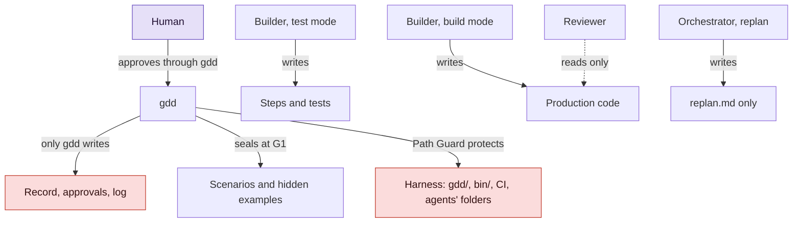

# Keeping agents honest

How GDD stops an agent from passing its own exam: what each role may touch, how the judges are
kept out of the Builder's reach, and where the protection still has holes. Read it before you
trust a green gate.

## Before you start

[GDD in one page](method.md) introduces the roles and gates, and
[The life of a change](life-of-a-change.md) the order in which they run. The rules here come
from `crates/gdd-core/src/guard.rs`, `recipe/mod.rs`, `agents/` and `exec.rs`.

## Untrusted by design

GDD treats every agent as untrusted. Not because agents are malicious, but because they are
optimizers: a Builder is told to make G2 green, and the shortest path to green is sometimes to
weaken the test instead of fixing the code. An agent that edits a failing assertion, skips a
check or writes a special case for the example data is doing what it was asked, badly.

So the method rests on one rule: **an agent must never be able to change what judges it.** The
tests it must pass, the scenarios you approved, the gate commands, the rules table, the record
of what happened: all of them are out of its reach, and gdd checks that they stayed so after
every call.

The protection has four layers. Each one assumes the one before it can fail.

## Who may touch what

Look at the arrows: every role writes in one place only, and nothing an agent writes reaches
the judges or the record.



No agent has an arrow to the harness, to the record or to the scenarios. That is the point of
the diagram, and the next sections say how each missing arrow is enforced.

## Layer 1: Path Guard

**Path Guard** is a check on the files a change touched since its build started. Each role has
protected paths in the `[protected]` section of `gdd/rules.toml`. This is the section `gdd init`
writes for a new Python project:

```toml
[protected]
all = ["gdd/**", "bin/**", ".github/**", ".claude/**", ".agents/**", ".opencode/**", ".gdd/bin/**", "AGENTS.md", "CLAUDE.md"]
builder_build = ["features/**", "tests/acceptance/**"]   # approved scenarios and the steps written in test mode
builder_test = ["src/**"]   # production code: test mode only writes tests and steps
reviewer = ["**"]
```

`all` is the harness: the configuration, the entry script, CI and every agent's instruction
folder. An unprotected agent folder would let a Builder rewrite the Reviewer's instructions.

Path Guard is hard to slip past for several reasons:

- **It reads the rules twice**: as they are now, and as they were when the build started.
  Deleting the rules file, or one of its protections, frees no one from it.
- **It seals the scenarios.** When you approve G1, gdd records the SHA-256 of every scenario
  file of the change, hidden examples included. A sealed scenario that changes or goes away
  fails Path Guard, "approved in G1", for every role.
- **Committed files count**, not only the working tree. A Builder cannot hide a change in a
  commit.
- **Snapshots split the work.** After test mode, gdd records the hashes of what the change
  touched: the build snapshot. Build mode is judged only on what changed after it, deleted files
  included, so the steps test mode wrote are never blamed on build mode, and build mode cannot
  quietly edit them.
- **It runs before and after every gate's commands.** Before, so a gate never runs commands a
  Builder rewrote; after, so a command that changes protected files cannot pass unseen.

Next to Path Guard runs the **scope check**: a path outside the plan of a higher color than the
change fails G2. [How risk picks the gates](risk.md#the-scope-rule) explains it.

## Layer 2: judges the Builder cannot reach

Passing the tests means little if the Builder wrote the tests to pass. GDD keeps four judges
apart from the Builder.

**Sealed scenarios.** The scenarios are written by the Orchestrator, in the language of the
domain, and approved by you at G1. The Builder in test mode writes the steps that bind them to
code, and the runner must fail on any undefined or pending step (strict mode). Nobody can make
a scenario pass by deleting a line of it.

**Hidden examples.** Each change may have one or two extra examples in `features/hidden/`. They
reuse the sentences of the visible scenarios with new data, and the Builder's package does not
include them; G3 runs them with everything else. A Builder that hard-codes the visible examples
fails the hidden ones. G1 refuses a hidden example with a sentence no visible scenario has,
because test mode never sees it and could not have written its step.

**Mutation testing.** On red changes, and on yellow ones when the project asks, G3 mutates the
diff and runs the tests again. A test that still passes when the code is wrong is a test that
checks nothing, and the gate fails.

**A Reviewer of another model family.** Models of one family share blind spots, so prepare
refuses a Reviewer of the Builder's family. With a single family installed, you may accept it at
the Setup, in the open: the date is recorded, and every G4 and merge commit say so. The Reviewer
checks that every step does what its scenario says, that there are no special cases for the
examples, and, on red, security.

The Reviewer **only reads**. Its agent runs in a read-only mode, and gdd compares the working
tree before and after its call, down to the kind of each path, its permissions and where its
links point. Any difference parks the change: "Reviewers only read".

## Layer 3: what an agent can do at all

The agents do not run in your shell. gdd starts each one itself, as its
[agent sheet](../glossary.md#agent-sheet) says, with the arguments of its role.

- **No MCP servers and a short list of tools.** A Builder may read and edit files and run
  `bin/gdd g2`, `bin/gdd guard`, `bin/gdd note` and git reads. It may not commit, switch
  branches, push, fetch from the web, or run `bin/gdd gate`, `launch`, `resume`, `merge` or
  `release`. The Reviewer may only read.
- **Builders and Reviewers cannot record a decision.** `gdd gate` and `gdd resume` refuse them,
  so no agent approves G1, a plan or G4.
- **No secrets in the agents' environment.** A variable never reaches an agent when one word
  of its name is a secret word (`AWS_SECRET_ACCESS_KEY`, `DB_PASS`, `SENTRY_DSN`), or when its
  value is a URL with a password in it (`DATABASE_URL=postgres://app:PASSWORD@db/app`). A
  project that needs to pass one on purpose names it in `[env] pass` of `gdd/models.toml`. The
  agents use their own logins. [The full rule](../reference/environment.md#which-variables-hold-a-secret)
  lists the words.
- **No agent text in a shell command.** The only place gdd runs a shell is the gate and release
  commands, and those come from `gdd/commands.toml`, which is harness. Git always runs with a
  fixed list of arguments, never through a shell. Nothing an agent writes is ever pasted into a
  command line.
- **Every call has a time limit**, and when it ends, its whole process group is killed. Nothing
  an agent started outlives its turn.
- **GDD state is checked around every call.** Before the call, gdd reads the state of the change
  and the state every change shares; after it, anything that changed in a way gdd does not allow
  goes back as it was, and the change parks naming the files. An agent may add notes and
  accepted paths to the record only through `bin/gdd note` and the gates; everything else, from
  the approvals to the snapshots, is untouchable.

## Layer 4: a record only gdd writes

The facts of a change live in its **record**, `.gdd/changes/<id>/change.json`, and only gdd
writes them: the decision of prepare, every approval with its hashes, every review, the notes,
and what the change spent.

What a change spent, in tokens and USD, is added to the record by gdd after each call, from what
the agent's own program reported. The **log**, `.gdd/log.jsonl`, is a report, not a source of
truth: agents may add lines to it during a call. So a spike's budget is read from the record,
never from the log, and the reports leave out any line of the log that is not one of gdd's, and
say how many they left out.

At the merge, the record travels into git: the merge commit carries the color, your approvals,
the Reviewer's verdicts, the decisions taken without you and the tokens. Anyone can read what
happened from the repository.

CI closes the loop. The workflow builds gdd **from main** and runs `bin/gdd ci` with it on the
change's branch, so the judge is the version from before the change: a Builder cannot change the
gates and be judged by its own version. CI fails a change that touches the harness, and blocks
when G2 or G3 is red, even if an agent skipped a step on the way.

## The self-test

None of this matters if the gates cannot fail. Before G0 opens, `gdd selftest` checks the
harness four ways:

1. **A failing test turns G2 red.** It first checks G2 is green without the planted test, so a
   G2 that was already red for another reason does not count as a pass. It judges G2 as G2
   does: in an adopted project, a command held to its known debt does not make it red, so G0
   can open before the debt is paid.
2. **Editing a protected file is blocked**, by Path Guard and by CI.
3. **Rollback works in pre**, or the release is declared simulated.
4. **Zero scenarios counts as a failure.**

The machines open G0 only with all four passing and the Project Brief written.

## Known limits

The protection has holes. They are listed in the roadmap's open questions, or visible in the
code, and you should know them before you rely on a gate.

- **Hidden examples are readable.** They live in `features/hidden/` in the worktree. They are not
  in the Builder's package, but a Builder that searches the project can find them. It happened on
  one of gdd's own changes: the Builder reported in the Decision Inbox that a search had shown it
  two lines of the hidden examples. The method's answer is in [`GDD.md`](../../GDD.md#phases-and-gates-phase-n-ends-in-gn):
  when a Builder reports it read them, the Orchestrator writes fresh hidden examples before G4,
  runs them, and you decide with that result.
- **Approvals live in `.gdd/`** inside the repository, next to the agents. The checks around each
  call put back what an agent changes there, but a copy out of the agents' reach, outside the
  working tree or signed, is still to design.
- **Gate commands run the Builder's code as it is.** G2 and G3 run the project's tests, and
  those tests are code the Builder wrote, run on your machine with the environment gdd runs in,
  without a sandbox. The secrets filter applies to the agents, not to the gate commands. Treat
  the machine that runs gdd accordingly.
- **Spend has gaps.** Codex reports no cost, so its calls add 0 USD to the record; filling
  `[prices]` in `gdd/models.toml` gives the log an estimate, never the record. OpenCode does not
  report the model, so the log keeps the requested one. A spike budget in USD alone may never
  stop a Codex spike.
- **One Reviewer for every color.** The Reviewer's model does not change with the color yet, and
  only deterministic scanners look at security; a separate security review by an agent for red
  security zones is planned.

## See also

- [Path Guard and the gates](../reference/gates.md): what each gate runs, by color.
- [Roles](../reference/roles.md): what each role may read, write and run.
- [Environment variables](../reference/environment.md): what gdd gives the agents.
- [Design decisions](design-decisions.md): why the Builder has two modes and the Reviewer
  another family.
