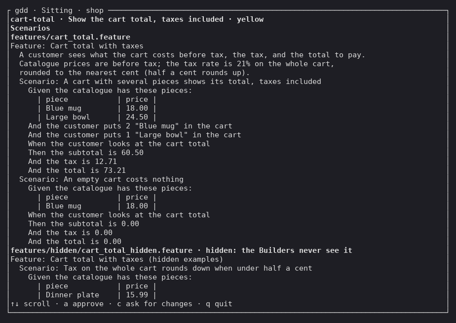
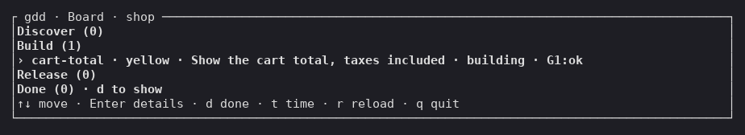
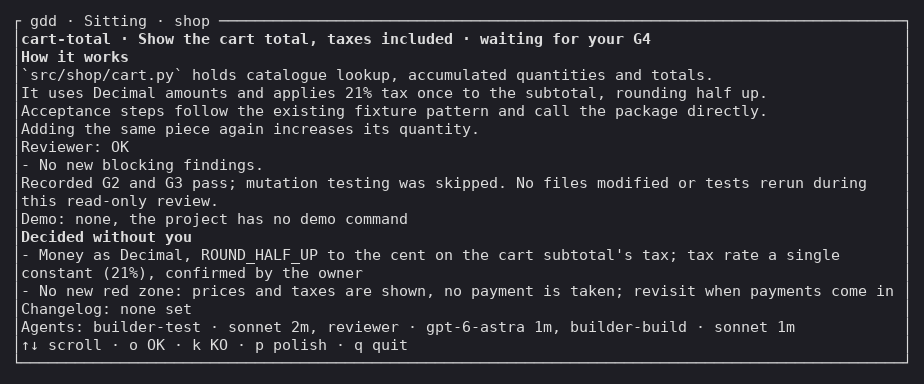
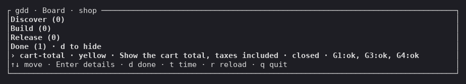

# Quickstart

On this page you take one change of a small example shop from an empty folder to a release in
production. You use a terminal to install gdd and create the
project; after that, the work goes through your coding agent.

<!-- Every output on this page comes from one real run of gdd 0.1.1 (main at 30b50c4) on
2026-10-31, with Claude Code as the chat agent and Codex as the Reviewer, in a throwaway
project `shop`. On the way to G4 the change parked three times on gdd 0.1.1 bugs (a Reviewer
finding written as a Markdown link did not start the fix round in test mode, and two relaunch
paths that followed from it) and the agent rebuilt it; the G4 blocks trim the lines of that
detour with `...`. Without it, the launch takes about two and a half minutes to reach G4; the
whole run, parks included, took 23 minutes from the form to the release. -->

## Before you start

- Linux or macOS, with [git](https://git-scm.com) and [Rust](https://rustup.rs) 1.98 or
  newer. Rust builds gdd.
- uv, OSV-Scanner and gitleaks, the tools that the Python stack of this example runs.
  [Install gdd](../how-to/install.md#python) links each one.
- At least one coding agent installed and signed in: Claude Code, Codex CLI or OpenCode. Two
  of different model families are better, one to build and one to review, because models of one
  family share blind spots.
- git knows your name and email (`git config user.name` and `git config user.email`):
  `gdd init` commits what it writes.

## 1. Install gdd

Install the `gdd` binary and check it:

```bash
cargo install --locked --git https://github.com/MarsGotta/gdd --tag v0.1.1 gdd
gdd --version
```

You should see:

```text
gdd 0.1.1
```

If your shell cannot find `gdd`, `~/.cargo/bin` is not on your `PATH`: see
[Install gdd](../how-to/install.md).

## 2. Run gdd init

In a new folder with a git repository, run `gdd init`:

```bash
mkdir shop
cd shop
git init -b main
gdd init
```

A form opens in the terminal. It asks seven questions, one per step, and writes nothing until
the end. You should see the first step:

```text
┌ gdd init · Step 1 of 7 · Project name ───────────────────────────────────────────────────────────┐
│What is the project called?                                                                       │
│> █                                                                                               │
│Enter: next · Ctrl-C: quit                                                                        │
└──────────────────────────────────────────────────────────────────────────────────────────────────┘
```

Answer each step and press `Enter`. Lists move with the arrow keys, and `Space` checks a box.
The last step is the summary:

```text
┌ gdd init · Summary ──────────────────────────────────────────────────────────────────────────────┐
│Every answer, before anything is written.                                                         │
│Name: shop                                                                                        │
│Description: A small online shop                                                                  │
│Platform: web                                                                                     │
│Stacks: python                                                                                    │
│Agents: claude, codex                                                                             │
│Language: en                                                                                      │
│Sensitive: Losing a customer's order                                                              │
│Enter to set up · Esc to go back                                                                  │
│Ctrl-C: quit                                                                                      │
└──────────────────────────────────────────────────────────────────────────────────────────────────┘
```

Press `Enter`. gdd writes the project, `CHANGELOG.md` included, and commits it. Then it
installs the stack and commits its lock file, the file that pins the version of every
dependency. You should see, at the end:

```text
gdd/project.toml
gdd/commands.toml
...
CHANGELOG.md
...
.agents/skills/gdd-stack-python/SKILL.md
python: uv lock && uv sync --locked
...
Installed 39 packages in 62ms
...
Committed: uv.lock
Next: start your coding agent here and run the gdd-setup command (/gdd-setup in Claude Code and OpenCode, $gdd-setup in Codex).
```

Look at the last line: it tells you where to go next. If the output stops with an error after
the `python:` line, uv is probably missing.

From here on the work goes through your agent. The Board and the sitting, further down, are
windows you open in a terminal to watch.

## 3. Run /gdd-setup in your agent

Start your agent in the `shop` folder and run the setup skill. In Claude Code and OpenCode:

```text
/gdd-setup
```

In Codex, skills start with `$`: `$gdd-setup`, and later `$gdd-change`. If the agent does not
know the skill, you started it outside the `shop` folder.

The agent reads what the form wrote and asks only what is missing. It writes the Project
Brief and runs the self-test of the [harness](../glossary.md#harness), the files and commands
gdd uses to check your project. Then it asks you to approve the *red zones*, the paths that
always get the strictest checks, and to check what it guessed:

```text
The harness is ready: the self-test passed 4/4 and the machines opened G0. Everything is
committed on `main` as `gdd: setup (G0)`, and the session is recorded.
...
**What I need from you (one reply is enough):**
1. **Approve the protected zones.** These are gdd's own files, the CI and the agent
   instructions, plus the dependency and toolchain files. Any change there gets the strictest
   checks. Reply "zones OK" and I'll record your approval. No change can start until you do.
2. **Check my guesses in the Brief:**
   - The users are customers buying on the web and a shop owner who handles the orders. Is
     that right?
   - My recommendation is to leave payments out of the first version and have orders paid
     outside the shop. The alternative is to include payments from day one, which brings in
     money as a sensitive area.
...
```

Your agent may ask its questions before it writes the Brief instead. Either way, answer in your
own words, briefly, and approve the zones in the same reply:

```text
zones OK. Your guesses are right: customers buy on the web and I run the orders. It sells
handmade ceramics: mugs, bowls and plates. Payments stay out of the first version.
```

The agent records your approval and ends with:

```text
Setup is finished. G0 is open, your approval of the protected zones is recorded, and the
self-test passed 4/4.
...
**Next step:** run `/gdd-discover`. It picks the web framework, maps where orders and customer
data live, and plans the first changes. After that, use `/gdd-change` for the first feature,
for example "customers can browse the catalogue".
```

Notice **G0 is open**: the Setup Gate (G0) is open and the zones are approved, so the project
is ready for its first change. The agent recommends `/gdd-discover`, for bigger ideas; for one
small change, go straight to the next step.

## 4. Describe your first change with /gdd-change

Say what you want in a sentence:

```text
/gdd-change show the cart total, taxes included
```

The Orchestrator, the role your agent plays here, creates the change `cart-total`. It writes
its *scenarios*, examples in Gherkin (plain Given, When, Then sentences) of what must happen,
commits them on the change's branch and shows them to you with the change's color:

```text
I've set up the change **cart-total** and written its scenarios. It's classified **yellow**:
ordinary code outside your protected zones. So there's no plan for you to approve now; you
approve the scenarios now and the finished result at the end.

**The scenarios to approve (G1)**

*A cart with several pieces shows its total, taxes included*
- The catalogue has a Blue mug at 18.00 and a Large bowl at 24.50.
- The customer puts 2 Blue mugs and 1 Large bowl in the cart.
- The cart shows a subtotal of **60.50**, tax of **12.71** and a total of **73.21**.
...
**Two rules I built into these numbers. Please confirm or correct them:**
1. **Tax rate: 21% on everything.** ...
2. **Catalogue prices are before tax.** ...

**Next step:** reply "scenarios OK", or give me your rate and price rule, and I'll seal the
scenarios and launch the build.
```

Notice *yellow*, the color of ordinary code: a Reviewer of another model family reads the
change, and you meet it twice, now and at the end.

## 5. Approve the scenarios

To read the scenario files themselves, hidden examples included, open the *sitting*, the screen
of everything a change needs from you, in a terminal:

```bash
gdd sitting cart-total
```

You should see the scenarios the agent committed:



Press `q` and answer in the chat: OK, or what to change, with the answers to its questions.
Your OK is the Scenario Gate (G1), and it seals the scenarios as the contract the code must meet:

```text
scenarios OK. 21% is my rate and my prices are before tax.
```

The agent records G1 and launches the change:

```text
Your answers are recorded and the build is running in the background:

- **Scenarios approved (G1):** sealed with your rule: 21% tax on the whole cart, catalogue
  prices before tax, and half a cent rounds up.
...
**Next step:** wait. I'll be notified when it finishes or stops, and I'll come back with the
result for your OK.
```

The Builder now writes the tests and the code, the gates check it and the Reviewer reads it.
To watch the change move, open the Board in a terminal:

```bash
gdd board
```

You should see the change under Build:



The Board reloads by itself every two seconds, so you can leave it open: the change moves to
Release on its own.

## 6. Approve at G4

A few minutes later the change pauses at the Release Gate (G4), merged into `main` and
deployed to pre, the environment before production. The agent comes back to the chat:

```text
...
**What you'd approve:** the cart now gives three amounts: the subtotal before tax, the 21% tax
on the whole cart rounded to the cent (half a cent rounds up), and the total. Adding the same
piece again adds to its quantity. The code is merged on `main` and deployed to pre. Pre is
simulated here, so there's no video or screenshots.

**The evidence:**
- **Reviewer:** OK, with no new findings. ...
- **Full checks (G3):** all green, including security, dependencies and a scan for leaked
  secrets.
- **Demo:** I ran all 5 scenarios on `main` and they all pass:
...
**Next step:** reply "OK", "polish", or "KO" (reject; production stays untouched).
```

Look at the evidence first. The five scenarios are the two you approved, two *hidden examples*
the Builder never saw, and the smoke scenario Setup wrote to check that the project runs.

The G4 page of the sitting, `gdd sitting cart-total`, shows the same decision:



<!-- The image leaves out four rows with the Reviewer's link to the file it had flagged (an
absolute path of the run) and the rows of the detour described at the top of the page. -->

Say OK:

```text
OK
```

The agent promotes the change and closes it:

```text
The cart total is in production as **v0.1.0**, and the change is closed. Production is still
simulated, so nothing is deployed to a real server yet.

What shipped: the cart shows the subtotal, the 21% tax on the whole cart (rounded to the cent,
with half a cent rounding up), and the total. It's tagged and recorded on `main`.
...
```

`main` now holds the change: the two commits of its branch, the scenarios and the work, the
merge commit that joined them, and the release commit that added its line to `CHANGELOG.md`,
tagged `v0.1.0`. The Board shows it under Done; press `d` to unfold it:



If a change stops on the way instead, it *parks*: the agent tells you why and proposes the next
step ([Get a parked change going again](../how-to/parked-change.md)).

You installed gdd, set up a project with your agent, approved one change's scenarios and its
result, and released it as `v0.1.0`.

## Next steps

- [Your first change](tutorial.md): the same path with one real change, every screen shown.
- [Describe a change to your agent](../how-to/run-a-change.md): sizes, types and what the
  Orchestrator asks you.
- [Skills reference](../reference/skills/index.md): every skill you can run from your agent.
- [GDD in one page](../explanation/method.md): why the gates are where they are.
