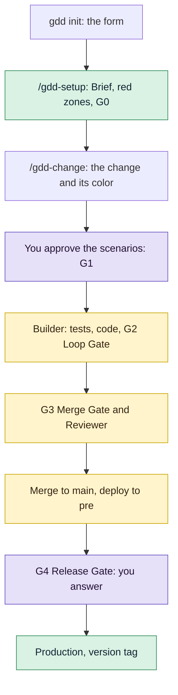

# Your first change

By the end of this tutorial you will have `shop`, a small online shop in Python, and one
change, the cart total, taken from a sentence to a tagged release in production. It follows
the path of the [Quickstart](quickstart.md) with every screen shown, so you can compare each
result with yours.

<!-- Every screen, message and output on this page comes from one real run of gdd 0.1.1 (main
at 30b50c4) on 2026-10-31, in a throwaway folder, with Claude Code as the chat agent, Codex as
the Reviewer and the default models. Paths are shown under /home/me. On the way to G4 the
change parked three times on gdd 0.1.1 bugs: the Reviewer wrote its finding's file as a
Markdown link, gdd did not see that it named a step only test mode may write, so the fix round
went to build mode, which may not touch it; the relaunches after the agent fixed the step by
hand then parked on Path Guard. The agent removed the worktree and launched again, and that
launch went straight to G4 in about two and a half minutes. Blocks trim the lines of that
detour with `...`, except where the page says so. The whole run, parks included, took 23
minutes from the form to the release. -->

## Before you start

- gdd, uv, OSV-Scanner and gitleaks installed: [Install gdd](../how-to/install.md) has every
  step, including the Python table.
- Claude Code and Codex installed and signed in. Claude Code builds and Codex reviews, because
  the Reviewer must be of another model family than the Builder.
- git knows your name and email: `gdd init` commits what it writes.
- A terminal at least 100 columns wide, for the screens gdd draws.

The launch that took this change straight to G4 cost 0.21 USD in Builder calls, as Claude Code
reported it; the whole run, with the parks described in step 6, cost 0.91 USD. Codex reports
no cost, so the Reviewer's calls show as unknown. With a subscription, your plan covers them.

## The path

You type one gdd command, `gdd init`, to create the project. After that the work goes through
your agent, and you answer in the chat. The Board, the sitting and `git log` are windows you
open in a terminal to watch. The purple steps in the diagram are yours:



[GDD in one page](../explanation/method.md) explains each gate. You do not need it to follow
along.

## 1. Create the project

Make an empty folder with a git repository and run `gdd init` in it:

```bash
mkdir shop
cd shop
git init -b main
gdd init
```

A form opens. It asks seven questions, one per step, and writes nothing until the end. The
first step asks for the name:

```text
┌ gdd init · Step 1 of 7 · Project name ───────────────────────────────────────────────────────────┐
│What is the project called?                                                                       │
│> █                                                                                               │
│Enter: next · Ctrl-C: quit                                                                        │
└──────────────────────────────────────────────────────────────────────────────────────────────────┘
```

Type `shop` and press `Enter`. The next step asks for a short description, which may stay
empty:

```text
┌ gdd init · Step 2 of 7 · Description ────────────────────────────────────────────────────────────┐
│What is it, in a few words? It may stay empty.                                                    │
│> █                                                                                               │
│Enter: next · Esc: back · Ctrl-C: quit                                                            │
└──────────────────────────────────────────────────────────────────────────────────────────────────┘
```

Type `A small online shop` and press `Enter`. Then pick the platform:

```text
┌ gdd init · Step 3 of 7 · Platform ───────────────────────────────────────────────────────────────┐
│Where does it run?                                                                                │
│> mobile                                                                                          │
│  desktop                                                                                         │
│  web                                                                                             │
│  cli                                                                                             │
│  other                                                                                           │
│Up/Down: move · Enter: pick · Esc: back · Ctrl-C: quit                                            │
└──────────────────────────────────────────────────────────────────────────────────────────────────┘
```

Move to `web` with the arrow keys and press `Enter`. Then the stacks:

```text
┌ gdd init · Step 4 of 7 · Stacks ─────────────────────────────────────────────────────────────────┐
│Which technology does it use? Pick one or more, or Not sure.                                      │
│> [ ] rust                                                                                        │
│  [ ] typescript                                                                                  │
│  [ ] python                                                                                      │
│  [ ] Not sure                                                                                    │
│Up/Down: move · Space: check · Enter: next · Esc: back · Ctrl-C: quit                             │
└──────────────────────────────────────────────────────────────────────────────────────────────────┘
```

Move to `python`, press `Space` to check it, then `Enter`. Each stack brings its *stack sheet*,
the commands each gate runs for that technology.

The coding agents found on the machine come checked, and the first checked one builds. Press
`Space` on `opencode` to uncheck it, so Claude Code builds and Codex reviews:

```text
┌ gdd init · Step 5 of 7 · Coding agents ──────────────────────────────────────────────────────────┐
│Which coding agents? The first checked builds; those found on this machine come checked.          │
│  [x] claude                                                                                      │
│  [x] codex                                                                                       │
│> [ ] opencode                                                                                    │
│Up/Down: move · Space: check · Enter: next · Esc: back · Ctrl-C: quit                             │
└──────────────────────────────────────────────────────────────────────────────────────────────────┘
```

Keep `en`, the language the agents use with you, and press `Enter`:

```text
┌ gdd init · Step 6 of 7 · Language ───────────────────────────────────────────────────────────────┐
│Which language do the agents use with you? (en, es...)                                            │
│> en█                                                                                             │
│Enter: next · Esc: back · Ctrl-C: quit                                                            │
└──────────────────────────────────────────────────────────────────────────────────────────────────┘
```

Type each sensitive area, what would be serious if it failed, and press `Enter`. Each one goes
into the list, and an empty line goes on. These words become *red zones* later, once there are
folders to protect:

```text
┌ gdd init · Step 7 of 7 · Sensitive areas ────────────────────────────────────────────────────────┐
│What would be serious if it failed? One area per line.                                            │
│  - Losing a customer's order                                                                     │
│> █                                                                                               │
│Enter: add, or go on when empty · Backspace: edit the last · Esc: back · Ctrl-C: quit             │
└──────────────────────────────────────────────────────────────────────────────────────────────────┘
```

Check the summary. To fix an answer, press `Esc` to go back to it:

```text
┌ gdd init · Summary ──────────────────────────────────────────────────────────────────────────────┐
│Every answer, before anything is written.                                                         │
│Name: shop                                                                                        │
│Description: A small online shop                                                                  │
│Platform: web                                                                                     │
│Stacks: python                                                                                    │
│Agents: claude, codex                                                                             │
│Language: en                                                                                      │
│Sensitive: Losing a customer's order                                                              │
│Enter to set up · Esc to go back                                                                  │
│Ctrl-C: quit                                                                                      │
└──────────────────────────────────────────────────────────────────────────────────────────────────┘
```

Press `Enter`. You should see every file gdd wrote, then uv at work, then what to do next:

```text
gdd/project.toml
gdd/commands.toml
gdd/rules.toml
gdd/zones.toml
gdd/models.toml
gdd/generated.toml
docs/brief.md
.github/workflows/gdd.yml
AGENTS.md
CLAUDE.md
CHANGELOG.md
...
.agents/skills/gdd-stack-python/SKILL.md
python: uv lock && uv sync --locked
Using CPython 3.13.15
Resolved 40 packages in 8ms
...
Installed 39 packages in 62ms
...
Committed: uv.lock
Next: start your coding agent here and run the gdd-setup command (/gdd-setup in Claude Code and OpenCode, $gdd-setup in Codex).
```

Look at the last line: it tells you where to go next. gdd made two commits, `gdd init 0.1.1`
with its files and `gdd bootstrap` with `uv.lock`, the lock file that pins the version of every
dependency. If the output stops with an error after the `python:` line, uv is probably missing:
see [Install gdd](../how-to/install.md#python).

## 2. Look at what init wrote

Each file has one job:

```text
shop/
├── gdd/                   the rules of the method, read by gdd, the agents and CI
│   ├── project.toml       name, platform, stack and the language the agents speak
│   ├── commands.toml      the commands each gate runs, from the Python stack sheet
│   ├── rules.toml         what each color gets: lanes, limits, protected paths
│   ├── zones.toml         the zone map: which paths are red, green or yellow
│   ├── models.toml        which agent and model plays each role
│   └── generated.toml     what init was asked, for gdd upgrade
├── docs/brief.md          the Project Brief: what the project is and what must not fail
├── .github/workflows/gdd.yml   CI: Path Guard, G2 and G3 on every pull request
├── AGENTS.md, CLAUDE.md   the first instructions every agent reads
├── CHANGELOG.md           the changelog, empty under [Unreleased]; each release adds to it
├── .claude/skills/        the GDD skills for Claude Code (/gdd-setup, /gdd-change...)
├── .agents/skills/        the same skills for Codex ($gdd-setup, $gdd-change...)
├── features/              the Gherkin scenarios: the contract you approve
├── src/shop/              the code, with a placeholder greeting.py
├── tests/unit/            unit tests
├── tests/acceptance/      the scenario steps, run by pytest-bdd
├── pyproject.toml, uv.lock     dependencies and the tools of the gates
└── osv-scanner*.toml      security and license checks of G3
```

Notice `gdd/zones.toml` and `gdd/models.toml`. The first decides how strict each change is,
the second which agent plays each role. gdd keeps its own state in `.gdd/`, which git ignores.
[Files gdd writes](../reference/files.md) describes each file.

## 3. Set up the project with your agent

Start Claude Code in the `shop` folder and run the setup skill:

```text
/gdd-setup
```

If Claude Code does not know `/gdd-setup`, you started it outside the `shop` folder, where the
skills live. The agent plays the *Orchestrator*, the role that talks to you. It has read what
the form wrote, so it asks only what is missing. Here the form was enough for a first Brief:
the agent wrote it, with an architecture decision record (ADR) for the technology and a small
skeleton with a first smoke scenario. It also ran the self-test of the *harness*, the files and
commands gdd uses to check the project. After about two minutes it answers:

<!-- The trimmed part of this message listed one check the agent could not run, and the
agent could not go online: this run drove Claude Code headless, where a command outside the
allowed tools is refused instead of asked. In a normal session Claude Code asks you to allow
them. -->

```text
The harness is ready: the self-test passed 4/4 and the machines opened G0. Everything is
committed on `main` as `gdd: setup (G0)`, and the session is recorded.

What I did:
- **Brief** (`docs/brief.md`): I wrote it from your one-line description. Some of it is my own
  guesses, so please check the questions below.
- **Technology** (`docs/adr/0001-technology.md`): Python, with pytest-bdd running the
  scenarios. ... The web framework is left for Discover to decide.
- **Starting test setup**: one simple smoke scenario that passes, plus empty
  `features/regression/` and `features/hidden/` folders.
- **Gate commands**: all of them pass when run by hand. There's no real pre-production or
  production yet, so release steps are simulated. A deploy just records that it passed and
  doesn't actually run.
...
**What I need from you (one reply is enough):**
1. **Approve the protected zones.** These are gdd's own files, the CI and the agent
   instructions, plus the dependency and toolchain files. Any change there gets the strictest
   checks. Reply "zones OK" and I'll record your approval. No change can start until you do.
2. **Check my guesses in the Brief:**
   - The users are customers buying on the web and a shop owner who handles the orders. Is
     that right?
   - My recommendation is to leave payments out of the first version and have orders paid
     outside the shop. The alternative is to include payments from day one, which brings in
     money as a sensitive area.

Next step: after your OK on the zones, run `/gdd-discover` to pick the web framework and map
the sensitive areas (orders, customer data).
```

Notice *the machines opened G0*: the Setup Gate (G0) opens once the Brief exists and the
self-test passes all four checks. *Release steps are simulated* means there is no pre or
production server yet. If the agent reports instead that a gate command cannot run, a tool of
the stack is missing: see [Install gdd](../how-to/install.md#python). Your agent may also ask
its questions first and write the Brief after your answers.

Look at the protected zones. A *red zone* is a set of paths that always gets the strictest
checks. A person approves the map once, because it sets how strict every later change is
([Map and approve red zones](../how-to/red-zones.md)), and no change can start before that.
The cart is not among the zones, so approve them, and answer the guesses in the same reply:

```text
zones OK. Your guesses are right: customers buy on the web and I run the orders. It sells
handmade ceramics: mugs, bowls and plates. Payments stay out of the first version.
```

The agent records your approval, updates the Brief and commits it on `main`. You should see:

```text
Setup is finished. G0 is open, your approval of the protected zones is recorded, and the
self-test passed 4/4.

I updated the Brief with your answers and committed it on `main`:
- The shop sells handmade ceramics (mugs, bowls and plates).
- Customers buy on the web and you run the orders.
- Payments are not in the first version; orders are paid outside the shop.
...
**Next step:** run `/gdd-discover`. It picks the web framework, maps where orders and customer
data live, and plans the first changes. After that, use `/gdd-change` for the first feature,
for example "customers can browse the catalogue".
```

The agent recommends `/gdd-discover`, which explores bigger ideas. Your first change is small,
so skip it.

To see the project from a terminal, open the *Board*, the screen of every change by phase:

```bash
gdd board
```

It is empty for now:

```text
┌ gdd · Board · shop ──────────────────────────────────────────────────────────────────────────────┐
│No changes yet · ask your agent: /gdd-change <what you want> ($gdd-change in Codex)               │
│↑↓ move · Enter details · d done · t time · r reload · q quit                                     │
└──────────────────────────────────────────────────────────────────────────────────────────────────┘
```

Leave it open in its terminal. The Board reloads by itself every two seconds, and `r` reloads
it at once.

## 4. Describe the change

A *change* is a small piece of work that passes the gates as one unit, on its own branch. Say
yours to the agent:

```text
/gdd-change show the cart total, taxes included
```

The Orchestrator picks an id, `cart-total`, a type, `Feature`, and the paths the change will
touch. gdd works out the color from those paths and the zone map, and the agent answers with
the color first:

```text
I've set up the change **cart-total** and written its scenarios. It's classified **yellow**:
ordinary code outside your protected zones. So there's no plan for you to approve now; you
approve the scenarios now and the finished result at the end.
...
```

Under the hood, the agent ran [`gdd new-change`](../reference/cli/new-change.md), which
created the branch `change/cart-total` and printed this classification:

```text
{
  "change": "cart-total",
  "color": "yellow",
  "lane": "full",
  "reasons": [
    "features/cart_total.feature -> yellow (no zone: default color)",
    "src/shop/cart.py -> yellow (no zone: default color)",
    "tests/acceptance/steps/** -> yellow (no zone: default color)",
    "tests/unit/test_cart.py -> yellow (no zone: default color)"
  ],
  "g1": true,
  ...
  "tests_first": true,
  "mutation": false,
  "reviewer": true,
  "review": "quick",
  "g4": true,
  "human_plan": false,
  "type": "Feature",
  "builder": {
    "integration": "claude",
    "model": "sonnet"
  },
  ...
  "reviewer_model": {
    "effort": "high",
    "integration": "codex",
    "model": "gpt-6-astra"
  },
  ...
}
```

Read it as the plan for this change:

- `color` is yellow: none of its paths is in a zone, and code without a zone is yellow.
- `lane` is full because the change adds scenarios, which rules out the
  [Fast Lane](../explanation/method.md#lanes).
- `tests_first` is true: the Builder writes the tests before the code.
- `g1` is true: you approve the scenarios before any code exists.
- `reviewer` is true: Codex, of another model family, reads the change.
- `g4` is true: a change with a G1 waits for you at the Release Gate.
- `builder` is Claude Code with Sonnet, the model `gdd/models.toml` gives a yellow change.

[How risk picks the gates](../explanation/risk.md) explains the colors.

The Board you left open shows the change under Discover, without reopening it:

```text
┌ gdd · Board · shop ──────────────────────────────────────────────────────────────────────────────┐
│Discover (1)                                                                                      │
│› cart-total · yellow · Show the cart total, taxes included · open · no gates yet                 │
│Build (0)                                                                                         │
│Release (0)                                                                                       │
│Done (0) · d to show                                                                              │
│↑↓ move · Enter details · d done · t time · r reload · q quit                                     │
└──────────────────────────────────────────────────────────────────────────────────────────────────┘
```

## 5. Read and approve the scenarios

A *scenario* is an example of what must happen, written in Gherkin: plain Given, When, Then
sentences that a test tool runs. The Orchestrator retells its two scenarios in the same
message, with the rules it needs you to confirm:

```text
**The scenarios to approve (G1)**

*A cart with several pieces shows its total, taxes included*
- The catalogue has a Blue mug at 18.00 and a Large bowl at 24.50.
- The customer puts 2 Blue mugs and 1 Large bowl in the cart.
- The cart shows a subtotal of **60.50**, tax of **12.71** and a total of **73.21**.

*An empty cart costs nothing*
- Subtotal **0.00**, tax **0.00**, total **0.00**.

I also wrote two hidden examples that the Builder doesn't see, to catch a wrong rounding rule or
a piece added twice.

**Two rules I built into these numbers. Please confirm or correct them:**
1. **Tax rate: 21% on everything.** That's the Spanish standard VAT rate, but it's only my
   example; tell me your real rate if it's different.
2. **Catalogue prices are before tax.** The shop adds the tax once, on the whole cart, and
   rounds to the cent (half a cent rounds up). The alternative is that the prices you list
   already include tax and the cart shows the tax inside them; in that case I'll redo the
   examples.

**Next step:** reply "scenarios OK", or give me your rate and price rule, and I'll seal the
scenarios and launch the build.
```

Before it showed you anything, the agent committed the scenario files on the branch
`change/cart-total`, so you can read them as they will be sealed. To see them on the *sitting*,
the screen of everything a change needs from you, run in a terminal:

```bash
gdd sitting cart-total
```

You should see `features/cart_total.feature` (blank lines trimmed):

```text
┌ gdd · Sitting · shop ────────────────────────────────────────────────────────────────────────────┐
│cart-total · Show the cart total, taxes included · yellow                                         │
│Scenarios                                                                                         │
│features/cart_total.feature                                                                       │
│Feature: Cart total with taxes                                                                    │
│  A customer sees what the cart costs before tax, the tax, and the total to pay.                  │
│  Catalogue prices are before tax; the tax rate is 21% on the whole cart,                         │
│  rounded to the nearest cent (half a cent rounds up).                                            │
│  Scenario: A cart with several pieces shows its total, taxes included                            │
│    Given the catalogue has these pieces:                                                         │
│      | piece           | price |                                                                 │
│      | Blue mug        | 18.00 |                                                                 │
│      | Large bowl      | 24.50 |                                                                 │
│    And the customer puts 2 "Blue mug" in the cart                                                │
│    And the customer puts 1 "Large bowl" in the cart                                              │
│    When the customer looks at the cart total                                                     │
│    Then the subtotal is 60.50                                                                    │
│    And the tax is 12.71                                                                          │
│    And the total is 73.21                                                                        │
│  Scenario: An empty cart costs nothing                                                           │
│    Given the catalogue has these pieces:                                                         │
│      | piece           | price |                                                                 │
│      | Blue mug        | 18.00 |                                                                 │
│    When the customer looks at the cart total                                                     │
│    Then the subtotal is 0.00                                                                     │
│    And the tax is 0.00                                                                           │
│    And the total is 0.00                                                                         │
...
│↑↓ scroll · a approve · c ask for changes · q quit                                                │
└──────────────────────────────────────────────────────────────────────────────────────────────────┘
```

Check the numbers: they are the contract the code must meet. 21% of 60.50 is 12.705, so the
first scenario also fixes how the cent rounds. Scroll down with the arrow keys to the *hidden
examples* in `features/hidden/cart_total_hidden.feature`, the same sentences with other data:

```text
┌ gdd · Sitting · shop ────────────────────────────────────────────────────────────────────────────┐
│features/hidden/cart_total_hidden.feature · hidden: the Builders never see it                     │
│Feature: Cart total with taxes (hidden examples)                                                  │
│  Scenario: Tax on the whole cart rounds down when under half a cent                              │
│    Given the catalogue has these pieces:                                                         │
│      | piece           | price |                                                                 │
│      | Dinner plate    | 15.99 |                                                                 │
│    And the customer puts 3 "Dinner plate" in the cart                                            │
│    When the customer looks at the cart total                                                     │
│    Then the subtotal is 47.97                                                                    │
│    And the tax is 10.07                                                                          │
│    And the total is 58.04                                                                        │
...
│Red zones: approved                                                                               │
│Plan: not needed for a yellow change                                                              │
│↑↓ scroll · a approve · c ask for changes · q quit                                                │
└──────────────────────────────────────────────────────────────────────────────────────────────────┘
```

The Builder never sees the hidden examples, so code that only fits the visible numbers fails
([Approve the scenarios](../how-to/write-scenarios.md)). `Red zones: approved` and `Plan: not
needed` mean nothing else waits for you at this sitting.

You could approve here with `a`. Press `q` instead and answer in the chat, with your answers to
its rules:

```text
scenarios OK. 21% is my rate and my prices are before tax.
```

The agent records the Scenario Gate (G1) with your words and launches the change. Within a
minute it answers:

```text
Your answers are recorded and the build is running in the background:

- **Scenarios approved (G1):** sealed with your rule: 21% tax on the whole cart, catalogue
  prices before tax, and half a cent rounds up.
- **What the Builder gets:** one short brief. Amounts are kept exact to the cent, with no
  floating-point rounding errors, and the 21% rate sits in one named place so it's easy to
  change later.
- **Decision I made myself:** this change isn't a protected zone. It shows prices and taxes but
  doesn't take any money. I'll raise it again when payments come in.

The steps: first a Builder writes tests that fail, then code that makes them pass, and the
automatic checks run. Then a reviewer from another AI vendor (gpt-6-astra) checks the work, the
full checks run including the hidden examples, and the release (simulated for now) follows.
Then it stops for your final OK (G4).

**Next step:** wait. I'll be notified when it finishes or stops, and I'll come back with the
result for your OK.
```

Notice *sealed*. Approving G1 seals the scenario files, so no agent can change them without a
new approval ([Keeping agents honest](../explanation/safety.md)).

## 6. Watch the build on the Board

From here the *recipe*, the fixed sequence of steps gdd runs for a change, goes on its own. In
order, gdd:

1. makes a git worktree for the change, a second checkout in its own folder,
   `../shop.worktrees/cart-total`, on the branch `change/cart-total`, and leaves your checkout
   on `main`;
2. starts the **Builder in test mode** (Claude Code, Sonnet), which writes the steps of the
   scenarios and the unit tests, failing because the code does not exist yet;
3. starts the **Builder in build mode**, in a separate session that cannot edit the scenarios,
   which writes `src/shop/cart.py` until the Loop Gate (G2) passes: lint, types, unit tests,
   the scenarios and Path Guard, the check of which files each role may edit;
4. runs the Merge Gate (G3): every scenario, the hidden examples included, plus the security,
   license, lock file and secrets checks;
5. starts the **Reviewer** (Codex), which reads the whole change and says OK or KO;
6. merges the change into `main`, builds it and deploys it to pre, the environment before
   production (both simulated here), and pauses at the Release Gate (G4).

The Board you left open moves the change to Build:

```text
┌ gdd · Board · shop ──────────────────────────────────────────────────────────────────────────────┐
│Discover (0)                                                                                      │
│Build (1)                                                                                         │
│› cart-total · yellow · Show the cart total, taxes included · building · G1:ok                    │
│Release (0)                                                                                       │
│Done (0) · d to show                                                                              │
│↑↓ move · Enter details · d done · t time · r reload · q quit                                     │
└──────────────────────────────────────────────────────────────────────────────────────────────────┘
```

When the change pauses at G4, the same Board shows it under Release:

```text
┌ gdd · Board · shop ──────────────────────────────────────────────────────────────────────────────┐
│Discover (0)                                                                                      │
│Build (0)                                                                                         │
│Release (1)                                                                                       │
│› cart-total · yellow · Show the cart total, taxes included · waiting for your G4 · G1:ok, G3:ok  │
│Done (0) · d to show                                                                              │
│↑↓ move · Enter details · d done · t time · r reload · q quit                                     │
└──────────────────────────────────────────────────────────────────────────────────────────────────┘
```

If a gate fails, the Builder gets another round. After its limit the change *parks*: the Board
shows it as `parked` under Build, and the agent tells you why and proposes the next step
([Get a parked change going again](../how-to/parked-change.md)).

> [!NOTE]
> In the run behind this page, the change parked three times before G4, on bugs of gdd 0.1.1:
> the Reviewer asked for a fix in a step file that only test mode may write, and gdd sent the
> fix round to build mode. The agent then removed the change's worktree and launched it again,
> and that launch went straight to G4 in about two and a half minutes. The details below keep
> the parks, so you can see how they look.

Press `Enter` to see the details of the change, with where its time went:

```text
┌ gdd · Board · shop ──────────────────────────────────────────────────────────────────────────────┐
│cart-total · Show the cart total, taxes included                                                  │
│Type: Feature                                                                                     │
│Color: yellow                                                                                     │
│State: in-pre                                                                                     │
│Gates: G1:ok, G3:ok                                                                               │
│Paths: src/shop/cart.py, tests/unit/test_cart.py, features/cart_total.feature,                    │
│tests/acceptance/steps/**                                                                         │
│Inbox: .gdd/changes/cart-total/inbox.md                                                           │
│Flow time 18m · active 4m (24%) · waiting 14m · between steps 0s                                  │
│Agents: builder-test · sonnet 2m, reviewer · gpt-6-astra 1m, builder-build · sonnet 1m            │
│Gates: acceptance 2s, security 2s, unit 2s, types 1s, acceptance_full 1s, secrets 1s, architecture│
│1s, lint 1s, dependencies 0s, lockfile 0s, path-guard 0s                                          │
│Waiting: parked 6m (Path Guard failed after test mode: src/shop/cart.py: protected path for       │
│builder-test), parked 4m (G3 still red after one fix), parked 2m (Reviewer KO or G3 red after one │
│fix), at the sitting 1m, to start 15s                                                             │
│Esc to go back · r reload · q quit                                                                │
└──────────────────────────────────────────────────────────────────────────────────────────────────┘
```

Look at the *Flow time* line: 18 minutes, 4 of them active. The *Waiting* line says where the
rest went: each park with its reason, and *at the sitting*, the time the change waited for your
answers. A change that goes straight through waits only at the sitting and to start.

## 7. Answer the Release Gate

The agent comes back to the chat. The change is merged and in pre, and it waits for your
answer at the Release Gate (G4):

```text
...
**What you'd approve:** the cart now gives three amounts: the subtotal before tax, the 21% tax
on the whole cart rounded to the cent (half a cent rounds up), and the total. Adding the same
piece again adds to its quantity. The code is merged on `main` and deployed to pre. Pre is
simulated here, so there's no video or screenshots.

**The evidence:**
- **Reviewer:** OK, with no new findings. Its earlier point is fixed: subtotal, tax and total
  are now separate steps.
- **Full checks (G3):** all green, including security, dependencies and a scan for leaked
  secrets.
- **Demo:** I ran all 5 scenarios on `main` and they all pass:
  - a cart with several pieces: 60.50 + 12.71 = 73.21
  - an empty cart: 0.00
  - the two hidden examples (rounding down, and the same piece added twice)
  - the smoke test
...
**Next step:** reply "OK", "polish", or "KO" (reject; production stays untouched).
```

Look at the evidence first. The five scenarios are the two you approved, the two hidden
examples and the smoke scenario from Setup. The agent also pointed out a gap it would leave
for a later change: the cart accepts a quantity of 0 or less.

The agent read all this from the change's *Decision Inbox*, the one message gdd keeps for each
change, in `.gdd/changes/cart-total/inbox.md`:

```text
# Decision Inbox · cart-total · Show the cart total, taxes included

Color yellow · lane full · state in-pre

## How it works
`src/shop/cart.py` holds catalogue lookup, accumulated quantities and totals.
It uses Decimal amounts and applies 21% tax once to the subtotal, rounding half up.
Acceptance steps follow the existing fixture pattern and call the package directly.
Adding the same piece again increases its quantity.

## Needs your decision
- Test mode: API assumed in shop.cart: TAX_RATE=Decimal('0.21'); Cart(catalogue: dict[str, Decimal]); Cart.add(piece, quantity) raises KeyError for a piece not in the catalogue; Cart.totals() -> Totals(subtotal, tax, total) as 2-decimal Decimal. Lint I001 on the new tests fails only while src/shop/cart.py is missing (Ruff then sees shop as third-party); the blank line before the shop import follows the package and is right once the module exists.
- G4 · Release Gate: check the pre demo and the change message, then answer your agent (or the sitting screen): OK promotes to production, KO rejects it (production untouched), polish with your notes runs one more Builder round. Your agent runs gdd resume cart-total --g4 ok, --g4 ko or --g4 polish --note <your notes>.

## Decided without you
- Money as Decimal, ROUND_HALF_UP to the cent on the cart subtotal's tax; tax rate a single constant (21%), confirmed by the owner
- No new red zone: prices and taxes are shown, no payment is taken; revisit when payments come in
...

## Parked
- Nothing.
...
```

- **How it works** is the Reviewer's short explanation of the code.
- **Needs your decision** holds the agents' notes and the G4 request. The Builder in test mode
  described the code its tests expect; the G4 line says what each answer does. You answer the
  agent in words, and it runs the command your answer becomes.
- **Decided without you** lists what the Orchestrator chose alone, each choice reversible.
- **Parked** lists what an agent set aside for later: nothing here.

The G4 page of the sitting shows the same decision, with the Reviewer's words and the
changelog line (blank lines trimmed):

```text
┌ gdd · Sitting · shop ────────────────────────────────────────────────────────────────────────────┐
│cart-total · Show the cart total, taxes included · waiting for your G4                            │
│How it works                                                                                      │
│`src/shop/cart.py` holds catalogue lookup, accumulated quantities and totals.                     │
│It uses Decimal amounts and applies 21% tax once to the subtotal, rounding half up.               │
│Acceptance steps follow the existing fixture pattern and call the package directly.               │
│Adding the same piece again increases its quantity.                                               │
│Reviewer: OK                                                                                      │
...
│- No new blocking findings.                                                                       │
│Recorded G2 and G3 pass; mutation testing was skipped. No files modified or tests rerun during    │
│this read-only review.                                                                            │
│Demo: none, the project has no demo command                                                       │
│Decided without you                                                                               │
│- Money as Decimal, ROUND_HALF_UP to the cent on the cart subtotal's tax; tax rate a single       │
│constant (21%), confirmed by the owner                                                            │
│- No new red zone: prices and taxes are shown, no payment is taken; revisit when payments come in │
...
│Changelog: none set                                                                               │
...
│↑↓ scroll · o OK · k KO · p polish · q quit                                                       │
└──────────────────────────────────────────────────────────────────────────────────────────────────┘
```

`Demo: none` means the project has no pre yet. `Changelog: none set` means nobody set a
changelog line, so gdd uses the default line of the type: a Feature gets its title under
`Added`. That line gives the change its version in step 8.

The totals are what you approved, and the Reviewer has no blocking finding. Press `q` and say
OK in the chat:

```text
OK
```

The agent promotes the change and closes it:

```text
The cart total is in production as **v0.1.0**, and the change is closed. Production is still
simulated, so nothing is deployed to a real server yet.

What shipped: the cart shows the subtotal, the 21% tax on the whole cart (rounded to the cent,
with half a cent rounding up), and the total. It's tagged and recorded on `main`.

**Cost:** about $0.91 for the Builders. The reviewer's and my own calls aren't priced, because
gdd has no price for those two models, so the real total is higher.
...
**Next step:** I recommend `/gdd-change a quantity must be at least 1`. It's small and closes
the gap before customers can choose quantities. The alternative is `/gdd-discover` first.
```

Notice **v0.1.0**. OK promoted the build that ran in pre to production (simulated here) and
closed the change. Its worktree is gone; its branch stays.

## 8. See the result

To see the change in `main`, run:

```bash
git log --oneline -7
```

You should see:

```text
c99adb1 (HEAD -> main, tag: v0.1.0) Release v0.1.0
eece577 gdd(cart-total): G3 Merge Gate · Show the cart total, taxes included
c803a66 (change/cart-total) gdd(cart-total): change work
c4ac2ed cart-total: scenarios for G1
f24d02c gdd: setup (G0) · brief confirmed by the owner
3255fe9 gdd: setup (G0)
ceced6c gdd bootstrap
```

`c4ac2ed` and `c803a66`, the scenarios and the work, came from the branch `change/cart-total`.
`eece577` is the merge commit that joined them into `main`. Its message holds the change's
record:

```text
gdd(cart-total): G3 Merge Gate · Show the cart total, taxes included

Color: yellow · lane full · type Feature
Approvals: G1 ok (human, 2026-10-31, 2 scenario file(s) sealed)
Reviewer: KO -> KO -> OK
...
Decided without the human:
  - Money as Decimal, ROUND_HALF_UP to the cent on the cart subtotal's tax; tax rate a single constant (21%), confirmed by the owner
  - No new red zone: prices and taxes are shown, no payment is taken; revisit when payments come in
...
Tokens: in 245,725 · cache 1,708,519 · out 22,043 · 0.91 USD (estimate) + unknown (3 call(s) with no price) · 10 agent call(s)
Record: .gdd/changes/cart-total/ (local)

Changelog: Added · Show the cart total, taxes included
Breaking: no
```

`Reviewer: KO -> KO -> OK` is every verdict of the Reviewer on this change: the two KOs are
the detour of the note in step 6. The `Tokens` line counts the agent calls, 10 here because the
change was built twice. `unknown (3 call(s) with no price)` are the Reviewer's calls: Codex
reports no cost, and `gdd/models.toml` has no price for its model
([Measure the work](../how-to/measure.md)).

The last two lines are the default changelog line from step 7. With the promotion, gdd wrote it
into `CHANGELOG.md` and committed it as `Release v0.1.0`, tagged `v0.1.0`: gdd gives a version to
a promoted change with a changelog line, and the first version of a project is 0.1.0
([Release versions and keep a changelog](../how-to/releases-and-changelog.md)). `CHANGELOG.md`
now reads:

```text
# Changelog

All notable changes to this project are documented in this file. The format is based on [Keep a Changelog](https://keepachangelog.com/en/1.1.0/), and this project adheres to [Semantic Versioning](https://semver.org/spec/v2.0.0.html).

## [Unreleased]

## [0.1.0] - 2026-10-31

### Added

- Show the cart total, taxes included <!-- gdd: eece57748e08 -->
```

For the cost of every call, the agent runs [`gdd report`](../reference/cli/report.md) for the
change:

```text
role -> calls · tokens in · cache · out · cost USD · seconds
builder-build -> 4 · 69,961 · 619,797 · 6,456 · 0.4063 · 74
builder-test -> 3 · 76,160 · 755,282 · 12,381 · 0.5039 · 103
orchestrator -> 1 · 66,390 · 4,350,540 · 25,029 · unknown · 0
reviewer -> 3 · 99,604 · 333,440 · 3,206 · unknown · 75
TOTAL -> in 312,115 · cache 6,059,059 · out 47,072 · 0.9102 USD + unknown (4 call(s) with no price)
unknown: no price in gdd/models.toml for claude-opus-5-5, gpt-6-astra
Human stops logged: 2
```

A change that goes straight through shows one call per Builder role and one for the Reviewer.
The `orchestrator` line is your chat session, which the agent records at the end. Its cost and
the Reviewer's show as `unknown`, never 0, and the legend line names the models without a
price. Two human stops: the scenarios and G4.

The Board, still open, shows the change under Done. Press `d` to unfold it:

```text
┌ gdd · Board · shop ──────────────────────────────────────────────────────────────────────────────┐
│Discover (0)                                                                                      │
│Build (0)                                                                                         │
│Release (0)                                                                                       │
│Done (1) · d to hide                                                                              │
│› cart-total · yellow · Show the cart total, taxes included · closed · G1:ok, G3:ok, G4:ok        │
│↑↓ move · Enter details · d done · t time · r reload · q quit                                     │
└──────────────────────────────────────────────────────────────────────────────────────────────────┘
```

You created a project, approved its red zones and its first scenarios, and took one change
through the build, the review and the Release Gate to version `v0.1.0`. You typed one gdd
command; your agent did the rest with you.

## Next steps

- [Describe a change to your agent](../how-to/run-a-change.md): the everyday loop, the same
  steps without the explanations.
- [Review a change at G4](../how-to/release-gate.md): what to check before OK, and what KO and
  polish do.
- [Approve the scenarios](../how-to/write-scenarios.md): scenarios that make good contracts,
  and hidden examples.
- [Map and approve red zones](../how-to/red-zones.md): turn the sensitive areas of the Brief
  into red paths, such as the orders of this shop.
