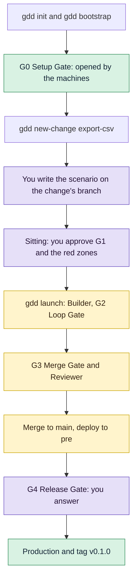

# Your first change

In this tutorial you set up `notes`, a small command-line notes tool in Python, and take one
change from an idea to a release: you write and approve its scenario, the agents build and
review it, and you answer its Release Gate. It takes about half an hour.

## Before you start

- gdd, uv, OSV-Scanner and gitleaks installed: [Install gdd](../how-to/install.md) has every
  step, including the Python table.
- Claude Code and Codex installed and signed in. Here Claude Code builds and Codex reviews,
  because the Reviewer must be of another model family than the Builder.
- A terminal at least 100 columns wide, for the screens gdd draws.

The agents' calls in this tutorial used about 73,000 new input tokens; with a subscription,
that is part of your plan, not a bill.

## The path

You walk the five gates of GDD once, in this order. The purple steps are yours; the machines
and the agents do the rest.



[GDD in one page](../explanation/method.md) explains each gate. You do not need it to follow
along.

## 1. Create the project

Make an empty folder with a git repository and set up GDD in it. Every answer goes in a flag,
so no form opens:

```bash
mkdir notes && cd notes
git init -b main
gdd init --name notes --platform cli --stack python --agents claude codex \
  --description "A command-line notes tool" --sensitive "Losing or corrupting a user's notes"
```

You should see every file gdd wrote, then what to do next:

```text
gdd/project.toml
gdd/commands.toml
gdd/rules.toml
gdd/zones.toml
gdd/models.toml
gdd/generated.toml
docs/brief.md
bin/gdd
...
.agents/skills/gdd-stack-python/SKILL.md
Next: run bin/gdd bootstrap (first install of each stack and its lock file), bin/gdd agents check, then start your agent and run the gdd-setup command (/gdd-setup in Claude Code and OpenCode, $gdd-setup in Codex).
```

`gdd init` commits those files, and only those, as `gdd init 0.1.0`.

Now install the project's tools. `gdd bootstrap` runs the first install of the stack, which
writes the lock file, and commits it:

```bash
bin/gdd bootstrap
```

You should see uv at work, then:

```text
python: uv lock && uv sync --locked
...
Installed 39 packages in 92ms
Committed: uv.lock
Next: bin/gdd selftest
```

From here on you call gdd as `bin/gdd`, the script `gdd init` wrote. The agents and CI call it
the same way.

## 2. Look at what init wrote

Each file has one job:

```text
notes/
├── gdd/                   the rules of the method, read by gdd, the agents and CI
│   ├── project.toml       name, platform, stack and the language the agents speak
│   ├── commands.toml      the commands each gate runs, from the Python stack sheet
│   ├── rules.toml         what each color gets: lanes, limits, protected paths
│   ├── zones.toml         the zone map: which paths are red, green or yellow
│   ├── models.toml        which agent and model plays each role
│   └── generated.toml     what init was asked, for gdd upgrade
├── docs/brief.md          the Project Brief: what the project is and what must not fail
├── bin/gdd                runs the gdd on your PATH
├── .github/workflows/gdd.yml   CI: Path Guard, G2 and G3 on every pull request
├── AGENTS.md, CLAUDE.md   the first instructions every agent reads
├── .claude/skills/        the GDD commands for Claude Code (/gdd-status...)
├── .agents/skills/        the same commands for Codex ($gdd-status...)
├── features/              the Gherkin scenarios: the contract you approve
├── src/notes/             the code, with a placeholder greeting.py
├── tests/unit/            unit tests
├── tests/acceptance/      the scenario steps, run by pytest-bdd
├── pyproject.toml, uv.lock     dependencies and the tools of the gates
└── osv-scanner*.toml      security and license checks of G3
```

gdd keeps its own state, the log and the record of each change, in `.gdd/`, which git
ignores. [Files gdd writes](../reference/files.md) describes each one.

## 3. Open G0, the Setup Gate

Setup ends at the Setup Gate (G0), which the machines open, not a person: gdd records it only
`--by machines`, and only with the Project Brief written and the harness self-test at 4 of 4.
In a real project you do Setup in a conversation with the Orchestrator (`/gdd-setup` in
Claude Code), which writes the Brief with you and runs these commands. Here the Brief
`gdd init` wrote is nearly complete: fill in who the tool is for.

Open `docs/brief.md` and replace the line under `## Who it is for` with:

```markdown
People who keep short notes in the terminal and want them in a spreadsheet now and then.
```

Commit it, run the self-test and open G0:

```bash
git commit -am "Brief: who notes is for"
bin/gdd selftest
bin/gdd gate G0 ok --by machines
```

You should see:

```text
OK a failing test turns G2 red
OK editing a protected file is blocked (Path Guard and CI)
OK rollback works in pre (simulated)
OK zero scenarios counts as a failure
harness 4/4
G0 ok (machines).
```

The self-test proves the gates can fail: a failing test turns G2 red, Path Guard blocks an
agent that edits a protected file, rollback works and a project with no scenarios fails G3.
Check where the project stands:

```bash
bin/gdd status
```

You should see:

```text
Project: notes · language en · platform cli
Brief: docs/brief.md
G0: ok · G0 ok
Red zones: pending · Red zones not approved yet: the Orchestrator proposes them at the end of Discover.
Harness self-test: harness 4/4
Scenarios in features/: 0
Security exceptions: none
Known debt: none
Changes:
Log: 2 lines in .gdd/log.jsonl (gdd report)
```

The red zones are still pending: you approve them in step 7, at the same sitting as your
first scenario.

## 4. Create the change

A *change* is a small piece of value that passes the gates as one unit, on its own branch.
Yours lets `notes` export the notes as CSV. Create it with the paths it plans to touch:

```bash
bin/gdd new-change export-csv --title "Export notes as CSV" \
  --paths "src/notes/**" "tests/**" features/export_csv.feature
```

gdd creates the branch `change/export-csv` and prints how it classified the change:

```text
{
  "change": "export-csv",
  "color": "yellow",
  "lane": "full",
  "reasons": [
    "features/export_csv.feature -> yellow (no zone: default color)",
    "src/notes/** -> yellow (no zone: default color)",
    "tests/** -> yellow (no zone: default color)"
  ],
  "g1": true,
  "features": [
    "features/export_csv.feature"
  ],
  "tests_first": true,
  "mutation": false,
  "reviewer": true,
  "review": "quick",
  "g4": true,
  "human_plan": false,
  "type": "Feature",
  ...
}
```

Read it as the plan for this change:

- `color` is yellow: none of its paths is in a zone of `gdd/zones.toml`, and code without a
  zone is yellow. A red path would make the whole change red.
- `g1` is true because it adds a scenario, so you approve the scenario before any code.
- `reviewer` is true: a Reviewer of another model family reads the whole change.
- `g4` is true: a change with a G1 waits for you at the Release Gate.

[How risk picks the gates](../explanation/risk.md) explains the colors.

## 5. Write the scenario

A scenario is a Gherkin sentence that says what must happen. It goes on the change's branch,
in `features/`. Switch to the branch and write it:

```bash
git switch change/export-csv
mkdir -p features/hidden
cat > features/export_csv.feature <<'EOF'
Feature: Export notes as CSV
  So that I can open my notes in a spreadsheet, notes writes them as CSV: a header line,
  then one line per note, in the order they were written.

  Scenario: Each note becomes one line
    Given the notes "Buy milk" and "Call the bank"
    When I export the notes as CSV
    Then the CSV is:
      """
      note
      Buy milk
      Call the bank
      """
EOF
```

Add a *hidden example* too: the same sentences with other data, in `features/hidden/`. The
Builder never sees it, so code that only fits the visible example fails at G3:

```bash
cat > features/hidden/export_csv.feature <<'EOF'
Feature: Export notes as CSV (hidden examples)

  Scenario: Other notes, same rule
    Given the notes "Water the plants" and "Pay the rent"
    When I export the notes as CSV
    Then the CSV is:
      """
      note
      Water the plants
      Pay the rent
      """
EOF
```

Commit both and go back to `main`:

```bash
git add features
git commit -m "Scenarios of export-csv"
git switch main
```

[Write and approve scenarios](../how-to/write-scenarios.md) has the rules for good scenarios
and hidden examples.

## 6. Give the Builder its package

The Builder gets only what its task needs: a short *context package* in the change's state
folder. The Orchestrator writes it in a real project (`/gdd-change`); here you write it:

```bash
cat > .gdd/changes/export-csv/package.md <<'EOF'
# export-csv

Goal: `notes` exports the notes as CSV, a header line `note` and then one line per note.
Color: yellow. Scenario: features/export_csv.feature.
Paths: a function `export_csv(notes: list[str]) -> str` in src/notes/export.py, its unit tests in
tests/unit/, its steps in tests/acceptance/steps/. Check with `bin/gdd g2`.
EOF
```

## 7. Approve at the sitting

Everything a change needs from you before the build comes to one *sitting*: the scenarios
(the Scenario Gate, G1), the red zones when they wait, and the plan of a red change. Open it:

```bash
bin/gdd sitting export-csv
```

You should see the scenarios from the change's branch, the hidden example marked as such, and
the two red zones `gdd init` mapped, with their reasons:

<!-- Real screen of gdd 0.1.0 at 100 columns: blank lines and part of the scenarios trimmed. -->
```text
┌ gdd · Sitting · notes ───────────────────────────────────────────────────────────────────────────┐
│export-csv · Export notes as CSV · yellow                                                         │
│Scenarios                                                                                         │
│features/export_csv.feature                                                                       │
│Feature: Export notes as CSV                                                                      │
│  So that I can open my notes in a spreadsheet, notes writes them as CSV: a header line,          │
│  then one line per note, in the order they were written.                                         │
│  Scenario: Each note becomes one line                                                            │
│    Given the notes "Buy milk" and "Call the bank"                                                │
│    When I export the notes as CSV                                                                │
│    Then the CSV is:                                                                              │
...
│features/hidden/export_csv.feature · hidden: the Builders never see it                            │
...
│Red zones to approve                                                                              │
│gdd/**, bin/**, .github/**, .claude/**, .agents/**, .opencode/**, .gdd/bin/** · The harness       │
│itself: touching the gates is touching the safety of the method                                   │
│pyproject.toml, uv.lock, osv-scanner.toml, osv-scanner-licenses.toml · Dependencies and toolchain:│
│supply chain                                                                                      │
│Plan: not needed for a yellow change                                                              │
│↑↓ scroll · a approve · c ask for changes · q quit                                                │
└──────────────────────────────────────────────────────────────────────────────────────────────────┘
```

Press `a`. Nothing is written yet: gdd shows exactly what it will record, as you (blank
lines trimmed here and below):

```text
┌ gdd · Sitting · notes ───────────────────────────────────────────────────────────────────────────┐
│This records, as you:                                                                             │
│- G1 ok on export-csv, sealing features/export_csv.feature, features/hidden/export_csv.feature    │
│- red zones ok: 2 red zone(s)                                                                     │
│y to record · n to go back                                                                        │
│↑↓ scroll · q quit                                                                                │
└──────────────────────────────────────────────────────────────────────────────────────────────────┘
```

Press `y`. You should see:

```text
┌ gdd · Sitting · notes ───────────────────────────────────────────────────────────────────────────┐
│Recorded                                                                                          │
│G1 ok on export-csv (human).                                                                      │
│Red zones ok (2 red zone(s)).                                                                     │
│Next: gdd launch export-csv                                                                       │
│↑↓ scroll · q quit                                                                                │
└──────────────────────────────────────────────────────────────────────────────────────────────────┘
```

Press `q` to close the screen. Approving G1 *seals* the scenario files: gdd keeps their
hashes, and no agent can change them afterwards without a new approval. `c` instead of `a`
asks for changes and records G1 KO with your words.

> [!NOTE]
> Without a terminal, for example in a script, record the same sitting with two commands:
> `bin/gdd gate zones ok --by human` and `bin/gdd gate G1 ok export-csv --by human`.

## 8. Launch the change

Hand the change to the recipe:

```bash
bin/gdd launch export-csv
```

gdd prints nothing while it works. It took about two minutes for this change; a larger one
takes longer. You should see, at the end:

```text
Paused at G4. Message: .gdd/changes/export-csv/inbox.md · To continue: gdd resume export-csv --g4 ok|ko|polish
```

Meanwhile, gdd did this, in order:

1. It made a git worktree for the change next to the project, `../notes.worktrees/export-csv`,
   on the branch `change/export-csv`, and left your checkout on `main`.
2. The **Builder in test mode** (Claude Code, Sonnet) wrote the steps of the scenario and the
   unit tests, which failed because the code did not exist yet.
3. The **Builder in build mode**, in a separate session, wrote `src/notes/export.py` until the
   Loop Gate (G2) passed: lint, types, unit tests, the scenario and Path Guard.
4. The Merge Gate (G3) ran every scenario, the hidden example included, plus the security,
   license, lock file and secrets checks.
5. The **Reviewer** (Codex) read the whole change and answered OK.
6. gdd merged the branch into `main`, ran the steps that deploy it to pre and stopped at the
   Release Gate (G4), because the change had a G1. This project has no pre or production yet,
   so those steps are simulated: `simulated = true` in `[release]` of `gdd/commands.toml`.

[The life of a change](../explanation/life-of-a-change.md) follows every step in detail.

## 9. Follow it

While the change runs, and after, three commands show where it is. `status` lists every
change with its state and gates:

```bash
bin/gdd status
```

```text
...
Scenarios in features/: 2
Security exceptions: none
Known debt: none
Changes:
  - export-csv · Export notes as CSV · in-pre · G1:ok, G3:ok
Log: 30 lines in .gdd/log.jsonl (gdd report)
```

The Board shows the changes by phase; `bin/gdd board`, or `gdd` with no arguments, opens it.
It only reads, and `Enter` shows the details of a change:

<!-- Real screen at 100 columns, blank lines trimmed. -->
```text
┌ gdd · Board · notes ─────────────────────────────────────────────────────────────────────────────┐
│Discover (0)                                                                                      │
│Build (0)                                                                                         │
│Release (1)                                                                                       │
│› export-csv · yellow · Export notes as CSV · waiting for your G4 · G1:ok, G3:ok                  │
│Done (0) · d to show                                                                              │
│↑↓ move · Enter details · d done · t time · q quit                                                │
└──────────────────────────────────────────────────────────────────────────────────────────────────┘
```

`report` says what the agent calls cost, from the log:

```bash
bin/gdd report
```

```text
role -> calls · tokens in · cache · out · cost USD · seconds
builder-build -> 1 · 23,396 · 183,870 · 1,501 · 0.1270 · 22
builder-test -> 1 · 25,843 · 288,673 · 3,123 · 0.1634 · 59
reviewer -> 1 · 23,312 · 123,264 · 1,301 · 0.0000 · 44
TOTAL -> in 72,551 · cache 595,807 · out 5,925 · 0.2904 USD
Human stops logged: 2
```

Three agent calls and two human stops: the scenario and the red zones, both at one sitting.
Codex reports no cost, so the Reviewer's line says 0 unless you fill `[prices]` in
`gdd/models.toml`.

## 10. Answer the Release Gate

The change is merged and in pre. Before it reaches production you are its editor: done is
not the same as good. Read its *Decision Inbox*, the one message gdd keeps for each change:

```bash
bin/gdd inbox export-csv
```

```text
# Decision Inbox · export-csv · Export notes as CSV

Color yellow · lane full · state in-pre

## How it works
- `src/notes/export.py` adds the requested `export_csv` function.
- It uses Python’s CSV writer to emit the `note` header and preserve note order.
- Acceptance steps follow the existing fixture-based test structure.
- Empty input produces only the header; output includes a trailing newline.

## Needs your decision
- El escenario compara el CSV por líneas (splitlines), así que no fija si hay salto de línea final; los tests unitarios tampoco.
- G4 · Release Gate: check the pre demo and the change message, then answer with gdd resume export-csv --g4 ok (promote to production), --g4 ko (reject: production untouched) or --g4 polish --note <what to polish> (one more Builder round).

## Decided without you
- Nothing.

## Parked
- Nothing.
```

*How it works* is the Reviewer's short explanation of the code, so you know what you approve
without reading every line. Your agents will word it differently.

The first line under *Needs your decision* is a note the Builder in test mode left with
`bin/gdd note`: the scenario compares the CSV line by line, so it does not say whether the file
ends with a newline. It came out in Spanish: Claude Code also reads its user's own
instructions, written in Spanish on the machine of this run, and here they won over the
project's `language`. Such a note is for you to weigh at G4: a trailing newline is fine for a
spreadsheet, so it changes nothing here.

You can answer on a screen with `bin/gdd sitting export-csv`, where `o` is OK, `k` is KO and
`p` is polish, or with one command. The code does what the scenario says, so answer OK:

```bash
bin/gdd resume export-csv --g4 ok
```

You should see:

```text
Released v0.1.0
Change export-csv closed. Message: .gdd/changes/export-csv/inbox.md · Tokens: gdd report --change export-csv
```

gdd ran the steps that promote the same build from pre to production and watch it, simulated in
this project, and closed the change. Because the change has a changelog line (a Feature goes
under Added, with its title), it got the project's first version, the tag `v0.1.0`. `ko` would
have kept it out of production, and `polish --note "..."` would have sent your notes to the
Builder for one more round. [Answer the Release Gate](../how-to/release-gate.md) covers all
three.

## 11. See the result

The change reached `main` as one merge commit:

```bash
git log --oneline --graph -6
```

```text
*   412bc25 gdd(export-csv): G3 Merge Gate · Export notes as CSV
|\
| * 13b016d gdd(export-csv): change work
| * 9fe1de1 Scenarios of export-csv
|/
* 4a1b193 Brief: who notes is for
* ca5c264 gdd bootstrap
* 96b1229 gdd init 0.1.0
```

The merge commit carries the change's record, so the history keeps what was decided and by
whom, while the working files stay in `.gdd/changes/export-csv/`:

```bash
git show -s --format=%B HEAD
```

```text
gdd(export-csv): G3 Merge Gate · Export notes as CSV

Color: yellow · lane full · type Feature
Approvals: G1 ok (human, 2026-10-30, 2 scenario file(s) sealed)
Reviewer: OK
Tokens: in 72,551 · cache 595,807 · out 5,925 · 0.29 USD (estimate) · 13 agent call(s)
Record: .gdd/changes/export-csv/ (local)

Changelog: Added · Export notes as CSV
Breaking: no
```

The tokens are those of `gdd report`. The count of calls is not: gdd 0.1.0 counts there the
ten gate commands of G2 and G3 too, so the three agent calls show as 13.

And the project now says so:

```bash
bin/gdd status
```

```text
...
Changes:
  - export-csv · Export notes as CSV · closed · G1:ok, G3:ok, G4:ok
Log: 34 lines in .gdd/log.jsonl (gdd report)
```

You took a change through every gate, with two stops: one sitting before the build and one
answer at the end. The worktree is gone; the branch `change/export-csv` stays.

## Next steps

- [Run a change](../how-to/run-a-change.md): the everyday loop, including parked changes and
  relaunches.
- [Write and approve scenarios](../how-to/write-scenarios.md): scenarios that make good
  contracts, and hidden examples.
- [Map and approve red zones](../how-to/red-zones.md): turn the sensitive areas of the Brief
  into red paths.
- [GDD in one page](../explanation/method.md): the phases, gates and colors you just walked
  through.
