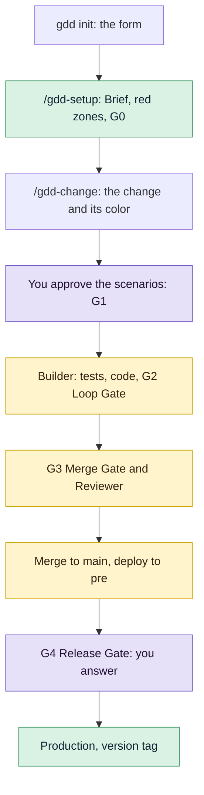

# Your first change

By the end of this tutorial you will have `shop`, a small online shop in Python, and one
change, the cart total, taken from a sentence to a tagged release in production. It follows
the path of the [Quickstart](quickstart.md) with every screen shown, so you can compare each
result with yours.

<!-- Every screen, message and output on this page comes from one real run of gdd 0.1.0 (main
at e244577) on 2026-10-31, in a throwaway folder, with Claude Code as the chat agent, Codex as
the Reviewer and the default models. Paths are shown under /home/me. The run took about eight
minutes from the form to G4, with no fix round. -->

## Before you start

- gdd, uv, OSV-Scanner and gitleaks installed: [Install gdd](../how-to/install.md) has every
  step, including the Python table.
- Claude Code and Codex installed and signed in. Claude Code builds and Codex reviews, because
  the Reviewer must be of another model family than the Builder.
- git knows your name and email: `gdd init` commits what it writes.
- A terminal at least 100 columns wide, for the screens gdd draws.

The Builder calls of this run cost 0.39 USD, as Claude Code reported it, and the Builder and
Reviewer calls together used about 103,000 new input tokens. With a subscription, your plan
covers them.

## The path

You type one gdd command, `gdd init`, to create the project. After that the work goes through
your agent, and you answer in the chat. The Board, the sitting and `git log` are windows you
open in a terminal to watch. The purple steps in the diagram are yours:



[GDD in one page](../explanation/method.md) explains each gate. You do not need it to follow
along.

## 1. Create the project

Make an empty folder with a git repository and run `gdd init` in it:

```bash
mkdir shop
cd shop
git init -b main
gdd init
```

A form opens. It asks seven questions, one per step, and writes nothing until the end. Type
the name and press `Enter`:

```text
┌ gdd init · Step 1 of 7 · Project name ───────────────────────────────────────────────────────────┐
│What is the project called?                                                                       │
│> shop█                                                                                           │
│Enter: next · Ctrl-C: quit                                                                        │
└──────────────────────────────────────────────────────────────────────────────────────────────────┘
```

Type a short description, or leave it empty, and press `Enter`:

```text
┌ gdd init · Step 2 of 7 · Description ────────────────────────────────────────────────────────────┐
│What is it, in a few words? It may stay empty.                                                    │
│> A small online shop█                                                                            │
│Enter: next · Esc: back · Ctrl-C: quit                                                            │
└──────────────────────────────────────────────────────────────────────────────────────────────────┘
```

Move to `web` with the arrow keys and press `Enter`:

```text
┌ gdd init · Step 3 of 7 · Platform ───────────────────────────────────────────────────────────────┐
│Where does it run?                                                                                │
│  mobile                                                                                          │
│  desktop                                                                                         │
│> web                                                                                             │
│  cli                                                                                             │
│  other                                                                                           │
│Up/Down: move · Enter: pick · Esc: back · Ctrl-C: quit                                            │
└──────────────────────────────────────────────────────────────────────────────────────────────────┘
```

Press `Space` to check `python`, then `Enter`. Each stack brings its *stack sheet*, the
commands each gate runs for that technology:

```text
┌ gdd init · Step 4 of 7 · Stacks ─────────────────────────────────────────────────────────────────┐
│Which technology does it use? Pick one or more, or Not sure.                                      │
│  [ ] rust                                                                                        │
│  [ ] typescript                                                                                  │
│> [x] python                                                                                      │
│  [ ] Not sure                                                                                    │
│Up/Down: move · Space: check · Enter: next · Esc: back · Ctrl-C: quit                             │
└──────────────────────────────────────────────────────────────────────────────────────────────────┘
```

The coding agents found on the machine come checked, and the first checked one builds. Press
`Space` on `opencode` to uncheck it, so Claude Code builds and Codex reviews:

```text
┌ gdd init · Step 5 of 7 · Coding agents ──────────────────────────────────────────────────────────┐
│Which coding agents? The first checked builds; those found on this machine come checked.          │
│  [x] claude                                                                                      │
│  [x] codex                                                                                       │
│> [ ] opencode                                                                                    │
│Up/Down: move · Space: check · Enter: next · Esc: back · Ctrl-C: quit                             │
└──────────────────────────────────────────────────────────────────────────────────────────────────┘
```

Keep `en`, the language the agents use with you, and press `Enter`:

```text
┌ gdd init · Step 6 of 7 · Language ───────────────────────────────────────────────────────────────┐
│Which language do the agents use with you? (en, es...)                                            │
│> en█                                                                                             │
│Enter: next · Esc: back · Ctrl-C: quit                                                            │
└──────────────────────────────────────────────────────────────────────────────────────────────────┘
```

Type each sensitive area, what would be serious if it failed, and press `Enter`. An empty line
goes on. These words become *red zones* later, once there are folders to protect:

```text
┌ gdd init · Step 7 of 7 · Sensitive areas ────────────────────────────────────────────────────────┐
│What would be serious if it failed? One area per line.                                            │
│> Losing a customer's order█                                                                      │
│Enter: add, or go on when empty · Backspace: edit the last · Esc: back · Ctrl-C: quit             │
└──────────────────────────────────────────────────────────────────────────────────────────────────┘
```

Check the summary. To fix an answer, press `Esc` to go back to it:

```text
┌ gdd init · Summary ──────────────────────────────────────────────────────────────────────────────┐
│Every answer, before anything is written.                                                         │
│Name: shop                                                                                        │
│Description: A small online shop                                                                  │
│Platform: web                                                                                     │
│Stacks: python                                                                                    │
│Agents: claude, codex                                                                             │
│Language: en                                                                                      │
│Sensitive: Losing a customer's order                                                              │
│Enter to set up · Esc to go back                                                                  │
│Ctrl-C: quit                                                                                      │
└──────────────────────────────────────────────────────────────────────────────────────────────────┘
```

Press `Enter`. You should see every file gdd wrote, then uv at work, then what to do next:

```text
gdd/project.toml
gdd/commands.toml
gdd/rules.toml
gdd/zones.toml
gdd/models.toml
gdd/generated.toml
docs/brief.md
.github/workflows/gdd.yml
AGENTS.md
CLAUDE.md
...
.agents/skills/gdd-stack-python/SKILL.md
python: uv lock && uv sync --locked
Using CPython 3.13.15
Resolved 40 packages in 329ms
...
Installed 39 packages in 61ms
...
Committed: uv.lock
Next: start your coding agent here and run the gdd-setup command (/gdd-setup in Claude Code and OpenCode, $gdd-setup in Codex).
```

Look at the last line: it tells you where to go next. gdd made two commits, `gdd init 0.1.0`
with its files and `gdd bootstrap` with `uv.lock`, the lock file that pins the version of every
dependency. If the output stops with an error after the `python:` line, uv is probably missing:
see [Install gdd](../how-to/install.md#python).

## 2. Look at what init wrote

Each file has one job:

```text
shop/
├── gdd/                   the rules of the method, read by gdd, the agents and CI
│   ├── project.toml       name, platform, stack and the language the agents speak
│   ├── commands.toml      the commands each gate runs, from the Python stack sheet
│   ├── rules.toml         what each color gets: lanes, limits, protected paths
│   ├── zones.toml         the zone map: which paths are red, green or yellow
│   ├── models.toml        which agent and model plays each role
│   └── generated.toml     what init was asked, for gdd upgrade
├── docs/brief.md          the Project Brief: what the project is and what must not fail
├── .github/workflows/gdd.yml   CI: Path Guard, G2 and G3 on every pull request
├── AGENTS.md, CLAUDE.md   the first instructions every agent reads
├── .claude/skills/        the GDD skills for Claude Code (/gdd-setup, /gdd-change...)
├── .agents/skills/        the same skills for Codex ($gdd-setup, $gdd-change...)
├── features/              the Gherkin scenarios: the contract you approve
├── src/shop/              the code, with a placeholder greeting.py
├── tests/unit/            unit tests
├── tests/acceptance/      the scenario steps, run by pytest-bdd
├── pyproject.toml, uv.lock     dependencies and the tools of the gates
└── osv-scanner*.toml      security and license checks of G3
```

Notice `gdd/zones.toml` and `gdd/models.toml`. The first decides how strict each change is,
the second which agent plays each role. gdd keeps its own state in `.gdd/`, which git ignores.
[Files gdd writes](../reference/files.md) describes each file.

## 3. Set up the project with your agent

Start Claude Code in the `shop` folder and run the setup skill:

```text
/gdd-setup
```

If Claude Code does not know `/gdd-setup`, you started it outside the `shop` folder, where the
skills live. The agent plays the *Orchestrator*, the role that talks to you. It has read what
the form wrote, so it asks only what is missing:

```text
Setup already has the basics: a web shop in Python, scenarios run with pytest-bdd, a skeleton
that runs, and one sensitive area (losing a customer's order). I need a few answers before I
write the Brief:

1. **What is the shop, in a few lines?** What does it sell, who buys, and roughly how big is it
   (a handful of products or a catalogue)?
2. **Who is it for?** My guess is one small seller and their customers, with no marketplace of
   many sellers. Is that right?
3. **Web framework.** I recommend **Django**. It comes with an admin panel for managing
   products and orders, plus logins and a database layer, which fits a small shop with little
   code. The alternative is **FastAPI**, if you'd rather have an API with a separate frontend.
4. **What else would be serious if it failed?** I have "losing a customer's order." My
   suggestions to add are:
   - **Charging the wrong amount, or taking payment without recording the order.** I'd
     recommend Stripe hosted checkout, so we never handle card numbers ourselves.
   - **Leaking customers' personal data** (names, addresses, emails).

   Is there anything to add or remove?

**Next step:** answer these four, even in one line each, and I'll write the Brief, the
technology decision and the gate commands, and open G0.
```

Answer each question in a line or two. Each one comes with a recommendation, and you need not
take it:

```text
It sells handmade ceramics: mugs, bowls and plates. One seller, me. Customers browse, put
pieces in a cart and place an order; payment comes later, it is out of scope for now. It is
for people who like handmade ceramics, and I run it day to day. I'd rather have FastAPI. Just
orders.
```

After about a minute and a half, the agent has written the Brief, an architecture decision
record (ADR) for the technology and a small skeleton with a first smoke scenario. It has also
run the self-test of the *harness*, the files and commands gdd uses to check the project. Then
it asks you one more thing:

<!-- The trimmed part of this message listed two checks the agent could not run: this run
drove Claude Code headless, where a command outside the allowed tools is refused instead of
asked. In a normal session Claude Code asks you to allow them. -->

```text
The harness self-test passes: **harness 4/4**. The Brief and the technology decision are
written, and the smoke scenario passes. Before I can open G0 and commit, I need two things from
you.

**1. Approve the red zones.** Red marks the parts of the project that get the strictest checks:
deeper review, mutation testing, and your sign-off before anything changes. For now there are
only two:
- **The harness itself:** gdd's own files, the CI workflow and the agent instructions.
- **Dependencies and the toolchain:** the files that decide which outside libraries the shop
  uses.

"Losing a customer's order" is in the Brief for now. It becomes a red zone once there is real
order-storage code. Reply **"zones OK"** to approve.
...
**Next step:** reply "zones OK". I'll then run the two checks, open G0, commit (`gdd: setup
(G0)`) and log the session.
```

Look at the two red zones. A *red zone* is a set of paths that always gets the strictest
checks. A person approves the map once, because it sets how strict every later change is
([Map and approve red zones](../how-to/red-zones.md)). The cart is not among the zones, so
approve them:

```text
zones OK
```

The agent opens the Setup Gate (G0) and commits the setup on `main`. You should see:

```text
Setup is done and **G0 is open**. The harness is ready: the self-test passes all four checks,
and the red zones you approved are recorded.
...
- **Release is still simulated:** there is no test or live server yet. The Brief keeps two open
  questions for later: one-of-a-kind stock, and how you'll see new orders.

**Next step:** I recommend `/gdd-discover` before the first change. Orders are your sensitive
area, so it's worth settling first how orders get stored and how stock works for pieces that are
one of a kind. If you'd rather start building now, run `/gdd-change` with one sentence, for
example "customers can browse the pieces".
```

Notice **G0 is open**: the machines open G0 once the Brief exists and the self-test passes all
four checks. *Release is still simulated* means there is no pre or production server yet. If
the agent reports instead that a gate command cannot run, a tool of the stack is missing: see
[Install gdd](../how-to/install.md#python).

The agent recommends `/gdd-discover`, which explores bigger ideas. Your first change is small,
so skip it.

To see the project from a terminal, open the *Board*, the screen of every change by phase. It
is empty for now:

```text
┌ gdd · Board · shop ──────────────────────────────────────────────────────────────────────────────┐
│No changes yet · ask your agent: /gdd-change <what you want> ($gdd-change in Codex)               │
...
│↑↓ move · Enter details · d done · t time · q quit                                                │
└──────────────────────────────────────────────────────────────────────────────────────────────────┘
```

Press `q` to close it.

## 4. Describe the change

A *change* is a small piece of work that passes the gates as one unit, on its own branch. Say
yours to the agent:

```text
/gdd-change show the cart total, taxes included
```

The Orchestrator picks an id, `cart-total`, a type, `Feature`, and the paths the change will
touch. gdd works out the color from those paths and the zone map, and the agent answers with
the color first:

```text
I've drafted the scenarios for **cart-total**. It's yellow, so there's no plan for you to
approve and the red zones are unchanged. Before I commit them I need your OK and three answers.
...
```

Under the hood, the agent ran [`gdd new-change`](../reference/cli/new-change.md), which
created the branch `change/cart-total` and printed this classification:

```text
{
  "change": "cart-total",
  "color": "yellow",
  "lane": "full",
  "reasons": [
    "features/cart_total.feature -> yellow (no zone: default color)",
    "features/hidden/cart_total.feature -> yellow (no zone: default color)",
    "src/shop/cart.py -> yellow (no zone: default color)",
    "tests/acceptance/steps/** -> yellow (no zone: default color)",
    "tests/unit/test_cart.py -> yellow (no zone: default color)"
  ],
  "g1": true,
  ...
  "tests_first": true,
  "mutation": false,
  "reviewer": true,
  "review": "quick",
  "g4": true,
  "human_plan": false,
  "type": "Feature",
  "builder": {
    "integration": "claude",
    "model": "sonnet"
  },
  ...
  "reviewer_model": {
    "effort": "high",
    "integration": "codex",
    "model": "gpt-6-astra"
  },
  ...
}
```

Read it as the plan for this change:

- `color` is yellow: none of its paths is in a zone, and code without a zone is yellow.
- `lane` is full because the change adds scenarios, which rules out the
  [Fast Lane](../explanation/method.md#lanes).
- `tests_first` is true: the Builder writes the tests before the code.
- `g1` is true: you approve the scenarios before any code exists.
- `reviewer` is true: Codex, of another model family, reads the change.
- `g4` is true: a change with a G1 waits for you at the Release Gate.
- `builder` is Claude Code with Sonnet, the model `gdd/models.toml` gives a yellow change.

[How risk picks the gates](../explanation/risk.md) explains the colors.

## 5. Read and approve the scenarios

A *scenario* is an example of what must happen, written in Gherkin: plain Given, When, Then
sentences that a test tool runs. The Orchestrator shows its three scenarios in the same
message, with its questions for you:

```text
**The scenarios** (all prices are set by you, tax already included):

> **Background:** the tax rate is 21%
>
> **1. The total adds up every piece in the cart**
> A cart with 1 × Blue mug at 24.20 and 2 × Wide bowl at 36.30.
> The total is **96.80**, and the tax included in it is **16.80**.
>
> **2. The tax is rounded to the cent**
> A cart with 1 × Small cup at 25.00.
> The total is **25.00**, and the tax included in it is **4.34**.
>
> **3. An empty cart costs nothing**
> The total is **0.00**, and the tax included is **0.00**.

I also wrote two hidden examples that the Builder won't see, to check it implemented the rule
and didn't just match the visible numbers.

**Questions:**
1. **Do your prices already include tax?** I recommend yes: the price on each piece is what the
   customer pays, and the cart shows how much of it is tax. The alternative is that you set
   prices before tax and the cart adds the tax on top. In that case scenario 1 would read
   "subtotal 80.00 + tax 16.80 = 96.80".
2. **Which tax rate, and which currency?** I used 21% as a placeholder (Spain's VAT rate) and
   left out the currency. Tell me your rate and currency and I'll put them in.
3. **Rounding:** I recommend working out the tax once on the cart total, rounded to the nearest
   cent. Working it out piece by piece can be off by a cent, for example 6.25 instead of 6.24.

**Next step:** reply "OK" if all my recommendations stand, or give your rate, currency and any
corrections. I'll then commit the scenarios, approve G1 with your note, and launch the build.
```

The file behind it, `features/cart_total.feature`, reads:

```gherkin
Feature: Cart total, taxes included
  The customer sees what the cart costs in total, taxes included,
  and how much of that total is tax.
  Prices are set by the seller with tax already included.

  Background:
    Given the tax rate is 21%

  Scenario: The total adds up every piece in the cart
    Given a cart with
      | piece     | price | quantity |
      | Blue mug  | 24.20 | 1        |
      | Wide bowl | 36.30 | 2        |
    When the customer looks at the cart
    Then the total is 96.80
    And the tax included in the total is 16.80

  Scenario: The tax is rounded to the cent
    Given a cart with
      | piece     | price | quantity |
      | Small cup | 25.00 | 1        |
    When the customer looks at the cart
    Then the total is 25.00
    And the tax included in the total is 4.34

  Scenario: An empty cart costs nothing
    Given an empty cart
    When the customer looks at the cart
    Then the total is 0.00
    And the tax included in the total is 0.00
```

Check the numbers: they are the contract the code must meet. The Orchestrator also wrote
*hidden examples* in `features/hidden/cart_total.feature`, the same sentences with other data.
The Builder never sees them, so code that only fits the visible numbers fails
([Approve the scenarios](../how-to/write-scenarios.md)).

To see the *sitting*, the screen of everything a change needs from you, run in a terminal:

```bash
gdd sitting cart-total
```

It shows no scenarios yet, because the Orchestrator commits them to the change's branch only
with your OK:

```text
┌ gdd · Sitting · shop ────────────────────────────────────────────────────────────────────────────┐
│cart-total · Show the cart total, taxes included · yellow                                         │
│Scenarios                                                                                         │
│No scenario files on change/cart-total                                                            │
│Red zones: approved                                                                               │
│Plan: not needed for a yellow change                                                              │
│↑↓ scroll · a approve · c ask for changes · q quit                                                │
└──────────────────────────────────────────────────────────────────────────────────────────────────┘
```

Press `q` and answer in the chat, with your answers to its questions:

```text
OK, as they are. My prices include tax, 21% is my rate and I sell in euros.
```

The agent commits the scenarios, records the Scenario Gate (G1) with your words and launches
the change. Within a minute it answers:

```text
The **cart-total** change is now building on its own. I'll get a notification when it finishes
or stops.

**Approved and recorded:**
- G1, with your note: prices include tax, the rate is 21%, amounts are in euros, and the tax is
  worked out once on the cart total.
- The Builder's brief for this change, with those rules. It says to use exact money arithmetic
  rather than approximate decimals, and to pass the tax rate in rather than fixing it in the
  code.

**What happens now:**
1. Tests are written first.
2. The Builder writes the code until the checks pass.
3. A Reviewer from a different model family checks it.
4. The change merges into `main` and goes to the test server, which is simulated for now.
5. The build pauses for your **G4** sign-off.

**Next step:** wait for the build. When it pauses at G4, I'll show you the result in plain
words and you answer OK, KO, or "polish" with your notes.
```

Notice *Approved and recorded*. Approving G1 *seals* the scenario files, so no agent can change
them without a new approval ([Keeping agents honest](../explanation/safety.md)).

## 6. Watch the build on the Board

From here the *recipe*, the fixed sequence of steps gdd runs for a change, goes on its own. In
order, gdd:

1. made a git worktree for the change, a second checkout in its own folder,
   `../shop.worktrees/cart-total`, on the branch `change/cart-total`, and left your checkout on
   `main`;
2. started the **Builder in test mode** (Claude Code, Sonnet), which wrote the steps of the
   scenarios and the unit tests, failing because the code did not exist yet;
3. started the **Builder in build mode**, in a separate session that cannot edit the scenarios,
   which wrote `src/shop/cart.py` until the Loop Gate (G2) passed: lint, types, unit tests, the
   scenarios and Path Guard, the check of which files each role may edit;
4. ran the Merge Gate (G3): every scenario, the hidden examples included, plus the security,
   license, lock file and secrets checks;
5. started the **Reviewer** (Codex), which read the whole change and said OK;
6. merged the change into `main`, built it and deployed it to pre, the environment before
   production (both simulated here), and paused at the Release Gate (G4).

To follow it, open the Board in another terminal:

```bash
gdd board
```

You should see the change under Build:

```text
┌ gdd · Board · shop ──────────────────────────────────────────────────────────────────────────────┐
│Discover (0)                                                                                      │
│Build (1)                                                                                         │
│› cart-total · yellow · Show the cart total, taxes included · building · G1:ok                    │
│Release (0)                                                                                       │
│Done (0) · d to show                                                                              │
│↑↓ move · Enter details · d done · t time · q quit                                                │
└──────────────────────────────────────────────────────────────────────────────────────────────────┘
```

The Board does not refresh by itself. To see where the change is now, press `q` and open it
again. About two minutes after the launch, it is under Release:

```text
┌ gdd · Board · shop ──────────────────────────────────────────────────────────────────────────────┐
│Discover (0)                                                                                      │
│Build (0)                                                                                         │
│Release (1)                                                                                       │
│› cart-total · yellow · Show the cart total, taxes included · waiting for your G4 · G1:ok, G3:ok  │
│Done (0) · d to show                                                                              │
│↑↓ move · Enter details · d done · t time · q quit                                                │
└──────────────────────────────────────────────────────────────────────────────────────────────────┘
```

Press `Enter` to see the details of the change, with where its time went:

```text
┌ gdd · Board · shop ──────────────────────────────────────────────────────────────────────────────┐
│cart-total · Show the cart total, taxes included                                                  │
│Type: Feature                                                                                     │
│Color: yellow                                                                                     │
│State: in-pre                                                                                     │
│Gates: G1:ok, G3:ok                                                                               │
│Paths: src/shop/cart.py, tests/unit/test_cart.py, features/cart_total.feature,                    │
│features/hidden/cart_total.feature, tests/acceptance/steps/**                                     │
│Inbox: .gdd/changes/cart-total/inbox.md                                                           │
│Flow time 3m · active 2m (59%) · waiting 1m · between steps 0s                                    │
│Agents: builder-test · sonnet 51s, reviewer · gpt-6-astra 30s, builder-build · sonnet 17s         │
│Gates: security 1s, secrets 0s, acceptance 0s, acceptance_full 0s, unit 0s, architecture 0s, lint │
│0s, types 0s, dependencies 0s, lockfile 0s, path-guard 0s                                         │
│Waiting: at the sitting 55s, to start 15s                                                         │
│Esc to go back · q quit                                                                           │
└──────────────────────────────────────────────────────────────────────────────────────────────────┘
```

Look at the *Flow time* line: the change took three minutes, two of them active. *Waiting at
the sitting* is the time the change waited for your answers. If a gate fails, the Builder gets
another round. After its limit the change *parks* and the agent tells you why ([Get a parked change going again](../how-to/parked-change.md)).

## 7. Answer the Release Gate

The agent comes back to the chat. The change is merged and in pre, and it waits for your
answer at the Release Gate (G4):

```text
The **cart-total** change is built and checked, and it's waiting for your **G4** answer.

**What it does:** a cart adds up the pieces in it and shows two figures, the total and how much
of that total is tax.
- 1 Blue mug (24.20) + 2 Wide bowls (36.30 each) gives a **total of 96.80, of which 16.80 is
  tax**.
- 1 Small cup (25.00) gives **25.00, of which 4.34 is tax**, rounded to the cent.
- An empty cart gives **0.00 and 0.00**.

The rule you approved is implemented: prices already include tax, the rate is 21%, and the tax
is worked out once on the cart total.

**Checks:**
- **All 6 scenarios pass**, including the 2 hidden examples the Builder never saw. That shows
  it implemented the rule rather than copying the numbers.
- **The other merge checks pass:** lint, types, unit tests, security, secrets and dependencies.
- **Mutation testing was skipped,** as the rules say for yellow changes. It deliberately breaks
  the code to see whether the tests notice.
- **The Reviewer from another model family said OK** with no findings.
- **It's merged into `main`.** The test server is simulated, so there's no page or video to
  look at yet. For now the cart only exists in the shop's core, not on a web page.

**Two things you should know:**
- The inbox asks you to approve the cart's technical interface: how other code adds pieces and
  reads the totals. That's a code detail; I've checked it and it's fine, so you don't need to
  decide anything there.
- The cart doesn't yet refuse odd input like a quantity of 0 or a negative price. Nothing
  allows that today, but I'd add the rule when pieces are added from a real page.

**Next step:** reply **OK** to send it to production (simulated for now), **KO** to reject it,
or **polish** with what you'd like changed.
```

Look at the checks first. The six scenarios are the three you approved, the two hidden examples
and the smoke scenario from Setup.

The agent read all this from the change's *Decision Inbox*, the one message gdd keeps for each
change, in `.gdd/changes/cart-total/inbox.md`:

```text
# Decision Inbox · cart-total · Show the cart total, taxes included

Color yellow · lane full · state in-pre

## How it works
- `src/shop/cart.py` adds a plain Python cart, independent of the web layer.
- Totals sum tax-inclusive prices multiplied by quantities using `Decimal`.
- Included tax uses the supplied rate, calculated once on the total and rounded half up.
- Acceptance steps follow the existing fixture pattern; unit tests cover rounding, alternative rates and empty carts.

## Needs your decision
- API expected by the tests: shop.cart.Cart(tax_rate: Decimal) with add(name: str, price: Decimal, quantity: int), and Decimal properties total and tax_included, both quantized to two places (str() shows e.g. 96.80). The rate is a percentage (Decimal(21)).
- G4 · Release Gate: check the pre demo and the change message, then answer with gdd resume cart-total --g4 ok (promote to production), --g4 ko (reject: production untouched) or --g4 polish --note <what to polish> (one more Builder round).

## Decided without you
- No human plan: the change is yellow. Money as Decimal, tax rate given to the cart (not hard-coded), tax computed once on the cart total and rounded half up to the cent.
- Euros: scenarios keep amounts without the euro sign, as approved; the currency shows up when the cart reaches a page.

## Parked
- Nothing.
```

- **How it works** is the Reviewer's short explanation of the code.
- **Needs your decision** holds the agents' notes and the G4 request. The agent read them for
  you and runs the command your answer becomes.
- **Decided without you** lists what the Orchestrator chose alone, each choice reversible.
- **Parked** lists what an agent set aside for later: nothing here.

The G4 page of the sitting shows the same decision, with the Reviewer's words and where the
time went (blank lines trimmed):

```text
┌ gdd · Sitting · shop ────────────────────────────────────────────────────────────────────────────┐
│cart-total · Show the cart total, taxes included · waiting for your G4                            │
│How it works                                                                                      │
│- `src/shop/cart.py` adds a plain Python cart, independent of the web layer.                      │
│- Totals sum tax-inclusive prices multiplied by quantities using `Decimal`.                       │
│- Included tax uses the supplied rate, calculated once on the total and rounded half up.          │
│- Acceptance steps follow the existing fixture pattern; unit tests cover rounding, alternative    │
│rates and empty carts.                                                                            │
│Reviewer: OK                                                                                      │
│No blocking findings. The implementation matches the package, and scenario steps assert exact     │
│amounts with two decimal places. No duplicated steps or example-specific shortcuts found.         │
│Recorded G2 and G3 pass; mutation testing was skipped. This review was read-only; no tests were   │
│rerun.                                                                                            │
│Demo: none, the project has no demo command                                                       │
│Decided without you                                                                               │
│- No human plan: the change is yellow. Money as Decimal, tax rate given to the cart (not          │
│hard-coded), tax computed once on the cart total and rounded half up to the cent.                 │
│- Euros: scenarios keep amounts without the euro sign, as approved; the currency shows up when the│
│cart reaches a page.                                                                              │
│Changelog: none set                                                                               │
│Flow time 3m · active 2m (59%) · waiting 1m · between steps 0s                                    │
│Agents: builder-test · sonnet 51s, reviewer · gpt-6-astra 30s, builder-build · sonnet 17s         │
│Gates: security 1s, secrets 0s, acceptance 0s, acceptance_full 0s, unit 0s, architecture 0s, lint │
│0s, types 0s, dependencies 0s, lockfile 0s, path-guard 0s                                         │
│Waiting: at the sitting 55s, to start 15s                                                         │
│↑↓ scroll · o OK · k KO · p polish · q quit                                                       │
└──────────────────────────────────────────────────────────────────────────────────────────────────┘
```

`Demo: none` means the project has no pre yet. `Changelog: none set` means nobody set a
changelog line, so gdd uses the default line of the type: a Feature gets its title under
`Added`. That line gives the change its version in step 8.

The total and the tax are what you approved, and the Reviewer found nothing. Press `q` and say
OK in the chat:

```text
OK
```

The agent promotes the change and closes it:

```text
**cart-total** is released as **v0.1.0**, and the change is closed. Production is still
simulated, so nothing is live on the web yet. The shop's core now has a cart that shows the
total and the tax included in it.

**What it cost:** the report shows **$0.39** in total. That figure covers only the Builder's
two rounds (writing the tests, then the code). The Reviewer and my own work show $0.00, which
looks like they weren't priced in the report rather than free. Your answers stopped the process
twice for a human decision: the scenarios and G4.

**Next step:** I recommend `/gdd-discover`. Orders are the area you said must never fail, so
it's worth deciding how orders are stored and how one-of-a-kind stock works before building
more. If you'd rather keep building, the natural next change is the catalogue: run
`/gdd-change customers can browse the pieces`.
```

Notice **v0.1.0**. OK promoted the build that ran in pre to production (simulated here) and
closed the change. Its worktree is gone; its branch stays.

## 8. See the result

To see the change in `main`, run:

```bash
git log --oneline -6
```

You should see:

```text
dc3c99a gdd(cart-total): G3 Merge Gate · Show the cart total, taxes included
7635ef3 gdd(cart-total): change work
394bab7 cart-total: scenarios (G1)
85aa812 gdd: setup (G0)
b356174 gdd bootstrap
5cbafa8 gdd init 0.1.0
```

The two commits under the top one, the scenarios and the work, came from the branch
`change/cart-total`. `dc3c99a` is the merge commit that joined them into `main`. It carries the
tag `v0.1.0`, because gdd gives a version to a promoted change with a changelog line, and the
first version of a project is 0.1.0. Its message holds the change's record:

```text
gdd(cart-total): G3 Merge Gate · Show the cart total, taxes included

Color: yellow · lane full · type Feature
Approvals: G1 ok (human, 2026-10-31, 2 scenario file(s) sealed)
Reviewer: OK
Decided without the human:
  - No human plan: the change is yellow. Money as Decimal, tax rate given to the cart (not hard-coded), tax computed once on the cart total and rounded half up to the cent.
  - Euros: scenarios keep amounts without the euro sign, as approved; the currency shows up when the cart reaches a page.
Tokens: in 103,260 · cache 533,866 · out 8,817 · 0.39 USD (estimate) · 13 agent call(s)
Record: .gdd/changes/cart-total/ (local)

Changelog: Added · Show the cart total, taxes included
Breaking: no
```

Look at the last two lines: the default changelog line from step 7. The project has no
`CHANGELOG.md` yet, so the line lives in this commit
([Release versions and keep a changelog](../how-to/releases-and-changelog.md)). The
`13 agent call(s)` is a known miscount of gdd 0.1.0, which also counts the ten gate commands
that ran.

For the real calls, the agent ran [`gdd report`](../reference/cli/report.md) for the change and
read it to you:

```text
role -> calls · tokens in · cache · out · cost USD · seconds
builder-build -> 1 · 23,685 · 154,625 · 1,605 · 0.1262 · 17
builder-test -> 1 · 43,025 · 296,425 · 6,017 · 0.2619 · 51
orchestrator -> 1 · 31,096 · 1,649,674 · 8,069 · 0.0000 · 0
reviewer -> 1 · 36,550 · 82,816 · 1,195 · 0.0000 · 30
TOTAL -> in 134,356 · cache 2,183,540 · out 16,886 · 0.3881 USD
Human stops logged: 2
```

One call per role, and two human stops: the scenarios and G4. The Reviewer's line shows no cost
because Codex reports none, and the Orchestrator's line, your chat session, has no price either.

Open the Board again: the change is under Done. Press `d` to unfold it:

```text
┌ gdd · Board · shop ──────────────────────────────────────────────────────────────────────────────┐
│Discover (0)                                                                                      │
│Build (0)                                                                                         │
│Release (0)                                                                                       │
│Done (1) · d to hide                                                                              │
│› cart-total · yellow · Show the cart total, taxes included · closed · G1:ok, G3:ok, G4:ok        │
│↑↓ move · Enter details · d done · t time · q quit                                                │
└──────────────────────────────────────────────────────────────────────────────────────────────────┘
```

You created a project, approved its red zones and its first scenarios, and took one change
through the build, the review and the Release Gate to version `v0.1.0`, in about eight minutes.
You typed one gdd command; your agent did the rest with you.

## Next steps

- [Describe a change to your agent](../how-to/run-a-change.md): the everyday loop, the same
  steps without the explanations.
- [Review a change at G4](../how-to/release-gate.md): what to check before OK, and what KO and
  polish do.
- [Approve the scenarios](../how-to/write-scenarios.md): scenarios that make good contracts,
  and hidden examples.
- [Map and approve red zones](../how-to/red-zones.md): turn the sensitive areas of the Brief
  into red paths, such as the orders of this shop.
