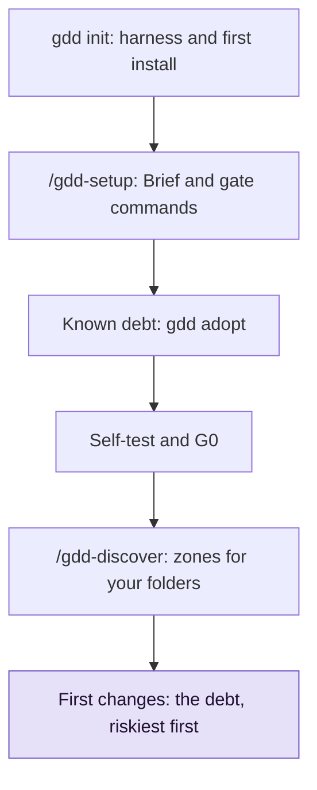

# Bring gdd to an existing project

Use this guide when a repository already has code and you want to work on it with GDD. You
run `gdd init` once in the terminal and your agent's setup skill does the rest; checks that fail
today become known debt, which warns instead of blocking.

## Before you start

- gdd, your coding agents and the tools of your stack are installed: see
  [Install gdd](install.md).
- The repository is a git repository with everything committed, on its main branch.
- If the words gate, zone and change are new to you, read
  [GDD in one page](../explanation/method.md) first.

The examples use `shop`, a small web shop in Python that already had code: a catalog, a cart,
one pytest test, Ruff, and an unused import that Ruff reports. The whole path looks like this:



The setup skill does B, C and D in one conversation with you.

## 1. Run gdd init

From the root of the repository:

```bash
gdd init
```

The Setup form asks seven questions: the name, a description, the platform, the stacks, the
coding agents, the language they use with you, and what would be serious if it failed. For the
stack, pick the one the project is written in. A summary shows every answer before anything is
written, and `Enter` sets the project up. [Install gdd](install.md#4-set-up-a-project) shows the
form.

gdd writes the [harness](../glossary.md#harness), the files it uses to check the project, next
to your code. It never overwrites a file, refuses to run in a folder that is already a GDD
project and commits only what it wrote (`gdd init 0.1.0`). Then it runs the first install of the
stack, which writes the lock file, and commits it (`gdd bootstrap`). You should see the files it
wrote, the install, then the next step:

```text
gdd/project.toml
gdd/commands.toml
gdd/rules.toml
gdd/zones.toml
gdd/models.toml
gdd/generated.toml
docs/brief.md
.github/workflows/gdd.yml
AGENTS.md
CLAUDE.md
.gitignore
.claude/skills/gdd-build/SKILL.md
...
.agents/skills/gdd-stack-python/SKILL.md
python: uv lock && uv sync --locked
Using CPython 3.13.15
Resolved 8 packages in 3ms
Using CPython 3.13.15
Creating virtual environment at: .venv
Resolved 8 packages in 0.91ms
Installed 7 packages in 10ms
Committed: uv.lock
Next: start your coding agent here and run the gdd-setup command (/gdd-setup in Claude Code and OpenCode, $gdd-setup in Codex).
```

No `src/` or `tests/` file is in the list. The project already had a `pyproject.toml`, so gdd
wrote no skeleton, and the files you already had stay yours.

- `AGENTS.md`: if the project already has one, gdd leaves it alone and tells you the line to
  add, which sends the agents to GDD.
- Lock file: if the project already committed one, you get `Nothing new to commit.` instead of
  `Committed: uv.lock`.

## 2. Run /gdd-setup

Start your agent in the project folder and run the setup skill:

```text
/gdd-setup
```

In Codex, run `$gdd-setup`. The agent plays the Orchestrator, the role that talks with you. It
reads your answers to the form in `gdd/project.toml` and `docs/brief.md`, then the code, and
asks only what those leave out. For `shop`, one question was left: who the shop is for. Its
message, trimmed:

<!-- Real output: one headless Claude Code session (claude -p '/gdd-setup', then --resume with
     the answer), gdd 0.1.0, on the example project. Trimmed with "..."; not edited. -->

```text
I've done all the technical setup. I need one answer from you before I can finish the Project Brief and open G0.

**What's ready**
- **Test runner:** pytest-bdd runs the scenarios (plain-language descriptions of what the shop should do). It's actively maintained; its last release was a month ago. I checked by hand that it fails when a step has no code behind it, that it can run only some scenarios, and that it runs the hidden ones only when asked.
...
- **Gates:** I ran every check command by hand. While doing that I fixed two problems:
  - The newest pytest (9.2) breaks pytest-bdd, so I held pytest below 9.2.
  - Mutation testing (a check that your tests catch deliberately planted bugs) crashed on files that give it nothing to test. It now skips them.
- **Existing debt:** the current code has one unused line, which fails the style check. I recorded it as known debt rather than fixing it now. It will get its own small Refactor later.
- **Harness self-test:** 4/4.
- **No real hosting yet:** there's no test or live server, so for now release steps are marked as simulated.

**One question**
- **Who is the shop for?** I'm guessing a small independent seller with customers buying online. Is that right, or is it something else, such as an internal tool or a demo?

...
**Next step:** answer the question. I'll then finish the Brief, open G0 and commit the setup on `main`.
```

Two lines matter most: `Existing debt`, recorded rather than fixed (step 3), and the one
question at the end (step 4).

Before it asks, the Orchestrator fits the gate commands to your layout, so that no command fails
only because a file is not where the [stack sheet](../reference/stacks.md) expects it. It
changes `gdd/commands.toml` or the project, and tries each command by hand. For `shop`, it:

- added the missing tools as dev dependencies, with pytest below 9.2, because pytest 9.2 breaks
  pytest-bdd 9.0.0 (pytest-bdd issue 850);
- moved `tests/test_cart.py` to `tests/unit/`, and wrote `tests/acceptance/` and a first smoke
  scenario, `features/smoke.feature`;
- added the settings the tools read to `pyproject.toml` (`[tool.mypy]`, `[tool.mutmut]`, an
  import-linter contract);
- changed the `mutation` command of `gdd/commands.toml` so that a file with nothing to mutate
  does not fail it.

Before you answer, read what the Orchestrator changed. These files are harness, so they change
on main, never inside a change.

> [!NOTE]
> A command that cannot start is not debt, it is a setup error, and it is cheaper to fix now.
> The Orchestrator fixes those before it records the debt.

## 3. Known debt: what fails today

[Known debt](../glossary.md#known-debt) is the list of checks the old code already fails, which
you agree to pay with Refactors; until then they warn instead of blocking. Once the commands
fit, the Orchestrator runs [`gdd adopt`](../reference/cli/adopt.md) to record it in
[`gdd/debt.toml`](../reference/configuration.md#debttoml), in a commit of its own
(`gdd adopt: known debt in lint`). For `shop`, gdd printed:

```text
Passed: architecture, types, unit, dependencies, lockfile, security
Known debt: lint (1)
Proposed Refactors, riskiest first:
  1. debt-lint · Pay the known debt of lint · .gdd/adoption/lint.txt
Ask your agent for each one: /gdd-change pay the debt of <name> ($gdd-change in Codex).
```

Look at the second line: `lint` is debt, with one problem. Below it, gdd proposes one Refactor
per debt, riskiest first. A Refactor is a change that improves the code without changing what it
does. The Orchestrator tells you in two lines what became debt and proposes a Refactor for each,
as in its message above. The last line is for the Orchestrator, not for you.

- Scenarios, mutation testing and secrets never become debt: commands whose names start with
  `acceptance`, `mutation` or `secrets` block from the start.
- The count after `lint` is a ceiling that can only go down;
  [Tune the gates](gates-and-commands.md#6-count-known-debt-with-the-ratchet) explains how gdd
  counts it.
- What each failing command printed is in `.gdd/adoption/<name>.txt`, for the Refactor that
  pays it.

A project is adopted once. A second `gdd adopt` stops and writes nothing:

```text
error: this project was already adopted on 2026-10-31 (gdd/debt.toml)
```

If every command passes, adopt writes nothing.

## 4. Answer, and let the setup finish

Answer the question in the chat. The Orchestrator finishes the Brief and runs the
[self-test](../glossary.md#self-test). At 4/4 it opens the Setup Gate (G0), even with debt
still open, commits the setup on main (`gdd: setup (G0)`) and tells you that the harness is
ready.

For `shop`, the answer was `Yes: a small independent seller, and their customers who buy
online.` Its closing message, trimmed:

```text
Setup is finished and G0 is open. The machines opened it because the Brief is written and the harness self-test passes 4/4.

- **Project Brief (`docs/brief.md`):** now lists the shop's two audiences: the small independent seller who runs it, and their customers who buy online. It also records the platform, the technology, the sensitive areas (payments and customer data) and three open questions for Discover:
...
- **Known debt:** one style error in the existing code, which will be fixed by its own small Refactor.
- **Release steps:** still simulated, because there is no real hosting yet.
- **Commit:** everything is committed on `main` as `gdd: setup (G0)`, and the session is logged.

**Next step:** run `/gdd-discover`. It starts from the open questions in the Brief and ends by proposing which parts of the code to protect around payments and customer data.
```

What the self-test and G0 printed in that session:

```text
OK a failing test turns G2 red
OK editing a protected file is blocked (Path Guard and CI)
OK rollback works in pre (simulated)
OK zero scenarios counts as a failure
harness 4/4
G0 ok (machines).
```

The first check passes even though `lint` still fails, because the check holds `lint` to its
known debt. If a G2 (Loop Gate) command reports more than its known debt, or fails without any,
the check fails:

```text
KO a failing test turns G2 red (G2 is red without it: lint)
```

The check also fails, with the reason, if `gdd/debt.toml` cannot be read. In both cases the
Orchestrator fixes the cause and runs the self-test again.

## 5. Map your folders to zones

Code that matches no zone is yellow, code without known tests;
[How risk picks the gates](../explanation/risk.md) explains what each color changes. To map your
folders, run `/gdd-discover` next. At its end, the Orchestrator turns the sensitive areas of the
Brief into paths in `gdd/zones.toml`. For `shop`, it could be:

```toml
[[zone]]
color = "red"
paths = ["src/shop/cart.py"]
reason = "Payments: the cart computes what the customer pays"

[[zone]]
color = "green"
paths = ["tests/**"]
reason = "Tests: a wrong test fails loudly and costs nothing in production"
```

You approve the red zones at the [sitting](../glossary.md#sitting) of the first change, with
its scenarios. Approving them records:

```text
Red zones ok (3 red zone(s)).
```

The count includes the two red zones `gdd init` wrote: the harness and the supply chain.
[Map and approve red zones](red-zones.md) has the details.

## 6. Plan the first changes

Start with the debt, riskiest first, and with tests around the yellow code you are about to
touch. To pay a debt, ask the Orchestrator for the Refactor the adoption proposed:

```text
/gdd-change pay the known debt of lint, as the adoption proposed (debt-lint)
```

- Characterization tests: if a yellow or red change touches code with no tests, ask for them.
  They record what the code does today and are written before the code changes.
- Scenarios: an adopted project starts with the one smoke scenario the setup skill wrote. Each
  change that adds a `.feature` file brings you its scenarios to approve; see
  [Approve the scenarios](write-scenarios.md).

While the debt is open, every gate reports it. A change that keeps lint at its ceiling passes
with `known_debt` in the report. A change that adds problems fails, as here in a project whose
lint debt was 4:

```text
lint reports 7, the known debt is 4: 3 more
```

## Under the hood

[`gdd init`](../reference/cli/init.md) writes the harness (its reference page lists the flags
that give the form's answers without a terminal), and its form runs the first install as
[`gdd bootstrap`](../reference/cli/bootstrap.md) does. The
[setup skill](../reference/skills/setup.md) edits `docs/brief.md`, `gdd/commands.toml` and the
project's settings, runs `gdd bootstrap` if the lock file is missing, then
[`gdd adopt`](../reference/cli/adopt.md),
[`gdd selftest`](../reference/cli/selftest.md) and [`gdd gate`](../reference/cli/gate.md) for
G0. [`gdd status`](../reference/cli/status.md) shows the debt still open.

## Next steps

- [Describe a change to your agent](run-a-change.md): the first Refactor, start to finish.
- [Tune the gates](gates-and-commands.md): what each gate runs, by color, and how the ratchet
  counts.
- [Run the gates in CI](ci.md): CI warns on known debt the same way the gates do.
- [Map and approve red zones](red-zones.md): the zone map in depth.
