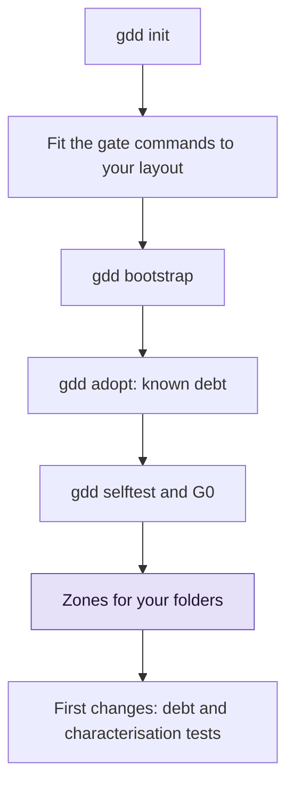

# Bring gdd to an existing project

Set up GDD in a repository that already has code, record what fails today as known debt so it
warns instead of blocking, map your folders to risk colors and plan the first changes.

## Before you start

- gdd and the tools of your stack are installed: see [Install gdd](install.md).
- The repository is a git repository with everything committed, on its main branch.
- You know which stack sheet fits the project: `python`, `rust` or `typescript` (see
  [Stacks](../reference/stacks.md)).
- Read [GDD in one page](../explanation/method.md) if the words gate, zone and change are new.

The whole path looks like this. The steps below follow it in order.



## 1. Run gdd init

`gdd init` writes the harness next to your code. It never overwrites a file, refuses to run in
a folder that is already a GDD project and commits only what it wrote. Name the stack with
`--stack`: gdd uses a stack's detect file (`pyproject.toml`, `Cargo.toml`, `package.json`)
only to decide whether to write a skeleton, and it skips the skeleton of any stack the folder
already has a project of.

```bash
gdd init --name notes --platform cli --stack python --agents claude codex \
  --description "A command-line notes tool" --sensitive "Losing notes"
```

You should see the files it wrote, then the next step:

```text
gdd/project.toml
gdd/commands.toml
gdd/rules.toml
gdd/zones.toml
gdd/models.toml
gdd/generated.toml
docs/brief.md
bin/gdd
.github/workflows/gdd.yml
AGENTS.md
CLAUDE.md
.gitignore
.claude/skills/gdd-build/SKILL.md
...
.agents/skills/gdd-stack-python/SKILL.md
Next: run bin/gdd bootstrap (first install of each stack and its lock file), bin/gdd agents check, then start your agent and run the gdd-setup command (/gdd-setup in Claude Code and OpenCode, $gdd-setup in Codex).
```

No `src/` or `tests/` file appears in the list: the project already had a `pyproject.toml`, so
gdd wrote no skeleton. Files you already had stay yours. When the project already has an
`AGENTS.md`, gdd leaves it and tells you the line to add:

```text
AGENTS.md is yours: add to AGENTS.md a line that sends agents to GDD:
This project works with **GDD · Gate-Driven Development**: work moves forward by passing gates, and
risk decides how many gates and how strict. `bin/gdd` runs the gates.
```

Every option of `gdd init` is in the [command reference](../reference/cli.md#gdd-init). With
agents of one model family only, add `--accept-same-family`; see
[Choose agents and models](agents-and-models.md).

## 2. Fit the gate commands to your layout

The stack sheet assumes its own layout. For Python that is code in `src/<package>/`, unit tests
in `tests/unit/`, scenario steps in `tests/acceptance/` and the gate tools (mypy, Bandit,
import-linter, pytest-bdd, mutmut, vulture) in the dev dependencies. An existing project rarely
matches all of it, and a command that fails for that reason would be recorded as debt in step 4.

1. Print what the sheet expects, from inside the project:

   ```bash
   bin/gdd stacks show python
   ```

2. For each difference, either change the project or change the command in
   `gdd/commands.toml`. For example, to keep unit tests in `tests/`, set `unit` in `[g2]` and
   the `file` of `[selftest]` to that folder. Keys and variables are in
   [Configuration](../reference/configuration.md#commandstoml).
3. Add the tools the commands call to the project. The example project already had pytest and
   Ruff; it adds the others, and keeps pytest below 9.2, because pytest 9.2 breaks pytest-bdd
   9.0.0 (pytest-bdd issue 850). A new project's skeleton has the same cap.

   ```bash
   uv add --dev mypy bandit import-linter pytest-bdd mutmut vulture "pytest>=9.1.1,<9.2"
   ```

   The example project had no scenario steps either. It took `tests/acceptance/` from the
   skeleton a new Python project gets (`__init__.py`, `steps/__init__.py` and
   `test_features.py`, which binds the features to the steps), and the pytest settings they
   need, in `pyproject.toml`:

   ```toml
   [tool.pytest.ini_options]
   pythonpath = ["."]
   bdd_features_base_dir = "features/"
   ```

4. Commit on the main branch. These files are harness: a person changes them on main, never
   inside a change.

> [!NOTE]
> Try each command by hand once (`uv run mypy src`, `cargo clippy ...`). A command that cannot
> start is not debt, it is a setup error, and it is cheaper to fix now.

## 3. Run gdd bootstrap

`gdd bootstrap` runs the first install of each stack, which writes the lock file, and commits
the supply-chain files it created or changed, and nothing else.

```bash
bin/gdd bootstrap
```

You should see:

```text
python: uv lock && uv sync --locked
...
Nothing new to commit.
Next: bin/gdd selftest
```

Here `uv add` had already written the lock file, committed in step 2, so there was nothing new
to commit. A project without a lock file gets `Committed: uv.lock`. Run it once. Later installs
go through the `install` command of `gdd/commands.toml`.

## 4. Record the known debt with gdd adopt

`gdd adopt` runs once each G2 and G3 command that judges the whole project. The ones that fail
become known debt in [`gdd/debt.toml`](../reference/configuration.md#debttoml), committed
alone. A command with known debt runs and warns in every gate but does not block, until a
change makes it pass.

```bash
bin/gdd adopt
```

You should see something like this (from a project with three unused imports, a `noqa` its
Ruff settings do not need, and no import-linter settings):

```text
Passed: types, unit, dependencies, lockfile, security
Known debt: architecture, lint (4)
Proposed Refactors, riskiest first:
  1. debt-architecture · Pay the known debt of architecture · .gdd/adoption/architecture.txt
  2. debt-lint · Pay the known debt of lint · .gdd/adoption/lint.txt
Create one with: bin/gdd new-change debt-<name> --type Refactor --title "..." --paths ...
```

What happened:

- Commands whose names start with `acceptance`, `mutation` or `secrets` never become debt. They
  judge the change or its scenarios, not old code, so they block from day one.
- `lint (4)` has a count: `[count]` in `gdd/commands.toml` tells gdd how to read the number of
  problems from what the command printed. That count is a ceiling, a ratchet. A change that
  reports more fails the gate with the difference; one that reports fewer lowers the ceiling
  when it merges.
- `architecture` has no count, because the sheet has no `[count]` texts for it. A change can
  add to that debt unseen, and `gdd status` says so.
- What each failing command printed is in `.gdd/adoption/<name>.txt`, for the Refactor that
  pays it.

A project is adopted once: a second `gdd adopt` stops with
`this project was already adopted on <day> (gdd/debt.toml)`. When every command passes, adopt
writes nothing.

Check the debt at any time:

```bash
bin/gdd status
```

```text
...
Known debt: architecture (no count: a change can add to it unseen), lint (4)
  - architecture · since 2026-10-30 · Refactor debt-architecture
  - lint · since 2026-10-30 · Refactor debt-lint
...
```

## 5. Run the self-test and open G0

The Setup Gate (G0) opens when the Brief is written and the harness self-test passes 4/4. Run
them right after the adoption: the debt does not need to be paid first.

```bash
bin/gdd selftest
bin/gdd gate G0 ok --by machines
```

You should see:

```text
OK a failing test turns G2 red
OK editing a protected file is blocked (Path Guard and CI)
OK rollback works in pre (simulated)
OK zero scenarios counts as a failure
harness 4/4
G0 ok (machines).
```

The first check judges G2 as G2 does: `architecture` and `lint` still fail, but each is held
to its known debt, so G2 stays green until the self-test plants its failing test, and then
turns red. The check still fails when a G2 command reports more than its known debt, or fails
without any:

```text
KO a failing test turns G2 red (G2 is red without it: lint)
```

It also fails, with the reason, when `gdd/debt.toml` cannot be read. Fix the file and run the
self-test again.

You can also let your agent do this step: the `gdd-setup` command runs the self-test and opens
G0 for you.

## 6. Map your folders to zones

Code that matches no zone is yellow: code without known tests. Turn the sensitive areas you
wrote with `--sensitive` into paths, in `gdd/zones.toml`. The highest color wins, and a red
zone is approved by a person before any change can build.

```toml
[[zone]]
color = "red"
paths = ["src/notes/store.py"]
reason = "Losing notes: the store writes the user's notes"

[[zone]]
color = "green"
paths = ["tests/**"]
reason = "Tests: a wrong test fails loudly and costs nothing in production"
```

Commit on main, then approve the red zones:

```bash
bin/gdd gate zones ok --note "store.py red: it writes the notes"
```

```text
Red zones ok (3 red zone(s)).
```

The count includes the two red zones `gdd init` wrote: the harness and the supply chain. The
full procedure, with how the Orchestrator proposes zones at the end of Discover, is in
[Map and approve red zones](red-zones.md).

## 7. Plan the first changes

Start with the debt, riskiest first, and with tests around the yellow code you are about to
touch.

1. Create one Refactor per debt the adoption proposed:

   ```bash
   bin/gdd new-change debt-lint --type Refactor --title "Pay the known debt of lint" --paths src/notes/store.py
   ```

   Plan concrete paths. In gdd 0.1.0 a planned pattern such as `src/**` is classified by the
   pattern itself, not by the files it covers, so it shows yellow even when a red file is
   inside it. The gates classify again from the paths the change really touched.

2. Yellow and red changes get `tests_first = true`: characterisation tests, which pin down
   what the code does today, are written before the code changes. Ask for them in the change's
   title and scenarios when the code has none.
3. Add the first scenario. An adopted project has none, and G3 fails until one exists:

   ```text
   {"name":"scenarios","tail":"Zero scenarios counts as a failure."}
   ```

   The first change that adds a `.feature` file goes through the Scenario Gate (G1); see
   [Write and approve scenarios](write-scenarios.md).

While the debt is open, every gate reports it. A change that keeps lint at its ceiling passes
with `known_debt` in the report. One that adds problems fails:

```text
lint reports 7, the known debt is 4: 3 more
```

## Next steps

- [Run a change](run-a-change.md): launch the first Refactor and follow it on the Board.
- [Tune the gates](gates-and-commands.md): what each gate runs, by color, and how the ratchet
  counts.
- [Run the gates in CI](ci.md): CI warns on known debt the same way the gates do.
- [Map and approve red zones](red-zones.md): the zone map in depth.
