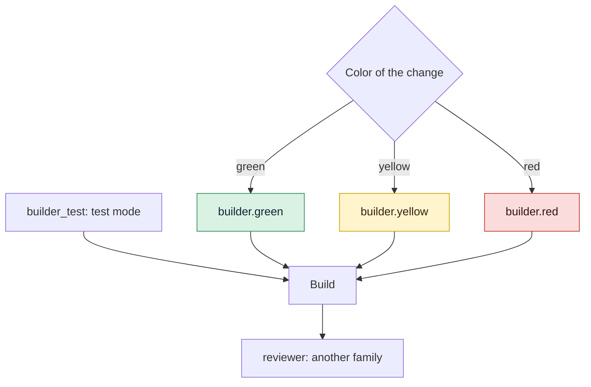

# Choose agents and models

Use this guide when you want to change which coding agent or model plays a role, add an agent
to a project, or price the calls of an agent that reports no cost.

## Before you start

- A GDD project: see [Bring gdd to an existing project](adopt-existing-project.md) or
  [Your first change](../getting-started/tutorial.md).
- The agents you want to use are installed and logged in: Claude Code (`claude`), Codex
  (`codex`) or OpenCode (`opencode`). See [Install gdd](install.md).
- The roles are described in [Roles](../reference/roles.md).

`gdd/models.toml` holds every choice on this page. It is part of the
[harness](../glossary.md#harness), the files gdd uses to check your project, so no agent may
edit it. Change it yourself, on the main branch, between changes.

## 1. See who plays each role

[`gdd init`](../reference/cli/init.md) fills `gdd/models.toml` from the agents you picked in the
form (or named with `--agents`), else from those whose program is on the `PATH`. The first
agent orchestrates and builds. The Reviewer is the first agent of another model family. With
`--agents claude codex`:

```toml
[orchestrator]
integration = "claude"
model = "opus"

[builder.green]
integration = "claude"
model = "haiku"

[builder.yellow]
integration = "claude"
model = "sonnet"

[builder.red]
integration = "claude"
model = "opus"

[builder_test]
integration = "claude"
model = "sonnet"

[reviewer]
integration = "codex"
model = "gpt-6-astra"
effort = "high"

[families]
"claude" = "anthropic"
"codex" = "openai"
```

The [color](../glossary.md#color) of a change picks the Builder's model in build mode: a light
model for green work, a standard one for yellow and the strongest for red. Test mode, the
Reviewer and the Orchestrator have one model each, whatever the color:



To see what a given change will get, classify it with
[`gdd classify`](../reference/cli/classify.md):

```bash
gdd classify CHANGE
```

The JSON (JavaScript Object Notation) output names each role's table (`builder`,
`builder_test`, `reviewer_model`, `orchestrator`) and the `builder_session` setting of step 4.

## 2. Change an agent or a model

To change who plays a role, edit the table of the role. `integration` is the agent (`claude`,
`codex` or `opencode`). `model` is a name that agent accepts: an alias such as `sonnet` for
Claude Code, a model id for Codex, `provider/model` for OpenCode. For example, a cheaper Builder
for green work through OpenCode:

```toml
[builder.green]
integration = "opencode"
model = "minimax/MiniMax-M3"
```

If the model name has a new prefix, or the agent is new, add its family to `[families]`
(step 3). If the agent is new, install its commands too (step 5).

If you use Codex, `effort` sets its reasoning effort (`low`, `medium`, `high`, `xhigh`), which
gdd passes as `-c model_reasoning_effort=<effort>`. Other agents ignore the key.

## 3. Keep the Reviewer in another model family

The Reviewer must be of another [model family](../glossary.md#model-family) than the Builder,
so that it does not miss the same mistakes;
[Keeping agents honest](../explanation/safety.md#layer-2-judges-the-builder-cannot-reach)
explains why. gdd finds a model's family in `[families]`: the first key its model name starts
with, or that equals its integration.

```toml
[families]
"claude" = "anthropic"
"codex" = "openai"
"minimax" = "minimax"
```

[`gdd prepare`](../reference/cli/prepare.md), the first step of every launch, refuses a change
whose Reviewer is of the Builder's family:

```text
error: Reviewer and Builder are the same model family: edit gdd/models.toml.
```

If you only have agents of one family, accept it once, knowingly, when you run init:

```bash
gdd init --name notes --platform cli --stack python --agents claude --accept-same-family
```

Without the flag, init stops:

```text
error: one model family only (anthropic): the Reviewer would share the Builder's blind spots. Install an agent of another family (OpenCode takes models from many providers) or run again with --accept-same-family.
```

With it, the Reviewer's table records the day you accepted:

```toml
[reviewer]
integration = "claude"
model = "opus"
same_family_accepted = "2026-10-30"   # the human accepted one model family only
```

In an existing project, add the same `same_family_accepted = "YYYY-MM-DD"` line by hand.
When a second family becomes available, replace the Reviewer.
[`gdd status`](../reference/cli/status.md) tells you when it finds one on the machine:

```text
A second model family is on this machine (codex, opencode): set it as the Reviewer in gdd/models.toml
```

## 4. Share one Builder session (optional)

By default, test mode and build mode run in separate sessions: build mode starts fresh and
reads what test mode wrote. If you want build mode to continue test mode's conversation, and
each later round to continue it too, set:

```toml
[session]
builder = "shared"   # or "separate", the default
```

Path Guard, mutation testing and the Reviewer stay as they are. The Reviewer never joins the
Builder's session.

A shared session works only if test mode and build mode use the same agent and that agent's
sheet says how to resume a session, which today is Claude Code only. Otherwise the sessions
stay separate and `gdd status` says why:

```text
Builder session: shared is set, but test mode (claude) and build mode (codex) use different agents: the sessions stay separate
```

Any other value stops every command that reads the file:

```text
error: gdd/models.toml: invalid TOML: session.builder must be separate or shared, not "one"
```

> [!NOTE]
> Measured on gdd's own repository (40 runs): the shared session used 21% fewer new tokens and
> 7% less time, with quality within the noise. That is why it is a choice, not the default.
> See [features/builder-session.feature](../../features/builder-session.feature).

## 5. Install the GDD commands in each agent

Each agent finds the GDD commands (`gdd-setup`, `gdd-change`, `gdd-build`, `gdd-review`...)
and the instructions of each stack (`gdd-stack-<name>`) in its own folder. `gdd init` wrote
them once. After you edit `gdd/models.toml` or upgrade gdd, write them again with
[`gdd agents`](../reference/cli/agents.md):

```bash
gdd agents install
```

Without `--agent`, it writes for every `integration` of `gdd/models.toml`. It prints the paths
as JSON and writes no other file, so your own skills and commands stay.

| Agent | Files it gets | How you call a command |
|---|---|---|
| Claude Code | `.claude/skills/gdd-<command>/SKILL.md` | `/gdd-status` |
| Codex | `.agents/skills/gdd-<command>/SKILL.md` | `$gdd-status` |
| OpenCode | `.opencode/commands/gdd-<command>.md` | `/gdd-status` |

To add an agent the models file does not use yet:

```bash
gdd agents install --agent opencode
```

```text
{"ok":true,"written":[".opencode/commands/gdd-build.md",".opencode/commands/gdd-build-test.md",...,".opencode/commands/gdd-stack-python.md"]}
```

`install` does not commit. These folders are harness, in a red zone: review and commit them
yourself, on main.

To check that nothing was edited or lost:

```bash
gdd agents check
```

```text
error: .claude/skills/gdd-report/SKILL.md: missing
error: .claude/skills/gdd-status/SKILL.md: differs from what gdd writes
```

It exits with 1 and names every file. After `install` it prints `{"ok":true}`. Each file says
at the top that it is generated, so edits there are lost.

Agent sheets (where each agent keeps its commands, how gdd launches it, what each role may do)
are built into gdd. An agent without a sheet is refused (`no agent sheet`).

Whatever an agent's own permissions allow, an agent that gdd started may run only `gdd g2`,
`gdd guard`, `gdd note`, `gdd status`, `gdd classify`, `gdd inbox`, `gdd report` and
`gdd scope`. gdd refuses every other command from it. See
[What an agent may run](../reference/roles.md#what-an-agent-may-run).

## 6. Fill in prices for estimates

gdd logs the tokens and the cost of every agent call. Each agent reports them in its own way:

| Agent | Tokens | Cost |
|---|---|---|
| Claude Code | yes | yes, its own client-side estimate |
| Codex | yes | no |
| OpenCode | yes | yes (it does not report the model: the log keeps the one gdd asked for) |

If an agent reports no cost, add the prices of its model to `[prices.<model>]`, in US dollars
(USD) per million tokens, and gdd computes the cost:

```toml
[prices.gpt-6-astra]
input = 0.0    # per million input tokens not read from the cache
cache = 0.0    # per million input tokens read from the cache
output = 0.0   # per million output tokens
```

Copy the numbers from the provider's price page; never guess them. Without prices, those calls
log 0 USD. If you pay by subscription, the cost is only an estimate, so compare tokens instead.
See [Measure the work](measure.md).

## 7. Other agent settings

Secrets: agents never get a variable with a secret word in its name (`KEY`, `TOKEN`, `SECRET`,
`PASS`, `PASSWORD`, `CREDENTIALS`, `DSN` and a few more) or a URL with a password as its value.
If an agent needs one, name it in `[env] pass = ["NAME"]` in `gdd/models.toml`.
[Environment variables](../reference/environment.md#which-variables-hold-a-secret) has the full
rule.

Time limit: an agent call may last `agent_timeout_s` seconds, 3600 by default. If calls need
more time, raise it in `[limits]` of `gdd/rules.toml`.

Every key is in [Configuration](../reference/configuration.md#modelstoml).

## Next steps

- [Tune the gates](gates-and-commands.md): what the machines check around the agents.
- [Measure the work](measure.md): tokens and cost by role, model and agent.
- [Keeping agents honest](../explanation/safety.md): why the Reviewer is of another family and
  what each role may touch.
