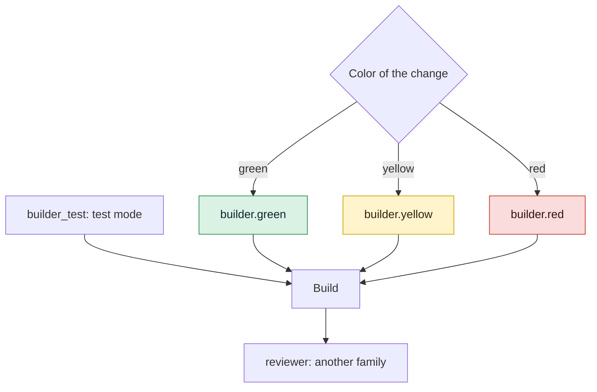

# Choose agents and models

Decide which coding agent and which model plays each role, per risk color, keep the Reviewer
in another model family, install the GDD commands in each agent's folder and tell gdd how to
price calls that report no cost.

## Before you start

- A GDD project: see [Bring gdd to an existing project](adopt-existing-project.md) or
  [Your first change](../getting-started/tutorial.md).
- The agents you want to use are installed and logged in: Claude Code (`claude`), Codex
  (`codex`) or OpenCode (`opencode`). See [Install gdd](install.md).
- The roles are described in [Roles](../reference/roles.md).

`gdd/models.toml` holds every choice on this page. It is harness, protected from every agent:
change it on the main branch, as a person, between changes.

## 1. See who plays each role

`gdd init` fills `gdd/models.toml` from the agents you named with `--agents`, or from those
whose program is on the `PATH`. The first agent orchestrates and builds; the Reviewer is the
first agent of another model family. With `--agents claude codex`:

```toml
[orchestrator]
integration = "claude"
model = "opus"

[builder.green]
integration = "claude"
model = "haiku"

[builder.yellow]
integration = "claude"
model = "sonnet"

[builder.red]
integration = "claude"
model = "opus"

[builder_test]
integration = "claude"
model = "sonnet"

[reviewer]
integration = "codex"
model = "gpt-6-astra"
effort = "high"

[families]
"claude" = "anthropic"
"codex" = "openai"
```

The color of a change picks the Builder in build mode: a light model for green work, a
standard one for yellow and the strongest for red. Test mode, the Reviewer and the
Orchestrator have one model each, whatever the color.



To see what a given change will get, classify it:

```bash
bin/gdd classify CHANGE
```

The JSON names each role's table: `builder`, `builder_test`, `reviewer_model`,
`orchestrator`, plus `builder_session`.

## 2. Change an agent or a model

Edit the table of the role. `integration` is the agent (`claude`, `codex` or `opencode`) and
`model` is a name that agent accepts: an alias such as `sonnet` for Claude Code, a model id
for Codex, `provider/model` for OpenCode. For example, a cheaper Builder for green work through
OpenCode:

```toml
[builder.green]
integration = "opencode"
model = "minimax/MiniMax-M3"
```

Then add the family of any new prefix or agent to `[families]` (step 3) and install the
commands of any new agent (step 5).

`effort` sets Codex's reasoning effort (`low`, `medium`, `high`, `xhigh`), which gdd passes as
`-c model_reasoning_effort=<effort>`. Only the Codex sheet says how to pass it: on another
agent the key is ignored.

## 3. Keep the Reviewer in another model family

The Reviewer must not share the Builder's blind spots, so it must be of another model family.
gdd finds a model's family in `[families]`: the first key its model name starts with, or that
equals its integration.

```toml
[families]
"claude" = "anthropic"
"codex" = "openai"
"minimax" = "minimax"
```

`gdd prepare`, the first step of every launch, refuses a change whose Reviewer is of the
Builder's family:

```text
error: Reviewer and Builder are the same model family: edit gdd/models.toml.
```

When you only have agents of one family, accept it once, knowingly. At init:

```bash
gdd init --name notes --platform cli --stack python --agents claude --accept-same-family
```

Without the flag, init stops:

```text
error: one model family only (anthropic): the Reviewer would share the Builder's blind spots. Install an agent of another family (OpenCode takes models from many providers) or run again with --accept-same-family.
```

With it, the Reviewer's table records the day you accepted:

```toml
[reviewer]
integration = "claude"
model = "opus"
same_family_accepted = "2026-10-30"   # the human accepted one model family only
```

In an existing project, add the same `same_family_accepted = "YYYY-MM-DD"` line by hand.
Replace the Reviewer as soon as a second family is available. `gdd status` notices one on the
machine:

```text
A second model family is on this machine (codex, opencode): set it as the Reviewer in gdd/models.toml
```

## 4. Share one Builder session (optional)

By default test mode and build mode run in separate sessions: build mode starts fresh and reads
what test mode wrote. You can make build mode continue test mode's conversation instead, and
each later round continue it too:

```toml
[session]
builder = "shared"   # or "separate", the default
```

Path Guard still checks each mode, and mutation testing and the Reviewer stay as they are. The
Reviewer never joins the Builder's session.

It works only when test mode and build mode use the same agent and that agent's sheet says how
to resume a session, which today is Claude Code only. Otherwise the sessions stay separate and
`gdd status` says why:

```text
Builder session: shared is set, but test mode (claude) and build mode (codex) use different agents: the sessions stay separate
```

Any other value stops every command that reads the file:

```text
error: gdd/models.toml: invalid TOML: session.builder must be separate or shared, not "one"
```

> [!NOTE]
> Measured on gdd's own repository (40 runs): the shared session used 21% fewer new tokens and
> 7% less time, with quality within the noise. That is why it is a choice, not the default.
> See [features/builder-session.feature](../../features/builder-session.feature).

## 5. Install the GDD commands in each agent

Each agent finds the GDD commands (`gdd-setup`, `gdd-change`, `gdd-build`, `gdd-review`...)
and the instructions of each stack (`gdd-stack-<name>`) in its own folder. `gdd init` wrote
them once; write them again after editing `gdd/models.toml` or upgrading gdd:

```bash
bin/gdd agents install
```

Without `--agent`, it writes for every `integration` of `gdd/models.toml`. It prints the paths
as JSON and writes no other file: your own skills and commands stay.

| Agent | Files it gets | How you call a command |
|---|---|---|
| Claude Code | `.claude/skills/gdd-<command>/SKILL.md` | `/gdd-status` |
| Codex | `.agents/skills/gdd-<command>/SKILL.md` | `$gdd-status` |
| OpenCode | `.opencode/commands/gdd-<command>.md` | `/gdd-status` |

To add an agent the models file does not use yet:

```bash
bin/gdd agents install --agent opencode
```

```text
{"ok":true,"written":[".opencode/commands/gdd-build.md",".opencode/commands/gdd-build-test.md",...,".opencode/commands/gdd-stack-python.md"]}
```

`install` does not commit. These folders are harness (red zone): review and commit them on
main.

Check that nothing was edited or lost:

```bash
bin/gdd agents check
```

```text
error: .claude/skills/gdd-report/SKILL.md: missing
error: .claude/skills/gdd-status/SKILL.md: differs from what gdd writes
```

It exits with 1 and names every file; after `install` it prints `{"ok":true}`. Each file says
at the top that it is generated: edits there are lost. The agent sheets themselves (where each
agent keeps its commands, how gdd launches it, what each role may do) are built into gdd; an
agent without a sheet is refused (`no agent sheet`).

## 6. Fill in prices for estimates

Each agent reports what a call used in its own way. gdd logs it per call:

| Agent | Tokens | Cost |
|---|---|---|
| Claude Code | yes | yes, its own client-side estimate |
| Codex | yes | no |
| OpenCode | yes | yes (it does not report the model: the log keeps the one gdd asked for) |

For an agent that reports no cost, gdd computes one from `[prices.<model>]`, in US dollars per
million tokens:

```toml
[prices.gpt-6-astra]
input = 0.0    # per million input tokens not read from the cache
cache = 0.0    # per million input tokens read from the cache
output = 0.0   # per million output tokens
```

Copy the numbers from the provider's price page; never guess them. Without prices, those calls
log 0 USD. With a subscription the cost is notional anyway: compare tokens. See
[Measure the work](measure.md).

## 7. Other agent settings

- **Secrets.** Agents never get a variable with a secret word in its name (`KEY`, `TOKEN`,
  `SECRET`, `PASS`, `PASSWORD`, `CREDENTIALS`, `DSN` and a few more) or a URL with a password
  as its value. Pass one on purpose with `[env] pass = ["NAME"]` in `gdd/models.toml`.
  [Environment variables](../reference/environment.md#which-variables-hold-a-secret) has the
  full rule.
- **Time to answer.** An agent call may last `agent_timeout_s` seconds, 3600 by default, set in
  `[limits]` of `gdd/rules.toml`.

Every key is in [Configuration](../reference/configuration.md#modelstoml).

## Next steps

- [Tune the gates](gates-and-commands.md): what the machines check around the agents.
- [Measure the work](measure.md): tokens and cost by role, model and agent.
- [Keeping agents honest](../explanation/safety.md): why the Reviewer is of another family and
  what each role may touch.
