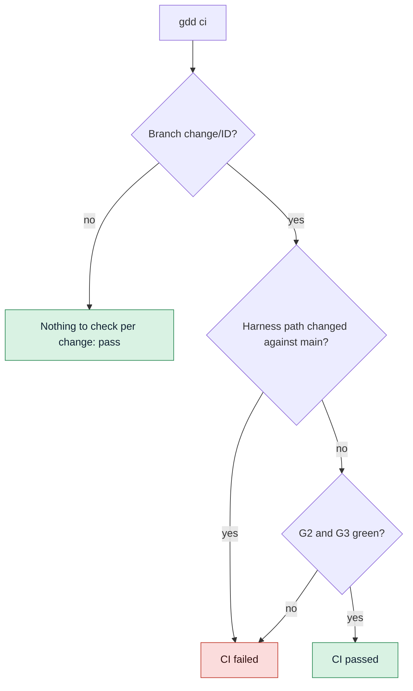

# Run the gates in CI

Use this guide to run the gates in CI (continuous integration) on GitHub Actions, on every push
and pull request. Then the gates block a change even if an agent or a person skips a step on
their machine.

## Before you start

- A GDD project set up with [`gdd init`](../reference/cli/init.md), pushed to a GitHub
  repository.
- Its self-test passes locally: [`gdd selftest`](../reference/cli/selftest.md) says
  `harness 4/4`.
- Changes run on branches named `change/<id>`, as
  [`gdd new-change`](../reference/cli/new-change.md) makes them: see [Describe a change to your
  agent](run-a-change.md).

## 1. Look at the workflow gdd init wrote

`gdd init` already wrote the workflow, `.github/workflows/gdd.yml`. For a Python project it is:

```yaml
name: gdd
# Written by gdd init 0.1.0. G2 and G3 in CI: they block even if an agent skips a step.
on:
  pull_request:
  push:
    branches: ["main", "change/**"]

jobs:
  gates:
    runs-on: ubuntu-latest
    steps:
      - uses: actions/checkout@v4
        with:
          fetch-depth: 0
      - uses: astral-sh/setup-uv@v7
      - name: Install the Python dependencies
        run: uv sync --locked
      - name: Install OSV-Scanner (checksum verified)
        run: |
          ...
      - name: Install gitleaks (checksum verified)
        run: |
          ...
      - name: Install gdd 0.1.0
        run: cargo install --locked --git https://github.com/MarsGotta/gdd --tag v0.1.0 gdd
      - name: GDD gates (Path Guard, G2, G3)
        run: gdd ci
```

Two lines matter most:

- `gdd ci`, the last line, runs the gates.
- `fetch-depth: 0` fetches the whole history, which [`gdd ci`](../reference/cli/ci.md) needs
  to compare the branch with the main branch.

The steps before `Install gitleaks` come from the `[ci] setup` of each stack sheet: Rust gets
its toolchain, cargo-deny and cargo-mutants, and TypeScript gets Node.

The workflow is part of the [harness](../glossary.md#harness), the files gdd uses to check your
project, so it sits in a red zone that no agent may edit. If you change it, change it yourself,
on main, and keep the `gdd ci` line: the self-test checks that CI runs the gates.

## 2. Make sure CI can install gdd

The workflow installs gdd from the git tag `v<version>` in the gdd repository, where
`<version>` is the version of gdd that wrote the file. The next step runs that `gdd`. A workflow
written by an older gdd keeps its older gates line, which the self-test still accepts.

> [!WARNING]
> The install step needs the tag `v0.1.0` to exist in the gdd repository. Until it is
> published, the step fails. Meanwhile, install from a commit you trust:
> `cargo install --locked --git https://github.com/MarsGotta/gdd --rev COMMIT gdd`.

When you upgrade gdd, [`gdd upgrade`](../reference/cli/upgrade.md) proposes the new version of
this line along with the rest of the file; see [Upgrade gdd in a project](upgrade.md).

## 3. Know what gdd ci checks

`gdd ci` runs [Path Guard](../glossary.md#path-guard), the Loop Gate (G2) and the Merge Gate
(G3), but only on change branches. It reads the branch from `GITHUB_HEAD_REF` (set on pull
requests), else it takes the current branch:



1. **Any other branch** passes at once:

   ```text
   Branch main: nothing to check per change.
   ```

2. **On `change/<id>`**, it lists what the branch committed since it left the main branch
   (`origin/main` when the repository has it). It fails on any harness path: `gdd/`,
   `.github/`, the agents' folders and the other paths of `[protected] all`. The first line
   names the file:

   ```text
   gdd/rules.toml: harness path changed inside a change
   G2 red: acceptance
   G3 red: acceptance_full
   CI failed
   ```

3. Then it runs G2 and G3 as [`gdd g2`](../reference/cli/g2.md) and
   [`gdd g3`](../reference/cli/g3.md) run them, on a change classified from those paths. A
   green change:

   ```text
   G2 green
   G3 green
   CI passed
   ```

`gdd ci` uses only what the repository holds, never your local records, approvals or log under
`.gdd/`. So in CI the harness paths replace the per-role Path Guard. `gdd ci` exits with 1 when
CI fails.

[Known debt](../glossary.md#known-debt) warns in CI as it does in the gates. With one lint
problem against a recorded ceiling of 3:

```text
G2 green · known debt still failing: lint
```

If a command reports more than its ceiling, the gate turns red. See
[Tune the gates](gates-and-commands.md#6-count-known-debt-with-the-ratchet).

## 4. Try it before you push

To catch a failure before CI does, run the same check on your machine:

1. Commit everything: `gdd ci` judges only what the branch committed.
2. If gdd is running the change, go to its worktree instead (by default the sibling folder
   `<repo>.worktrees/CHANGE`), where the branch is already checked out.
3. Switch to the change's branch and run `gdd ci`:

```bash
git switch change/CHANGE
gdd ci
```

On a pull request, GitHub checks out a merge commit rather than the branch, so it sets
`GITHUB_HEAD_REF` to the branch name for `gdd ci` to read.

## 5. Add checks of your own (optional)

If you want more checks, add steps to the workflow yourself, on main. For example, to check
that `CHANGELOG.md` covers every change on main, after the gates:

```yaml
      - name: Changelog covers every change
        if: github.ref == 'refs/heads/main'
        run: gdd changelog --check
```

See [Release versions and keep a
changelog](releases-and-changelog.md#6-check-the-changelog-in-ci-optional).

If you want gdd to push main after the Merge Gate, set `push_main = true` in `gdd/rules.toml`
once the repository has a remote and this workflow. The default is `false`.

## Next steps

- [Tune the gates](gates-and-commands.md): the commands CI runs are the same as local ones.
- [Upgrade gdd in a project](upgrade.md): a new gdd version updates this workflow on a branch.
- [Keeping agents honest](../explanation/safety.md): why a change never edits the harness.
