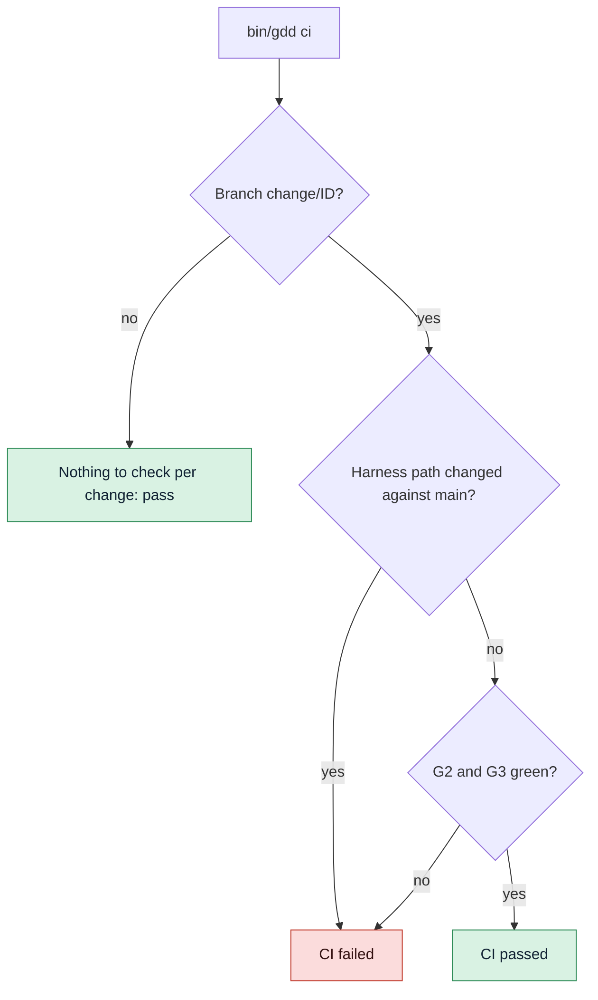

# Run the gates in CI

Make every push and pull request run Path Guard, G2 and G3 on GitHub Actions, so the gates
block even when an agent or a person skips a step on their machine.

## Before you start

- A GDD project set up with `gdd init`, pushed to a GitHub repository.
- Its self-test passes locally: `bin/gdd selftest` says `harness 4/4`.
- Changes run on branches named `change/<id>`, as `gdd new-change` makes them: see
  [Run a change](run-a-change.md).

## 1. Look at the workflow gdd init wrote

`gdd init` wrote `.github/workflows/gdd.yml`. For a Python project it is:

```yaml
name: gdd
# Written by gdd init 0.1.0. G2 and G3 in CI: they block even if an agent skips a step.
on:
  pull_request:
  push:
    branches: ["main", "change/**"]

jobs:
  gates:
    runs-on: ubuntu-latest
    steps:
      - uses: actions/checkout@v4
        with:
          fetch-depth: 0
      - uses: astral-sh/setup-uv@v7
      - name: Install the Python dependencies
        run: uv sync --locked
      - name: Install OSV-Scanner (checksum verified)
        run: |
          ...
      - name: Install gitleaks (checksum verified)
        run: |
          ...
      - name: Install gdd 0.1.0
        run: cargo install --locked --git https://github.com/MarsGotta/gdd --tag v0.1.0 gdd
      - name: GDD gates (Path Guard, G2, G3)
        run: bin/gdd ci
```

The steps before `Install gitleaks` come from the `[ci] setup` of each stack sheet: Rust gets
its toolchain, cargo-deny and cargo-mutants; TypeScript gets Node. `fetch-depth: 0` matters:
`gdd ci` compares the branch with the main branch, so it needs the history.

The workflow is harness, in a red zone and protected from every agent. Change it on main, as a
person. Keep the `bin/gdd ci` line: the self-test checks that CI runs the gates.

## 2. Make sure CI can install gdd

The workflow installs gdd from its git tag `v<version>` in the gdd repository, the version that
wrote the file. `bin/gdd` then runs the `gdd` on the `PATH` (or the program `GDD_BIN` names).

> [!WARNING]
> The install step needs the tag `v0.1.0` to exist in the gdd repository. Until it is
> published, the step fails. Meanwhile, install from a commit you trust:
> `cargo install --locked --git https://github.com/MarsGotta/gdd --rev COMMIT gdd`.

When you upgrade gdd, `gdd upgrade` proposes the new version of this line along with the rest
of the file; see [Upgrade gdd in a project](upgrade.md).

## 3. Know what gdd ci checks

`gdd ci` decides by branch. It reads the branch from `GITHUB_HEAD_REF` (set on pull requests),
else the current branch.



1. **Any other branch** passes at once:

   ```text
   Branch main: nothing to check per change.
   ```

2. **On `change/<id>`**, it lists what the branch committed since it left the main branch
   (`origin/main` when the repository has it), and fails on any harness path: `gdd/`, `bin/`,
   `.github/`, the agents' folders and the other paths of `[protected] all`. A change never
   edits the gates that judge it.

   ```text
   bin/gdd: harness path changed inside a change
   G2 green
   G3 red: scenarios
   CI failed
   ```

3. Then it runs G2 and G3 as `gdd g2` and `gdd g3` run them, on a change classified from those
   paths. A green change:

   ```text
   G2 green
   G3 green
   CI passed
   ```

`gdd ci` reads and writes nothing under `.gdd/`: CI has only what the repository holds, never
your local records, approvals or log. Without a change record there is no Path Guard per role;
the harness paths stand for it. It exits with 1 when CI fails.

Known debt warns in CI as it does in the gates. With one lint problem against a recorded
ceiling of 3:

```text
G2 green · known debt still failing: lint
```

A command that reports more than its ceiling turns the gate red. See
[Tune the gates](gates-and-commands.md#6-count-known-debt-with-the-ratchet).

## 4. Try it before you push

Run the same check on your machine, on the change's branch, with everything committed. While
the recipe runs a change, its branch is checked out in its own worktree (by default the sibling
folder `<repo>.worktrees/CHANGE`): run it there instead.

```bash
git switch change/CHANGE
bin/gdd ci
```

`gdd ci` judges what the branch committed, so commit first. On a pull request GitHub sets
`GITHUB_HEAD_REF` to the branch name, because the checkout there is not on the branch itself.

## 5. Add checks of your own (optional)

Add steps to the workflow, on main, as a person. For example, to keep `CHANGELOG.md` complete
on main, after the gates:

```yaml
      - name: Changelog covers every change
        if: github.ref == 'refs/heads/main'
        run: bin/gdd changelog --check
```

See [Release versions and keep a changelog](releases-and-changelog.md#6-check-the-changelog-in-ci-optional).

`push_main = false` in `gdd/rules.toml` keeps gdd from pushing main after the Merge Gate. Set
it to `true` once the repository has a remote and this workflow.

## Next steps

- [Tune the gates](gates-and-commands.md): the commands CI runs are the same as local ones.
- [Upgrade gdd in a project](upgrade.md): a new gdd version updates this workflow on a branch.
- [Keeping agents honest](../explanation/safety.md): why a change never edits the harness.
