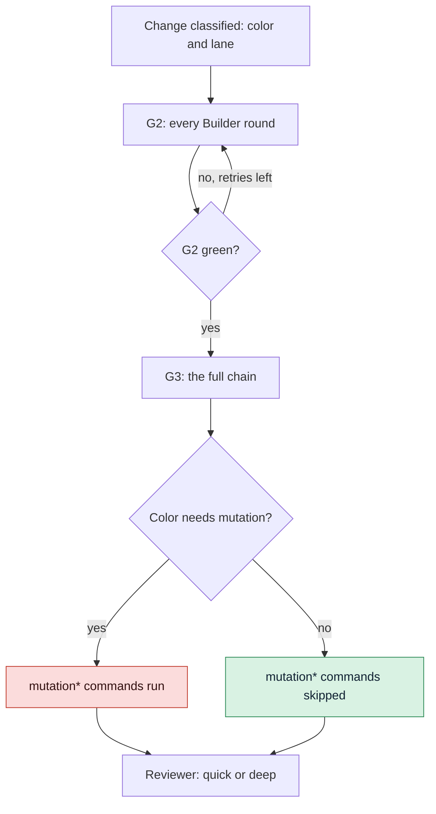

# Tune the gates

Change what the Loop Gate (G2) and the Merge Gate (G3) check, how strict each risk color is and
how long a check may run. Use this guide when a gate is too slow, misses a kind of bug your
project has, or blocks something you have decided to accept.

## Before you start

- A GDD project whose self-test passes: [`gdd selftest`](../reference/cli/selftest.md) says
  `harness 4/4`.
- You know what each gate is for: see [Gates](../reference/gates.md) and
  [How risk picks the gates](../explanation/risk.md).

## What each gate command protects

Each command of a [gate](../glossary.md#gate) guards against one problem. G2 runs the fast
ones after every round of the Builder, and G3 runs the slow ones before the merge:

| Command | Gate | What it protects you from |
|---|---|---|
| `lint` | G2 | Inconsistent style and the simple bugs a linter (a tool that reads code without running it) spots |
| `types` | G2 | Values of the wrong type, caught before anything runs |
| `unit` | G2 | Breaking a function that worked |
| `acceptance` | G2 | A change that does not do what its scenarios say |
| `architecture` | G2 | Code reaching across a boundary it should not, such as the package importing its tests |
| `acceptance_full` | G3 | Breaking another scenario, or passing only the examples the Builder could see |
| `lockfile` | G3 | A lock file (the exact versions of every dependency) that does not match the manifest |
| `security` | G3 | Unsafe code patterns and dependencies with known vulnerabilities |
| `dependencies` | G3 | Shipping a dependency whose license you cannot use |
| `secrets` | G3 | A password or token committed in the change |
| `mutation` | G3 | Tests that run the code without checking what it does |

Every [stack sheet](../reference/stacks.md), the tools gdd keeps for each language, uses these
names. [Gates](../reference/gates.md) lists the checks a gate runs besides them.

Two files hold the gates: `gdd/commands.toml` says what runs, and `gdd/rules.toml` says what
each color gets. Both are [harness](../glossary.md#harness), the files gdd uses to check your
project, so no agent may touch them. Change them yourself on the main branch, then run
`gdd selftest`.

In the diagram, follow a change from G2 to the Reviewer: the color decides whether the
mutation commands run.



## 1. See what the gates run today

[`gdd init`](../reference/cli/init.md) composed `gdd/commands.toml` from your stack sheets.
Each key of `[g2]` and `[g3]` is a command name, and each value is a shell command:

```toml
[g2]
lint = "uv run ruff check . && uv run ruff format --check ."
types = "uv run mypy src"
unit = "uv run pytest -q tests/unit"
acceptance = "uv run pytest -q tests/acceptance || [ $? -eq 5 ]"
architecture = "uv run lint-imports"

[g3]
acceptance_full = "GDD_FEATURES= GDD_HIDDEN=1 uv run pytest -q tests/acceptance || [ $? -eq 5 ]"
lockfile = "uv lock --check"
security = "uv run bandit -q -r src && osv-scanner scan source -L uv.lock"
dependencies = "..."
secrets = "BASE=$(git rev-parse -q --verify main || git rev-parse origin/main) && ..."
mutation = "set -f; P=$(printf '%s\n' \"$GDD_DIFF_FILES\" | ...)"
```

To compare your file with what a stack sheet gives, run
[`gdd stacks`](../reference/cli/stacks.md) from inside the project:

```bash
gdd stacks show python
gdd stacks compose python typescript
```

`compose` prints, as TOML, the commands several sheets give together, and writes nothing. With
more than one stack, each name carries its stack: `lint-python`, `lint-typescript`.

## 2. Change a gate command

1. Edit the command in `gdd/commands.toml`. Every command runs with `sh -c` from the project
   root and gets these variables:

   | Variable | What it holds |
   |---|---|
   | `GDD_CHANGE` | The id of the change |
   | `GDD_COLOR` | `green`, `yellow` or `red` |
   | `GDD_DIFF_FILES` | The paths the change touched (or plans, while it touched none), one per line |
   | `GDD_FEATURES` | The change's `.feature` files, one per line; empty means none |

2. Keep the rules a command name carries:
   - A command whose name starts with `mutation` runs only when the color asks for mutation
     testing. Otherwise the report lists it under `skipped`.
   - Names starting with `acceptance`, `mutation` or `secrets` can never become known debt.
   - An empty command (`types = ""`) is not configured and does not run. A gate with no
     command at all fails.
3. Try the command by hand, commit on main, then run:

   ```bash
   gdd selftest
   ```

   The first check plants a failing test and expects G2 to turn red. A G2 that cannot fail is
   refused.

A gate prints its report as JSON. Besides your commands, it lists the checks of its own, such
as `path-guard`:

```text
{"ok":true,"gate":"G3","color":"yellow","passed":["acceptance_full","dependencies","lockfile","secrets","security","path-guard","scenarios (1)","exceptions"],"skipped":["mutation"],"failures":[],"out_of_scope":[]}
```

`ok` says whether the gate passed, and `failures` says why when it did not. Here `mutation` is
under `skipped` because a yellow change does not ask for it.

## 3. Decide what each color gets

`gdd/rules.toml` has one table per color and lane. A new project starts with these values:

| Key | green fast | green full | yellow fast | yellow full | red full |
|---|---|---|---|---|---|
| `tests_first` | false | true | true | true | true |
| `mutation` | false | false | false | false | **true** |
| `reviewer` | false | true | true | true | **true** |
| `g4_if_g1` | false | true | false | true | **true** |
| `review` | quick | quick | quick | quick | **deep** |

The bold cells are the [core](../glossary.md#core) of GDD: no rules file can switch them off.
[Red has a core that no file can switch
off](../explanation/risk.md#red-has-a-core-that-no-file-can-switch-off) explains why.

To run mutation testing on yellow changes too, set it in both yellow tables:

```toml
[color.yellow.full]
tests_first = true
mutation = true
reviewer = true
g4_if_g1 = true
review = "quick"
```

To ask for a deep review in green or yellow too, set `review = "deep"`. A quick review reads
the files the change touched, its package and its scenarios. A deep one also reads the code
around the change.

Every command that reads the rules file refuses one that switches the core off for red:

```text
error: gdd/rules.toml: red changes always get mutation testing, the Reviewer and the human G4 (the core of GDD): remove color.red.full.mutation = false from gdd/rules.toml
```

It refuses a depth other than `quick` or `deep` too:

```text
error: gdd/rules.toml: review must be quick or deep: color.yellow.full.review = "medium" in gdd/rules.toml
```

Check the result on a real change with [`gdd classify`](../reference/cli/classify.md):

```bash
gdd classify CHANGE
```

The JSON shows `tests_first`, `mutation`, `reviewer`, `review` and `g4` for that change.

## 4. Set retries and time limits

The limits live in `[limits]` of `gdd/rules.toml`:

```toml
[limits]
builder_retries = 3      # Builder rounds against G2
replans = 1              # Orchestrator replans per stuck change
command_seconds = 1800   # how long each gate and release command may run
```

When a command runs past `command_seconds`, gdd kills it with everything it started, and the
gate fails with:

```text
# The failure text, as features/mutation-speed.feature checks it with command_seconds = 1
timed out (1s): raise limits.command_seconds in gdd/rules.toml
```

The value must be a whole number of seconds above 0. On a slow or busy machine, raise it
instead of removing checks. Agent calls have their own limit, `agent_timeout_s` (3600 by default).

## 5. Keep mutation testing fast

Mutation testing, which plants small bugs and expects a test to catch each one, is the slowest
check of G3. The sheets already run it on the change's diff only:

- Python (mutmut) mutates the modules of `src/` listed in `GDD_DIFF_FILES`.
- Rust (cargo-mutants) mutates the diff against the main branch. It is faster with mold
  installed, and it gives mutants that only timed out a second chance; see the
  [rust sheet](../reference/stacks.md#rust).

If mutation testing still runs past the time limit, raise `command_seconds` (step 4), or avoid
two changes in G3 at once.

When the project has no mutation command, red changes go without it, and
[`gdd status`](../reference/cli/status.md) says so:

```text
no mutation testing command in [g3] of gdd/commands.toml: red changes go without it
```

## 6. Count known debt with the ratchet

[Known debt](../glossary.md#known-debt) is what failed on day one in a project adopted with
[`gdd adopt`](../reference/cli/adopt.md), recorded in `gdd/debt.toml`; it warns instead of
blocking. The [ratchet](../glossary.md#ratchet) lets that debt shrink but never grow. To make it
work, tell gdd in `[count]` of `gdd/commands.toml` how to read how many problems a command
reported:

```toml
[count]
lint = ["Found {n} error", "{n} file would be reformatted", "{n} files would be reformatted"]
types = ["Found {n} error"]
unit = ["{n} failed", "{n} error"]
```

A text with `{n}` adds up the number at each place it matches. A text without it counts the
lines that contain it. With a count recorded:

- a change that reports more fails the gate: `lint reports 5, the known debt is 3: 2 more`;
- one that reports as much passes, with the command under `known_debt` in the report;
- one that reports less lowers the ceiling when it merges, and one that passes pays the debt;
- a failing command whose count gdd cannot read fails the gate:
  `lint failed and gdd cannot count what it reported`.

See [Bring gdd to an existing project](adopt-existing-project.md) for how debt is recorded.

## 7. Allow a security exception

To accept a known vulnerability that blocks G3, under your responsibility, write the exception
in the scanner's own file, with a reason:

```toml
# osv-scanner.toml
[[IgnoredVulns]]
id = "GHSA-xxxx-xxxx-xxxx"
ignoreUntil = 2027-01-31   # it blocks again after this date
reason = "dev tool only, never shipped; reviewed by the team"
```

For Rust, write `[advisories] ignore = [{ id = "RUSTSEC-...", reason = "..." }]` in `deny.toml`.

gdd keeps track of every exception:

- Red: the scanner's files are a [red zone](../glossary.md#red-zone), so adding an exception
  is a red change, approved at a sitting.
- Reason: G3 refuses an exception without one (`osv-scanner.toml: GHSA-... has no reason`).
- G4: G3 names the exceptions a change adds, so you see them at G4.
- Status: `gdd status` lists every active one, with its end date or `expired`.

## 8. Add Learn tools

To add a tool that only warns, such as a finder of duplicated or unused code, put it in
`[learn]`. It never blocks a gate. [`gdd learn`](../reference/cli/learn.md) runs it: see
[Run Learn](measure.md#5-run-learn).

Every key and its default is in [Configuration](../reference/configuration.md#commandstoml).

## Next steps

- [Measure the work](measure.md): which gate commands take the time, per change.
- [Run the gates in CI](ci.md): the same G2 and G3 on every pull request, in continuous
  integration (CI).
- [Bring gdd to an existing project](adopt-existing-project.md): known debt from the start.
- [Keeping agents honest](../explanation/safety.md): why the core cannot be switched off.
