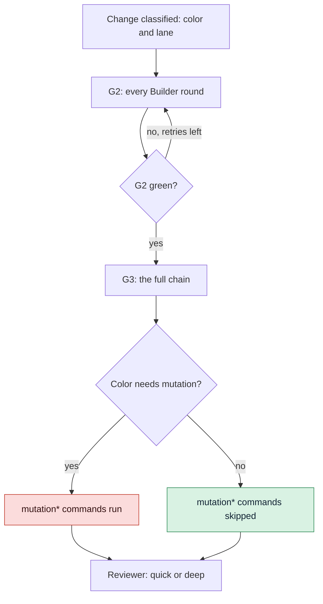

# Tune the gates

Choose the commands the Loop Gate (G2) and the Merge Gate (G3) run, what each risk color gets,
how long a command may run and how mutation testing, known debt and security exceptions behave.

## Before you start

- A GDD project whose self-test passes: `bin/gdd selftest` says `harness 4/4`.
- You know what each gate is for: see [Gates](../reference/gates.md) and
  [How risk picks the gates](../explanation/risk.md).

Two files hold the gates: `gdd/commands.toml` says what runs, and `gdd/rules.toml` says what
each color gets. Both are harness, protected from every agent: change them on the main branch,
as a person, and run `bin/gdd selftest` afterwards.



## 1. See what the gates run today

`gdd init` composed `gdd/commands.toml` from your stack sheets. Each key of `[g2]` and `[g3]`
is a command name, each value a shell command:

```toml
[g2]
lint = "uv run ruff check . && uv run ruff format --check ."
types = "uv run mypy src"
unit = "uv run pytest -q tests/unit"
acceptance = "uv run pytest -q tests/acceptance || [ $? -eq 5 ]"
architecture = "uv run lint-imports"

[g3]
acceptance_full = "GDD_FEATURES= GDD_HIDDEN=1 uv run pytest -q tests/acceptance || [ $? -eq 5 ]"
lockfile = "uv lock --check"
security = "uv run bandit -q -r src && osv-scanner scan source -L uv.lock"
dependencies = "..."
secrets = "BASE=$(git rev-parse -q --verify main || git rev-parse origin/main) && ..."
mutation = "set -f; P=$(printf '%s\n' \"$GDD_DIFF_FILES\" | ...)"
```

To compare with what a stack sheet gives, from inside the project:

```bash
bin/gdd stacks show python
bin/gdd stacks compose python typescript
```

`compose` prints the commands several sheets give together, as TOML, and writes nothing. With
more than one stack, each name gets its stack: `lint-python`, `lint-typescript`.

## 2. Change a gate command

1. Edit the command in `gdd/commands.toml`. Every command runs with `sh -c` from the project
   root and gets these variables:

   | Variable | What it holds |
   |---|---|
   | `GDD_CHANGE` | The id of the change |
   | `GDD_COLOR` | `green`, `yellow` or `red` |
   | `GDD_DIFF_FILES` | The paths the change touched (or plans, while it touched none), one per line |
   | `GDD_FEATURES` | The change's `.feature` files, one per line; empty means none |

2. Keep the rules a command name carries:
   - A command whose name starts with `mutation` runs only when the color asks for mutation
     testing; otherwise the report lists it under `skipped`.
   - Names starting with `acceptance`, `mutation` or `secrets` can never become known debt.
   - An empty command (`types = ""`) is not configured and does not run. A gate with no
     command at all fails.
3. Try the command by hand, commit on main, then:

   ```bash
   bin/gdd selftest
   ```

   The first check plants a failing test and expects G2 to turn red: a G2 that cannot fail is
   refused.

G2 also runs Path Guard before and after the commands, and the scope check in build mode. G3
adds Path Guard, the scenario count (`[acceptance] required = true` makes zero scenarios a
failure) and the check of security exceptions. A gate prints its report as JSON:

```text
{"ok":true,"gate":"G3","color":"yellow","passed":["acceptance_full","dependencies","lockfile","secrets","security","path-guard","scenarios (1)","exceptions"],"skipped":["mutation"],"failures":[],"out_of_scope":[]}
```

## 3. Decide what each color gets

`gdd/rules.toml` has one table per color and lane. A new project starts with these values:

| Key | green fast | green full | yellow fast | yellow full | red full |
|---|---|---|---|---|---|
| `tests_first` | false | true | true | true | true |
| `mutation` | false | false | false | false | **true** |
| `reviewer` | false | true | true | true | **true** |
| `g4_if_g1` | false | true | false | true | **true** |
| `review` | quick | quick | quick | quick | **deep** |

The bold cells are the core of GDD: what guards against the agents. GDD has three levels:

1. **The core**, always on: the gates G1 to G4, the colors, Path Guard, hidden examples, a
   Reviewer of another model family, and for red changes mutation testing, the Reviewer, a deep
   review and the human G4.
2. **The stack's checks**, on by default: the commands of the sheet. Empty one to switch it off.
3. **Extras**, off until you add their section: `[learn]` in `gdd/commands.toml`, `[session]`
   in `gdd/models.toml`, `[versions]` in `gdd/rules.toml`, and others.

To run mutation testing on yellow changes too, set it in both yellow tables:

```toml
[color.yellow.full]
tests_first = true
mutation = true
reviewer = true
g4_if_g1 = true
review = "quick"
```

`review = "deep"` asks for a deep review in green or yellow too. A quick review looks at the
files the change touched, its package and its scenarios; a deep one adds the code around the
change and what can go badly wrong there.

A rules file that switches the core off for red is refused by every command that reads it:

```text
error: gdd/rules.toml: red changes always get mutation testing, the Reviewer and the human G4 (the core of GDD): remove color.red.full.mutation = false from gdd/rules.toml
```

A depth other than `quick` or `deep` is refused too:

```text
error: gdd/rules.toml: review must be quick or deep: color.yellow.full.review = "medium" in gdd/rules.toml
```

Check the result on a real change:

```bash
bin/gdd classify CHANGE
```

The JSON shows `tests_first`, `mutation`, `reviewer`, `review` and `g4` for that change.

## 4. Set retries and time limits

In `[limits]` of `gdd/rules.toml`:

```toml
[limits]
builder_retries = 3      # Builder rounds against G2
replans = 1              # Orchestrator replans per stuck change
command_seconds = 1800   # how long each gate and release command may run
```

When a command runs past `command_seconds`, gdd kills it with everything it started, and the
gate fails with:

```text
# The failure text, as features/mutation-speed.feature checks it with command_seconds = 1
timed out (1s): raise limits.command_seconds in gdd/rules.toml
```

The value must be a whole number of seconds above 0. On a slow or busy machine, raise it rather
than removing checks. Agent calls have their own limit, `agent_timeout_s` (3600 by default).

## 5. Keep mutation testing fast

Mutation testing changes the code the change touched and expects a test to fail for each
mutant. It is the slowest check of G3, so the sheets run it on the change's diff only.

- **Python** (mutmut): the modules of `src/` listed in `GDD_DIFF_FILES`.
- **Rust** (cargo-mutants): the diff against the main branch, with these speed-ups, all in the
  sheet's command:
  - mutants built without debug info (`CARGO_PROFILE_TEST_DEBUG=0`);
  - linked with mold when it is installed and `RUSTFLAGS` is not set;
  - each test process capped at 2 GB where `prlimit` exists, so a mutant that turns a loop into
    endless allocation cannot take the machine down;
  - a second chance for timeouts. When the only problem left is mutants that timed out, they
    run again one at a time with at least 120 s per test. A mutant that hangs again counts as
    caught; one that now survives is a missed mutant and fails the gate. Missed mutants get no
    second chance.

When the project has no mutation command, red changes go without it, and `gdd status` says so:

```text
no mutation testing command in [g3] of gdd/commands.toml: red changes go without it
```

## 6. Count known debt with the ratchet

A project adopted with `gdd adopt` has known debt in `gdd/debt.toml`: commands that failed on
day one. They warn instead of blocking. `[count]` in `gdd/commands.toml` tells gdd how to read
how many problems a command reported, so the debt cannot grow unseen:

```toml
[count]
lint = ["Found {n} error", "{n} file would be reformatted", "{n} files would be reformatted"]
types = ["Found {n} error"]
unit = ["{n} failed", "{n} error"]
```

A text with `{n}` adds up the number at each place it matches; a text without it counts the
lines that contain it. With a count recorded:

- a change that reports more fails the gate: `lint reports 5, the known debt is 3: 2 more`;
- one that reports as much passes, with the command under `known_debt` in the report;
- one that reports less lowers the ceiling when it merges, and one that passes pays the debt;
- a failing command whose count gdd cannot read fails the gate:
  `lint failed and gdd cannot count what it reported`.

See [Bring gdd to an existing project](adopt-existing-project.md) for how debt is recorded.

## 7. Allow a security exception

A known vulnerability blocks G3. To accept one under your responsibility, write the exception in
the scanner's own file, with a reason:

```toml
# osv-scanner.toml
[[IgnoredVulns]]
id = "GHSA-xxxx-xxxx-xxxx"
ignoreUntil = 2027-01-31   # it blocks again after this date
reason = "dev tool only, never shipped; reviewed by the team"
```

For Rust, `[advisories] ignore = [{ id = "RUSTSEC-...", reason = "..." }]` in `deny.toml`.

- These files are a red zone, so adding an exception is a red change, approved at a sitting.
- G3 refuses an exception without a reason: `osv-scanner.toml: GHSA-... has no reason`.
- G3 names the exceptions a change adds, so you see them at G4.
- `gdd status` lists every active one, with its end date or `expired`.

## 8. Add Learn tools

Tools that only warn, such as duplication or unused code, go in `[learn]`. They never block a
gate; `gdd learn` runs them. See [Measure the work](measure.md#5-run-learn).

Every key and its default is in [Configuration](../reference/configuration.md#commandstoml).

## Next steps

- [Measure the work](measure.md): which gate commands take the time, per change.
- [Run the gates in CI](ci.md): the same G2 and G3 on every pull request.
- [Bring gdd to an existing project](adopt-existing-project.md): known debt from the start.
- [Keeping agents honest](../explanation/safety.md): why the core cannot be switched off.
