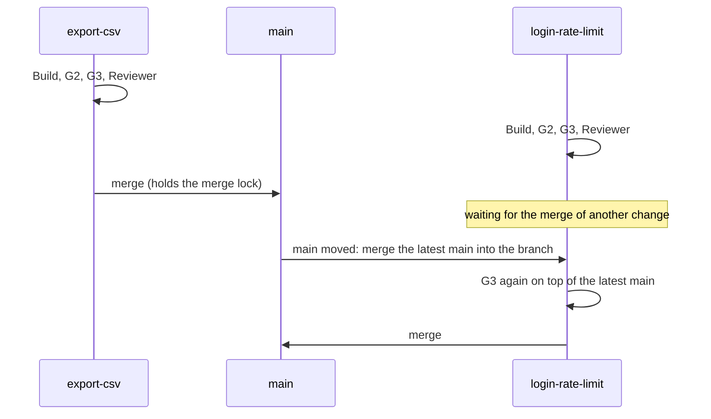

# Run changes in parallel

Build a second change while the first one is still building. Each change gets its own working
folder, they merge one at a time, and gdd caps how many build at once and warns you when two
plan the same files. You start each change as usual.

## Before you start

- A first change already launched: see [Describe a change to your agent](run-a-change.md).
- Enough room on your machine for two builds at once, and agent subscriptions that can take two
  sessions at once. Mutation testing and the full scenario run of G3 are the heaviest steps.

The examples use the project `notes` and the changes `export-csv` and `login-rate-limit`.

## Start a second change

Start another session of your agent in the project folder and describe the second change there,
as you did the first:

```text
/gdd-change limit login attempts, five per minute per account
```

The Orchestrator prepares it and holds its sitting while the first change builds. Follow both
on the Board (`gdd board`): each shows under Build, then Release.

## How several changes share one project

Two Builders editing the same folder would overwrite each other's files. So each launch makes a
[worktree](../glossary.md#worktree) for its change: a second working folder of the same
repository, on the branch `change/<id>`, next to the project by default
(`../notes.worktrees/export-csv`). The main checkout, your usual project folder, stays on main,
so you and the Orchestrator keep working there. All of them share one state: the `.gdd/` of the
main checkout holds the records, the log and the approvals for every worktree.

Read the diagram top to bottom: both changes build at the same time, and the second to finish
takes the latest main and passes G3 again before it merges.



## 1. Set how many changes build at once

The cap is `[parallel] max` in `gdd/rules.toml`, 2 by default. `gdd init` does not write the
table. To change the cap, add it on main, with the folder of the worktrees if you want another:

```toml
[parallel]
max = 3                 # changes building at once; a whole number from 1
folder = "../trees"     # where the worktrees go, from the project root
```

Only changes that are building count: `prepared`, `building` and `polishing`. A change parked
or waiting at G4 does not hold a place. gdd refuses a launch past the cap before anything runs,
and names the changes building and what lets the new one start. The message has this shape
(illustrative: put together from the code, not from a run):

```text
2 change(s) building, the cap is 2: cart-total, export-csv
login-rate-limit can launch once one of those building reaches G4 or is parked, or with a higher [parallel] max in gdd/rules.toml.
```

The real limit is often below the number you write. Two G3 runs at once can fill the memory of
a small machine, the agents' subscriptions have quotas, and you can hold only a few sittings
at a time.

## 2. Read the overlap warnings

When a change launches, gdd compares the paths it plans with the paths of every change in
flight: building, parked or waiting at G4 (closed changes do not count). An overlap does not
stop the launch. gdd warns, names the paths, and keeps the warning in the Decision Inbox, under
"Decided without you". A real one, from gdd's own repository:

```text
builder-session overlaps mutation-speed (in-pre): crates/gdd-acceptance/tests/acceptance.rs with crates/gdd-acceptance/tests/acceptance.rs; git settles it when builder-session merges.
```

The line names both changes, the state of the other one (`in-pre`) and the file they share.
This is how gdd compares paths:

| Planned paths | Overlap? |
|---|---|
| `src/export.rs` and `src/export.rs` | Yes: the same file |
| `src/export.rs` and `src/store.rs` | No: two plain paths overlap only when they are the same |
| `src/lib/**` and `src/lib/parse.rs` | Yes: a folder pattern overlaps every path inside it |
| `src/**` and `docs/**` | No: they part before the first wildcard |

gdd compares planned paths only. A change that touches a file it did not plan can still collide
with another at the merge.

## 3. Follow the merge queue

Merges go one at a time, under a lock: only the change that holds it may merge. A change that
reaches its merge while another one merges says `waiting for the merge of another change` and
goes on when the lock is free.

When main moved since a change passed G3, gdd does not merge it on top of an old main:

1. gdd commits the change's work and merges the latest main into its branch, never a rebase.
2. It says `main moved under export-csv: G3 again on top of it` and runs G3 again there.
3. Green, the change merges. Red, it parks with `G3 red on top of the latest main`. When git
   cannot merge main into the branch, it parks with
   `main moved under it and the merge has conflicts in <paths>` and the way out: see [Settle
   merge conflicts with main](parked-change.md#6-settle-merge-conflicts-with-main).

Any commit on main while a change builds counts as main moving, a commit of docs included. That
change then runs G3 a second time before it merges.

## 4. Approve things while agents work

Approving the red zones, opening G0 or saving the self-test writes state every change shares.
While an agent call is under way, such a write waits for it to end, and no new call starts
meanwhile. You see:

```text
waiting for the agents at work to end their call
G0 ok (machines).
```

The first line is the wait. The second comes once the call ended and gdd wrote the approval.
Approving the red zones as they already are writes nothing, so it never waits.

## Good practice

- Do not run two changes that touch the same core files at once. Before you launch a second
  change, compare the `paths` of both records. Files that almost every change touches (the
  command-line entry point, the file of scenario steps) are where conflicts come from: two
  changes that both add steps at the end of the same file always conflict.
- Chain changes that restructure the same function. When both reshape one function, picking
  a side of the conflict drops a feature. Launch the second after the first merged.
- Plan the paths honestly. Overlap warnings and the scope check only know what the change
  plans.
- Batch commits on main. Each commit while changes build costs each of them a second G3.
  Keep unrelated work (a docs branch, for example) apart and merge it at a quiet moment.
- **Do not touch `.gdd/bin/` while an agent works.** gdd checks that folder around every agent
  call, for every change: a new binary there in the middle of a call parks the change. Change
  it once no change is building.

## Under the hood

Each launch is a [`gdd launch`](../reference/cli/launch.md): it refuses a change past the cap
before anything runs, and warns about overlaps first, also in the Decision Inbox. The merge
queue runs inside the recipe of each change, and [`gdd status`](../reference/cli/status.md) and
[`gdd board`](../reference/cli/board.md) show every change in flight.

## Next steps

- [Get a parked change going again](parked-change.md): what to do when a merge parks a change.
- [Describe a change to your agent](run-a-change.md): launch, follow on the Board, relaunch.
- [Configuration, rules.toml](../reference/configuration.md#parallel): `[parallel]`, the cap
  and the folder of the worktrees.
- [The life of a change](../explanation/life-of-a-change.md): where the merge queue sits in the
  recipe.
