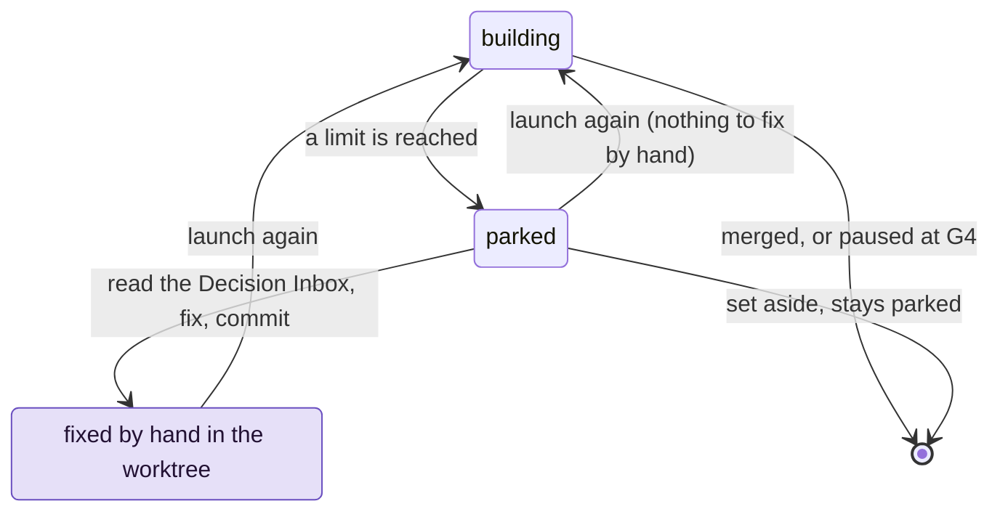

# Get a parked change going again

Use this page when a change parks. Every loop of the recipe has a limit, so a change that
cannot get through stops and waits for a person instead of retrying, and spending, without end.
The usual causes: the gates stayed red after every retry, the Reviewer still said KO, or
another change merged into main first and the two conflict. The Orchestrator tells you why and proposes the next step. You decide, fix what only
you can fix, and the change runs again.

## Before you start

- A parked change. The Orchestrator tells you when one parks, the Board shows it under Build,
  and `/gdd-status` names it.
- Its worktree: a parked change keeps it, next to the project by default
  (`../notes.worktrees/export-csv` for the project `notes`). The agents' work is there.

The examples use the change `export-csv` of the project `notes`.

## The park and relaunch loop

A parked change waits for you. Each relaunch runs the recipe again from the start, and the
change can park again for another reason.



## Why changes park

Every loop of the recipe has a limit (`[limits]` of `gdd/rules.toml`), and the reason names the
one reached:

| Reason | What happened | Usual way out |
|---|---|---|
| `G2 still red after 3 retries and 1 replan` | The Builder could not turn the Loop Gate (G2) green in its 3 rounds of build mode, the 3 retries: lint, types, tests, Path Guard or the scope. The Orchestrator's replan and one more round did not help either. | Read `g2.json`. Fix what the Builder could not: the package, a scenario, a step, the harness. |
| `G3 still red after one fix` | The Merge Gate (G3) failed, and one more Builder round did not fix it. | Read `g3.json`: a scenario, a hidden example, security analysis or a surviving mutant. |
| `Reviewer KO or G3 red after one fix` | The Reviewer said KO, then KO again after one fix round, or G3 broke during that fix. The fix round is one Builder round in build mode. When a finding names a file only test mode may write, such as a step, the Builder in test mode gets a round first, checked by Path Guard. | Read the last `outputs/reviewer-<n>.md`. Fix what the Builder could not, or answer the finding. |
| `main moved under it and the merge has conflicts in ...` | Another change merged first and git cannot merge main into this one. | [Settle the conflicts](#6-settle-merge-conflicts-with-main). |
| `G3 red on top of the latest main` | Main merged cleanly, but G3 fails with it. | Fix it on the branch, as for G3 red. |
| `Path Guard failed after test mode: ...` | The Builder in test mode wrote what only build mode may write, such as production code. | Remove those files from the worktree. |
| `the Builder in build mode changed GDD state: ...` | An agent wrote in `.gdd/`. gdd put the state back. | Read the agent's output; check its instructions. |
| `the Reviewer changed ...: Reviewers only read` | The Reviewer edited a file. | Remove its edits; check its agent sheet. |
| `the Builder in build mode did not answer within 3600 seconds` | The agent ran out of time and was stopped. | Check the agent's login and quota; `[limits] agent_timeout_s` sets the time. |
| `the spike spent ... USD of its budget of ... USD` | A Spike reached `[spike] max_usd`. | See [Explore with a spike](spikes.md). |
| `the merge needs the main checkout (...) without uncommitted changes in tracked files: commit or stash them.` | Someone edited a tracked file in the main checkout while the change ran. | Commit or stash it, then relaunch. |
| `production may have it, but gdd cannot go on with it (...)` | The change was caught in the middle of a promotion. | Look at production first: see [Review a change at G4](release-gate.md). |

A path outside the plan that has a higher color than the change also fails G2, under `scope`:

```text
src/store/index.rs: outside the package and red (the change is yellow); remove it, or the Orchestrator widens the scope
```

gdd counts what the change really touched, so after such a park the change is red. To keep the
path, relaunch: the change now needs its plan approved, and the Orchestrator brings it to you
as at any sitting. To drop the path, remove the file in the worktree, then relaunch.

## 1. Read the Decision Inbox

When a change parks, gdd prints one line: the change, the reason, and where its message is.
The Orchestrator that launched it relays that line in the chat, reads the change's Decision
Inbox and proposes the next step. Two real parks, from changes of gdd's own repository (paths
rewritten):

<!-- Real output of gdd launch, gdd 0.1.0, in gdd's own repository. The Orchestrator's own
     words around it are not reproduced here: they vary with the agent and the language of the
     project. -->

```text
Change one-gdd parked: Reviewer KO or G3 red after one fix. Message in .gdd/changes/one-gdd/inbox.md
```

```text
Change role-guard parked: main moved under it and the merge has conflicts in crates/gdd/src/lib.rs: merge main into change/role-guard in its worktree (/home/me/gdd.worktrees/role-guard), settle the conflicts, commit, then gdd launch role-guard. Message in .gdd/changes/role-guard/inbox.md
```

The command at the end of the second line (`gdd launch role-guard`) is the Orchestrator's to
run, once the conflicts are settled: you ask it to launch the change again (step 5).

The inbox itself is one message per change, also on the Board (`Enter` on the change) and in
`.gdd/changes/export-csv/inbox.md`. One of a change parked by hand:

```text
# Decision Inbox · export-csv · Export notes as CSV

Color yellow · lane full · state parked

## Needs your decision
- Tags with spaces: one field joined by spaces, or one column per tag? I recommend one field.

## Decided without you
- The header stays in English whatever the language of the notes.

## Parked
- Waiting for the bank's CSV format before going on
```

- **Needs your decision**: questions the agents left, each with a recommendation.
- **Decided without you**: what the agents decided and why, including paths outside the plan
  that the scope check accepted, and warnings that the change overlaps another one.
- **Parked**: every reason the change parked, the latest last.
- **How it works**, first, when the Reviewer wrote one: a short explainer of the code.

A merge conflict reads like this in a real inbox (paths rewritten):

```text
## Parked
- Reviewer KO or G3 red after one fix
- main moved under it and the merge has conflicts in crates/gdd-core/src/change.rs, crates/gdd-core/src/recipe/mod.rs: merge main into change/builder-session in its worktree (/home/me/gdd/../gdd.worktrees/builder-session), settle the conflicts, commit, then gdd launch builder-session
```

## 2. Read what the gates and the agents said

When the inbox is not enough, everything the run left is in `.gdd/changes/export-csv/`, in the
main checkout. Ask the Orchestrator to read it with you, or open it yourself:

| File | What it holds |
|---|---|
| `g2.json`, `g3.json` | The last report of each gate: what passed, what was skipped, and the failure lines of each failed command. |
| `review.md` | The Reviewer's verdict and its findings. |
| `replan.md` | The Orchestrator's replan: the cause and the new approach. |
| `outputs/<role>-<n>.md` | What each agent call said, numbered in order (`builder-build-3.md`, `reviewer-2.md`). |
| `package.md` | The context package the Builder worked from. |

## 3. Answer what needs you

Answer each question of the inbox in the chat, in words. When your answer changes the work,
the Orchestrator puts it where the agents read it: the package, a scenario (which needs your OK
again, see [Approve the scenarios](write-scenarios.md#5-change-a-scenario-after-its-approval)),
the plan, or the zone map on main. It also leaves a note of what you decided in the inbox.

On the next launch, the questions of this run are marked as resolved. gdd keeps them in the
change's record, `change.json`, and the inbox shows only how many there were, for example
`_1 earlier request(s) were resolved before the last launch (kept in change.json)._`

## 4. Fix by hand in the worktree

Some causes need a hand fix: a step only test mode could write, a scenario that contradicts the
change, a problem in the harness (the files gdd uses to check your project). Work in the
change's worktree, never on main:

```bash
cd ../notes.worktrees/export-csv
git status
```

> [!WARNING]
> If you fix something by hand, commit the agents' work on the branch first. A parked change
> keeps their work uncommitted, and the relaunch starts its build at the commit checked out.
> Path Guard judges everything after that commit as build mode's work. So if you commit only
> your own files, the steps test mode wrote come after that starting point, Path Guard blames
> build mode for them, and the change parks again.

```bash
git add -A
git commit -m "export-csv: the agents' work before the hand fix"
# now your fix
git add tests/acceptance/export_csv.rs
git commit -m "export-csv: hand fix of the export step"
git log --oneline -3
```

Check with `git log` and `git status` that both commits are there and the tree is clean. Then
go back to the main checkout:

```bash
cd ../../notes
```

When you commit nothing by hand, the relaunch commits the agents' work itself, as
`gdd(export-csv): work of the earlier run, before relaunch`, once the gates that judged it
accept it.

## 5. Launch it again

To run the change again, tell the Orchestrator to launch it. A relaunch checks the change again (G0, red
zones, G1, the plan of a red change, the model families) and runs G2 on the code of the branch.
When that G2 is already green, the Builder is skipped and the recipe goes on to G3 and the
Reviewer (`G2 already green: Builder skipped` in the log). When it is red, the Build runs again
from its start, with a full set of retries and a replan.

The relaunch runs from the main checkout, on main, with no uncommitted changes in tracked
files. Otherwise it is refused with `run gdd launch from the main checkout (...)` or
`The working tree has uncommitted changes. Commit them before launching a change.`

## 6. Settle merge conflicts with main

Merges go one at a time. When main moved since the change passed G3, gdd merges the latest main
into the change's branch and runs G3 again on top of it. When git cannot merge, gdd gives the
merge up, leaves the branch with its work committed (`gdd(export-csv): change work`) and parks
the change. gdd does not settle conflicts for you. In the worktree:

```bash
cd ../notes.worktrees/export-csv
git merge main
# settle every file git names, keeping what both sides added
git add -A
git commit --no-edit
```

Run the tests of the files you settled, go back to the main checkout and tell the Orchestrator
to launch the change again. The relaunch runs G3 on the merge and the Reviewer reads it too. To
avoid the conflict next time, see [Run changes in parallel](parallel-changes.md).

## 7. Set a change aside

To stop a change for now, for example while you wait for something from outside the project,
ask the Orchestrator to park it with the reason. The reason goes to its Decision Inbox. gdd
prints:

```text
Change export-csv parked: Waiting for the bank's CSV format before going on. Message in .gdd/changes/export-csv/inbox.md
```

The change keeps its record, its branch and its worktree. It stays parked until you ask the
Orchestrator to launch it again. While it waits, a change that plans an overlapping path
launches with a warning that names it (see [Run changes in parallel](parallel-changes.md)).

## Under the hood

The reasons come from the recipe of [`gdd launch`](../reference/cli/launch.md), which exits
with 1 when a change parks; a relaunch is the same command.
[`gdd inbox`](../reference/cli/inbox.md) prints the Decision Inbox,
[`gdd note`](../reference/cli/note.md) adds a `needs`, `decided` or `parked` note to it, and
[`gdd park`](../reference/cli/park.md) parks a change by hand (it always exits with 1).
[`gdd report --change CHANGE`](../reference/cli/report.md) shows what the run cost so far.

## Next steps

- [Troubleshooting](troubleshooting.md): more messages, their causes and fixes.
- [Run changes in parallel](parallel-changes.md): the merge queue, and how to keep conflicts
  rare.
- [Files gdd writes](../reference/files.md): the record, the log and the Decision Inbox.
- [The life of a change](../explanation/life-of-a-change.md): every step a relaunch runs again.
